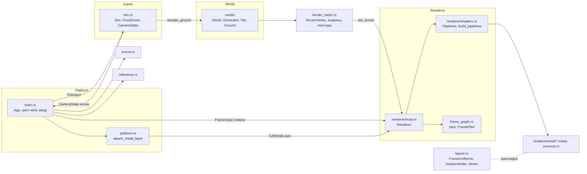
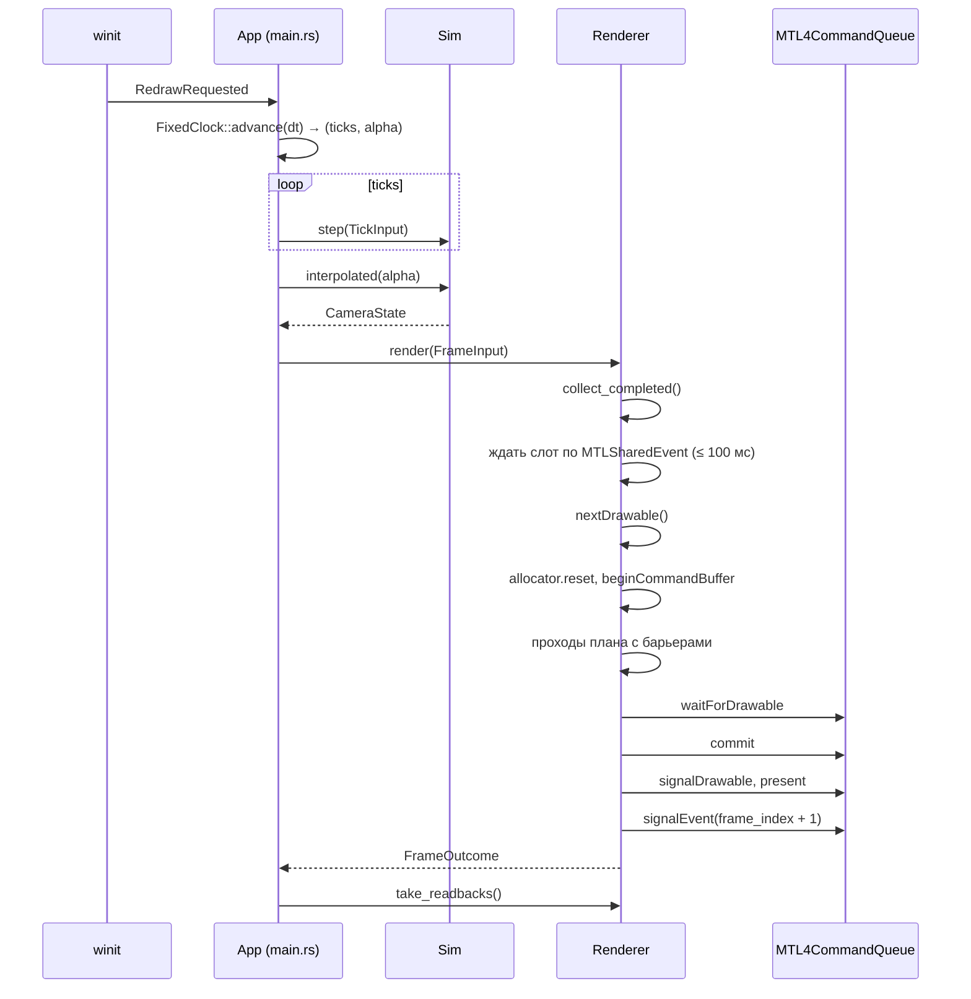

# Архитектура движка «Эхо мицелия»

Живой документ: описывает код в том виде, в котором он есть сейчас. Правила обновления — в [AGENTS.md](../AGENTS.md#архитектура).

- Состояние на — 2026-11-07, ревизия `22c3804` и правки после неё
- Подсистемы — [02-terrain.md](02-terrain.md), [03-water.md](03-water.md)
- Покрытые этапы — [00. Платформа и архитектура](../specs/00-platform.md) (`completed`), [01. Основа Metal 4](../specs/01-metal-foundation.md) (`partial`), [02. Ландшафт и биомы](../specs/02-terrain-biomes.md) (`partial`): подэтап [02.1](../specs/02-1-terrain-data.md) (`completed`), 02.2–02.5 не начаты; [10. Руки от первого лица](../specs/10-first-person-hands.md) (`partial`, шаг 1 — ассет)
- Отчёты — [00](../reports/00-platform.md), [01](../reports/01-metal-foundation.md), [02](../reports/02-terrain-biomes.md), [02.1](../reports/02-1-terrain-data.md), [10](../reports/10-first-person-hands.md)
- Подсистемы — [мир и ландшафт](02-terrain.md)
- Язык и API — Rust 1.99.1 (edition 2024), Metal 4 через `objc2-metal` 0.3.2, MSL

## Содержание

1. [Границы подсистем](#1-границы-подсистем)
2. [Соглашения](#2-соглашения)
3. [Поток кадра](#3-поток-кадра)
4. [Модули, структуры и методы](#4-модули-структуры-и-методы)
5. [Шейдеры и привязки](#5-шейдеры-и-привязки)
6. [Синхронизация и время жизни ресурсов](#6-синхронизация-и-время-жизни-ресурсов)
7. [Планировщик проходов](#7-планировщик-проходов)
8. [Самопроверка](#8-самопроверка)
9. [Соответствие спецификациям](#9-соответствие-спецификациям)
10. [Архитектурные решения и причины](#10-архитектурные-решения-и-причины)
11. [Ограничения и ближайшие изменения](#11-ограничения-и-ближайшие-изменения)
12. [Журнал изменений](#12-журнал-изменений)

## 1. Границы подсистем

[Спецификация 00](../specs/00-platform.md#границы-в-коде) задаёт четыре части: `Platform`, `World`, `Game`, `Renderer`. Сейчас они разложены по модулям так:

| Часть из спецификации | Модуль | Ответственность сейчас | Чего ещё нет |
| --- | --- | --- | --- |
| `Platform` | `src/platform.rs`; приложение `src/app/` (окно, ввод, цикл, самопроверка), точка входа `src/main.rs` | Окно winit, ввод, `CAMetalLayer` на `NSView` | Файловые пути |
| `World` | `src/world/` ([подробно](02-terrain.md)) | Генератор, тайлы 64 × 64 м, поля среды, `BiomeWeights`, `sample_ground` по треугольникам LOD 0, маркеры маршрута, экспорт и импорт слоёв PNG | LOD 1–2, растительность, стриминг (этапы 02, 08) |
| `Game` | `src/sim/` | Фиксированный тик, камера, полёт и ходьба по `Ground` | Игрок, задания, события (этап 05) |
| `Renderer` | `src/renderer/` — фасад `Renderer` и модули `device`, `resources`, `frame`, `passes/`, `readback`, `targets`, `terrain`, `water`, `shaders` ([AD-41](#ad-41-рендерер-и-приложение-разбиты-на-модули-проходы--объекты-за-общим-трейтом)) | Устройство, очередь, ресурсы, проходы, синхронизация, вывод | Счётчики GPU, общий RHI (этап 06) |
| Общие данные | `src/layout.rs`, `shaders/metal/common.h` | Раскладка структур CPU/GPU | — |
| Описание проходов | `src/frame_graph.rs` | Проходы, ресурсы, барьеры без зависимости от API | Стадия indirect-аргументов (этап 02) |
| Тестовая сцена | `src/scene.rs` | Куб и два экземпляра; куб же рисует столбики маркеров | Остаётся для самопроверки (клавиша T) |
| Сетка ландшафта | `src/terrain_mesh.rs` | `TerrainVertex` всех тайлов, общие индексы, детальная текстура | LOD-сетки 33/17 и юбки (подэтап 02.3) |
| Эталоны | `src/reference.rs` | CPU-эталоны узора, глубины кубов и глубины ландшафта (луч по `Ground`) | — |

Правила границ, проверенные в коде:

- Нативные типы (`objc2`, `raw-window-handle`) подключены только в `platform.rs` и `renderer/`. Все вхождения `unsafe` там же: 1 в `platform.rs`, 19 в `renderer/`.
- `Game` не знает о рендере. `Renderer` получает копию состояния через `FrameInput` и не может изменить симуляцию.
- winit 0.30 использует objc2 0.5, проект — objc2 0.6. Связь идёт через сырой указатель `NSView` из `raw-window-handle`, поэтому типы двух версий не смешиваются.

## 2. Соглашения

| Тема | Правило | Где закреплено |
| --- | --- | --- |
| Единицы | Метры, секунды | `sim.rs` |
| Система координат | Правая, Y вверх, при `yaw = 0` камера смотрит в −Z | `CameraState::forward`, тест `yaw_zero_looks_down_negative_z` |
| Матрицы | Векторы-столбцы, `clip = P * V * M * p`, хранение по столбцам (`to_cols_array_2d`) | `layout.rs`, `scene.metal` |
| Глубина | Клип [0, 1], reversed-Z: ближняя плоскость 1, бесконечность 0, очистка 0, тест `GreaterEqual` | `sim::projection`, `Renderer::new`, тест `reversed_z_maps_near_to_one_and_far_to_zero` |
| Лицевая сторона | CCW, отсечение задних граней | `scene::cube`, `setFrontFacingWinding(CounterClockwise)`, тест `cube_triangles_face_outward` |
| Экран | Начало в левом верхнем углу | `reference::expected_depth` |
| Цвет | Линейный HDR `RGBA16Float`, одно преобразование в sRGB форматом `BGRA8Unorm_sRGB` | `shaders.rs`, `tonemap.metal` |
| Общие GPU-данные | `#[repr(C)]`, `align(16)` для uniform-структур, `bytemuck::Pod`, проверка смещений на CPU и GPU | `layout.rs`, ядро `layout_probe` |
| Время симуляции | Тик 1/60 с, не больше 5 догоняющих тиков, кадр длиннее 0,25 с обрезается | `sim.rs` |
| Карта | Тайлы 64 × 64 м, `TileId` — целые координаты, LOD 0 — 65 × 65 точек с шагом 1 м, граничные точки общие; север — малые z, море на юге | `world/mod.rs` |
| Треугольники ландшафта | Ячейка (i, j): диагональ (i, j)–(i+1, j+1), треугольники (a, c, b) и (a, d, c), CCW сверху; одинаково в отрисовке и `sample_ground` | `terrain_mesh::tile_indices`, `World::sample_ground` |

## 3. Поток кадра

Порядок проходов: `pattern` (compute) → `wet_sand` (compute, маска мокрого песка, если загружена вода) → `sky_lut` (compute, 04.1) → `cull` (compute, срез кластеров на GPU, 02.5) → `forest` (compute, расстановка леса, 02.4) → `rt` (compute: сцена для лучей, 11) → `probes` (compute: пробы освещённости, 11) → `shadows` (render, 4 каскада карты теней, 04.2) → `scene` (render: ландшафт, кубы, затем прозрачная вода) → `readback` (compute, только по запросу) → `rt_ao` (compute: затенение лучами, 11) → `volumetric` (compute: объёмный свет, 11) → `taa` (compute, временное сглаживание и копия в HDR, 04.5) → `viewmodel` (render: руки поверх сцены с очищенной глубиной, если они в кадре) → `bloom` (compute, 04.5) → `exposure` (compute) → `tonemap` (render).

## 4. Модули, структуры и методы

### 4.1. `src/main.rs` и `src/app/` — приложение и цикл кадра

`src/main.rs` — только точка входа: модули, разбор аргументов, `--export-world`, цикл winit, код выхода. Приложение — `src/app/`:

| Файл | Строк | Ответственность |
| --- | --- | --- |
| `app/mod.rs` | 195 | константы (`LIGHT_DIR`, `WORLD_SEED`, `WORLD_TILES`, `DETAIL_TEXTURE_SIZE`, `SKY_COLOR`, `TEST_SCENE_CLEAR`), `SceneMode`, `App` (поля состояния), `App::new`, `set_grab`, `reload_shaders`, `land`, `is_minimized` |
| `app/args.rs` | 84 | `Args` (в том числе `pose` — стартовая поза рук), `Args::parse`, `load_world` |
| `app/cameras.rs` | 91 | `trail_start_camera`, `look_camera`, `island_overview_camera`, `terrain_check_camera`, `marker_posts`, `start_camera` |
| `app/input.rs` | 88 | `tick_input` (оси из клавиш), `on_key_pressed` (команды по клавишам) |
| `app/hands.rs` | 56 | `hands_frame` — аниматор рук по камере и шагу, палитра, `HandsUniforms`; в самопроверке — контрольная поза |
| `app/frame.rs` | 144 | `water_frame`, `frame` — тики, камера, `FrameUniforms`, руки, `FrameInput`, readback |
| `app/title.rs` | 85 | `update_title` (с позой рук) |
| `app/setup.rs` | 81 | `create_renderer` — устройство, рендерер, ландшафт, материалы, вода, руки (`Option<Hands>`: без ассета игра работает без рук) |
| `app/handler.rs` | 165 | `impl ApplicationHandler for App`: `resumed`, `window_event`, `device_event`, `about_to_wait`, `exiting` |
| `app/selftest/mod.rs` | 280 | `TestStep`, `SelfTest` (`new`, `check`), `App::selftest_step` |
| `app/selftest/checks.rs` | 302 | `verify_readback`, `compare_terrain_depth`, `compare_terrain_raw`, `verify_terrain_readback`, `verify_water_probe`, `verify_skin_probe`, `report_terrain_readback`, `report_readback` |

Элементы ниже описаны по смыслу; файл — по таблице выше.

Связывает подсистемы. Управление: клик — захват мыши, WASD, Shift — бег, Space — прыжок (в полёте вверх), G — ходьба/полёт (над водой и за картой — на начало тропы), R — на начало тропы, E/Q — вверх/вниз в полёте, B — покачивание головы и рук, L — рельеф кластерами или тайлами, H — показать или спрятать руки, 1–4 — позы рук (`relaxed`, `grip`, `point`, `reach`), V/Shift+V — отладочные виды ландшафта, T — ландшафт/тестовые кубы, Esc, ⌘M — свернуть окно, F5 — перезагрузка MSL, F9 — readback, F12 — GPU capture. Аргументы: `--selftest`, `--overview` (старт в полёте над морем с видом на весь остров), `--capture-frame N`, `--world DIR` (мир из слоёв PNG), `--export-world DIR` (записать слои и выйти), `--camera x,y,z,tx,ty,tz`, `--view <вид>`, `--pose <поза>`, `--tiles` (рельеф тайлами уровня 0 для сравнения).

| Элемент | Вид | Описание |
| --- | --- | --- |
| `LIGHT_DIR` | `const Vec3` | Направление света от источника к сцене, нормируется при записи в uniforms |
| `WORLD_SEED` = `0xEC40`, `WORLD_TILES` = 12, `DETAIL_TEXTURE_SIZE` = 512 | const | Первая карта и её текстура |
| `SKY_COLOR`, `TEST_SCENE_CLEAR` | const | Цвет очистки для ландшафта и для тестовой сцены |
| `SceneMode` | enum | `Cubes` — тестовая сцена этапа 01, `Terrain` — ландшафт и маркеры |
| `Args { selftest, overview, capture_frame, world, export_world, camera, view, wet_test }` | struct | Аргументы командной строки. `Args::parse()` разбирает `std::env::args` |
| `load_world(&Args) -> World` | fn | `layers::import(dir)` при `--world`, иначе `World::generate`; ошибка слоёв — сообщение и выход с кодом 2 |
| `trail_start_camera(&World)` | fn | Поза на начале тропы, взгляд вдоль тропы |
| `island_overview_camera(&World)` | fn | Камера `--overview`: 330 м над юго-западным морем, взгляд на центр острова |
| `terrain_check_camera(&World)` | fn | Контрольная камера самопроверки: 12 м над точкой «склон над лесом», взгляд на торфяник |
| `marker_posts(&World) -> Vec<InstanceData>` | fn | Столбики 0,5 × 4 м на маркерах, цвет по виду |
| `start_camera()` | fn | Стартовая и контрольная поза камеры `(0.4, 1.4, 3.6)`, `pitch = −0.3` |
| `TestStep` | enum | Шаги самопроверки: `Warmup`, `ReadbackA`, `HotReload`, `AfterBrokenReload { frames }`, `Minimized { since, presented_at: Option<u64> }`, `Restored { presented_before, presented_while_minimized }`, `Resize`, `ReadbackB`, `TerrainView`, `TerrainReadback`, `Done` |
| `SelfTest` | struct | Состояние самопроверки: `step`, `frames_in_step`, `failures`, `log`, `resize_target`, `size_before`. `check(ok, what)` печатает `[pass]`/`[FAIL]` и копит ошибки |
| `App` | struct | Состояние приложения, см. ниже |
| `verify_readback(t, rb, view, proj)` | fn | Сверяет readback с эталонами: узор, глубина в 9 точках с покрытием обоих кубов, 17 полей раскладки |
| `compare_terrain_depth(rb, view, proj, &World, log) -> (hits, sky, bad, worst)` | fn | Глубина ландшафта с GPU, переведённая в метры (`NEAR_PLANE_M / depth`), против луча по `sample_ground`; допуск 2·10⁻³ относительно; небо — глубина 0 |
| `verify_terrain_readback(...)`, `report_terrain_readback(...)` | fn | Проверка ландшафта в самопроверке и вывод по F9 |
| `report_readback(rb, view, proj)` | fn | То же для F9 в обычном режиме, вывод в stderr |
| `look_camera(from, to)` | fn | Камера для `--camera` |
| `App::water_frame(camera)` | fn | `WaterFrame` кадра: `SeaState::params_for`, `dt`, точки проверки, `water_levels` вокруг камеры; `None` вне ландшафта |
| `verify_water_probe(t, rb, frame, shore)` | fn | Самопроверка: ядро `water_probe` против `water::wave_at`, ±2 мм |
| `compare_terrain_raw(rb, view, proj, &World)` | fn | Вид `Raw`: высота ±5 см, уклон грани ±2°, доминирующий биом ближайшего узла против CPU |
| `main()` | fn | При `--export-world` записывает слои и выходит; иначе создаёт `EventLoop` (`ControlFlow::Poll`), запускает `App`, выходит с `exit_code` |

Поля `App`:

| Поле | Тип | Назначение |
| --- | --- | --- |
| `args` | `Args` | Режимы запуска |
| `world` | `World` | Мир, генерируется в `new` (около 260 мс в Debug) |
| `scene` | `SceneMode` | Что рисовать; самопроверка начинает с `Cubes` |
| `window` | `Option<Arc<Window>>` | Окно, создаётся в `resumed` |
| `renderer` | `Option<Renderer>` | Бэкенд, удаляется в `exiting` до освобождения окна |
| `sim` | `Sim` | Состояние симуляции |
| `clock` | `FixedClock` | Аккумулятор времени |
| `keys` | `HashSet<KeyCode>` | Зажатые клавиши, очищаются при потере фокуса |
| `modifiers` | `ModifiersState` | Текущие модификаторы для сочетаний вроде ⌘M |
| `look` | `(f32, f32)` | Накопленный поворот мыши до следующего тика |
| `grabbed` | `bool` | Курсор захвачен |
| `last_frame`, `started`, `title_timer` | `Instant` | Время кадра, время с запуска, период обновления заголовка |
| `frames_since_title` | `u32` | Кадры для расчёта fps в заголовке |
| `last_error` | `Option<String>` | Последняя ошибка MSL (файл и стадия) |
| `readback_requested`, `capture_requested` | `bool` | Запросы F9 и F12 на следующий кадр |
| `selftest` | `Option<SelfTest>` | Активна при `--selftest` |
| `exit_code` | `i32` | 0 — успех, 1 — провал самопроверки, 2 — ошибка запуска |

Методы `App`:

| Метод | Что делает |
| --- | --- |
| `new(args)` | Генерирует мир, ставит `Sim` на начало тропы в режиме ходьбы (в самопроверке и `--overview` — полёт) |
| `set_grab(grab)` | Вызывает `platform::grab_cursor`, ставит `grabbed`, сбрасывает `look` |
| `reload_shaders()` | Вызывает `Renderer::reload_shaders(None)`, пишет результат в stderr и заголовок |
| `tick_input()` | Строит `TickInput` из `keys`; поворот мыши добавляется в `frame` |
| `is_minimized()` | `Window::is_minimized()`, `false` без окна |
| `update_title(force)` | Раз в 0,5 с: GPU, размер, fps, CPU-время кодирования, поколение или ошибка MSL; на ландшафте — режим, тайл, субстрат, тропа/вода, высота грунта |
| `frame(event_loop)` | Шаг кадра: тики `Sim::step(input, Some(&world))`, интерполяция, `FrameUniforms`, `FrameInput` (ландшафт, маркеры или кубы, цвет очистки), вызов `render`, обработка readback. В свёрнутом окне только `collect_completed` |
| `selftest_step(...)` | Конечный автомат самопроверки, см. [раздел 8](#8-самопроверка) |

`ApplicationHandler for App`:

| Обработчик | Поведение |
| --- | --- |
| `resumed` | Создаёт окно 1280 × 720 pt, `probe_device`, `attach_metal_layer`, `Renderer::new`, `set_terrain` (сетка, индексы, текстура), первый `resize`. Ошибка → stderr и код 2 |
| `window_event` | `CloseRequested` → выход; `Resized` → `Renderer::resize`; `ModifiersChanged` → `modifiers`; `Focused(false)` → очистка клавиш и освобождение мыши; клик → захват; клавиши, включая ⌘M → `set_minimized(true)`, G → `Sim::set_mode`, T → `scene`; `RedrawRequested` → `frame` |
| `device_event` | `MouseMotion` добавляет относительное смещение в `look`, если мышь захвачена |
| `about_to_wait` | Обычное окно: `ControlFlow::Poll` и `request_redraw`. Свёрнутое: `collect_completed`, `ControlFlow::WaitUntil(+100 мс)`, сброс `last_frame`, без перерисовки. В самопроверке разворачивает окно через секунду после подтверждённого сворачивания |
| `exiting` | Удаляет `Renderer` (его `Drop` ждёт GPU) |

Поворот мыши за кадр целиком уходит в первый тик кадра. Для воспроизводимой записи ввода его нужно будет хранить по тикам.

### 4.2. `src/platform.rs` — поверхность вывода

| Элемент | Сигнатура | Описание |
| --- | --- | --- |
| `attach_metal_layer` | `fn(&Window) -> Result<Retained<CAMetalLayer>, String>` | Берёт `NSView` из `RawWindowHandle::AppKit`, создаёт `CAMetalLayer`, включает `wantsLayer`, ставит слой и `contentsScale`. Вызывается на главном потоке из обработчика winit |
| `grab_cursor` | `fn(&Window, bool)` | Захват: `CursorGrabMode::Locked` (при неудаче `Confined`) и `NSCursor::hide`. Освобождение: `CursorGrabMode::None` и `NSCursor::unhide`. Вызовы `hide`/`unhide` сбалансированы флагом |
| `CURSOR_HIDDEN` | `static AtomicBool` | Скрыт ли курсор этим модулем |

### 4.3. `src/sim/` — фиксированный шаг и камера (`Game`)

Код — `sim/mod.rs`, тесты — `sim/tests.rs`.

Константы: `TICK_DT = 1/60`, `MAX_CATCHUP_TICKS = 5`, `MAX_FRAME_DT = 0.25`, `MOVE_SPEED = 8.0` м/с (полёт), `FAST_MULTIPLIER = 4.0`, `FLY_ACCEL = 40` м/с², `MOUSE_SENSITIVITY = 0.0025` рад/пиксель, `PITCH_LIMIT = 1.55` рад, `NEAR_PLANE_M = 0.05`. Ходьба: `EYE_HEIGHT_M = 1.7`, `MAX_STEP_M = 0.35`, `MAX_SLOPE_DEG = 40`, `WALK_SPEED = 4.0`, `RUN_SPEED = 7.0` м/с, `GROUND_ACCEL = 40`, `GROUND_FRICTION = 28`, `AIR_ACCEL = 6` м/с², `UPHILL_SLOWDOWN = 0.8`, `JUMP_SPEED = 4.2` м/с, `GRAVITY = 9.81`. Только для вида (приватные): `STEP_SMOOTH_TAU = 0.07` с, `STEP_SMOOTH_MIN = 0.08` м, `LAND_DIP_PER_SPEED = 0.025`, `LAND_DIP_MAX = 0.25` м, `BOB_STRIDE_M = 0.8`, `BOB_WALK_M = 0.03`, `BOB_RUN_M = 0.05`.

| Тип | Поля | Методы |
| --- | --- | --- |
| `TickInput` | `forward`, `right`, `up` ∈ [−1, 1] (`up > 0` при ходьбе — прыжок); `look_dx`, `look_dy` в пикселях; `fast` | — (команда одного тика) |
| `CameraState` | `position: Vec3`, `yaw`, `pitch` | `forward()` — единичный вектор взгляда; `view()` — `Mat4::look_to_rh`; `lerp(other, t)` — линейная интерполяция позы |
| `MoveMode` | `Fly`, `Walk` | — |
| `Sim` | `tick: u64`, `prev`, `curr: CameraState`, `mode`, `vertical_speed`, `on_ground`, `blocked_ticks`, `velocity: Vec3` (м/с), `view_dy_prev`, `view_dy` (сдвиг глаз только для вида), `head_bob: bool`; приватные `eye_lag`, `bob_phase`, `bob_weight` | `new(start)` (полёт); `look(dx, dy)` — поворот мыши сразу в `prev` и `curr`; `set_mode(mode, &dyn Ground)` — при ходьбе ставит на грунт, обнуляет скорость; `step(&TickInput, Option<&dyn Ground>)` — поворот из команды, затем `walk` или полёт с разгоном `FLY_ACCEL`, `tick += 1`; приватные `walk` (разгон, торможение, замедление на подъёме, скольжение с гашением скорости по оси упора, прыжок, падение, сглаживание ступеньки, приседание при приземлении, покачивание головы) и `can_step` (ступенька ≤ 0,35 м, подъём не круче 40°); `interpolated(alpha)` — поза плюс интерполированный `view_dy` |
| `FixedClock` | `accumulator` (приватное), `dropped_ticks` | `advance(frame_dt) -> (ticks, alpha)` — обрезает `dt`, считает тики, при превышении лимита отбрасывает долг и увеличивает `dropped_ticks` |

Свободные функции: `projection(aspect) -> Mat4` — `perspective_infinite_reverse_rh`, FOV 70°, near 0,05 м; приватные `approach(v, target, max_delta)` и `approach2` — сдвиг вектора к цели не больше чем на шаг.

Инвариант: состояние на тике N зависит только от команд тиков 0..N, поворотов `look` до этого тика и поверхности. `view_dy` не влияет на физику. Тесты `same_ticks_same_state_at_30_60_120_fps` и `walking_is_deterministic_across_frame_rates`. Правила ходьбы — в [02-terrain.md](02-terrain.md#5-ходьба).

### 4.4. `src/layout.rs` — общие данные CPU/GPU

| Структура | Размер, выравнивание | Поля и смещения |
| --- | --- | --- |
| `FrameUniforms` | 240 Б, 16 | `view_proj [[f32;4];4]` @0, `camera_pos [f32;4]` @64, `light_dir [f32;4]` @80, `time f32` @96, `exposure f32` @100, `pattern_time f32` @104, `frame_index u32` @108, `view_mode u32` @112 (`TerrainView`), `map_size_m f32` @116, `grid_nx u32` @120, `grid_step_m f32` @124 (поле высот кластерного рельефа), `underwater_m f32` @128 (глубина глаз под водой, 0 — над водой), `canopy_eye f32` @132 (доля леса у глаз — тень полога на руках), `pre_exposure f32` @136 (предэкспозиция, AD-51), `_pad f32` @140, `view_proj_rel [[f32;4];4]` @144 (проекция × поворот вида без сдвига), `cam_hi [f32;4]` @208 (камера, округлённая вниз до 256 м), `cam_lo [f32;4]` @224 (остаток) — AD-49 |
| `InstanceData` | 80 Б, 16 | `model [[f32;4];4]` @0, `tint [f32;4]` @64 |
| `Vertex` | 32 Б, 4 | `position [f32;3]` @0, `normal [f32;3]` @12, `uv [f32;2]` @24. В MSL — `packed_float3`, `packed_float3`, `float2` |
| `TerrainVertex` | 32 Б, 4 | `position [f32;3]` @0 (мировые м), `normal [f32;3]` @12, `weights [u8;4]` @24 (лес, торф, берег, тропа), `material [u8;4]` @28 (субстрат, русло, влажность, тип берега 0 песок … 255 камень). В MSL — `packed_float3`, `packed_float3`, `uchar4`, `uchar4` |
| `GerstnerWave` | 32 Б, 4 | `dir [f32;2]` @0, `wavelength` @8, `amplitude` @12, `steepness` @16, `phase` @20, `omega` @24, `_pad` @28 |
| `SeaParams` | 432 Б, 16 | `sea_level` @0, `wave_count u32` @4, `shore_wavelength` @8, `shore_amplitude` @12, `shore_omega` @16, `swash_sand_m` @20, `swash_rock_m` @24, `dry_time_s` @28, `field_size u32` @32, `field_step_m` @36, `dt` @40, `_pad` @44, `waves [GerstnerWave; 8]` @48, `probe [[f32;4]; 8]` @304 |
| `WaterLevel` | 32 Б, 4 | `origin [f32;2]` @0, `cell` @8, `morph_edge u32` @12, `inner_min [f32;2]` @16, `inner_max [f32;2]` @24 |
| `SkinnedVertex` | 52 Б, 4 | `position [f32;3]` @0, `normal [f32;3]` @12, `uv [f32;2]` @24, `joints [u8;4]` @32, `weights [f32;4]` @36. В MSL — `packed_float3`, `packed_float3`, `packed_float2`, `uchar4`, `packed_float4`: всё упаковано, без хвоста |
| `TerrainCluster` | 16 Б, 4 | `vertex_offset` @0, `triangle_offset` @4, `triangle_count` @8, `depth` @12 |
| `FeatureSegment` | 32 Б, 8 | `a [f32;2]` @0, `b [f32;2]` @8, `half_width` @16, `kind u32` @20 (0 тропа, 1 река, 2 дорога), `_pad [f32;2]` @24 |
| `PlantVertex` | 36 Б, 4 | `position` @0, `normal` @12, `uv` @24, `attr [u8;4]` @32 (материал, ветер, затенение) |
| `UiVertex` | 20 Б, 4 | `pos` @0, `uv` @8 (u < 0 — сплошной цвет), `color [u8;4]` @16 |
| `PlantInstance` | 32 Б, 4 | `position` @0, `scale` @12, `yaw` @16, `tint` @20, `phase` @24 |
| `CullView` | 128 Б, 16 | `planes [[f32;4];6]` @0, `camera` @96 (w — пикселей на единицу), `params` @112 (znear, порог, орто, включён) |
| `CullNode` | 32 Б, 4 | `sphere` @0, `error` @16, `group i32` @20, `child_offset` @24, `child_count` @28 |
| `CullBounds` | 32 Б, 4 | `sphere` @0, `error` @16 |
| `CullCluster` | 32 Б, 4 | `sphere` @0, `group` @16, `refined i32` @20 |
| `ShadowUniforms` | 304 Б, 16 | `vp_rel [[[f32;4];4];4]` @0 (проекция света × вид относительно камеры, глубина [0, 1], 0 — у света), `splits` @256 (дальние границы каскадов 0–2, м; 3 — ∞), `texel_m` @272, `params` @288 (x — тени включены) |
| `TerrainZone` | 32 Б, 4 | `far_count u32` @0 (узлов поля острова; `u32::MAX` — зоны нет), `n u32` @4, `step_m` @8, `origin_x` @12, `origin_z` @16 (отдельные `f32`: `float2` в MSL выравнивается по 8), `_pad [f32;3]` @20 |
| `SkyInputs` | 176 Б, 16 | `sun_dir` @0, `moon_dir` @16 (w — освещённая доля), `star_rot [[f32;4];3]` @32, `params` @80 (фикс. экспозиция, dt, время, E☉), `inv_view_proj_rel` @96, `view` @160 (телесный угол пикселя) |
| `HandsUniforms` | 144 Б, 16 | `proj [[f32;4];4]` @0 (проекция рук, reversed-Z), `view_to_world [[f32;4];4]` @64 (поворот глаз → мир), `vertex_count u32` @128, `joint_count u32` @132, `_pad [u32;2]` @136 |

| Элемент | Описание |
| --- | --- |
| `expected_probe() -> [u32; 43]` | Ожидаемые размеры и смещения в порядке записи ядра `layout_probe` |
| `LAYOUT_PROBE_LEN = 43`, `LAYOUT_PROBE_NAMES`, `SEA_WAVES = 8`, `WATER_PROBES = 8`, `SKIN_PROBES = 8` | Длина и имена полей для диагностики |

Изменение любой структуры требует правки `common.h` в той же правке; несовпадение ловят тест `cpu_layout_matches_msl_rules` и самопроверка.

### 4.5. `src/frame_graph.rs` — проходы и барьеры

Не зависит от Metal. Алгоритм — в [разделе 7](#7-планировщик-проходов).

| Тип | Описание |
| --- | --- |
| `ResourceId(u32)` | Логический ресурс кадра |
| `Stages(u32)` | Битовая маска стадий: `NONE`, `VERTEX`, `FRAGMENT`, `DISPATCH`, `BLIT`. Методы `is_empty`, `contains`, операторы `|`, `|=` |
| `PassKind` | `Compute` (разрешены `DISPATCH`, `BLIT`) или `Render` (`VERTEX`, `FRAGMENT`). Приватный `allowed()` |
| `Hazard` | `Raw`, `War`, `Waw` |
| `PassDecl` | `name`, `kind`, `reads`, `writes` — списки `(ResourceId, Stages)` |
| `Barrier` | `after`, `before: Stages`, `hazards: Vec<(ResourceId, Hazard)>` — один барьер перед проходом |
| `FramePlan` | `passes` и `barriers` с совпадающими индексами |
| `GraphError` | `ReadBeforeWrite { pass, resource }`, `StageNotAllowed { pass, stages }`, реализует `Display` |
| `Track` (приватный) | `last_write`, `reads_since_write` для одного ресурса |
| `plan_after(previous, passes, imported) -> Result<FramePlan, GraphError>` | Валидация и барьеры кадра `passes`, перед которым в очереди выполнен кадр `previous` |
| `plan(passes, imported)` (только тесты) | `plan_after` для кадра, повторяющего тот же список |

### 4.6. `src/renderer/` — бэкенд Metal 4

Фасад `Renderer` (`mod.rs`) хранит ресурсы и оркестрирует кадр; остальное — в модулях ([AD-41](#ad-41-рендерер-и-приложение-разбиты-на-модули-проходы--объекты-за-общим-трейтом)):

| Файл | Строк | Ответственность |
| --- | --- | --- |
| `mod.rs` | 484 | `Renderer` и публичный API: `new`, `size`, `pipeline_generation`, `frame_index`, `shader_dir`, `plan_summary`, `resize`, `reload_shaders`, `collect_completed`, `take_readbacks`, `wait_idle`, `render`; приватные `retire`, `upload_textures`, `encode_frame` (upload слота с руками и палитрой, `PassCtx`, цикл по плану с поиском прохода в реестре); `depth_state` |
| `device.rs` | 103 | `DeviceInfo`, `probe_device`, `start_capture`, `stop_capture` |
| `resources.rs` | 310 | `label`, `to_mtl_stages`, `as_allocation`, `f16_to_f32`, `shared_buffer`, `buffer_with`, `upload_bytes`, `sampled_texture(_usage)`, `private_texture`, `TextureUpload`, `upload_textures`, `DeferredRelease` (`push`, `collect`) — очередь отложенного освобождения |
| `frame.rs` | 204 | константы слота и upload, `ResourceId` проходов, `FrameOutcome`, `FrameInput` (в том числе `hands: Option<HandsFrame>`), `WaterFrame`, `Stats`, `Table` (индекс таблицы аргументов), `FrameSlot` (`new`, `table`), `frame_passes` |
| `readback.rs` | 119 | `RB_*`, `DEPTH_SAMPLES`, `sample_pixels`, `Readback` (в том числе `skin_probe`), `PendingReadback::decode` |
| `targets.rs` | 41 | `Targets::new` — HDR и глубина |
| `terrain.rs` | 145 | `TerrainGpu`, `TerrainTextures`, `Renderer::set_terrain` |
| `water.rs` | 52 | `WaterGpu`, `Renderer::set_water` |
| `terrain_clusters.rs` | 117 | `MAX_VISIBLE_CLUSTERS` = 2¹⁸, `CLUSTER_VERTEX_COUNT` = 384, `ClustersGpu` (поле высот, кластеры, вершины, треугольники, слои весов, материала и поясов RGBA8), `ClusterData`, `Renderer::set_terrain_clusters` |
| `hands.rs` | 72 | `MAX_JOINTS` = 64, `HandsGpu` (вершины, индексы, `index_count`, альбедо кожи sRGB с mip), `HandsFrame { uniforms, palette }`, `Renderer::set_hands(vertices, indices, albedo, size)` |
| `passes/mod.rs` | 97 | трейт `FramePass` (`name`, `encode`), `PassCtx` (рендерер, слот, upload, цели, drawable, вход, readback, вода), `PassBarrier` (`apply`, `apply_always`), реестр `REGISTRY`, `find`, `size2` |
| `passes/pattern.rs`, `wet_sand.rs`, `scene.rs`, `readback.rs`, `viewmodel.rs`, `tonemap.rs` | 38–165 | по проходу: `PatternPass`, `WetSandPass`, `ScenePass` (`draw_terrain`, `draw_cubes`, `draw_water`), `ReadbackPass` (с ядрами `water_probe` и `skin_probe`), `ViewmodelPass` (HDR — загрузка, глубина — очистка в 0, обход против часовой, без отсечения граней), `TonemapPass` |
| `shaders.rs` | 284 | компиляция MSL и pipeline |

Описание констант и типов ниже сохранено; файл — по таблице.

Константы:

| Константа | Значение | Смысл |
| --- | --- | --- |
| `FRAME_SLOTS` | 2 | Кадров в полёте |
| `SLOT_WAIT_TIMEOUT_MS` | 100 | Таймаут ожидания слота, после — пропуск кадра |
| `UPLOAD_BYTES` | 12 544 | Upload-буфер слота |
| `INSTANCE_OFFSET`, `INSTANCE_END` | 256, 4096 | Диапазон экземпляров в upload |
| `MAX_INSTANCES` | 48 | `(4096 − 256) / 80` |
| `SEA_OFFSET`, `LEVELS_OFFSET` | 4096, 4608 | `SeaParams` и `WaterLevel[13]` в upload |
| `HANDS_OFFSET`, `PALETTE_OFFSET` | 8192, 8448 | `HandsUniforms` и палитра костей `float4x4[MAX_JOINTS]` в upload |
| `RES_PATTERN … RES_WETNESS` | 1…6 | `ResourceId` для планировщика; 6 — маска мокрого песка. `viewmodel` пишет `RES_HDR` и `RES_DEPTH` |
| `RB_*`, `DEPTH_SAMPLES` | см. [раздел 6](#раскладка-буферов) | Раскладка readback и 9 точек проверки глубины |

Публичные типы:

| Тип | Поля и смысл |
| --- | --- |
| `DeviceInfo` | `name`, `os`, `metal4`, `apple_family: Option<u32>`, `raytracing`, `raytracing_from_render: Option<bool>` (`None` в режиме capture). `Display` печатает строку диагностики |
| `FrameOutcome` | `Presented`, `SkippedZeroSize`, `SkippedNoDrawable`, `SkippedBusySlot` |
| `FrameInput<'a>` | Снимок для кадра: `uniforms: FrameUniforms`, `instances: &[InstanceData]` (кубы или столбики маркеров), `draw_terrain: bool`, `clear_color: [f32; 3]`, `readback: bool`, `capture: Option<PathBuf>`, `water: Option<WaterFrame>` |
| `WaterFrame` | `params: SeaParams`, `levels: [WaterLevel; 11]` — вода кадра |
| `TerrainTextures<'a>` | `detail_rgba`, `detail_size`, `materials: &MaterialArrays`, `wetness_size` |
| `Readback` | `frame`, `pattern_time`, `width`, `height`, `pattern: Vec<u8>` (RGBA8 256 × 256), `depth: Vec<(x, y, f32)>`, `hdr: Vec<[f32; 4]>`, `water_probe: [[f32; 4]; 8]`, `probe: [u32; 24]` |
| `Stats` | `presented`, `skipped_busy`, `skipped_no_drawable`, `released_deferred`, `cpu_encode_ms` |

Приватные типы:

| Тип | Поля и смысл |
| --- | --- |
| `PendingReadback` | `signal_value` (значение события, после которого можно читать), `frame`, `pattern_time`, `width`, `height`, `pixels` (точки глубины) |
| `FrameSlot` | `allocator: MTL4CommandAllocator`, `cmd: MTL4CommandBuffer`, `tables: [MTL4ArgumentTable; 10]` (до 16 буферов и 8 текстур), `visible` (видимые кластеры кадра, 1 МБ), (pattern, scene, readback, tonemap, terrain, wet sand, water, water probe, hands, skin probe), `upload: MTLBuffer`, `signal_value: u64` |
| `TerrainGpu` | вершины, индексы, `detail`, `albedo`, `normal`, `wetness` (R16Float, read/write) |
| `WaterGpu` | `field` (RGBA32Float 1025²), `indices`, `index_count` |
| `HandsGpu` | `vertices` (`SkinnedVertex`), `indices` (u16), `index_count`, `albedo` |
| `TextureUpload` | `texture`, `data`, `pixel_bytes`, `mips` — элемент `upload_textures` |
| `TerrainGpu` | `vertices` (все тайлы), `indices` (одна сетка 65 × 65), `index_count`, `tile_count`, `detail` (текстура с mip) |
| `Targets` | `width`, `height`, `hdr` (`RGBA16Float`), `depth` (`Depth32Float`), обе `Private` |
| `Retired` | `after_value`, `textures` (удаляются из residency set), `_keep_alive: Option<Box<dyn Any>>` (например, старые `Pipelines`) |

Поля `Renderer`:

| Поле | Тип | Назначение |
| --- | --- | --- |
| `info` | `DeviceInfo` | Диагностика адаптера |
| `device` | `MTLDevice` | Устройство |
| `queue` | `MTL4CommandQueue` | Единственная очередь для compute, render и copy |
| `compiler` | `MTL4Compiler` | Сборка pipeline |
| `layer` | `CAMetalLayer` | Поверхность вывода, `BGRA8Unorm_sRGB`, `framebufferOnly`, 3 drawable |
| `residency` | `MTLResidencySet` | Все ресурсы движка; добавлен в очередь вместе с `layer.residencySet()` |
| `event` | `MTLSharedEvent` | Номер последнего завершённого кадра |
| `depth_state` | `MTLDepthStencilState` | `GreaterEqual`, запись глубины |
| `slots` | `Vec<FrameSlot>` | Два слота кадра |
| `pipelines` | `Pipelines` | Текущее поколение pipeline |
| `targets` | `Option<Targets>` | `None` при нулевом размере окна |
| `terrain` | `Option<TerrainGpu>` | Загруженный ландшафт |
| `pattern_tex` | `MTLTexture` | 256 × 256 `RGBA8Unorm`, `ShaderRead | ShaderWrite` |
| `vertex_buf`, `index_buf` | `MTLBuffer` | Куб в `StorageModeShared` |
| `index_count` | `usize` | 36 |
| `readback_buf` | `MTLBuffer` | Общий буфер readback |
| `plans` | `[[FramePlan; 2]; 2]` | Планы `plans[prev][cur]` по наличию readback в предыдущем и текущем кадре |
| `prev_readback` | `bool` | Был ли readback в последнем отправленном кадре |
| `frame_index` | `u64` | Число отправленных кадров |
| `retired` | `Vec<Retired>` | Ожидают завершения GPU |
| `pending_readback` | `Option<PendingReadback>` | Не больше одного readback в полёте |
| `completed_readbacks` | `Vec<Readback>` | Готовые результаты |
| `shader_dir` | `PathBuf` | Каталог MSL |
| `stats` | `Stats` | Счётчики |

Методы `Renderer`:

| Метод | Описание |
| --- | --- |
| `new(device, info, layer, vertices, indices) -> Result<Renderer, String>` | Проверяет Metal 4, настраивает слой, создаёт очередь, компилятор, событие, residency set, depth state, pipeline, буферы, текстуру узора, два слота с таблицами, строит четыре плана переходов |
| `size() -> Option<(u32, u32)>` | Размер целей |
| `pipeline_generation() -> u32` | Поколение pipeline |
| `frame_index() -> u64` | Отправлено кадров |
| `shader_dir() -> &Path` | Каталог MSL |
| `plan_summary() -> String` | Текстовые планы «readback после readback» и «обычный кадр после readback» |
| `resize(width, height, scale)` | Нулевой размер → цели уходят в `retired`, вывод пропускается. Иначе новые цели по пиксельному размеру, добавление в residency set, старые — в `retired` |
| `reload_shaders(over) -> Result<u32, ShaderError>` | Собирает новый набор; при успехе подменяет, старый уходит в `retired`; при ошибке текущий не трогается |
| `collect_completed()` | Освобождает `retired` по значению события, забирает готовый readback |
| `take_readbacks() -> Vec<Readback>` | Отдаёт готовые результаты |
| `set_terrain(vertices, indices, tile_count, detail_rgba, detail_size) -> Result<(), String>` | Буферы в `StorageModeShared`, private-текстура с полным набором mip; одноразовый командный буфер: копия staging → mip 0, барьер blit → blit, `generateMipmaps`; CPU ждёт отдельный `MTLSharedEvent` до 5 с; staging удаляется из residency set; прежний ландшафт уходит в `retired` |
| `wait_idle()` | Ждёт все отправленные кадры, до 2 с |
| `render(&FrameInput) -> FrameOutcome` | Кадр целиком, см. [раздел 3](#3-поток-кадра) и [раздел 6](#6-синхронизация-и-время-жизни-ресурсов). В проходе `scene` сначала ландшафт (группа `terrain: N tiles`, один instanced draw), затем кубы |
| `retire(textures, other)` (приватный) | Ставит ресурс в очередь освобождения с `after_value = frame_index` |
| `read_back(PendingReadback) -> Readback` (приватный) | Копирует данные из `readback_buf` |
| `start_capture(path) -> bool` (приватный) | `MTLCaptureManager` → `.gputrace`, нужен `MTL_CAPTURE_ENABLED=1` |
| `Drop` | `wait_idle()` |

Свободные функции модуля:

| Функция | Описание |
| --- | --- |
| `probe_device() -> Result<(device, DeviceInfo), String>` | `MTLCreateSystemDefaultDevice`, семейство Apple10…7, Metal 4, признаки трассировки |
| `capture_enabled()` | `MTL_CAPTURE_ENABLED == "1"`; при capture признаки трассировки не запрашиваются |
| `flag(Option<bool>)` | Текст «да», «нет», «не запрошено (capture)» |
| `label(&str)` | `NSString` для подписей ресурсов |
| `to_mtl_stages(Stages) -> MTLStages` | Перевод стадий планировщика в Metal |
| `as_allocation(&obj)` | Приведение буфера или текстуры к `MTLAllocation` для residency set |
| `shared_buffer(device, len, name)` | Буфер `StorageModeShared` с подписью |
| `upload_bytes(buf, offset, bytes)` | Проверенная запись в shared-буфер |
| `private_texture(device, format, w, h, usage, name)` | 2D текстура `Private` с подписью |
| `frame_passes(readback) -> Vec<PassDecl>` | Объявление проходов кадра |

### 4.7. `src/renderer/shaders.rs` — MSL и pipeline

| Элемент | Описание |
| --- | --- |
| `Obj<T>` | `Retained<ProtocolObject<T>>` — владеющая ссылка на объект Metal |
| `HDR_FORMAT`, `DEPTH_FORMAT`, `DRAWABLE_FORMAT`, `PATTERN_FORMAT` | `RGBA16Float`, `Depth32Float`, `BGRA8Unorm_sRGB`, `RGBA8Unorm` |
| `Pipelines` | `pattern`, `layout_probe`, `wet_sand`, `water_probe`, `skin_probe` (compute), `scene`, `tonemap`, `terrain`, `terrain_clusters` (`terrain_cluster_vs` + `terrain_fs`), `water`, `hands` (render), `generation` |
| `ShaderError { file, stage, message }` | Стадии: `read`, `compile MSL`, `entry point`, `compute pipeline`, `render pipeline` |
| `SourceOverride<'a>` | `Option<(файл, текст)>` — подмена исходника в памяти для самопроверки |
| `shader_dir()` | `ECHO_SHADER_DIR`, иначе `Contents/Resources/shaders/metal` при запуске из бандла, иначе `shaders/metal` рядом с `Cargo.toml` |
| `bundle_shader_dir()` (приватная) | Если исполняемый файл лежит в `Contents/MacOS`, возвращает существующий `../Resources/shaders/metal` |
| `read_source(dir, file, over)` | Читает файл и подставляет текст `common.h` вместо `#include "common.h"` |
| `compile_library(device, dir, file, over)` | `newLibraryWithSource:options:error:` |
| `function(lib, name)` | `MTL4LibraryFunctionDescriptor` |
| `require_function(lib, file, name)` | Проверка точки входа по `functionNames` |
| `compute_pipeline(compiler, lib, file, name)` | `MTL4ComputePipelineDescriptor` → `MTL4Compiler` |
| `render_pipeline(compiler, lib, file, label, vs, fs, color_format)` | `MTL4RenderPipelineDescriptor` с одним цветовым вложением |
| `build_pipelines(device, compiler, dir, generation, over)` | Собирает все четыре pipeline или возвращает первую ошибку; частичный набор не публикуется |

### 4.8. `src/scene.rs` — тестовая сцена этапа 01

| Функция | Описание |
| --- | --- |
| `cube() -> (Vec<Vertex>, Vec<u16>)` | Куб [−0.5, 0.5]³: 6 граней по 4 вершины, 36 индексов, обход CCW снаружи |
| `instance_models() -> [Mat4; 2]` | Куб A: масштаб 1,2, поворот Y 0,4. Куб B: масштаб 0,9, поворот X 0,6 и Y −0,3, сдвиг (0,65; 0,35; 0,45), пересекает A |
| `instances() -> [InstanceData; 2]` | Матрицы и оттенки для GPU |
| `boxes() -> Vec<Box3>` | Те же кубы для CPU-эталона |

### 4.9. `src/reference.rs` — CPU-эталоны

| Элемент | Описание |
| --- | --- |
| `PATTERN_SIZE = 256`, `SELFTEST_PATTERN_TIME = 1.25` | Размер узора и фиксированное время самопроверки |
| `pattern_color(x, y, size, t) -> [f32; 3]` | Повторяет `pattern_color` из `common.h`: градиент, шахматка 32 px, полосы по синусу |
| `compare_pattern(pixels, size, t, tolerance) -> (mismatches, max_diff)` | Сверка RGBA8 с эталоном в единицах 1/255 |
| `Box3 { model }` | Куб для пересечения лучом |
| `ray_box(origin, dir, box)` (приватная) | Метод плит в локальных координатах куба |
| `expected_depth(px, py, w, h, view, proj, boxes) -> f32` | Луч из центра пикселя, ближайшее попадание, reversed-Z глубина; 0 — фон |
| `pixel_ray(px, py, w, h, view, proj) -> (origin, dir)` | Луч из центра пикселя в мире |
| `expected_terrain_view_depth((px, py), (w, h), view, proj, &dyn Ground, max_dist) -> Option<f32>` | Шаг 0,25 м до пересечения с грунтом, 40 шагов бисекции, глубина по оси взгляда в метрах; `None` — за картой или дальше `max_dist` |

### 4.9a. `src/terrain_materials.rs` — материалы ландшафта

| Элемент | Вид | Описание |
| --- | --- | --- |
| `MaterialLayer { id, role }`, `LAYERS` | struct, const | 5 слоёв: 0 камень `Rock062`, 1 песок `Ground093A`, 2 почва `Ground082S`, 3 мох `Moss002`, 4 лесная подстилка `Ground037`; индекс = `MAT_*` в MSL |
| `LAYERS` (10) | const | 0 камень, 1 песок, 2 почва, 3 мох, 4 лесная подстилка, 5 трава, 6 тёмный опад `Ground023`, 7 листовой опад `Ground078`, 8 щебень `Ground081`, 9 мшистый камень `Rock064`; скан 2 : 1 при загрузке складывается вдвое по вертикали |
| `MATERIAL_SIZE` = 2048 | const | сторона текстуры; `normal_rough.a` — AO фотоскана (`AmbientOcclusion.jpg`) |
| `MaterialArrays { size, layers, albedo_height, normal_rough }` | struct | упакованные слои RGBA8: цвет + высота (Displacement); нормаль XY + шероховатость + 255 |
| `source_dir()` | fn | `Contents/Resources/ambientcg` в бандле или `assets/source/ambientcg` |
| `load(dir) -> Result<MaterialArrays, String>` | fn | декодирует `Color`, `NormalGL`, `Roughness`, `Displacement` (JPEG, `zune-jpeg`) параллельно по слоям; ошибка называет материал и файл |
| `TerrainView` | enum `u32` | `Lit` 0, `Height` 1, `Slope` 2, `Biome` 3, `Substrate` 4, `CoastType` 5, `Wetness` 6, `Materials` 7, `WaterDepth` 8, `WaterDirection` 9, `Surf` 10, `Raw` 15 (числа для самопроверки); `next(back)`, `name()`, `parse(name)` |

### 4.9b. `src/water.rs` — море и прибой

Подробно — [03-water.md](03-water.md).

| Элемент | Вид | Описание |
| --- | --- | --- |
| `WATER_LEVELS` = 13, `WATER_GRID_N` = 64, `WATER_CELL0_M` = 0,5, `DRY_TIME_S` = 20 | const | кольцевая сетка и высыхание |
| `SeaState { params }` | struct | `new(seed)` — 6 волн Герстнера по ветру, береговая волна 30 м / 7 с, заплеск 0,7 / 0,25 м; `params_for(&ShoreField)` — с размером поля |
| `ShoreField { size, step_m, data }` | struct | `from_world(&World)` — (высота, `Fields.coast_d`, `rocky`, 0) на мировой сетке с шагом мира, параллельно; приватные `bilinear`, `shore_at` |
| `ShoreSample { bed, coast_d, rocky, dir }`, `WaveOut { pos, foam, swash, shore }`, `WaterSample { height, depth, dry }` | struct | результаты запросов |
| `wave_at(field, params, base, t, filter_cell) -> WaveOut` | fn | точка поверхности узла сетки (как `water.h`) |
| `sample_water(field, params, p, t) -> WaterSample` | fn | высота воды над мировой точкой; заголовок окна показывает глубину под игроком |
| `water_levels(camera) -> [WaterLevel; 11]` | fn | кольца вокруг камеры с привязкой к решётке |
| `grid_indices()`, `probe_points(&World)` | fn | индексы уровня; 8 точек проверки CPU ↔ GPU |

### 4.9c. `tools/geo/` — импорт реального рельефа

Подробно — [02-terrain.md](02-terrain.md) и [мир Якусимы](../assets/world/yakushima/README.md).

| Элемент | Описание |
| --- | --- |
| `requirements.txt` | numpy, scipy, tifffile, imagecodecs, pillow; окружение `.venv-geo/` вне git |
| `yakushima.py fetch` | скачивает источники из `assets/source/geo/sources.json` в `assets/source/geo/cache/` и сверяет SHA-256 |
| `osm_yakushima.overpassql`, `osm.py` | запрос Overpass (реки, ручьи, водопады, дороги и тропы, вершины, деревья, приюты, болота, водоёмы) и разбор в мировые метры: `Features` (реки, тропы, дороги, болота, точки), `segments`, `sample_lines`, `to_json` |
| `gsi.py` | разбор JPGIS GML GSI: `parse_gml` (охват, размер, начало, значения после запятой; −9999 — нет данных), `iter_tiles(archive, kind)` по вложенным zip, `mosaic(archives, kind, bbox, step″)` — мозаика широта × долгота, строка 0 — север. `yakushima.py`: `load_gsi` (DEM5A 0,2″, кэш `.npy` по именам и размерам архивов), `sample_gsi` (среднее по окну ≈ шагу мира без NaN, затем билинейно), `compare_dem` (Copernicus − GSI по поясам) |
| `cover.py` | пояса растительности: `load_fractions` (доли групп классов ESA WorldCover в окне 30 м), `belts` (низинный лес, кедровый лес якусуги, якудзаса и луга, гранит и застройка по покрову и высоте с шумом ±80 м, граница леса 1500–1750 м), `encode` (RGBA с суммой 255), `report`; `yakushima.py` пишет `cover.png` 2049² × 15 м (`write_cover`) |
| `zone.py` | игровая зона ~1 м по GSI DEM1A: `ZONE_I0`, `ZONE_J0`, `ZONE_CELLS` = 384, `ZONE_RATIO` = 8 (ущелье Сиратани, 2,88 × 2,88 км, шаг 0,9375 м), `meshes_for`/`dem1a_keep` (отбор квадратов 3-го уровня до разбора), `build` (мозаика DEM1A, билинейно в узлы, пропуски из DEM5A); `yakushima.py` пишет `height_zone.png` в собственном диапазоне высот (шаг ~1,4 см) |
| `hydrology.py` | сток: `fill` (priority flood с подъёмом 1 мм), `d8`, `accumulate`, `flow` (с врезкой известных русел), `channel_segments`, `river_width_m` (1,5 м + 3,5 м × √км²) |
| `yakushima.py far` | дальний рельеф всего острова: сетка 1025², шаг 30 м; высоты — грунт GSI DEM5A, за охватом GSI — Copernicus; локальная касательная проекция WGS84 (центр 30,335° с. ш., 130,525° в. д.); суша — связная область у центра; знаковое расстояние до кромки (EDT); дно — процедурный шельф до −250 м до батиметрии GEBCO; тип берега по уклону; влажность и температура по высоте; маркеры мест по OSM (конец дороги к Сиратани, Дзёмон-суги, Миянoура, Ханоэго, устье Анбо — на ближайший берег; пляж Нагата — приблизительно); сток по рельефу со сверкой с реками OSM и по рельефу с врезкой OSM; ширина рек по водосбору; болота OSM в маску торфяника; слои формата 3, `features.json`, `flow.png` и `world.json` с `geo` и `features` в `assets/world/yakushima/far/`. Повторный запуск даёт те же файлы |

### 4.9d. `src/hands/` — руки от первого лица

Пространство рук — пространство глаза: начало в глазу, взгляд −Z, вверх +Y ([AD-44](#ad-44-руки-скелет-на-cpu-скиннинг-в-вершинном-шейдере-отдельный-проход-с-очищенной-глубиной)).

| Файл | Строк | Элементы |
| --- | --- | --- |
| `mod.rs` | 80 | `asset_path()`, `VIEWMODEL_FOV_DEG` = 60, `VIEWMODEL_NEAR_M` = 0,01, `projection(aspect)` (reversed-Z), `CONTROL_POSE` = `point`; `Hands { asset, rig }`: `load()` (позы `POSE_NAMES` и кости `hand.L/R` обязательны), `palette(&RigInput)`, `control_palette()` |
| `asset.rs` | 239 | `HandsAsset { vertices, indices, skeleton, poses, albedo, albedo_size }`, `pose(name)`; `load(path)` — `gltf::Gltf::from_slice`, буферы из блока GLB; суставы скина с родителями и неподвижными узлами между ними (`pre`), обратные матрицы привязки; одна сетка с одним примитивом, веса нормируются; позы — первый ключ каждого канала анимации поверх позы покоя; PNG текстуры → RGBA8 |
| `skeleton.rs` | 132 | `Trs { t, r, s }` (`to_mat4`, `blend` — lerp и slerp), `Joint { name, parent, pre, rest, inverse_bind }`, `Skeleton` (`new` — топологический порядок, `rest_pose`, `joint`, `globals`, `palette(pose, root)`), `Pose(Vec<Trs>)` (`blend`), `skin_position` — CPU-эталон скиннинга |
| `rig.rs` | 132 | `POSE_NAMES` (`relaxed`, `grip`, `point`, `reach`), `POSE_BLEND_S` = 0,25; `RigInput { dt, yaw, pitch, bob_phase, bob_weight, view_dy }`; `HandRig` (`new`, `target`, `set_pose` — переход из текущей смешанной позы, `pose` — smoothstep-смешивание, `update` — прогресс, отставание `lag` от поворота (доля 0,6, τ 0,07 с, ≤ 0,08 рад), сглаженный `view_dy` (τ 0,12 с), `root` — сдвиг покачивания (8 мм вбок, 6 мм вниз по фазе шага), проседание ×0,6 и поворот отставания вокруг глаза) |
| `tests.rs` | 166 | ассет и веса; суставы всех поз против эталона Blender (±1 мм); кисть перед глазом и в кадре, длина 8–25 см; непрерывность смешивания; переход, отставание и выключение покачивания; конечность скиннинга |

### 4.9e. `src/terrain_clusters/` — кластерный рельеф в духе Nanite

Подробно — [02-terrain.md](02-terrain.md#4a-кластерный-рельеф) и [AD-46](#ad-46-рельеф--кластерная-сетка-в-духе-nanite-вместо-cdlod), [AD-47](#ad-47-кластеры-рельефа-через-meshoptclusterlod-вершина--номер-узла-поля-высот).

| Файл | Строк | Элементы |
| --- | --- | --- |
| `mod.rs` | 176 | `MAX_TRIANGLES` = 128, `NODE_WIDTH` = 8; `Bounds { center, radius, error }` (`INFINITY` — терминальная группа); `ClusterInfo { group, refined, bounds }`; `Node { bounds, group, child_offset, child_count }`; `ClusterSet { groups, info, gpu, vertices, triangles, levels, group_clusters, nodes }` (`triangle_count`, тестовый `cluster_triangles`); `build(&HeightField)` — `meshopt::clod_build` с `clod_default_config(128)`, локальные индексы `clod_local_indices`, лес деревьев `clod_build_hierarchy` |
| `select.rs` | 143 | `View { camera, pixels_per_unit, znear, planes, threshold_px }` (`new(view, proj, height_px, znear, threshold)`, `projected_error`, `sphere_visible`), `SelectStats { clusters, triangles, culled }`, `select` — обход деревьев над группами с отбрасыванием поддеревьев по ошибке, правило «группа груба, а источник точен», отсечение сферой кластера; тестовый `select_all` — перебор |
| `cache.rs` | 201 | `key(&HeightField)` — хеш поля и версии, `load_or_build` — `target/terrain-cache/clusters-<ключ>.bin` или сборка с записью; формат `ECLU`, версия 1 |
| `tests.rs` | 219 | покрытие уровня 0, монотонность ошибок и повторяемость, водонепроницаемый срез с 6 камер, уровень 0 у глаз, отсечение за спиной, обход = перебор |

### 4.9f. Небо и время суток (04.1)

| Файл | Элементы |
| --- | --- |
| `src/sky/celestial.rs` | `julian_day`, `Site { lat_deg, lon_deg }`, `Horizontal { alt_deg, az_deg }` (`world_dir`: x восток, y вверх, z юг), `sun_position` (NOAA), `sunrise_sunset_utc_min`, `gmst_deg`, `equatorial_to_world` (часовой угол → горизонт → мир), `MoonState { equatorial, illuminated, age_days }`, `moon_state` (Шлютер), `SYNODIC_MONTH` |
| `src/sky/time.rs` | `TimeOfDay { jd_utc, tz_hours, scale, paused }`: `new`, `advance`, `shift_hours`, `label`; `DEFAULT_SCALE` = 60 |
| `src/app/sky.rs` | `site_of(&World)` (привязка мира или −3°), `initial_time`, `App::sky_frame` → `SkyInputs` и направление на главное светило (солнце выше −1° или луна), `advance_time` (от тиков, не в самопроверке), `time_key` (`[` `]` `\` `-` `=`), `time_label` |
| `src/renderer/sky.rs` | `SkyGpu` (LUT пропускания 256 × 64, многократного рассеяния 32 × 32, вида неба 192 × 108 для солнца и луны — RGBA16Float; `aerial` — 3D LUT воздушной перспективы 32³ RGBA16Float, `AERIAL_SIZE`; `frame` — `SkyFrame`; `state` — экспозиция; `static_ready`; `stars`), `set_stars`, `last_exposure` |
| `passes/sky_lut.rs`, `passes/exposure.rs` | `SkyLutPass` (статические LUT один раз, вид неба ×2, воздушная перспектива `sky_aerial_lut` (поток на столбец 32 × 32), `sky_ambient`, барьеры внутри кодировщика), `ExposurePass` (`exposure_meter` по HDR) |
| `shaders/metal/sky.h`, `sky.metal` | атмосфера (Рэлей, Ми, озон), отображения LUT, `sample_skyview`, `sh_irradiance`, `sky_sun_term`, `sky_ambient_term`, `underwater_light`, `MOON_K`; ядра `sky_transmittance_lut`, `sky_multiscatter_lut`, `sky_view_lut(_moon)`, `sky_ambient`, `exposure_meter`; `sky_vs`/`sky_fs` (небо, солнце, луна), `stars_vs`/`stars_fs` (точки, аддитивно) |
| `assets/sky/stars.bin`, `tools/sky/stars.py` | 9096 звёзд BSC5: направление J2000, V, B−V |

### 4.9g. Каскадные тени (04.2)

| Файл | Элементы |
| --- | --- |
| `src/app/shadows.rs` | `CASCADE_RADII_M` = [30, 150, 800], `light_view_proj(center, radius, to_light) -> DMat4` (орто-камера света в f64, центр привязан к сетке текселей в осях света, глубина ±(R + 4000 м)), `shadow_frame(set, camera, map_size_m, to_light, budget, visible, scratch) -> Option<ShadowFrame>` (каскады 0–2 вокруг камеры, 3 — весь остров с центром карты; `vp_rel = vp · translate(камера)`; срез кластеров `View::ortho` с порогом 1 тексель; `None`, если светило под горизонтом) |
| `src/renderer/shadows.rs` | `CASCADES` = 4, `SHADOW_SIZE` = 2048, `ShadowFrame { uniforms: ShadowUniforms, ranges: [(u32, u32); 4] }`, `ShadowGpu { map (Depth32Float, 2D-массив × 4, Private), depth_state (LessEqual, запись) }`, `ShadowGpu::new` |
| `passes/shadows.rs` | `ShadowsPass`: на каскад — кодировщик с очисткой слоя (1,0), таблица `shadow` (буферы как у кластеров + `buffer(12)` матрица каскада), конвейер `terrain_shadow` (только вершины), смещение глубины по наклону 1,5 (clamp 0,01), без отсечения граней |
| `sky.h`, `sky.metal` (04.2) | влажная дымка в `medium_at` (`HAZE_SCAT` 0,018 км⁻¹, `HAZE_ABS`, `HAZE_H` 0,8 км — во всех LUT неба); `AERIAL_SIZE`, `AERIAL_KM` = 40, `aerial_at(lut, frame, rel) -> float4` (экранные uv по `view_proj_rel`, слой ∝ √дальности, доля первого слоя у камеры), `apply_aerial`; ядро `sky_aerial_lut` (солнце и луна, тень планеты, 2 подшага на слой); рельеф — `texture(8)`, вода — `texture(3)`: цвет·T + рассеяние (у воды — в закрываемой доле) |
| `terrain_clusters/select.rs` | `View.ortho`, `View::ortho(view_proj, texels_per_m, threshold_texels)`: ошибка в текселях без деления на расстояние, плоскости из строк орто-матрицы (ближняя z ≥ 0, дальняя z ≤ w); обход иерархии отсекает узлы по сфере (`sphere_visible`) |
| `shaders/metal/terrain.metal`, `sky.h` | `node_position` (общая позиция и нормаль узла для кластеров и теней), `terrain_shadow_vs`; `shadow_factor(sh, map, rel, n, to_light)`: каскад по расстоянию до камеры, смещение по нормали (1,5–3,5 текселя) и к свету (0,5), PCF 3 × 3 по `sample_compare` с билинейной фильтрацией; множитель солнечного члена в `terrain_fs` |

### 4.9g-1. Врезанные тропы (02.7)

| Файл | Элементы |
| --- | --- |
| `src/world/carve.rs` | `Line { segs, start_s, profile }` (`height_at(s)`), `lines(src, origin, features)` — подряд идущие отрезки одного вида в полилинии, профиль через `PROFILE_STEP_M` = 1 м, сглаживание треугольным окном `SMOOTH_ROAD_M` = 12 / `SMOOTH_TRAIL_M` = 5 м (02.10, AD-67); после врезки зоны — `ZoneField::sync_far(far)` (узлы зоны на сетке острова копируются в поле острова — инвариант стыковки, иначе шипы на грубых уровнях кластеров); `carve_paths(hf, origin, features) -> usize`: узел берёт ближайшую ось и тянется к высоте сглаженного профиля в ближайшей точке (до 02.10 — к сырой высоте рельефа в ближайшей точке осевой линии) (в полуширине — полностью, на бровке 2,5 м у тропы и 4 м у дороги — по smoothstep); вызывается в `layers::import` для поля острова и зоны 1 м до ключа кэша кластеров |

### 4.9h. Крупная детализация рельефа (02.9)

| Файл | Элементы |
| --- | --- |
| `tools/geo/macro.py` | `macro.png` RGBA8 на сетке `height_fine` (4097², 7,5 м): R — видимость неба (16 азимутов до 2 км, косинусно-взвешенная, относительно касательной плоскости), G — кривизна (лапласиан гаусса 15 и 60 м, 0,5 — ровно), B — влажность (log₂ водосбора `flow.png`), A — осыпь (до 60 м ниже склонов круче 45°, на склоне положе 35°); запись `world.json → macro` |
| `src/world/` | `World.macro_detail: Option<CoverLayer>` (тот же тип, что пояса: `size`, `rgba`, `at`); `LayersMeta.macro_detail` (ключ `macro`); `cover::export_as(dir, layer, file, channels)` |
| `renderer/terrain_clusters.rs` | `ClusterData.macro_detail`, `ClustersGpu.macro_detail` (без слоя — 1 × 1 нейтральный: небо открыто, ровно, сухо) |
| `terrain.metal` | `texture(9)` таблицы `terrain` (оба пути; у тайлов без кластеров — любая текстура); в `terrain_fs`: мох во впадинах, вдоль стока и на северных склонах, суше на гребнях; осыпи (камень + почва) поверх; тон по кривизне и влажности; кроны вдали темнее в ложбинах; затенение света неба `sky_vis³ · (1 − 0,6 · впадина)` и части солнца; `sample_layer_uv`, `sample_layer_triplanar` (камень на склонах круче 35–55°); вид `VIEW_MACRO` = 14 |

### 4.9i. Выбор кластеров на GPU (02.5)

| Файл | Элементы |
| --- | --- |
| `src/terrain_clusters/gpu.rs` | `CullData { nodes, groups, clusters, group_clusters, depths, depth_sizes, roots }`, `cull_data(&ClusterSet)` (глубины дерева обходом в ширину, фронт глубины d ≤ узлов на глубине d; бесконечная ошибка → 1e30 для быстрой математики MSL), `MAX_DEPTH` = 48, `View::to_gpu(self) -> CullView` |
| `src/renderer/cull.rs` | `CULL_VIEWS` = 5 (камера + 4 каскада), `CASCADE_CAP` = 2¹⁶, `VISIBLE_TOTAL` = 2¹⁸ + 4 · 2¹⁶ (буфер видимых слота), `region_base(view)`, `ARGS_OFFSET`; `CullFrame { views }`, `CullStats { visible, overflow, frame }`; `CullGpu` (дерево, группы, кластеры, `levels` — `CullLevel` по глубинам, `regions` — `CullRegions`; на слот — `frontier` видов × узлов и shared-счётчики с indirect-аргументами), `take_and_reset(slot, frame)` — числа завершённого кадра слота и сброс (фронт глубины 0 = корни) |
| `passes/cull.rs` | `CullPass`: dispatch `cull_clusters` на глубину (потоки = узлов на глубине × 5 видов), барьеры внутри кодировщика, `cull_finish` пишет `MTLDrawPrimitivesIndirectArguments` |
| `shaders/metal/cull.metal` | `cull_error`, `cull_visible`, ядра `cull_clusters` (то же правило, что `select`: ошибка узла, сфера узла, ошибка грубой и точной группы, сфера кластера; атомарные счётчики фронта и списка, переполнение) и `cull_finish` |
| Отрисовка | `draw_clusters` и `ShadowsPass` при `FrameInput.cull` — `drawPrimitives:indirectBuffer:` с областью видимых своего вида; без него — CPU-срез 02.3 (`--cpu-cull`) |

### 4.9j. Лес (02.8, 02.4, 02.10)

| Файл | Элементы |
| --- | --- |
| `tools/plants/build_plants.py` | процедурные сетки (numpy) в `assets/models/plants/*.glb` (деревья — `trees.py`, 02.10; первоначально `yakusugi`, `broadleaf`, `boulder`) с `lod0..lod2`: ствол с желобами и корнями-наплывами, ярусы ветвей, хвоя и листья карточками; атлас `foliage.png` 1024 × 512 (хвоя и листья по 4 варианта); COLOR_0: материал, ветер, затенение |
| `src/plants/mod.rs` | `SPECIES`, `LODS`, `TEXTURE_SIZE`/`TEXTURE_LAYERS`, `LodRange`, `PlantAssets { vertices, indices, lods, albedo }`, `load(models, ambientcg)` (glb + кора Bark012/Bark007 + атлас в верхнюю половину слоя 2), `models_dir` |
| `src/renderer/forest.rs` | `FOREST_LISTS` = 12 (вид × LOD и тени вида), `FOREST_CAP` = 16 384, `FOREST_GRID` = 160, `ForestGpu` (общие вершины и индексы, `lods` — диапазоны, массив альбедо, на слот — экземпляры и shared-счётчики с indirect-аргументами), `take_and_reset`, `ForestStats`; `Renderer::set_forest`, `has_forest`, `forest_stats` |
| `passes/forest.rs` | `ForestPass` (`forest_place` 160² потоков, `forest_finish`), `active`, `draw_scene` (9 списков `drawIndexedPrimitives:…indirectBuffer:`), `draw_shadow` (каскады 0–1, списки теней) |
| `shaders/metal/forest.metal` | `ground_height` (поле острова или зона 1 м), `forest_place` (клетка 6 м, хэш клетки мира; дерево и валун; пояса `cover`, уклон, тропы/дороги/реки, море; основание по нижней точке у ствола; LOD 45/150 м, предел 480 м, валуны 180 м; тени до 160 м), `forest_finish`, `plant_world` (поворот, масштаб, ветер), `plant_vs`/`plant_fs` (кора, листва с заострённой альфой, просвет, валун трёхпроекционно из слоёв рельефа 0 и 9, тени, небо, дымка), `plant_shadow_vs`/`plant_shadow_fs` |
| Рельеф | `FrameUniforms.forest`: с лесом ложные пятна полога выключены, подкраска «кронами» — с 400–500 м |
| Сообщества | `World.vegetation: Option<VegetationLayer { size, ids, forest }>` (`layers/vegetation.rs`, ключ `vegetation` в `world.json`, экспорт не переносит); `set_forest(assets, vegetation)` → `ForestGpu.vegetation` (R8Unorm, номер сообщества) и `vegetation_table` (256 × 2 float4: густота, доля криптомерии, масштаб от–до; валуны); `forest_place` выбирает сообщество в точке со смещением ±10 м (граница не по сетке 15 м), без карты — по поясам; великаны якусуги (масштаб 1,6, 4 %) — только в естественном кедровом лесу |
| Подлесок | виды 3 папоротник (`fern.glb`, вайи — изогнутые полосы карточек) и 4 якудзаса (`sasa.glb`, вертикальные карточки); атлас `foliage.png` 1024 × 1024 (четверти: хвоя, листья, вайи, саса); `forest_place` — 4 подклетки по 3 м в клетках до 70 м: папоротник по лесным поясам, влажности и впадинам (`macro.png`, `texture(2)`), саса — по поясу лугов; LOD 15/35 м; материалы 5 и 6 — листва; списки 17 (`CAMERA_LISTS` = 15, тени деревьев 15–16, `COUNTS_WORDS` = 32); ветер растёт с высотой точки |
| Генератор (02.10, сессия 1) | `tools/plants/mesh.py` — `Mesh` (`vert(p, n, uv, mat, wind, ao, moss)`), `tube(…, moss_of, v0)` (`ao` — число или функция), `card`, `frame`, `bezier`, `atlas_rect`, материалы 0–8 (8 — почва `SOIL`); `tools/plants/trees.py` — `Skeleton`, `grow` (ломаная со случайным блужданием и тропизмом, дочерние по золотому углу, пучки листвы на старших порядках), `mesh_tree` (LOD 0–2 из одного скелета: порог радиуса ветвей 0 / 3,5 / 10 см, каждый 1/2/4-й пучок крупнее), `roots`, `mound` (бугор почвы, край на 0,15 м под грунтом), `surface_roots`, `sugi`, `sugi_old`, `broad`, `shrub`, `log`, `stump` (полый, проём, расщеплённый верх), `windfall` (корневая тарелка), `SPECIES`; `tools/plants/ground.py` — `debris`, `moss_cushion`; `build_plants.py` пишет `.glb` и разворачивает треугольники против часовой со стороны нормалей |
| Виды и списки (02.10) | `plants::SPECIES` — 16 сеток (`sugi_a`, `sugi_b`, `sugi_old`, `broad_a..c`, `boulder`, `fern`, `sasa`, `shrub`, `log`, `stump`, `windfall`, `debris`, `moss_cushion`, `mushroom`); `renderer/forest.rs`: `GPU_SPECIES` = 15, `TREE_MESHES` = 6, `CAMERA_LISTS` = 45, `PROPS_LIST` = 51, `FOREST_LISTS` = 52, `COUNTS_WORDS` = 64 (`ARGS_OFFSET` = 256 Б), `TRUNK_R` — радиусы стволов шести деревьев; препятствия — списки теней деревьев, LOD 0 валунов (6·3) и пней (11·3); `PlantAssets.bark_normal` (Bark012/Bark007 `NormalGL`), `ForestGpu.bark_normal` (RGBA8Unorm, 2 слоя, мипы) — `texture(4)` таблицы `plant` |
| Расстановка (02.10) | `forest_place`: три кандидата в клетке 6 м — дерево (вариант по хэшу, древняя якусуги в естественном кедровом лесу 6 %), валун, валежник (пень / ствол / вывороченное, отступ от тропы 4 и 15 м); подлесок — 9 подклеток по 2 м: кусты до `SHRUB_DIST` = 100 м пятнами `patch_noise` 22 м и на опушках троп, папоротник куртинами 14 м, у ручьёв и во впадинах, саса; мелочь — 16 подклеток по 1,5 м до `CLUTTER_DIST` = 26 м (сор, подушки мха во влажном), LOD 8/16 м; `forest_finish` — 52 списка |
| Шейдер (02.10) | `plant_world(v, inst, frame, PlantGround { heights, zone_heights, zone }, n)`: драпировка — вес 1 − smoothstep(0,1; 0,7; высота точки), вершина садится на `ground_height` под собой + заглубление основания (не глубже 8 см), нормаль доворачивается по градиенту рельефа (разности на 0,5 м); буферы 6–8 таблиц `plant` и `plant shadow` (`bind_ground` в `passes/forest.rs`); порывы `gust` 0,15–1 по времени и месту, раскачка с фазой экземпляра, дрожание вдоль нормали только у листвы (материалы 2, 3, 5, 6) с фазой и частотой экземпляра; форма экземпляра из битов `phase` — вытянутость 0,85–1,2, ширина 0,8–1,2 по двум осям, наклон до 6 % от высоты, всё растёт от 0 у земли к полной силе на 3 м; `PlantOut.moss` (атрибут A); кора: нормаль из `bark_normal` в базисе по производным `rel`/`uv`, мох слоя рельефа 3 по маске атрибута, тон якусуги (0,70; 0,42; 0,30), лиственных (0,24; 0,22; 0,19); материал 8 — почва: подстилка (слой 4) сверху в мировых XZ / 3 м, как на рельефе, почва (слой 2) на боках, мох по атрибуту |
| Столкновения | `ForestGpu.obstacles` (x, z, радиус) — при `take_and_reset` из списков теней (деревья в 160 м) и LOD 0 валунов; `Renderer::forest_obstacles`; `Sim.obstacles` (в 12 м от игрока), `sim::push_out`, `PLAYER_RADIUS_M` = 0,35: выталкивание из цилиндров и гашение скорости в препятствие при ходьбе |

### 4.9k. Интерфейс и игровой срез (05.1–05.2)

| Файл | Элементы |
| --- | --- |
| `tools/ui/font_atlas.py`, `assets/ui/font.{png,json}` | SDF-атлас PT Sans (OFL) 1024², 177 знаков (ASCII, кириллица, знаки), размер 48, разброс 6 |
| `src/ui/mod.rs` | `Font { pixels, atlas_size, … }` (`load`, `width`), `UiBuilder { font, verts, scale }` (`rect`, `text` с тенью, `line`), `assets_dir` |
| `renderer/ui.rs`, `passes/ui.rs`, `ui.metal` | `UI_MAX_VERTS` = 65 536, буфер слота: размер экрана (16 Б) + `UiVertex`; `Renderer::set_ui_font`; проход `ui` после `tonemap` (загрузка drawable, `Blend::Alpha` — предумноженная альфа), `ui_vs`/`ui_fs` (sRGB → линейный, SDF через `fwidth`) |
| `src/game/mod.rs` | `Species`, `SPECIES` (5 видов), `Mushroom { …, marked }`, `Focus { Mushroom(i), Trace(i) }`, `Game { mushrooms, found, journal_open, toast, focus, sense, traces, node, closeup, notes, subtitles, hands_override }`: `new` (грибы в зоне 1 м по сообществам, влажности и впадинам, клетка 3 м, хэш; следы и узел), `update_focus` (гриб — луч 3 м, помеченный след — 4 м; в осмотре не меняется), `inspect(&CameraState)` (след — запись, гриб — приседание или подъём), `record_mushroom`, `tick` (осмотр, субтитры, сообщение), `instances` (до 120 м); `community`, `macro_at` — сообщество и маски под точкой |
| `src/game/sense.rs` (05.2) | `Sense { level, held_s, … }` (нити текущего импульса, возраст волны, часы); `Trace { position, kind, found, marked }`, `TRACE_KINDS` (олень, макаки); `Node { position, heard, hinted }`; `Subtitle { speaker, text, seconds }`, `Note { title, text }`, `Subtitles` = `VecDeque<Subtitle>`. `update_sense(dt, eye, sensing, world)` — сила 0…1 (0,6 с вверх, 0,8 с вниз), импульс каждые `PULSE_PERIOD_S` = 2,6 с, волна `PULSE_SPEED` = 9 м/с помечает цели (гриб 10 с, след 25 с), подсказка у узла в 25 м, эхо Мориты после `NODE_LISTEN_S` = 1,5 с в `NODE_RADIUS_M` = 6 м — один раз (3 реплики, запись журнала). `sense_beads` — бусины нитей и колец (`_pad` = `GLOW_MUSHROOM` 8 / `GLOW_TRACE` 9 / `GLOW_NODE` 10, `tint` — яркость). `place_node` (120–450 м от `TrailStart`, 6–14 м от тропы, максимум кедра, влажности, впадины), `place_traces` (клетка 30 м, 700 м от начала тропы) |
| `src/game/closeup.rs` (05.2) | `Closeup { target, t, … }` (`active`, `weight`); `Game::toggle_closeup`, `update_closeup` (0,9 с вниз, 0,6 с вверх; запись в журнал, когда присел), `view(CameraState, &World) → CameraState` (глаза сидящего на корточках: `CROUCH_EYE_M` = 0,6 м над землёй, `CROUCH_BACK_M` = 0,45 м от гриба; дуга «вниз, потом вперёд», мышь ±0,35/±0,25 рад от взгляда при входе), `fov_deg` (`FOV_DEG` 70 → `MACRO_FOV_DEG` 30), `hands_hint` → (поза, сдвиг в пространстве глаза) |
| `src/game/ui.rs` | Затемнение и надпись чувства, прицел, подсказки грибов и следов, карточка макро-осмотра, сообщение, субтитры (голос сети — голубой), строка клавиш, журнал с разделом «Наблюдения» |
| Лес | вид `mushroom` (`build_plants.py`; с 02.10 — сетка 15, `PROPS_LIST` = 51), до 02.10 `PROPS_LIST` = 17, `FOREST_LISTS` = 18, `FrameInput.props` (CPU пишет экземпляры и счётчик до ядра), `PlantOut.kind`; материал 7 — гриб (цвет по виду, свечение мицена) |
| Приложение | `App.game`, `App.font`; F — осмотр (приседание), J — журнал, C (удерживать) или `--sense` — чувство мицелия; камера кадра — `Game::view` после интерполяции симуляции, проекция `sim::projection_fov(aspect, Game::fov_deg)`; в осмотре оси ходьбы обнулены; `RigInput.offset` и поза рук от `Game::hands_hint` (после — `relaxed`); `FrameInput.props` = грибы + бусины |
| Шейдер | `plant_fs`: материал 7 и `kind` > 7,5 — бусина: альбедо 0,04, свечение цвета вида × `tint` × 0,8 / `pre_exposure` (постоянная яркость на экране днём и ночью) |

### 4.10. Сборка `.app`

`scripts/bundle-app.sh [--open]` собирает `target/release/Echo.app`:

| Путь в бандле | Источник |
| --- | --- |
| `Contents/MacOS/echo` | `cargo build --release` |
| `Contents/Resources/shaders/metal/` | копия `shaders/metal/`, компилируется при запуске |
| `Contents/Info.plist` | `packaging/Info.plist`: `com.vladislav-vasilenko.mycelium-engine`, версия из `Cargo.toml`, номер сборки — число коммитов, `LSMinimumSystemVersion` 26.0, `NSHighResolutionCapable` |

Подпись ad-hoc (`codesign --sign -`), проверка `codesign --verify --strict`. Задача VS Code `bundle Echo.app`.

| Флаг | Действие |
| --- | --- |
| `--install` | `ditto` в `/Applications/Echo.app` (или `ECHO_INSTALL_DIR`), снятие карантина, проверка подписи; запущенная копия закрывается |
| `--open` | Запуск установленной или собранной копии |

`scripts/make-dmg.sh [--no-build] [--layout]` собирает `dist/Echo-<версия>.dmg` (UDZO, HFS+): `Echo.app` и символическая ссылка `Applications`. `--layout` создаёт записываемый образ, оформляет окно Finder через AppleScript (значки 128 pt, приложение слева, `Applications` справа) и конвертирует его в сжатый. Переменные `ECHO_SIGN_IDENTITY` (подпись Developer ID с hardened runtime) и `ECHO_NOTARY_PROFILE` (`notarytool submit --wait`, `stapler staple`) включают подпись и нотаризацию. Задача VS Code `make Echo.dmg`.

### 4.11. Ассеты и инструменты Blender

Ассеты собираются скриптами из неизменённых исходников; результат лежит в `assets/models/` и загружается модулем `src/hands/` ([этап 10](../specs/10-first-person-hands.md)).

| Путь | Назначение |
| --- | --- |
| `assets/source/fps-arms/` | Исходник рук: `fps-arms-rig.blend`, `new_diff.png`, `LICENSE.md` (CC0, автор, SHA-256) |
| `tools/blender/arms_poses.json` | Позы: цель кисти (м от глаза, оси Blender), направление `fwd`, поворот ладони `roll`, сгиб пальцев `curl` (градусы) |
| `tools/blender/export_arms.py` | `prepare` — удаляет камеру, лампы и анимационные данные, впекает масштаб 0,1 и сдвиг к глазу в кости и вершины; `skin_material` — Principled BSDF с текстурой; `set_pose` — кисти через `hand.*.control` (IK), сгиб первых фаланг; `bake_pose`/`apply_visual`/`key_all` — видимые матрицы костей в action из одного ключа; снятие ограничений; экспорт GLB; эталон `*.poses.json` |
| `tools/blender/check_arms.py` | Импорт `.glb` в пустую сцену: одна сетка со скином, 50 костей + `neutral_bone`, позы, суставы кисти против эталона (допуск 1 мм), длина кисти; рендер поз; код выхода 0/1 |
| `tools/blender/scan_lods.py` (02.11) | Сканы Poly Haven → растения: `role_of`, `BUDGET` по роли, `material_textures` (слоты из glTF), `decimated` (Decimate в несколько проходов, `remove_doubles` при застое), `thin_foliage` (островки листвы на дальних LOD), `mesh_arrays` (Z-вверх → Y-вверх, uv перевёрнут, COLOR_0: слот материала, ветер по высоте, затенение 1, мох 0; слияние вершин), `write_glb`, `process` (объект → вариант, основание в начало координат), опись `assets/models/scans/scans.json`; запуск `blender -b -P tools/blender/scan_lods.py -- [имена] [--heavy]` |
| `tools/plants/fetch_polyhaven.py` (02.11) | Загрузка glTF 1K Poly Haven, `manifest.json`, `LICENSE.md` |
| `assets/models/fps-arms.glb` | Сетка 4600 вершин / 8152 треугольника, скин 51 сустав, материал `skin` с текстурой, анимации `relaxed`, `grip`, `point`, `reach`; метры, начало в глазу, −Z вперёд, +Y вверх |

## 5. Шейдеры и привязки

Файлы в `shaders/metal/`. Строки `#include "файл.h"` подставляются при загрузке рекурсивно (`expand_includes`): Metal API не знает путей проекта.

| Файл | Функции | Назначение |
| --- | --- | --- |
| `common.h` | `camera_relative`, `clip_from_world`, `pattern_uv` (AD-49), `underwater_fog`, `FrameUniforms`, `InstanceData`, `Vertex`, `TerrainVertex`, `GerstnerWave`, `SeaParams`, `WaterLevel`, `SkinnedVertex`, `HandsUniforms`, `SKIN_PROBES`, `pattern_color` | Общие типы и эталонная функция узора |
| `pattern.metal` | `pattern_main` (kernel), `layout_probe` (kernel) | Диагностический узор; запись размеров и смещений структур |
| `scene.metal` | `scene_vs`, `scene_fs` | Вершины из буфера по `vertex_id`, экземпляры по `instance_id`; ambient + Ламберт с текстурой узора |
| `terrain.metal` | `terrain_vs`, `terrain_fs`, `sample_layer_uv` (явные градиенты), `layer_height`, `sample_layer_triplanar`, `rot_uv`/`rot_grad`, `MAT_DEPTH_M`, `ramp` | Вершина `instance_id × 4225 + vertex_id`; 5 слоёв материалов ambientCG по весам, типу берега, уклону, тропе, руслу и дну, смешивание по высоте рельефа материала, карты нормалей, мокрый песок по маске, солнце (Ламберт + GGX) и небо; вблизи — параллакс главного слоя (до 24 шагов, гаснет к 22 м и при скользящем взгляде) с самозатенением к солнцу до 14 м, мелкая нормаль ×5,3 до 8 м, AO материала на свет неба; отладочные виды по `view_mode`. См. [02-terrain.md](02-terrain.md#4-отрисовка) |
| `features.h` | `FeatureDist`, `feature_distances` | Точное расстояние до отрезков троп, рек и дорог своей ячейки 32 м |
| `water.h` | `ShoreSample`, `field_bilinear`, `shore_at`, `alongshore_phase`, `WaveOut`, `wave_at` | Функция волн, общая для отрисовки, маски и проверки. См. [03-water.md](03-water.md) |
| `water.metal` | `water_vs`, `water_fs`, `wet_sand_update` (kernel), `water_probe` (kernel), `level_point`, `sky_color` | Кольцевая сетка воды, цвет, пена, мокрый песок, проверка CPU ↔ GPU |
| `hands.metal` | `skin`, `hands_vs`, `hands_fs`, `skin_probe` (kernel) | Скиннинг по 4 весам (позиция и нормаль), проекция рук; кожа: альбедо, «обёрнутый» Ламберт, красноватый край терминатора, слабый широкий блик; нормаль задних граней разворачивается по `front_facing`; сверка скиннинга с CPU |
| `tonemap.metal` | `tonemap_vs`, `tonemap_fs` | Полноэкранный треугольник без буфера; экспозиция и ACES (Narkowicz) |

Таблицы аргументов (`MTL4ArgumentTable`, по одной на проход в каждом слоте, до 16 буферов и 8 текстур):

| Проход | `buffer(0)` | `buffer(1)` | `buffer(2)` | `texture(0)` | Стадии |
| --- | --- | --- | --- | --- | --- |
| `pattern` | upload: `FrameUniforms` | — | — | `pattern_tex` (write) | compute |
| `scene` | `vertex_buf` | upload: `FrameUniforms` | upload + 256: `InstanceData[]` | `pattern_tex` (sample) | vertex, fragment |
| `terrain` (в проходе `scene`) | вершины тайлов или поле высот (кластеры) | upload: `FrameUniforms` | `FeatureSegment[]`; `buffer(3)` ячейки, `buffer(4)` списки; кластеры: `buffer(5)` `TerrainCluster[]`, `buffer(6)` вершины, `buffer(7)` треугольники, `buffer(8)` видимые, `buffer(10)` высоты зоны, `buffer(11)` `TerrainZone`; `buffer(12)` `ShadowUniforms`; `texture(4)` веса, `texture(5)` материал, `texture(6)` пояса, `texture(7)` карта теней (`depth2d_array`), `texture(8)` воздушная перспектива (`texture3d`), `texture(9)` крупная детализация (02.9) | детальная текстура; `texture(1)` альбедо + высота (массив 5 слоёв, sRGB), `texture(2)` нормаль + шероховатость (массив), `texture(3)` маска мокрого песка R16Float | vertex, fragment |
| `wet sand` (проход `wet_sand`) | — | upload: `FrameUniforms` | upload @4096: `SeaParams` | `texture(0)` маска (read_write), `texture(1)` поле берега | compute |
| `water` (в проходе `scene`) | — | upload: `FrameUniforms` | `buffer(2)` `SeaParams`, `buffer(3)` `WaterLevel[]` | `texture(0)` поле берега, `texture(1)` детальная текстура | vertex, fragment |
| `water probe` (в проходе `readback`) | `readback_buf` + `RB_WATER_OFFSET` | — | `buffer(2)` `SeaParams` | `texture(0)` поле берега | compute |
| `readback` | `readback_buf` + `RB_PROBE_OFFSET` | — | — | — (копии: узор, глубина и HDR в 9 точках) | compute |
| `skin probe` (в проходе `readback`) | вершины рук | upload @8192: `HandsUniforms` | upload @8448: палитра; `buffer(3)` `readback_buf` + `RB_SKIN_OFFSET` | — | compute |
| `hands` (проход `viewmodel`) | вершины рук | upload @8192: `HandsUniforms` | upload @8448: палитра; `buffer(3)` upload: `FrameUniforms` | альбедо кожи | vertex, fragment |
| `tonemap` | — | upload: `FrameUniforms` | — | `hdr` (sample) | vertex, fragment |

Сэмплеры заданы в MSL через `constexpr sampler`, отдельные объекты сэмплеров не используются.

## 6. Синхронизация и время жизни ресурсов

### Слоты кадра и событие

- Кадр с номером N (с нуля) использует слот `N % 2` и после commit сигналит `MTLSharedEvent` значением `N + 1`. Это значение записывается в `slot.signal_value`.
- Перед записью в слот CPU ждёт `event ≥ slot.signal_value`. При таймауте 100 мс кадр пропускается (`SkippedBusySlot`) с сообщением в stderr.
- Других ожиданий CPU нет, кроме `wait_idle()` при выходе. В прогоне самопроверки пропусков 0.

### Вывод кадра

Схема Apple для Metal 4: `nextDrawable` → кодирование → `queue.waitForDrawable` → `commit` → `queue.signalDrawable` → `present`. Без drawable кадр пропускается (`SkippedNoDrawable`), при нулевом размере — `SkippedZeroSize`.

### Резидентность

Все буферы и текстуры движка добавлены в один `MTLResidencySet`, который подключён к очереди вместе с `layer.residencySet()`. Новые цели после resize добавляются сразу, старые удаляются в `collect_completed` после завершения кадров, затем `commit()` набора.

### Отложенное освобождение

`retire` запоминает `after_value = frame_index`, то есть номер последнего отправленного кадра. `collect_completed` освобождает запись, когда `event.signaledValue() ≥ after_value`. Так освобождаются старые цели после resize и старые pipeline после перезагрузки MSL.

### Раскладка буферов

| Буфер | Диапазон | Содержимое |
| --- | --- | --- |
| upload слота (14 080 Б) | 0..240 | `FrameUniforms` |
| | 256..4096 | до 48 `InstanceData` |
| | 4096..4528 | `SeaParams` |
| | 4608..5024 | `WaterLevel[13]` |
| | 8192..8336 | `HandsUniforms` |
| | 8448..12 544 | палитра костей, до 64 × `float4x4` |
| | 12 544..12 720 | `SkyInputs` (04.1) |
| | 12 800..13 104 | `ShadowUniforms` (04.2); без теней — нули (`params.x` = 0) |
| | 13 312..13 952 | `CullView` × 5 (02.5) |
| видимые кластеры слота (`VISIBLE_TOTAL` × 4 Б) | 0..2¹⁸ | основной срез кадра |
| | далее | GPU (02.5): каскад k — с `region_base(k + 1)`, по 2¹⁶; CPU (`--cpu-cull`): каскады подряд после основного, `ShadowFrame.ranges` |
| `readback_buf` (262 656 Б) | 0..262 144 | узор RGBA8, строка 1024 Б |
| | 262 144..262 400 | глубина `f32` в 9 точках `DEPTH_SAMPLES` |
| | 262 400..262 656 | 31 значение `u32` из `layout_probe` |
| | далее по 256 Б | HDR в 9 точках (`RB_HDR_OFFSET`), `water_probe` (`RB_WATER_OFFSET`), `skin_probe` — 8 × float4: позиция и индекс вершины (`RB_SKIN_OFFSET`) |

`readback_buf` один на приложение, поэтому в полёте не больше одного readback. Данные читаются после сигнала кадра, в котором стоят копии.

## 7. Планировщик проходов

`frame_graph::plan`:

1. Проверяет, что стадии прохода разрешены его типом, и что каждый прочитанный ресурс записан раньше в кадре или помечен импортированным. Иначе `GraphError`.
2. Первый круг проходит список предыдущего кадра и только собирает состояние ресурсов, второй проходит текущий кадр и выдаёт барьеры. Так учитываются зависимости через границу кадров в одной очереди, в том числе когда состав проходов меняется между кадрами.
3. Для чтения: если есть предыдущая запись — RAW, `after |= стадия записи`.
4. Для записи: если были чтения после последней записи — WAR по стадиям чтений; иначе, если была запись — WAW.
5. Все зависимости прохода сливаются в один барьер `after → before`.

Бэкенд Metal 4 кодирует барьер в начале кодировщика прохода: `barrierAfterQueueStages:beforeStages:visibilityOptions:` с `MTL4VisibilityOptions::Device`. Это consumer queue barrier в терминах Apple: он задерживает стадии `before` в этом и всех следующих проходах очереди, пока стадии `after` не завершатся во всех предыдущих проходах, включая прошлые кадры.

Renderer хранит четыре плана `plans[prev][cur]` и выбирает план по тому, был ли readback в предыдущем отправленном кадре. План «обычный кадр после кадра с readback» отличается от повторяющегося обычного кадра: `pattern` и `scene` ждут ещё и `BLIT`, иначе запись следующего кадра может пересечься с копией readback.

План «кадр с readback после такого же», как его печатает самопроверка:

| Проход | after | before | Зависимости |
| --- | --- | --- | --- |
| `pattern` | `FRAGMENT \| BLIT` | `DISPATCH` | WAR `pattern` (чтения прошлого кадра) |
| `scene` | `FRAGMENT \| DISPATCH \| BLIT` | `FRAGMENT` | RAW `pattern`, WAR `hdr`, WAR `depth` |
| `readback` | `FRAGMENT \| DISPATCH \| BLIT` | `DISPATCH \| BLIT` | RAW `pattern`, RAW `depth`, WAW `readback` |
| `viewmodel` | `BLIT` (и `FRAGMENT` без readback) | `FRAGMENT` | WAR `hdr`, WAR `depth` после копий readback; без readback — WAW после `scene`. Без рук в кадре проход не кодируется: следующий барьер ждёт те же стадии очереди |
| `tonemap` | `FRAGMENT` | `FRAGMENT` | RAW `hdr`, WAW `drawable` |

План «обычный кадр после кадра с readback»: `pattern` — after `FRAGMENT | BLIT`, `scene` — after `FRAGMENT | DISPATCH | BLIT`, `tonemap` без изменений.

Слияние зависимостей в один барьер иногда синхронизирует больше необходимого. Это принятое упрощение этапа 01.

## 8. Самопроверка

`./target/debug/echo --selftest` с фиксированной камерой и `pattern_time = 1.25`. Рекомендуемый запуск: `MTL_DEBUG_LAYER=1 MTL_DEBUG_LAYER_ERROR_MODE=assert MTL_SHADER_VALIDATION=1`.

| Шаг | Условие перехода | Проверки |
| --- | --- | --- |
| `Warmup` | 5 кадров | Печать `DeviceInfo` и плана; захват курсора на 2-м кадре и освобождение на 4-м; запрос readback |
| `ReadbackA` | Готов readback | Узор 256 × 256, глубина в 9 точках с покрытием обоих кубов, 13 полей раскладки |
| `HotReload` | Сразу | Перезагрузка без изменений → поколение +1; ошибочный `pattern.metal` из памяти → ошибка с файлом и стадией, поколение не меняется |
| `AfterBrokenReload` | 3 кадра | Вывод продолжается; исправленная перезагрузка успешна; `set_minimized(true)` |
| `Minimized` | Окно подтверждённо свёрнуто 1 с (`about_to_wait`) | Счёт кадров с момента, когда `is_minimized()` стал `true`; разворот. Не свернулось за 5 с — провал |
| `Restored` | 5 выведенных кадров | В свёрнутом окне выведено 0 кадров; вывод возобновился; запрос размера окна 960 × 600 |
| `Resize` | Размер изменился и прошло 4 кадра | Новые цели, запрос readback |
| `ReadbackB` | Готов readback | Те же проверки при новом размере; сцена переключается на ландшафт |
| `TerrainView` | 3 кадра с контрольной камерой ландшафта | Запрос readback |
| `TerrainReadback` | Готов readback | Глубина ландшафта против луча по `sample_ground` (≥ 4 точек на грунте), вид `Raw`, волны `water_probe`, скиннинг `skin_probe` в контрольной позе `point` (±0,01 мм), раскладка 43 полей. В самопроверке порог среза кластеров −1: рисуется только уровень 0, вид `Raw` сверяет его с CPU точно |
| `Done` | — | Статистика, `SELFTEST PASSED` и код 0 или `SELFTEST FAILED` и код 1. Предохранитель — 1000 кадров. Кадры, пришедшие после `exit()`, игнорируются, итог печатается один раз |

Итог — 21 проверка. Модульные тесты (`cargo test`, 43 и 1 ручной `export_first_map`): планировщик (6), раскладка (1), симуляция и ходьба (17, включая бота на тропе в сгенерированном мире и в мире из слоёв), эталоны (2), куб (1), шум (2), генератор (1), мир (6), слои (4), сетка ландшафта (3).

## 9. Соответствие спецификациям

| Пункт спецификации | Реализация | Статус |
| --- | --- | --- |
| 00 · Rust, Metal 4, MSL | `Cargo.toml`, `objc2-metal`, `shaders/metal/` | Выполнено |
| 00 · Проверка GPU в приложении | `probe_device`, `DeviceInfo` | Выполнено |
| 00 · Границы `Platform`/`World`/`Game`/`Renderer` | [Раздел 1](#1-границы-подсистем) | `World` появится в 02 |
| 00 · Единицы, координаты, reversed-Z, CCW | [Раздел 2](#2-соглашения) | Выполнено, покрыто тестами |
| 00 · `#[repr(C)]` и проверка на GPU | `layout.rs`, `layout_probe` | Выполнено |
| 00 · Линейный HDR, одно преобразование в sRGB | `HDR_FORMAT`, `DRAWABLE_FORMAT`, `tonemap.metal` | Выполнено |
| 01.1 · winit, `CAMetalLayer`, Debug-компиляция MSL, подписи | `platform.rs`, `shaders.rs`, `label` | Выполнено; офлайн `.metallib` не сделан (нет Metal Toolchain) |
| 01.2 · `MTL4CommandQueue`, буфер, аллокатор, таблицы, резидентность, drawable | `Renderer::new`, `render` | Выполнено |
| 01.3 · Два слота, `MTLSharedEvent`, таймаут, resize, свёрнутое окно | `FrameSlot`, `render`, `resize`, `Retired`, `App::is_minimized`, `about_to_wait` | Выполнено; сворачивание проверяет самопроверка |
| 01.4 · Куб, `Depth32Float`, `RGBA16Float`, тонмаппинг | `scene.rs`, `Targets`, `tonemap.metal` | Выполнено |
| 01.5 · Ввод, фиксированный шаг, интерполяция | `App`, `sim.rs` | Выполнено; ввод вручную не проверен |
| 01.6 · Compute → fragment, сверка с эталоном | `pattern_main`, барьер, `verify_readback` | Выполнено |
| 01.7 · Перезагрузка MSL | `reload_shaders`, `ShaderError` | Выполнено; схема аргументов проверяется только по точкам входа |
| 02.1 · Тайлы 64 × 64 м, 65 × 65 высот, общие границы, `worldSeed`, версия, `TileId` | `world/mod.rs`: `Tile`, `TileId`, `World::generate` | Выполнено |
| 02.1 · Поля высоты, влажности, температуры, субстрата; тропа, русло, берег | `world/generator.rs` | Выполнено |
| 02.1 · `SampleGround(xz)` по треугольникам LOD 0 | `impl Ground for World` | Выполнено, проверено на CPU и GPU |
| 02.1 · `BiomeWeights` из полей, наклона, масок | `generator::biome_weights` | Выполнено |
| 02.1 · Карта высот, сетки на CPU, indexed terrain с текстурой | `terrain_mesh.rs`, `Renderer::set_terrain`, `terrain.metal`, `world::layers::import` (`--world`) | Выполнено; карта генерируется (AD-28) или загружается из слоёв PNG (AD-34) |
| 02.1 · Ходьба: ступенька, крутой склон, граница тайлов | `Sim::walk`, тесты `sim::tests` | Выполнено |
| 02.1 · Точки наблюдения, место моста, коридор реки до моря | `World::place_markers`, `marker_posts` | Выполнено |
| 02.1 · Остров: суша окружена морем, плавная береговая линия, дно уходит под воду | `Generator::coast_distance`, `terrain_without_trail`, тест `island_is_surrounded_by_sea` | Выполнено (AD-36) |
| 02.1 · Проход по тропе от начала до каменистого берега | Бот в тесте `bot_walks_whole_trail_from_start_to_shore`, брод (AD-33) | Выполнено |
| 02.1 · Маска типа берега: песчаные бухты и каменистые мысы | `Generator::rocky`, `coast_type.png`, тест `coast_alternates_sand_and_rock` | Выполнено (AD-37) |
| 02.2 · Texture arrays, `TerrainMaterials`, `TerrainView`, мокрый песок, материалы берега | `terrain_materials.rs`, `Renderer::set_terrain`/`set_wetness`, `terrain.metal`, вид `Raw` в самопроверке | Выполнено (AD-38); 5 слоёв вместо 4 |
| 02.3 · Кластерный рельеф: `HeightField`, сборка иерархии кластеров, срез по экранной ошибке на CPU | `world/heightfield.rs`, `layers/fine.rs`, `terrain_clusters/`, `renderer/terrain_clusters.rs`, `terrain_cluster_vs` | Выполнено (AD-46, AD-47): шаги 1–5; GPU-выбор — 02.5 |
| 02.4 · `Placement`, группы экземпляров, береговой декор | — | Не начато |
| 03.1 · Море до горизонта, волны Герстнера, мелководье, разворот к берегу, обрушение, накат, мокрый песок, пена | `water.rs`, `water.h`, `water.metal`, `Renderer::set_water`, проход `wet_sand`, самопроверка `волны моря` | Выполнено (AD-39, AD-40); брызги у камней — только пена |
| 03.2–03.4 · Река, устье и вихрь, плывущий мусор | — | Не начато |
| 04.1 · Время суток, солнце, луна, звёзды, атмосфера, свет неба, экспозиция, управление временем | `src/sky/`, `app/sky.rs`, `renderer/sky.rs`, `sky_lut`, `exposure`, `sky.metal`, `stars.bin` | Частично (AD-51): нет текстуры луны, консоли, GPU-замера |
| 02.2 · Детализация вблизи: 2K, параллакс, мелкий слой | `MATERIAL_SIZE` 2048, AO в `normal_rough.a`, параллакс и самозатенение в `terrain_fs`, мелкая нормаль | Выполнено (AD-57); GPU-замер не снят |
| 02.5 · п. 1 срез на GPU, п. 2 indirect, п. 4 счётчики | `terrain_clusters/gpu.rs`, `renderer/cull.rs`, `passes/cull.rs`, `cull.metal`, indirect в `scene` и `shadows`, проверка в самопроверке | Частично (AD-56): mesh-шейдеры и экземпляры растений (п. 3, после 02.4) — нет |
| 02.9 · Крупная детализация: маски, свет, цвет, стены | `tools/geo/macro.py`, `macro.png`, `World.macro_detail`, `texture(9)`, `sample_layer_triplanar`, вид `macro` | Частично (AD-55): стохастическая выборка плиток не сделана; GPU-замер не снят |
| 04.2 · п. 1 прямой свет солнца или луны | `sky_sun_term` (04.1), Ламберт + GGX в `terrain_fs` | Выполнено в 04.1 |
| 04.2 · п. 2 каскадные тени | `app/shadows.rs`, `renderer/shadows.rs`, `passes/shadows.rs`, `View::ortho`, `terrain_shadow_vs`, `shadow_factor` | Частично (AD-53): тени от рельефа; отклонение — каскады 30/150/800 м + весь остров вместо конца на 300–500 м; тени на воде и руках — нет |
| 04.2 · п. 3 туман по высоте и воздушная перспектива | влажная дымка в `medium_at`, `sky_aerial_lut`, `aerial_at`/`apply_aerial` в рельефе и воде | Выполнено (AD-54); утренний туман в долинах — с погодой 04.3 |
| 04.2 · п. 4 bloom | — | Не начато |
| 04.2–04.4 · Тени и туман, погода и осадки, ночное свечение | — | Не начато |
| 11 · Глобальное освещение: видимость неба, пробы освещённости, отражения | — | Не начато |
| 12 · Звук: микшер, окружение, шаги, 3D-звук | — | Не начато |
| 13 · Физика: запросы, капсула игрока, твёрдые тела, плавучесть | — | Не начато |
| 14 · Жизнь в лесу: частицы-существа на GPU, звери с анимацией | — | Не начато |
| 08.1 · World partition, quadtree мира, стриминг ячеек, NVMe, бюджеты (мир ~21 × 20 км) | — | Не начато |
| 08.2 · Виртуальное текстурирование | — | Не начато |
| 08.3 · Кластерная геометрия (Nanite-подобная) | — | Не начато |
| 08.4 · Тесселяция и displacement вблизи, scattering на лету | — | Не начато |
| 08.5 · Тени по полям расстояний | — | Не начато |
| 08.6 · Водосборы, дельты изменений, «Дыхание пустыни» | — | Не начато |
| 02.5 · Видимые списки, indirect, импосторы | — | Не начато |
| 02.6 · Hi-Z, двухпроходное отсечение, occlusion queries | — | Не начато |
| 02.8 · Растения: конвейер Blender, LOD, импосторы, ветер, шейдер листвы | — | Не начато |
| 02.7 · Импорт Якусимы: данные и лицензии, весь остров 30 м | `tools/geo/yakushima.py`, `assets/world/yakushima/far/`, `World.step_m`, `coast_distance.png`, `GeoRef` | Частично (AD-42, AD-43): Copernicus, дно процедурное |
| 02.7 · Реки по стоку, тропы и места по OSM | `tools/geo/{osm,hydrology}.py`, `features.json`, `flow.png`, `world/features.rs`, `features.h` | Частично (AD-45): сток и сверка готовы, вода в руслах — цвет до 03.2, водопады — только точки OSM |
| 02.7 · Пояса растительности и покров | `tools/geo/cover.py`, `cover.png`, `layers/cover.rs`, `World.cover`, слой `Grass004`, пояса и полог в `terrain.metal`, вид «пояса» | Выполнено (AD-50) |
| 02.7 · Игровая зона 1 м (GSI DEM1A) | `tools/geo/zone.py`, `height_zone.png`, `world/zone.rs`, `fine::import_zone`, `TerrainZone`, `build_world` | Частично (AD-52): зона Сиратани; маршрут бота по тропе — не сделан |
| 10.1 · CC0-ассет рук, метры, начало в глазу, запечённые позы, проверка повторным импортом | `tools/blender/export_arms.py`, `check_arms.py`, `assets/models/fps-arms.glb` | Выполнено |
| 10.2 · glTF и скиннинг, сверка GPU ↔ CPU | `src/hands/{asset,skeleton}.rs`, `hands.metal` (`skin`, `skin_probe`), `SkinnedVertex` в `layout_probe` | Выполнено (AD-44) |
| 10.3 · Проход `viewmodel` | `ViewmodelPass`, `hands::projection` (60°, 1 см), `frame_passes` | Выполнено; стоимость в GPU capture не замерена |
| 10.4 · Движение | `HandRig` (смешивание поз 0,25 с, отставание, покачивание, проседание), клавиши 1–4, H, B | Частично: сгиб пальцев по параметрам не сделан |
| 10.5 · Кожа, волосы, рукав | `hands_fs` — временный свет | Не начато |
| 01 · Описание проходов, RAW/WAR/WAW | `frame_graph.rs`, `plan_after` | Выполнено, включая смену состава проходов между кадрами; стадия indirect — в 02 |
| 05.1 · Интерфейс, грибы, осмотр, журнал | `ui`, `game` (раздел 4.9k) | Частично |
| 05.2 · Чувство мицелия, узел и эхо Мориты, макро-осмотр | `game::sense`, `game::closeup` (раздел 4.9k), AD-64 | Частично: вручную не пройдено |
| 02.10 · Реализм леса, сессия 1 | `trees.py`, `ground.py`, `forest.metal` (раздел 4.9j), AD-65, AD-66 | Сессия 1 выполнена, 2–5 открыты |
| 04.5 · TAA, сессия 1 | `taa.metal`, `passes/taa.rs`, `TaaUniforms`, AD-70 | Частично: векторы скорости объектов открыты |

## 10. Архитектурные решения и причины

Каждое решение записано в форме: что выбрано, почему, какие варианты отброшены и какой ценой, когда пересмотреть. Номера `AD-NN` постоянные: при пересмотре решение помечается как заменённое и получает ссылку на новое.

### AD-01. Rust и прямой Metal 4 вместо wgpu, Swift или C++

- **Решение.** Код движка на Rust, графика через нативный Metal 4 (`objc2-metal`), шейдеры на MSL.
- **Почему.** Цель проекта учебная: самим вести очереди, барьеры, резидентность и время жизни GPU-ресурсов. wgpu 30.0.1 на Metal использует прежний `MTLCommandQueue` и скрывает синхронизацию, поэтому Metal 4 через него не изучить. Rust даёт проверку владения для данных мира и симуляции, которые потом переедут на Windows без изменений.
- **Отброшено.** wgpu как основа (остаётся лабораторией в [07](../specs/07-shader-labs.md#wgpu-и-общий-исходник)); Swift (сложный путь на Windows); C++ (время жизни указателей без проверки компилятора).
- **Цена.** Много `unsafe` в бэкенде, отдельный бэкенд D3D12 в этапе 06.
- **Пересмотреть,** если Linux станет целью (Vulkan) или поддержка двух бэкендов окажется дороже пользы.

### AD-02. `objc2-metal` как привязка к Metal

- **Решение.** Привязки `objc2-metal` 0.3.2 и соседние крейты `objc2-*`.
- **Почему.** Они генерируются из заголовков SDK и уже содержат `MTL4CommandQueue`, `MTL4ArgumentTable`, `MTL4Compiler` и барьеры Metal 4. Отдельная ручная привязка устарела бы с каждым SDK.
- **Цена.** Почти все вызовы Metal идут через `Retained<ProtocolObject<dyn …>>`, часть методов помечена `unsafe`. В Debug objc2 проверяет наличие методов, отсюда особый случай GPU capture (AD-19).

### AD-03. Конкретный рендерер без общего RHI

- **Решение.** `Renderer` написан прямо на Metal 4. Общая граница — данные кадра (`FrameInput`, `layout.rs`) и описание проходов (`frame_graph.rs`).
- **Почему.** Абстракция над одним API угадывает форму второго. Общий слой выделяем, когда D3D12 повторит несколько реальных проходов ([06](../specs/06-d3d12-port.md), шаг 5).
- **Цена.** Часть кода бэкенда D3D12 будет написана заново.

### AD-04. Одна очередь для compute, render и copy

- **Решение.** Единственная `MTL4CommandQueue`.
- **Почему.** Простейшая корректная модель синхронизации: порядок задают барьеры внутри очереди, межочередные события не нужны. Объём работы этапа 01 не требует параллельного compute.
- **Пересмотреть,** когда профиль покажет простой GPU, который закроет async compute (FFT воды, отбор растительности).

### AD-05. Два слота кадра

- **Решение.** `FRAME_SLOTS = 2`, у каждого свой аллокатор, командный буфер, таблицы аргументов и upload-буфер.
- **Почему.** CPU готовит кадр N+1, пока GPU выполняет кадр N, при задержке ввода не больше одного кадра. Память аллокатора Metal 4 и upload можно переписывать только после завершения GPU, поэтому они принадлежат слоту.
- **Отброшено.** Три слота: дают запас при неровном GPU, но добавляют кадр задержки. Drawable у слоя и так три.

### AD-06. `MTLSharedEvent` с таймаутом и пропуском кадра

- **Решение.** Событие получает номер кадра. Перед повторным использованием слота CPU ждёт не дольше 100 мс, иначе пропускает кадр с диагностикой.
- **Почему.** Одно монотонное значение отвечает сразу на три вопроса: свободен ли слот, можно ли освободить ресурс, готов ли readback. Таймаут не даёт зависнуть приложению при сбое GPU и делает проблему видимой. CPU ждёт только там, где без завершения GPU нельзя продолжить, как требует спецификация.

### AD-07. Один residency set плюс набор слоя

- **Решение.** Все ресурсы движка в одном `MTLResidencySet`, подключённом к очереди вместе с `layer.residencySet()`.
- **Почему.** В Metal 4 резидентность явная: ресурс, которого нет в наборе, GPU не видит. При десятке ресурсов один набор проще всего проверять.
- **Пересмотреть** в этапе 08: при стриминге тайлов понадобятся наборы по группам ресурсов.

### AD-08. Барьеры из описания проходов, независимого от API

- **Решение.** Проходы объявляют чтения, записи и стадии. `frame_graph::plan` вычисляет RAW, WAR и WAW, бэкенд кодирует барьер своего API.
- **Почему.** Metal 4 не отслеживает зависимости сам, и ручная расстановка барьеров легко ломается при добавлении прохода. Описание в данных проверяется тестами без GPU и переиспользуется для D3D12. Циклический анализ ловит WAR через границу кадров: следующий `pattern` не должен писать, пока прошлый `scene` читает текстуру.
- **Упрощение.** Все зависимости прохода сливаются в один барьер `after → before`. Иногда это синхронизирует больше нужного, зато один вызов на кодировщик. Уточним, если профиль покажет простои.
- **Исправление.** Первая версия анализировала список циклически, предполагая, что предыдущий кадр выполнил тот же список. После кадра с readback следующий обычный кадр не ждал `BLIT` и мог перезаписать `pattern` и `depth` во время копии. Теперь план строится по фактическому составу предыдущего кадра (`plan_after`), тест `plan_change_waits_for_previous_frame_stages`.

### AD-09. Reversed-Z с бесконечной дальней плоскостью и `Depth32Float`

- **Решение.** Ближняя плоскость 0,05 м даёт глубину 1, бесконечность — 0, тест `GreaterEqual`.
- **Почему.** У float больше точности около нуля. Reversed-Z переносит эту точность на дальние расстояния, где она нужна большой карте с лесом и берегом. Бесконечная дальняя плоскость убирает подбор far для разных сцен.
- **Цена.** Очистка глубины нулём и обратный тест везде, включая будущие тени и D3D12.

### AD-10. HDR-буфер и отдельный проход тонмаппинга

- **Решение.** Сцена пишет линейный `RGBA16Float`, тонмаппинг (ACES) выводит в `BGRA8Unorm_sRGB`.
- **Почему.** Освещение складывается в линейном пространстве и не обрезается до 1. Экспозиция, bloom и ночные сцены этапа 04 работают с этим буфером. Формат drawable делает одно преобразование в sRGB, без ручной гаммы в шейдере.

### AD-11. Вершины из буфера по `vertex_id` без vertex descriptor

- **Решение.** `scene_vs` читает `Vertex` по индексу из `buffer(0)`.
- **Почему.** Меньше состояния pipeline. Тот же приём подходит данным, которые позже сгенерирует compute (частицы, отбор экземпляров), и близок к mesh-шейдерам из лаборатории 07.
- **Цена.** Раскладку вершины проверяет не Metal, а `layout_probe` и тесты.

### AD-12. Общие структуры через `#[repr(C)]` и проверку на GPU

- **Решение.** `layout.rs` и `common.h` описывают одни структуры. Ядро `layout_probe` пишет размеры и смещения, самопроверка сравнивает их с `offset_of!`.
- **Почему.** Ошибка выравнивания (`float3` против `packed_float3`) не даёт ошибки компиляции, а портит данные молча. Проверка на настоящем компиляторе MSL ловит её сразу.

### AD-13. Фиксированный тик 1/60 с, интерполяция, предел догоняющих тиков

- **Решение.** `Sim` меняется только в `step`, рендер интерполирует между `prev` и `curr`. Не больше 5 тиков за кадр, кадр длиннее 0,25 с обрезается.
- **Почему.** Этап 05 требует одинаковой последовательности событий при 30, 60 и 120 кадрах/с. Это возможно, только если результат зависит от числа тиков, а не от времени кадра. Предел не даёт циклу «догонять» сотни тиков после паузы в отладчике.
- **Цена.** Отрисовка отстаёт от симуляции до одного тика. Для поворота мыши это заменено [AD-32](#ad-32-поворот-мыши-в-каждом-кадре-разгон-и-сдвиг-глаз-только-для-вида).

### AD-14. Компиляция MSL в рантайме и ручная подстановка `common.h`

- **Решение.** В Debug исходники компилируются через `newLibraryWithSource`. Строка `#include "common.h"` заменяется текстом заголовка.
- **Почему.** Metal Toolchain для офлайн-сборки не установлен, а перезагрузка по F5 всё равно требует компиляции в рантайме. API компиляции из строки не знает путей проекта, поэтому заголовок подставляется вручную.
- **Пересмотреть** при сборке Release с `.metallib`.

### AD-15. Атомарная подмена набора pipeline с поколениями

- **Решение.** `build_pipelines` собирает все четыре pipeline. Подмена только при полном успехе, старый набор уходит в `Retired`.
- **Почему.** Частично обновлённый набор может сочетать несовместимые шейдеры. Старые pipeline ещё используются кадрами в полёте, поэтому их нельзя освободить сразу. Номер поколения показывает в заголовке и логе, какая версия работает.

### AD-16. Отложенное освобождение по номеру кадра

- **Решение.** `Retired { after_value }` хранит ресурс до `event ≥ after_value`, затем удаляет его из residency set.
- **Почему.** Rust освобождает объект при `Drop`, а GPU может ещё читать его в отправленном кадре. Номер кадра переносит правило владения Rust на GPU. Это упражнение из маршрута чтения: `Drop` на CPU, освобождение GPU-памяти после последнего кадра.

### AD-17. Самопроверка через readback и независимые CPU-эталоны

- **Решение.** Режим `--selftest` читает с GPU узор, глубину и раскладку и сравнивает с эталонами из `reference.rs`.
- **Почему.** Скриншот не доказывает правильность матриц, обхода граней и глубины. Эталон глубины считается иначе, чем на GPU (луч и пересечение с кубом), поэтому совпадение до 1e-7 проверяет камеру, reversed-Z, отсечение задних граней и перекрытие одновременно. Самопроверка запускается без человека и даёт код выхода.

### AD-18. Статическая геометрия в `StorageModeShared`

- **Решение.** Вершины и индексы куба в shared-памяти без копирования в private.
- **Почему.** На Apple silicon память общая, и для 24 вершин копирование ничего не даёт. Явный upload появится, когда объём данных вырастет в этапе 02 и в порте 06 на дискретный GPU.

### AD-19. Признаки трассировки не запрашиваются при GPU capture

- **Решение.** При `MTL_CAPTURE_ENABLED=1` поля `raytracing` равны `None`.
- **Почему.** Capture оборачивает устройство в `CaptureMTLDevice`, который только пересылает `supportsRaytracing`. Проверка методов objc2 в Debug считает это ошибкой и завершает процесс. Признаки не нужны для записи кадра, а их отсутствие видно в диагностике.

### AD-20. Граница winit ↔ Metal через `raw-window-handle`

- **Решение.** `platform.rs` получает `NSView` как сырой указатель и создаёт `CAMetalLayer` своими типами objc2 0.6.
- **Почему.** winit 0.30 собран с objc2 0.5. Сырой указатель — единственное место стыка двух версий, поэтому их типы не смешиваются, а `unsafe` сосредоточен в одной функции.

### AD-21. Сэмплеры в MSL и диагностика в заголовке окна

- **Решение.** Сэмплеры объявлены `constexpr` в шейдерах. Ошибки MSL, fps и поколение pipeline выводятся в заголовок окна и stderr.
- **Почему.** Меньше объектов в таблицах аргументов. Текстового вывода в кадре пока нет, а заголовок виден всегда и не требует отдельного прохода.
- **Пересмотреть,** когда появится текстовый оверлей.

### AD-22. Debug-профиль: свой код без оптимизаций, зависимости с оптимизацией

- **Решение.** `[profile.dev] opt-level = 0` для крейта `echo`, `[profile.dev.package."*"] opt-level = 2` для зависимостей.
- **Почему.** При `opt-level = 1` LLDB видел встроенные функции и терял локальные переменные. Без оптимизаций свой код пошагово отлаживается в VS Code, а glam, objc2 и winit остаются быстрыми, поэтому кадр и самопроверка не замедляются заметно (CPU-кодирование кадра 0,1–0,5 мс).
- **Цена.** Чуть медленнее собственный код в Debug. Замеры производительности делать в Release.

### AD-23. Consumer queue barriers вместо producer barriers и fence

- **Решение.** Межпроходная синхронизация — consumer barrier в начале прохода-потребителя (`barrierAfterQueueStages:beforeStages:`). Внутри прохода — `barrierAfterEncoderStages:beforeEncoderStages:` при необходимости. Producer barriers и `MTLFence` не используются. Синхронизация CPU и GPU — слоты кадра и `MTLSharedEvent`.
- **Почему.** Планировщик вычисляет зависимости со стороны потребителя: какие стадии каких предыдущих проходов нужно дождаться. Consumer barrier выражает это одним вызовом и охватывает прошлые кадры той же очереди. Producer barrier удобнее, когда один производитель кормит много потребителей; fence точнее, потому что ждёт конкретный проход, а не все предыдущие проходы со стадией, но требует пары `updateFence`/`waitForFence` и объекта на каждую зависимость. Для четырёх проходов в одной очереди выигрыш не окупает сложности.
- **Ограничение TBDR.** На Apple GPU intrapass barrier не может ждать стадии `fragment` или `tile`. Поэтому readback глубины и тонмаппинг вынесены в отдельные проходы, а не сделаны барьером внутри render pass. Это совпадает с рекомендацией Apple: закончить render pass и поставить consumer barrier в следующем.
- **CPU и GPU.** Пример Apple держит число копий изменяемых буферов равным числу кадров в полёте и ждёт освобождения семафором из completion handler. У нас та же схема на `MTLSharedEvent`: два слота с upload-буферами, ожидание значения события перед повторным использованием слота. CPU пишет upload до commit и не трогает его до конца кадра.
- **Пересмотреть,** когда появится async compute на второй очереди (тогда `MTLSharedEvent` между очередями, fence в Metal 4 работают только внутри очереди) или когда профиль покажет, что широкие барьеры задерживают независимые проходы (тогда точечные fence).
- **Источники.** [Consumer barriers](https://developer.apple.com/documentation/metal/synchronizing-passes-with-consumer-barriers), [Producer barriers](https://developer.apple.com/documentation/metal/synchronizing-passes-with-producer-barriers), [Fence](https://developer.apple.com/documentation/metal/synchronizing-passes-with-a-fence), [Intrapass barriers](https://developer.apple.com/documentation/metal/synchronizing-stages-within-a-pass), [CPU и GPU](https://developer.apple.com/documentation/metal/synchronizing-cpu-and-gpu-work).

### AD-24. Свёрнутое окно определяется через окно, а не через drawable

- **Решение.** `App` проверяет `Window::is_minimized()`: в свёрнутом окне кадр не кодируется, цикл переходит на `WaitUntil` с интервалом 100 мс, `Renderer::collect_completed` продолжает освобождать ресурсы. ⌘M обрабатывается в `window_event`.
- **Почему.** Спецификация требует пропускать вывод при свёрнутом окне. Проверка показала, что macOS продолжает выдавать drawable свёрнутому окну, поэтому ветки `SkippedNoDrawable` и `SkippedZeroSize` в рендерере этот случай не ловят: за секунду в свёрнутом окне выводилось около 60 кадров. Меню winit на macOS содержит только пункты приложения, без Window → Minimize, поэтому ⌘M не работал вовсе.
- **Цена.** Решение о пропуске кадра принимает `Platform`, а не `Renderer`. Сворачивание асинхронное: пока идёт анимация, кадры ещё выводятся, и самопроверка считает их с момента подтверждения.

### AD-25. Курсор скрывается через `NSCursor`, а не через winit

- **Решение.** `platform::grab_cursor` скрывает курсор вызовом `NSCursor::hide` и возвращает `NSCursor::unhide`. `Window::set_cursor_visible` не используется.
- **Почему.** При клике в окно приложение падало с `EXC_BAD_ACCESS (SIGBUS)`, `EXC_ARM_DA_ALIGN`. В crash report: `WinitView::reset_cursor_rects` → `invisible_cursor` → `NSImage initWithData` → `IIO_Reader_GIF::parse`. winit 0.30.13 строит невидимый курсор из встроенной GIF-картинки, и на macOS 27.0.1 её разбор в ImageIO внутри приложения падал. Та же GIF в отдельном процессе декодируется, а самопроверка в среде агента падение не воспроизвела: вероятно, курсорные области пересчитываются только в активном окне под мышью. `NSCursor hide` не декодирует изображений.
- **Цена.** Скрытие курсора действует на всё приложение, а не на область окна. Счётчик `hide`/`unhide` AppKit нужно держать сбалансированным, отсюда флаг `CURSOR_HIDDEN`.
- **Пересмотреть** после обновления winit или macOS: проверить, падает ли `set_cursor_visible(false)`.

### AD-26. Бандл `.app` с исходниками MSL и ad-hoc подписью

- **Решение.** Скрипт собирает бандл вокруг release-бинарника, кладёт MSL в `Resources`, `shader_dir` ищет их там. Подпись ad-hoc.
- **Почему.** Metal Toolchain не установлен, поэтому `.metallib` собрать нельзя, а шейдеры и так компилируются при запуске (AD-14). Путь к исходникам, зашитый через `CARGO_MANIFEST_DIR`, работает только на машине сборки; поиск относительно исполняемого файла делает бандл переносимым. `CFBundleIdentifier` нужен macOS для окна и снимает предупреждения о пустом идентификаторе. Ad-hoc подписи хватает для запуска на этом Mac.
- **Отброшено.** `cargo-bundle` — лишняя зависимость ради нескольких команд.
- **Цена.** В бандле лежат исходники шейдеров, компиляция при каждом запуске. Для другого Mac нужна подпись Developer ID и нотаризация.
- **Пересмотреть,** когда появится Metal Toolchain (класть `.metallib`) или понадобится распространение.

### AD-27. Распространение через `.dmg` с ярлыком Applications, подпись по переменным окружения

- **Решение.** `make-dmg.sh` строит образ на `hdiutil` с символической ссылкой на `/Applications` для установки перетаскиванием. Оформление окна — опция `--layout`. Подпись Developer ID и нотаризация включаются переменными окружения, по умолчанию остаётся ad-hoc.
- **Почему.** Перетаскивание из смонтированного образа — привычный способ установки на macOS, и `hdiutil` есть в системе без зависимостей вроде `create-dmg`. Копия, переданная как папка через мессенджер, теряет бит исполнения и получает карантин (так сломалась копия в `/Applications`), а образ сохраняет права. В связке ключей есть только сертификат Apple Development, им нельзя подписывать для распространения, поэтому подпись не зашита в скрипт.
- **Цена.** Без Developer ID и нотаризации на чужом Mac Gatekeeper блокирует запуск: нужно «Открыть» из контекстного меню или разрешение в настройках «Конфиденциальность и безопасность». `--layout` управляет Finder через AppleScript и требует разрешения «Автоматизация».
- **Пересмотреть,** когда появится сертификат Developer ID Application: задать `ECHO_SIGN_IDENTITY` и `ECHO_NOTARY_PROFILE`, проверить `spctl --assess --type open --context context:primary-signature`.

### AD-28. Мир запекается из генератора на общей мировой сетке

- **Решение.** Первая карта задаётся генератором (`Generator::first_map`): шум от seed плюс авторские сплайны реки и тропы, чаша торфяника и береговая линия. Поля считаются на одной мировой сетке (сейчас 1025 × 1025 точек), нормали — центральными разностями по ней же, тайлы нарезаются из сетки.
- **Почему.** Спецификация требует брать высоты и нормали на границе из одного мирового источника. Общая сетка делает совпадение границ точным по построению, а не по допуску. Готовой карты высот нет, а генератор от seed даёт воспроизводимый результат, контрольную сумму и версию для будущих сохранений. Авторские сплайны держат маршрут и место моста там, где они нужны для заданий.
- **Отброшено.** Загрузка PNG/RAW карты высот: нужен внешний инструмент, и поля среды всё равно пришлось бы считать. Отдельная генерация каждого тайла: граничные нормали потребовали бы соседей.
- **Цена.** Шаг 1 спецификации (теперь 02.1) говорил «загрузить карту высот»; вместо файла — запечённый генератор. Вся карта в памяти (~590 тыс. точек). Для стриминга этапа 08 понадобится нарезка без общей сетки или запекание на диск.
- **Пересмотреть** в этапе 08 при карте 4 × 4 км или при появлении авторской карты высот.

### AD-29. Все тайлы LOD 0 одним instanced draw с выборкой вершин

- **Решение.** Вершины всех тайлов лежат подряд в одном буфере, индексы общие для одной сетки 65 × 65 (`u16`), ландшафт рисуется одним `drawIndexedPrimitives(instanceCount: тайлов)`; вершинный шейдер берёт `vertices[instance_id × 4225 + vertex_id]`.
- **Почему.** Один вызов вместо 144, индексы в `u16`, и тот же приём ляжет на indirect-отрисовку видимых тайлов в шагах 3 и 5: список экземпляров станет списком видимых тайлов. Позиции в мировых метрах, поэтому матрица модели не нужна.
- **Цена.** Пока рисуются все тайлы без отсечения. При LOD понадобятся отдельные индексные буферы на уровень и таблица смещений вершин вместо `instance_id × 4225`.

### AD-30. Ходьба по треугольникам LOD 0 через трейт `Ground`

- **Решение.** `Sim` принимает `Option<&dyn Ground>`; `World::sample_ground` интерполирует высоту по тем же треугольникам, что рисует GPU, и отдаёт нормаль грани. Правила: ступенька до 0,35 м, подъём не круче 40°, скольжение по осям, падение под тяжестью.
- **Почему.** Спецификация требует, чтобы форма поверхности для столкновений совпадала с треугольниками LOD 0 в зоне ходьбы. Трейт отделяет симуляцию от мира: тесты подставляют синтетические ступеньки и склоны, а этап 03 добавит воду тем же запросом.
- **Цена.** Нет столкновений с объектами и капсулы игрока — только точка под ногами. Добавятся вместе с растительностью и мостом.

### AD-31. Проверка ландшафта на GPU лучом по `SampleGround`

- **Решение.** Самопроверка читает глубину ландшафта в 9 точках и сравнивает её, переведённую в метры, с трассировкой луча по `sample_ground` на CPU.
- **Почему.** Совпадение доказывает сразу всё: раскладку `TerrainVertex`, выборку вершин по `instance_id`, разбор треугольников и что игрок ходит по той же поверхности, которую видит. Эталон считается по другому коду (луч и бисекция), а не повтором шейдера.
- **Цена.** Допуск 2·10⁻³ относительно задан точностью бисекции и float-глубины; проверяется 9 точек, а не весь кадр.

### AD-32. Поворот мыши в каждом кадре, разгон и сдвиг глаз только для вида

- **Решение.** Поворот мыши применяется в каждом кадре через `Sim::look` сразу к `prev` и `curr`, без интерполяции. Скорость меняется с ограниченным ускорением: разгон 40 м/с², торможение 28 м/с², в воздухе 6 м/с². Шаг 4 м/с, бег 7 м/с, полёт 8 м/с (×4 с Shift). На подъёме скорость делится на 1 + 0,8 · tg уклона. Space — прыжок 4,2 м/с. Ступенька, приземление и покачивание головы сдвигают только глаза (`view_dy`), физическая позиция не меняется.
- **Почему.** При тике 1/60 с и дисплее 120 Гц поворот через тик обновлялся 60 раз в секунду и отставал на тик: вид «плыл» за мышью. Мгновенная скорость давала рывки при старте и остановке, ступенька поднимала камеру скачком на 0,35 м. Скорость 1,6 м/с была реалистичной, но маршрут 768 м занимал бы около 8 минут только на прямой дороге.
- **Отброшено.** Перевести весь `Sim` на переменный шаг — ломает детерминизм (AD-13). Сглаживать физическую высоту — тогда ноги не на грунте и тесты `SampleGround` теряют смысл.
- **Цена.** Поворот больше не идёт через `TickInput`: запись команд для повтора (этап 05) должна сохранять и `look` с номером тика. Покачивание головы может быть неприятно части игроков: выключается клавишей B.
- **Пересмотреть.** При записи и повторе команд в этапе 05; при добавлении капсулы игрока и столкновений с объектами.

### AD-33. Брод у тропы вместо крутого берега до появления моста

- **Решение.** В `terrain_without_trail` внешний край склона русла у оси тропы отодвигается на `FORD_WIDENING_M = 40` м (полностью до 4 м от оси, спад к 12 м). Версия генератора повышена до 2.
- **Почему.** Тест-бот, идущий по тропе бегом, остановился у места моста: тропа спускается в русло, а противоположный берег поднимается под углом до 70°. Маршрут подэтапа 02.1 должен проходиться целиком, а мост появится позже.
- **Отброшено.** Временный мост-объект — нужны столкновения с объектами, которых пока нет. Ослабить правило уклона — сломало бы проверку 40°.
- **Цена.** Около переправы русло шире и мельче, вода этапа 03 должна учесть брод. Запрос `trail.nearest` добавлен в каждую точку рельефа: запекание 261 → 278 мс.
- **Пересмотреть.** Когда появится мост: вернуть крутые берега или оставить брод как второй путь.

### AD-34. Слои карты в PNG: источники и ручные замены

- **Решение.** Мир можно выгрузить в каталог слоёв и собрать обратно (`world::layers`). Источники — `height.png` (16 бит), `masks.png`, `climate.png` — определяют поля; веса биомов и субстрат пересчитываются из них. `biome.png` и `substrate.png` заменяют вычисленные значения, только если перечислены в `overrides` файла `world.json`. Сплайны тропы и реки по-прежнему берутся из генератора по seed, маркеры — из `world.json`. Крейты `png`, `serde`, `serde_json`.
- **Почему.** Карту нужно править в обычных редакторах (Krita, Photoshop, Gaea) слоями: проложить тропу, расширить торфяник, нарисовать веса биомов. Это закрывает исходное требование 02.1 «загрузить карту высот» (отклонение [AD-28](#ad-28-мир-запекается-из-генератора-на-общей-мировой-сетке)). Слои одного размера с мировой сеткой (1025 × 1025) сохраняют общие точки на стыках тайлов.
- **Отброшено.** Сырой `.rgb` или `.r16` — без заголовка размера и разрядности, легко перепутать. 8-битная высота — шаг около 30 см даёт террасы и ложные ступеньки. EXR — нужен тяжёлый декодер, а 16 бит хватает. Автоматически применять все производные слои — правка высоты оставила бы устаревшие веса.
- **Цена.** Квантование: высота ±0,6 мм, поля 1/255; мир из слоёв отличается от сгенерированного (другая контрольная сумма), но импорт детерминирован и идемпотентен. В памяти хранится сетка `World.fields` (~16 МБ). Правка тропы в `masks.png` меняет грунт, но не сплайн тропы: стартовая камера и бот идут по сплайну генератора.
- **Пересмотреть.** Когда понадобится рисовать тропу и маркеры без кода — хранить сплайны в `world.json`; при стриминге этапа 08 — слои по тайлам вместо одного изображения.

### AD-35. Руки из CC0-ассета через скрипт Blender с запечёнными позами

- **Решение.** Руки берутся из CC0-модели «fps arms (rigged only)» (основа MakeHuman). Исходник хранится без изменений, `tools/blender/export_arms.py` собирает `fps-arms.glb`: метры, начало координат в глазу, оси движка, позы как анимации из одного ключа, встроенная текстура. `check_arms.py` проверяет результат повторным импортом.
- **Почему.** Нужны анатомичные руки с отдельными фалангами под реалистичные детали (кожа, волоски, грязь). У выбранной модели 3 кости на палец и UV-развёртка с текстурой, лицензия CC0. Риг автора держит позу в IK и Copy Rotation, которые glTF не переносит, поэтому позы запекаются в видимые матрицы суставов. Скрипт вместо ручного экспорта делает ассет воспроизводимым и проверяемым.
- **Отброшено.** Низкополигональные руки «low poly arms rigged» — грубая сетка и однотонная текстура не подходят для деталей. Руки, собранные процедурно в коде, — нет анатомии кисти. FBX напрямую в движок — нет готового разборщика, а glTF хорошо поддержан в Rust. Ручной экспорт из интерфейса Blender — не повторяется и не проверяется.
- **Цена.** Нужен Blender 5.2 для пересборки. Покой (bind pose) — опущенные руки, в кадре всегда используется одна из поз. Экспортёр добавляет `neutral_bone`. Рукава нет, его нужно моделировать.
- **Пересмотреть.** При замене модели рук или переходе на собственный риг; если понадобится анимация длиннее одного ключа (жесты, розжиг) — хранить клипы, а не позы.

### AD-36. Остров на карте 1024 м вместо берега только на юге

- **Решение.** Первая карта — 16 × 16 тайлов (1024 м). Суша — остров: знаковое расстояние до кромки (`Generator::coast_distance`) от эллипса с плавным изгибом края по углу и авторским каменистым мысом в конце тропы. Рельеф сходит к кромке пляжем, под водой — шельф и спуск до −24 м; весь край карты глубже −10 м. Раскладка маршрута перенесена в координаты новой карты, генератор v3.
- **Почему.** Мир должен читаться как остров, окружённый водой, с плавной береговой линией, а не как квадрат с морем на одной стороне. Глубокий край карты позволит воде этапа 03 продолжиться до горизонта без шва. Карта 1024 м сохраняет длину маршрута (781 м) и даёт полосу моря около 100 м.
- **Отброшено.** Остров на карте 768 м — пришлось бы сжать маршрут, моря у края остаётся 60–80 м. Береговая линия из шума без эллипса — трудно гарантировать, что тропа и река не выйдут к морю; авторские эллипс и мыс плюс тест дают контроль. Отдельный «океан» за картой без дна — нет данных для мелководья и видимого дна.
- **Цена.** Точек сетки в 1,8 раза больше: запекание ~480 мс в Debug, 2,1 млн треугольников за кадр до LOD (02.3), около 120 кадров/с на M3 Max. Диапазон `height.png` расширен до −40…60 м. Слои, выгруженные раньше (v2, 769 × 769), к новой карте не подходят.
- **Пересмотреть.** При стриминге этапа 08 — береговая линия станет данными (маской), а не формулой; при появлении воды 03 — проверить глубину у края и видимость дна.

### AD-37. Маска типа берега по направлению от центра острова

- **Решение.** Тип берега `rocky` (0 песок, 1 камень) — функция направления от центра острова: шум по углу даёт чередование участков, выступающие мысы чаще каменистые, мыс в конце тропы — камень, пляж у устья — песок. Маска меняет уклон пляжа и шельфа, каменистые гряды и субстрат; хранится в `Fields`, `Sample`, `TerrainVertex.material[3]` и слое `coast_type.png`. Генератор v4, формат слоёв 2.
- **Почему.** Берег должен чередоваться: песчаные бухты и каменистые мысы. Одинаковое значение вдоль луча от суши к дну делает участок цельным: пляж, шельф и дно у кромки одного типа. Маска нужна потребителям: материалам 02.2, прибою 03.1, валунам 02.4.
- **Отброшено.** Каменистый только восток (`ROCKY_COAST_X`, заменён) — одна сторона острова. Тип по уклону рельефа — берег становится каменистым там, где случайно круто, без контроля. Узкий переход (±0,06 по шуму) — давал радиальные швы на мелководье, расширен до ±0,22.
- **Цена.** Маска не следит за реальной формой бухт: в узком заливе тип может смениться посреди изгиба. Слои формата 1 больше не читаются.
- **Пересмотреть.** Когда берег станет рисоваться вручную (слои) или появятся устья других рек.

### AD-38. Материалы ландшафта: фотосканы ambientCG в двух массивах, смешивание по высоте

- **Решение.** 5 материалов ambientCG (CC0, 1K): камень, песок, почва, мох, лесная подстилка. JPEG читаются при запуске (`zune-jpeg`) и упаковываются в два `texture2d_array` по 5 слоёв: альбедо (sRGB) + высота и нормаль + шероховатость; mip строит GPU. Шейдер выбирает доли слоёв по весам биомов, типу берега, тропе, руслу, уклону и дну, затем смешивает по высоте рельефа материала; повторы гасит вторая выборка в повёрнутых координатах. Мокрый песок — тот же песок по маске влажности R8 (1 м/тексель) с учётом впитывания слоя, отдельного слоя нет. Отладочные виды — `FrameUniforms.view_mode`; вид `Raw` пишет числа в HDR, самопроверка сверяет их с CPU через readback HDR.
- **Почему.** Фотосканы дают реалистичный камень и песок у воды без ручной работы, лицензия CC0. Два массива вместо пяти пар текстур — одна привязка на тип данных и индекс слоя, общий для Rust и MSL. Смешивание по высоте даёт естественную границу (камень выступает из песка) вместо мутного перехода. Маска влажности вынесена в текстуру, чтобы прибой 03.1 обновлял её в compute без пересборки вершин.
- **Отброшено.** Процедурные текстуры в коде — заметно синтетичнее. Хранить в репозитории упакованные PNG вместо JPEG — в 3–4 раза больше. Пятый слой «трава» вместо лесной подстилки — трава будет геометрией в 02.4. Триплановая проекция камня — в этой итерации не нужна, склоны пологие; пересмотреть на скалах.
- **Цена.** 23 МБ JPEG в репозитории, ~0,8 с загрузки при старте (Debug), 2 × 5 × 4 МБ текстур на GPU с mip. Спецификация 02.2 называла 4 слоя — добавлена лесная подстилка. Отладочные виды проходят через тонмаппинг и выглядят светлее.
- **Пересмотреть.** При скалах и оврагах (триплан), при стриминге этапа 08 (сжатые форматы ASTC/BC), при появлении травы 02.4.

### AD-39. Море: кольцевая сетка, береговая волна по расстоянию до кромки, одна функция на CPU и GPU

- **Решение.** Вода — 11 вложенных колец (64² ячеек, шаг 0,5 м × 2^L) вокруг камеры с привязкой к мировой решётке; стыки — отбрасыванием внутренней части во фрагментном шейдере и сшивкой края. Открытое море — волны Герстнера; у берега — отдельная береговая волна, фаза которой зависит от расстояния до кромки, поэтому фронт параллелен берегу в любом месте острова; обмеление, обрушение и заплеск — аналитически. Функция волн одна (`water.h` ↔ `water.rs`), CPU-запрос `sample_water` совпадает с GPU, это проверяет самопроверка. Вода рисуется в проходе `scene` после непрозрачной геометрии с dual-source смешиванием (`dst × пропускание + цвет`); толщина воды — по высоте дна из поля берега. Мокрый песок — маска в compute.
- **Почему.** Кольца, привязанные к решётке, не «плывут» и тянутся до горизонта (~32 км) за ~90 тыс. треугольников. Поворачивать волны Герстнера к берегу нельзя без разрыва фазы; волна по линиям равного расстояния даёт параллельный фронт без интегрирования. Единая функция позволяет геймплею (лодка, брод, мокрая одежда) опираться на ту же поверхность. Dual-source даёт поглощение по каналам (бирюза на мелководье) без копии кадра.
- **Отброшено.** Отдельный проход `water` с чтением глубины сцены — нужна копия глубины или промежуточный буфер; толщина по полю берега дешевле и точна для дна рельефа. Projected grid — вершины «плывут» при движении камеры. FFT-океан — в лаборатории 07, сохранив контракт.
- **Цена.** Толщина воды над объектами (камни, мусор), которых нет в поле берега, не учитывается. Брызги у камней пока только пена, без частиц. Небо в отражении — градиент до 04.1. Рябь детальной текстуры даёт заметный узор вдали.
- **Пересмотреть.** При 04.1 (LUT неба в отражении), при объектах в воде (02.4, 03.4), при FFT-лаборатории.

### AD-40. Гладкая кромка воды и мокрого песка — в шейдерах, а не уплотнением сеток

- **Решение.** В полосе прибоя фрагментный шейдер воды ищет пересечение луча взгляда с точной поверхностью (2 уточнения по `wave_at`) и выдаёт глубину `[[depth(any)]]`; сетка там приподнята на 15 см, чтобы треугольники накрывали кромку. Растворение воды начинается на 3 см выше гладкого дна. Маска мокрого песка хранит непрерывное покрытие, переходы растянуты на несколько текселей, шейдер ландшафта берёт `smoothstep`. Подкраска дна по `y < 0` в шейдере ландшафта удалена.
- **Почему.** На пологом пляже (4,5 %) ошибка высоты в 1 см сдвигает кромку на 20–30 см, поэтому любая линейная интерполяция (вершины воды, треугольники рельефа 1 м, двоичная маска 1 м) рисует ступени с шагом сетки. Попиксельный расчёт нужен только в узкой полосе у берега и не меняет частоту кадров (115–120 кадров/с).
- **Отброшено.** Уплотнить сетку воды и рельефа у берега — в разы больше вершин и всё равно ступени на своём шаге. Маска 0,25 м — в 16 раз больше памяти и обновлений.
- **Цена.** `depth(any)` отключает раннюю проверку глубины для воды; на воду это не влияет — она прозрачна и рисуется последней.
- **Пересмотреть.** Если полоса прибоя займёт большую часть кадра и станет дорогой — ограничить уточнения расстоянием до камеры.

### AD-41. Рендерер и приложение разбиты на модули; проходы — объекты за общим трейтом

- **Решение.** `src/renderer/mod.rs` (1522 строки) и `src/main.rs` (1324) разделены по ответственности: в рендерере — фасад `Renderer` с прежним API и модули устройства, ресурсов, кадра, readback, целей, ландшафта, воды и проходов; в приложении — `src/app/` (аргументы, камеры, ввод, кадр, заголовок, создание рендерера, события winit, самопроверка и сверки). Проходы кадра — типы с трейтом `FramePass` в реестре; `encode_frame` находит проход по имени из плана `frame_graph` и передаёт ему `PassCtx` и `PassBarrier` (паттерн «Стратегия» вместо большого `match`). Отложенное освобождение — объект `DeferredRelease`, слот кадра — `FrameSlot::new` и `Table` вместо индексов-чисел. Тесты `sim`, `world`, `world::layers` вынесены в отдельные файлы. Поведение не изменилось: тот же вывод самопроверки (20 проверок) и 51 тест.
- **Почему.** Правило размера файлов (AGENTS.md): оба файла были в красной зоне. Проходы растут с каждым этапом (вода, тени, отсечение на GPU); как объекты они добавляются новым файлом и строкой реестра, не раздувая фасад. Самопроверка и сверки — отдельная подсистема, её удобно читать и расширять отдельно от цикла окна.
- **Отброшено.** Наследование и иерархии типов — в Rust композиция и трейты. Отдельный объект на каждую отрисовку внутри `scene` — пока три функции в одном файле проще. Динамическая регистрация проходов во время работы — статического реестра достаточно.
- **Цена.** Поиск прохода по имени (5 сравнений строк за проход, пренебрежимо). Поля `Renderer` видны подмодулям рендерера; `PassCtx` держит ссылку на весь рендерер, а не на узкий набор ресурсов.
- **Пересмотреть.** Когда проходов станет больше десятка или появится динамический граф — сопоставлять проходы по `enum`, а не по строке, и сузить `PassCtx`.

### AD-42. Реальный рельеф: скрипт Python, шаг сетки мира и георазметка

- **Решение.** Реальные данные готовит офлайн-скрипт `tools/geo/yakushima.py` (numpy, scipy, tifffile) в собственном окружении; движок получает обычные слои формата 3. Шаг сетки стал параметром мира (`World.step_m`, `sample_step_m` в `world.json`): тайл — 64 шага, у генератора 1 м, у дальнего рельефа Якусимы 30 м (1920 м на тайл). Расстояние до кромки стало полем мира (`Fields.coast_d`, слой `coast_distance.png`), вода берёт его оттуда, а не из формулы генератора. Привязка к Земле — `GeoRef` в `world.json`. Исходники (кэш, архивы GSI) лежат вне git, в репозитории — адреса, SHA-256 и производные слои.
- **Почему.** Геоданные — это GeoTIFF, GML, проекции и расстояния до кромки: в Python это несколько строк, в Rust — отдельные зависимости и время сборки движка. Один формат слоёв для генератора и реальных данных сохраняет все проверки 02.1 и 03.1. Сетка 1025² с шагом 30 м покрывает весь остров в натуральную величину без изменений рендерера.
- **Отброшено.** Импорт GeoTIFF прямо в движке — тянет GDAL-подобные зависимости в игру. Перепроецирование в UTM — нужен pyproj; на 30 км касательная плоскость точнее 0,1 %. Хранить исходные данные в git — сотни мегабайт.
- **Цена.** Для пересборки мира нужен Python с зависимостями и архив GSI, который пользователь скачивает в браузере (сервер отвечает скрипту 403); без архива сборка откатывается на Copernicus — поверхность с кронами (+10–12 м в лесу). Дно — процедурное до GEBCO.
- **Пересмотреть.** При игровой зоне 1 м (слои `zone/` и сшивка с `far/`), при подгрузке ячеек 08.1.

### AD-43. Точность вдали от начала координат: позиции и лучи относительно камеры

- **Решение.** Шейдер ландшафта считает нормаль грани по производным позиции относительно камеры (`rel = world − camera`), вид `Raw` пишет высоту относительно камеры. CPU-эталон строит луч пикселя от позиции камеры: направление — обратной проекцией в пространстве вида, затем поворот обратной матрицей вида.
- **Почему.** На карте 30 км координаты доходят до 30 000 м, шаг f32 там ~2 мм; разность соседних пикселей ~1 см, поэтому производные мировой позиции ошибались на 10–20 % (уклон — на градусы), обратная матрица `proj × view` сбивала эталонный луч на сантиметры, а half в HDR давал шаг высоты 1 м. Ошибки нашла самопроверка на мире Якусимы.
- **Отброшено.** Сдвиг всего мира к началу координат (floating origin) — правильное решение для стриминга, но затрагивает симуляцию и все данные; отложено до 08.1.
- **Цена.** Текстурные координаты материалов по-прежнему мировые: в 15 км от начала их точность ~0,5 текселя; нужен сдвиг начала текстур относительно камеры.
- **Пересмотреть.** В 08.1 — floating origin для всего движка.

### AD-44. Руки: скелет на CPU, скиннинг в вершинном шейдере, отдельный проход с очищенной глубиной

- **Решение.** glTF читается крейтом `gltf` без загрузки изображений (`utils`, `names`); PNG кожи декодирует уже подключённый `png`. Позы — локальные `Trs` суставов; смешивание (lerp сдвига и масштаба, slerp поворота) и палитра `root × глобальная × обратная привязки` считаются на CPU каждый кадр, палитра (до 64 матриц) идёт в upload слота. Вершинный шейдер смешивает 4 матрицы по весам. Руки рисует отдельный проход `viewmodel` после `readback`: HDR загружается, глубина очищается, своя проекция 60° с ближней плоскостью 1 см. Движение (отставание, покачивание, проседание) — один корневой сдвиг и поворот в пространстве глаза, а не изменение поз костей. Сверка GPU ↔ CPU — ядро `skin_probe` в контрольной позе.
- **Почему.** 51 кость и 4600 вершин — CPU-палитра стоит микросекунды и проверяется тестами без GPU. Очищенная глубина гарантирует, что руки не уходят в склон при любом рельефе, а отдельная проекция — что их не обрезает ближняя плоскость мира (5 см). Проход после `readback` оставляет проверки сцены без рук. Стандартная схема FPS-движков (viewmodel).
- **Отброшено.** Скиннинг в compute с записью в буфер — нужен при многих персонажах (этап 14), для одной сетки лишний проход. Рисовать руки в проходе `scene` с подменой диапазона глубины — проще, но руки пересекают близкие склоны. `gltf` с функцией `import` — тянет крейт `image`. Двойные кватернионы — без пользы при отсутствии сильных скручиваний.
- **Цена.** Руки не отбрасывают тень на мир и не получают тень от мира (до этапа 04). Глубина мира после `viewmodel` потеряна: проход, которому она нужна после рук, должен идти раньше.
- **Пересмотреть.** Этап 14 (много персонажей со скином — compute-скиннинг), этап 04 (тени рук), шаг 10.5 (шейдер кожи).

### AD-45. Тропы и реки векторами с точным расстоянием в шейдере, а не полем расстояний в текстуре

- **Решение.** Тропы, дороги и реки OSM хранятся отрезками (`features.json` → `FeatureSet`), разложенными по ячейкам 32 м со списками индексов. Фрагментный шейдер ландшафта находит ячейку и считает точное расстояние до её отрезков (до 41 у Якусимы); `sample_ground` делает то же на CPU. Сток (D8) считается офлайн для сверки и ширины рек; рисуются линии OSM.
- **Почему.** Тропа шириной 1,6 м на сетке рельефа 30 м: вершинные веса дают полосы по 30–60 м. Сначала было сделано поле расстояний 4096² (7,5 м на тексель): беззнаковое расстояние ломается на самой линии, и билинейная выборка у оси тропы давала 2–4 м вместо 0 — тропы пропадали, русла превращались в ромбы. Знаковое расстояние по стороне линии даёт ложные нули между соседними линиями. Точное расстояние по отрезкам чёткое на любой дальности, стоит десятки операций на пиксель и занимает ~3 МБ вместо 64 МБ текстуры. Линии OSM гладкие, а русла D8 на сетке 30 м идут ступеньками по 45°.
- **Отброшено.** Поле расстояний в текстуре (см. выше), более мелкая текстура (на 30 км нужна 60 000² для 0,5 м), растеризация троп в маску высокого разрешения (64 МБ и ступени), врезка русел в карту высот 30 м (канавы по 30–60 м).
- **Цена.** Стоимость фрагмента растёт в плотной застройке (много дорог в ячейке); вода в руслах — только цвет на склоне, пока нет 03.2; русла по карте 30 м не всегда лежат на дне долины — вода местами на склоне.
- **Пересмотреть.** С зоной 1 м (02.7, шаг 5) — врезать русла и тропы в рельеф зоны; с 03.2 — настоящая поверхность воды по сплайнам рек; при >100 отрезков в ячейке — более мелкие ячейки или отсечение по виду.

### AD-46. Рельеф — кластерная сетка в духе Nanite вместо CDLOD

- **Решение.** Рельеф собирается офлайн в иерархию кластеров по ~128 треугольников (уровень 0 — блоки 8 × 8 ячеек поля высот полного разрешения; выше — группы, упрощённые `meshopt` с замороженной границей). Каждый кадр выбирается срез по экранной ошибке от общих сфер групп: сначала на CPU (02.3), затем на GPU с mesh-шейдерами и indirect (02.5) и Hi-Z (02.6). Скалы, стволы, постройки и пещеры идут тем же форматом (08.3, 16). Ходьба — по полю высот уровня 0.
- **Почему.** Решение пользователя 2026-11-14: нужен уровень лучших движков, а не промежуточная система. CDLOD — LOD только для карты высот: нависания и пещеры невозможны, а для скал и деревьев нужна вторая система LOD. Epic идёт к Mesh Terrain — рельефу как 3D-сетке с поддержкой Nanite и переменной тесселяцией; кластерная иерархия даёт один конвейер выбора, отсечения, стриминга и тесселяции вблизи для всей геометрии.
- **Отброшено.** CDLOD по quadtree (прежняя спецификация 02.3): дни работы, но для пещер и моделей всё равно нужен кластерный конвейер — работа на выброс. Geometry clipmaps — те же ограничения карты высот. Nanite-ландшафт поверх карты высот, как в UE5 — две системы данных.
- **Цена.** Недели вместо дней до детального острова; офлайн-сборка (минуты для 33 млн треугольников); объём данных больше одной текстуры высот (вершины и индексы всех уровней ~2× уровня 0); до 02.5 выбор на CPU стоит до 2 мс.
- **Пересмотреть.** Если выбор на GPU (02.5) не уложится в бюджет на M3 Max или память кластеров острова превысит бюджет 08.1 до стриминга.

### AD-47. Кластеры рельефа через `meshopt::clusterlod`; вершина — номер узла поля высот

- **Решение.** Иерархию строит `clod_build` из `meshopt` 0.7 (порт clusterlod Арсения Капулкина по докладу Nanite): кластеры ≤ 128 треугольников, разбиение на группы по ~16, упрощение с замороженной границей группы (permissive, запасной путь — sloppy), ошибки по правилу слияния, лес деревьев над группами по уровням. Вершина кластера — номер узла поля высот (4 байта): вершинный шейдер берёт позицию и нормаль из поля, поэтому кластер — 4 Б на вершину и 4 Б на треугольник. На CPU срез обходит деревья групп и отбрасывает поддеревья, у которых наибольшая ошибка уже меньше порога. Готовая иерархия кэшируется на диске по хешу поля.
- **Почему.** Своя сборка DAG (группировка по смежности, METIS-подобное разбиение, учёт ошибок) — недели отладки; clusterlod — проверенная реализация того же алгоритма. Упрощение сохраняет исходные узлы, поэтому вершины всех уровней — узлы поля, и позиция не хранится. Обход деревьев даёт на острове 548 тыс. кластеров выбор за 1,4 мс в отладочной сборке вместо ~15 мс перебора.
- **Отброшено.** Своя сборка DAG; вершины с копией позиции и нормали (в 4 раза больше памяти); сборка при каждом запуске (45 с на острове 7,5 м).
- **Цена.** Зависимость на C-код (meshoptimizer, MIT); 456 МБ иерархии острова на GPU; кэш 474 МБ в `target/`; срез на CPU до 02.5.
- **Пересмотреть.** 02.5 — тот же лес деревьев на GPU; 08.1 — страницы кластеров вместо одного буфера; 08.3 — вершины произвольных мешей вместо номеров узлов.

### AD-48. Подводный вид — дымка толщи в шейдерах материалов, а не пост-эффект

- **Решение.** CPU определяет глубину глаз под поверхностью той же функцией волн, что рисует море (`sample_water`), и передаёт `FrameUniforms.underwater_m`. Под водой шейдеры рельефа и рук ослабляют свет толщей над точкой и смешивают цвет с цветом толщи по пути от глаз (`underwater_fog`, ослабление по каналам, красный гаснет первым, видимость ~25 м); шейдер воды рисует поверхность снизу: в окне Снелла (~48,6°) — преломлённое небо, дальше — полное внутреннее отражение; цвет очистки — цвет толщи на глубине глаз.
- **Почему.** Глубина сцены после прохода рук очищается, а для полноэкранного пост-эффекта её пришлось бы сохранять и читать отдельно; расстояние до точки есть в каждом фрагментном шейдере даром. Одна функция в `common.h` даёт одинаковую дымку для рельефа, рук и поверхности.
- **Отброшено.** Пост-проход по глубине (сохранение глубины до `viewmodel`, лишнее чтение всего кадра); объёмный туман с лучами света (04.2).
- **Цена.** Объекты без вызова `underwater_fog` (столбики маркеров) не затуманены; нет каустик, лучей света и мути частиц; граница камеры на поверхности воды резкая (половина кадра над водой не делится).
- **Пересмотреть.** 16 — подводный грот (каустики, частицы, полупогружённая камера); 04.2 — объёмный свет.

### AD-49. Рендеринг относительно камеры: позиции и узоры текстур без больших чисел

- **Решение.** CPU делит камеру на `cam_hi` (округление вниз до 256 м) и `cam_lo` (остаток) и передаёт `view_proj_rel` — проекцию с поворотом вида без сдвига. Вершинные шейдеры рельефа, воды и кубов считают `(мир − cam_hi) − cam_lo` и умножают на `view_proj_rel`. Узоры текстур рельефа берут координаты `fract(cam_hi / период) + (мир − cam_hi) / период`. Руки уже в пространстве глаза.
- **Почему.** Пользователь заметил дрожь сетки и текстур у ног на Якусиме. В 28 км от угла карты матрица `view_proj` содержит сдвиг ~28 000 м: в f32 при каждом повороте точка у ног прыгала на единицы пикселей (тест: 12 px против 0,0007 px относительно камеры), координата узора с периодом 3 м теряла ~0,3 текселя. `cam_hi` кратна 256 м, а узлы сетки — кратны шагу 7,5 м, поэтому их разность точна в f32; дробь `cam_hi / период` постоянна, пока камера в той же клетке 256 м.
- **Отброшено.** Позиции в f64 на GPU (нет на Apple GPU в шейдерах), сдвиг всего мира к камере (floating origin в симуляции — затрагивает физику, данные, сохранения; 08.1), только `rel` в вершинном шейдере без деления камеры (у самой разности `мир − камера` теряется точность камеры).
- **Цена.** Ещё 96 байт в `FrameUniforms`; при переходе камеры в соседнюю клетку 256 м узоры сдвигаются на ~0,001 периода (незаметно). Мировые координаты на CPU остаются f32: шаг позиции игрока в 28 км ~2 мм.
- **Пересмотреть.** 08.1 — большие миры из многих карт: floating origin для симуляции.

### AD-50. Пояса растительности слоем покрова; полог леса — подмена до деревьев

- **Решение.** Импорт сводит покров ESA WorldCover (10 м) и высоту в четыре пояса (`cover.png`, RGBA, 15 м): низинный лес, кедровый лес якусуги, якудзаса и луга, гранит и застройка. Шейдер рельефа делит вес «лес» по поясам между опадом, мхом, травой (новый слой `Grass004`), гранитом и почвой; крутые склоны в лесу замшелые. Пока нет деревьев (02.4), полог подменяется: вдали (80–450 м) под лесом рисуется цвет крон с пятнами, вблизи — тень полога (пятна солнца, приглушённое зелёное небо); руки темнеют по доле леса у глаз (`canopy_eye`).
- **Почему.** Весь остров был одного жёлто-зелёного цвета; пояса по реальному покрову сразу дают узнаваемую Якусиму сверху. Без подмены полога лес сверху выглядит бурым опадом, а пол леса — ярким газоном.
- **Отброшено.** Расширение `BiomeWeights` до пяти поясов во всей цепочке генератора и слоёв (`biome.png` с суммой 255) — затрагивает первую карту и формат; отдельный необязательный слой проще и обратно совместим. Классы WorldCover напрямую как материалы — нет деления леса по высоте.
- **Цена.** Подмена полога исчезнет с деревьями 02.4 (её нужно будет убрать); пояса только у кластерного пути (тайлы — старое правило); граница поясов — шум по высоте, а не данные о видах деревьев.
- **Пересмотреть.** 02.4 — деревья по поясам, убрать подмену полога; 04.2 — настоящие тени вместо пятен солнца.

### AD-51. Небо по Hillaire 2020, свет неба (SH) на GPU, экспозиция по кадру с предэкспозицией

- **Решение.** Небо — LUT по Hillaire 2020: пропускание и многократное рассеяние один раз, вид неба каждый кадр — для солнца и отдельно для луны. Свет неба для материалов — SH 2-го порядка из LUT вида на GPU (`sky_ambient`) с отражённым от земли светом и ночным минимумом; цвет главного светила — с пропусканием атмосферы. Единицы — доли освещённости солнца; материалы: «солнце» = E/π, «небо» = E(n)/π. Экспозиция — по кадру (логарифмическое среднее с центральным весом, `exposure_meter`), адаптация τ = 0,8 с, ночной ключ 0,03 вместо 0,22 и сумеречное зрение в тонмаппинге. Предэкспозиция: CPU читает экспозицию прошлого замера из общего буфера, освещённые шейдеры пишут яркость × её, тонмаппинг делит обратно. Положение светил — на CPU (NOAA, Шлютер, звёздное время).
- **Почему.** Hillaire — промышленный метод (Unreal Sky Atmosphere): дешёвые LUT, правильные закаты и сумерки при любой высоте камеры. SH на GPU избавляет от чтения LUT на CPU. Экспозиция по освещённости пересвечивала закат (низкое солнце, яркое небо в кадре); полная физическая адаптация делала лунную ночь днём. Без предэкспозиции ночные яркости ~10⁻⁶ в half-буфере давали кольца на небе.
- **Отброшено.** Аналитические модели неба (Preetham, Hosek-Wilkie) — нет сумерек и камеры в небе; кубическая карта неба для освещения — дороже и без выгоды при SH; экспозиция на CPU с чтением кадра — задержка; RGBA32Float для HDR — вдвое больше полосы.
- **Цена.** Два прохода compute каждый кадр; экспозиция зависит от прошлого кадра (сдвиг на кадр); луна и звёзды ярче физических; предэкспозицию нужно помнить в каждом новом освещённом шейдере.
- **Пересмотреть.** 04.2 — воздушная перспектива (LUT объёма камеры) и тени; 04.3 — облака меняют свет неба; 11 — GI заменит SH-окружение.

### AD-52. Игровая зона 1 м в поле острова: деление клеток на 8 и веер в кольце

- **Решение.** Зона — квадрат клеток острова 7,5 м, каждая делится на 8 (0,9375 м); каждый 8-й узел зоны совпадает с узлом острова, высоты острова в этих узлах выравниваются по зоне. Внешнее кольцо клеток острова, примыкающих к зоне стороной, триангулируется веером от дальнего угла к 9 узлам границы — сетка без Т-стыков (`zone::combined_mesh`). Кластеры собираются по общей сетке; номера добавленных узлов зоны переводятся в `nx·nz + номер в зоне`, вершинный шейдер берёт высоту из поля зоны. Ходьба — тот же разбор (`ZoneField::sample`).
- **Почему.** Пользователь увидел у ног грани 7,5 м. DEM1A на весь остров — ~900 млн точек, без стриминга не помещается; зона там, где идёт маршрут, даёт 1 м за +18,6 млн треугольников уровня 0. Деление на целое число сохраняет общие узлы, а иерархия кластеров сама делает переход по детализации — без юбок и морфинга.
- **Отброшено.** Отдельный мир зоны со сшивкой по краю на GPU (две системы); юбки по краю зоны (видимые щели под углом); DEM1A на весь остров (память, 08.1).
- **Цена.** Сборка иерархии 68 с (кэш 1,1 с), 709 МБ кластеров; кольцо из узких треугольников веера; экспорт слоёв пока не пишет зону; материалы и вода остаются на сетке 30 м.
- **Пересмотреть.** 08.1 — зоны по требованию вокруг игрока; 08.4 — тесселяция вблизи.

### AD-53. Каскадные тени: три каскада вокруг камеры и один на весь остров, срез кластеров на каждый каскад

- **Решение.** Карта теней — `Depth32Float`, 2D-массив 4 × 2048². Каскады 0–2 — квадраты ±30, ±150, ±800 м вокруг камеры, каскад 3 — весь остров (≈ 21 м на тексель). Матрицы света считаются в f64, центр каскада привязан к сетке текселей в осях света, на GPU уходит `vp_rel` (относительно камеры, как в AD-43/AD-49). Геометрия теней — тот же кластерный рельеф: на каждый каскад свой CPU-срез по ошибке в текселях (`View::ortho`, порог 1 тексель), списки каскадов идут в буфер видимых кластеров после основного среза. Каскад выбирается по расстоянию до камеры; PCF 3 × 3 с аппаратным сравнением, смещение по наклону при записи и по нормали при чтении. Обход иерархии теперь отсекает узлы по сфере: без этого узкий каскад (порог 3 см) спускался до уровня 0 по всему острову — 23 к/с вместо 118.
- **Почему.** Рельеф Якусимы — горы до 1936 м: утренние и вечерние тени хребтов тянутся на километры, и каскад до 300–500 м (как в спецификации) их не даёт. Грубый каскад острова стоит ~900 кластеров и закрывает эту дыру до далёких теней по полям расстояний (08.5). Срез на каждый каскад даёт тени из той же геометрии, что видна, без отдельного LOD.
- **Отброшено.** Логарифмическое разбиение по пирамиде камеры — привязка к текселям сложнее, а квадраты вокруг камеры не «дышат» при повороте. Карта высот горизонта (horizon map) для дальних теней — только рельеф, без будущих деревьев и камней. Одна карта на весь остров — 21 м на тексель у ног.
- **Цена.** Четыре прохода глубины (~4–10 тыс. кластеров), 64 МБ карты; CPU-срез четырёх каскадов; на стыке каскадов виден скачок резкости (без смешивания); тени только на рельефе — вода и руки пока без них.
- **Пересмотреть.** При переносе выбора на GPU (02.5) — каскады тем же компьютным срезом; при появлении леса (02.4/02.8) — бюджет каскада 0 и альфа-тест листвы; дальние тени — 08.5.

### AD-54. Воздушная перспектива — 3D LUT по Hillaire, туман по высоте — слой дымки в той же атмосфере

- **Решение.** Каждый кадр ядро `sky_aerial_lut` строит LUT 32 × 32 × 32 (экран × дальность до 40 км, слои ∝ квадрату номера): рассеянный свет солнца и луны с пропусканием до светила, многократным рассеянием и тенью планеты, и пропускание до глаза. Рельеф и вода выбирают LUT по экранной позиции и дальности: цвет·T + L. Туман по высоте — не отдельная формула, а влажный нижний слой (рассеяние 0,03 км⁻¹, высота 0,8 км, фаза Ми) в `medium_at`, общий для неба и дымки.
- **Почему.** Один и тот же воздух у неба и у склонов: цвет дымки у горизонта совпадает с небом на рассвете, днём и на закате без подгонки (критерий 04.2). LUT стоит 1024 потока × 64 шага — дешевле, чем интеграл в каждом пикселе.
- **Отброшено.** Аналитический экспоненциальный туман поверх сцены — цвет пришлось бы подбирать под время суток и он расходился бы с небом. Интеграл по лучу в фрагментном шейдере — дорого при 3,7 млн пикселей. Отдельные объёмы тумана с тенями (froxel volumetrics) — нужны для лучей в лесу, позже.
- **Цена.** Нет теней рельефа в дымке (нет световых лучей в ущельях); разрешение 32 × 32 по экрану достаточно для плавной дымки, но не для резких краёв тумана; дымка постоянна — утренний туман в долинах и облака у вершин придут с погодой 04.3.
- **Пересмотреть.** На 04.3 (плотность дымки и туман долин от погоды, пересчёт статических LUT при её смене) и для объёмного света в лесу.

### AD-55. Крупная детализация рельефа — маски, запечённые офлайн по полю высот

- **Решение.** `tools/geo/macro.py` один раз считает по полю 7,5 м видимость неба (горизонт по 16 азимутам до 2 км относительно касательной плоскости), кривизну, влажность по водосбору и осыпи и пишет `macro.png` RGBA8 4097². Шейдер рельефа берёт маску во фрагменте (детализация не теряется на грубых кластерах вдали) и меняет ею долю мха, почвы и травы, тон, цвет крон и свет неба. Камень на стенах круче 35–55° — трёхпроекционно.
- **Почему.** Изменчивость на 50–500 м и тёмные складки дают объём сверху сильнее, чем мелкая текстура; маски следуют реальному стоку (тест: реки OSM во впадинах и влажно). Офлайн — 50 с на Python, без стоимости в кадре, кроме одной выборки.
- **Отброшено.** Расчёт на GPU при загрузке — нет PNG в репозитории, но труднее проверить и отладить; маски в вершинном шейдере — на грубых кластерах (сотни метров между вершинами) пропали бы. Экранное SSAO — не видит за краем кадра и шумит на рельефе.
- **Цена.** +22 МБ PNG; маска живёт на сетке 7,5 м — внутри зоны 1 м мельче не становится; ручные коэффициенты смешивания.
- **Пересмотреть.** При стриминге 08.1 (маски по тайлам) и с лесом 02.4: те же маски — условия роста.

### AD-56. Срез кластеров на GPU обходом дерева групп по глубинам, отрисовка через indirect

- **Решение.** Правило 02.3 перенесено в compute без изменений. Дерево групп обходится по глубинам: dispatch на глубину d, поток — узел фронта и вид (камера и 4 каскада теней в одном dispatch); узел с ошибкой ≤ порога или вне пирамиды пропускается, внутренний узел атомарно дописывает детей во фронт d + 1, лист проверяет кластеры группы и пишет видимые в область своего вида. Размер dispatch глубины — число узлов на ней (верхняя граница фронта), фронт читается счётчиком. `cull_finish` пишет indirect-аргументы `drawPrimitives`; рельеф и каскады рисуются по ним. Счётчики — shared-буфер слота: CPU читает числа прошлого кадра слота для заголовка и самопроверки и сбрасывает их.
- **Почему.** Детерминированное число dispatch (глубина дерева ~20) без persistent threads и глобальной очереди: проще и проверяемо — самопроверка сравнивает число видимых с CPU-эталоном (совпадение до кластера: 61 662 на Якусиме, 8 506 на генераторе). CPU-время рельефа и теней не зависит от числа кластеров.
- **Отброшено.** Persistent threads с очередью (как в Nanite) — быстрее на больших деревьях, но сложнее синхронизация и отладка; проверить её на M3 позже. Mesh-шейдеры сразу — сначала тот же путь «экземпляр = кластер» через indirect, чтобы сравнить. Чтение результатов на CPU в том же кадре — ожидание GPU.
- **Цена.** ~20 dispatch с барьерами на кадр; порядок видимых недетерминирован (для отрисовки неважно); числа в заголовке отстают на 2 кадра; ёмкость каскада 2¹⁶ (переполнение считается).
- **Пересмотреть.** При mesh-шейдерах (02.5 п. 2), экземплярах растений (п. 3) и Hi-Z (02.6): тот же фронт получает второй проход по глубине.

### AD-57. Детализация вблизи: текстуры 2K, параллакс главного слоя с общим смещением, мелкая нормаль

- **Решение.** Фотосканы ambientCG — 2048² (1–2 мм на тексель при повторе 2–4 м), AO фотоскана — в альфе массива нормалей. Параллакс (steep parallax + линейное уточнение) считается только по высоте главного слоя; найденное смещение в метрах по XZ получают все слои, смешанные по высоте как раньше. Самозатенение — 6 шагов к светилу. Мелкая нормаль главного слоя в 5,3 раза мельче (повёрнутая) вблизи. Все выборки — с явными градиентами от несмещённых координат.
- **Почему.** Под ногами нужен объём и зерно; параллакс по каждому слою умножил бы выборки на число слоёв (до 6 × 24 × 2). Общее смещение даёт согласованный рельеф при смешивании.
- **Отброшено.** Тесселяция/смещение геометрии — кластеры рельефа 7,5 м и 1 м, мелкий рельеф 1–6 см геометрией дорог; виртуальное текстурирование (08.2) — следующий шаг; 4K — вдвое больше памяти (уже ~270 МБ на массивы с мипами без сжатия).
- **Цена.** ~270 МБ GPU-памяти несжатых массивов, декодирование JPEG при запуске 1,5 с (было 0,34 с), +100 МБ исходников в git; на границе слоёв рельеф параллакса — от главного слоя; при скользящем взгляде параллакс гаснет.
- **Пересмотреть.** Сжатие ASTC/BC при запекании ассетов, виртуальные текстуры 08.2, параллакс по нескольким слоям, если стыки заметны.

### AD-58. Тропы — полка в рельефе при загрузке; переходы материалов — шум и широкое смешивание

- **Решение.** Тропы и дороги OSM врезаются в поле высот при загрузке мира (`carve_paths`): поперёк полотна уклона нет, на бровке рельеф плавно возвращается к склону. Ходьба, кластеры (ключ кэша — от высот) и шейдер видят одну геометрию. В шейдере: на мире с поясами грубая маска тропы сетки 30 м отключена (оставались полосы 30 м с прямыми краями), край тропы — вытоптанная бровка ~1 м по шуму, порог крутого камня дрожит шумом, пояса домножаются на шум 20–30 м, полоса смешивания по высоте шире (0,3 вместо 0,18).
- **Почему.** Линия тропы лежала поверх склона и выглядела краской; границы материалов повторяли сетки 7,5 и 15 м.
- **Отброшено.** Перегенерация `height_fine.png`/`height_zone.png` в Python — данные и правила врезания разъехались бы; отдельная сетка тропы поверх рельефа — z-конфликты и ходьба по другой поверхности.
- **Цена.** На сетке 7,5 м полка шире настоящей тропы (врезание до ~4 м от оси); пересборка кластеров при изменении правил (~70 с); более широкое смешивание немного «мылит» стыки слоёв.
- **Пересмотреть.** Со стримингом 08.1 (сетка 1 м шире зоны) и с переходными материалами (опад, гравий, корни) в 02.2.

### AD-59. Переходные материалы между мхом, почвой и камнем; асфальт дорог

- **Решение.** Массивы материалов — 10 слоёв: к шести добавлены тёмный опад, листовой опад, щебень и мшистый камень (ambientCG, CC0, 2K). На стыке мха (или подстилки) и почвы и на стыке травы и почвы вес опада растёт как √(w₁·w₂) — между ними ложится прослойка, как в лесу. Опад — по поясам (листовой в низинном лесу, тёмный в кедровом), щебень — на осыпях, полотне троп и обочинах, мшистый камень — на крутых склонах в лесу. Дороги OSM на мире с поясами — асфальт (тёмно-серый тон без рисунка камня), обочина — щебень и опад пятнами; над дорогой нет ложных пятен полога.
- **Почему.** Резкие швы «мох — почва» и полосы дорог в виде камня с почвой были самыми заметными ошибками вблизи (замечание пользователя).
- **Отброшено.** Отдельные текстуры переходов на каждую пару слоёв — комбинаторно; более широкое смешивание без прослойки — «мыло».
- **Цена.** ~430 МБ GPU на несжатые массивы 2K × 10 слоёв с мипами; до 10 выборок слоёв на пиксель в худшем случае (обычно 3–4 с весом > 0,01).
- **Пересмотреть.** Сжатие ASTC, отбор не более 4 слоёв на пиксель, карта растительности 1 : 25 000 вместо WorldCover.

### AD-60. Маска мокрого песка — окно 1 км вокруг игрока с кольцевой адресацией

- **Решение.** Маска мокрого песка — RG16Float 1024², 1 м на тексель, окно вокруг камеры: тексель хранит клетку мира с номером ≡ его номеру (mod 1024), попавшую в окно; G — метка оборота окна. Когда окно сдвигается, у пришедшей клетки метка не совпадает, и влажность начинается с оценки по расстоянию до кромки (мокро в 3 м от воды). Рельеф выбирает маску по мировым XZ / 1024 с повтором и гасит её у края окна.
- **Почему.** Маска 1024² на всю карту давала 1 м на тексель только на карте 1 км; на Якусиме (30 км) — 30 м на тексель: мокрые пятна в десятки метров далеко от воды с волнистым краем интерполяции (замечание пользователя, снимок пляжа ночью).
- **Отброшено.** Маска на всю карту в 1 м — 30 720² текселей; маска по тайлам со стримингом — сложнее, а мокрый песок нужен только рядом с игроком.
- **Цена.** Дальше ~450 м мокрого песка нет; при быстром перемещении следы откатившихся волн у новых клеток начинаются с оценки, а не с истории.
- **Пересмотреть.** При стриминге 08.1 и погоде 04.3 (дождь мочит весь берег).

### AD-61. Пояса растительности по карте растительности 1 : 25 000 Минприроды Японии

- **Решение.** `tools/geo/vegetation.py` растеризует полигоны сообществ карты 1/25,000植生図 (выборка Якусимы из сборки Pacific Spatial Solutions, CC BY 4.0) на сетку `cover.png` и переписывает четыре пояса по названию сообщества (правила по японским словам: スギ/ツガ — кедровый лес, シイ/カシ/タブ — низинный, ササ/ススキ/シャクナゲ — якудзаса и луга, 裸地/岩壁/市街地 — голое и застройка; затем категория 植生区分, затем зона ブナクラス/ヤブツバキクラス). Где полигонов нет (2 %), остаётся ESA WorldCover; 15 % WorldCover подмешивается везде. Номер сообщества — `vegetation.png` с легендой `vegetation.json` для расстановки леса.
- **Почему.** WorldCover — 11 классов по спутнику с ошибками (стоянка у тропы — «застройка», лес криптомерии и широколиственный не различаются); карта растительности — 47 сообществ острова по полевой съёмке.
- **Отброшено.** Скачивание всей сборки (6,7 ГБ) — выборка по HTTP через DuckDB; исходные шейп-файлы центра по префектуре — ручная загрузка.
- **Цена.** Ручные правила по японским названиям; движок пока видит только 4 пояса — сообщества используются только при расстановке леса.
- **Пересмотреть.** На 02.4: виды деревьев и подлеска по сообществу, а не по поясу.

### AD-62. Лес расставляется на GPU каждый кадр по хэшу клеток мира

- **Решение.** Растения не хранятся: ядро `forest_place` каждый кадр проходит сетку 160 × 160 клеток по 6 м вокруг камеры, в клетке — кандидат на смещении из хэша номера клетки мира (детерминированно, без зависимости от порядка), отбор по поясам `cover.png` (02.7/AD-61), уклону, тропам, дорогам, рекам и морю; видимые — в списки вида × LOD с indirect-аргументами, ближние — в списки теней. Сетки трёх видов — из генератора на numpy, а не из Blender.
- **Почему.** Нет памяти и стриминга под миллионы деревьев острова; тот же подход, что выбор кластеров (02.5): решение на GPU, CPU — 0 работы. Детерминизм — один и тот же лес при каждом заходе.
- **Отброшено.** Расстановка на CPU по тайлам с кэшем — память и подгрузка; Blender (спецификация 02.8) — карточки и трубки проще и воспроизводимее строить напрямую.
- **Цена.** Деревья только до 480 м (дальше — подкраска кронами), без импосторов; тени деревьев — до 160 м; нет столкновений со стволами; подлеска нет; при каждом кадре 25 600 потоков и выборки рельефа.
- **Пересмотреть.** Импосторы и дальний лес (02.8 п. 4), подлесок и папоротники, сообщества `vegetation.png` для видов, столкновения (13).

### AD-63. Экспозиция с защитой светов

- **Решение.** Цель автоэкспозиции — минимум из «ключ / логарифмическое среднее» и «0,3 / среднее яркости» (взвешенное по центру).
- **Почему.** В тёмном лесу с солнечными полянами логарифмическое среднее поднимало экспозицию и выжигало освещённое в белое.
- **Отброшено.** Гистограмма с процентилями — дороже; экспозиция по освещённости — пересвечивала закат (AD-51).
- **Цена.** Сцены с ярким небом в кадре немного темнее, чем раньше.
- **Пересмотреть.** С bloom (04.2 п. 4) и гистограммой.

### AD-64. Нити чувства мицелия — экземпляры гриба с CPU, макро-осмотр — подмена камеры

- **Решение.** Нити и кольца чувства мицелия — бусины: экземпляры сетки гриба в списке 17 леса (`FrameInput.props`), цвет — в `PlantInstance._pad` (8–10), яркость — в `tint`, свечение в `plant_fs` делится на предэкспозицию. Пути нитей строит CPU по `sample_ground` раз в импульс. Макро-осмотр — функция `Game::view`, подменяющая камеру кадра после симуляции, и угол обзора в проекции; симуляция игрока не знает о приседании.
- **Почему.** Не меняет раскладку `FrameUniforms`, проходы и `terrain.metal` (жёлтая зона); бусины до ~1500 в кадре дешевле нового прохода; подмена камеры не ломает детерминизм симуляции и столкновения.
- **Отброшено.** Прожилки в шейдере рельефа по маске импульсов (красивее, но новые поля кадра и рост `terrain.metal`); граф `MyceliumNode` на GPU (05, шаги 3–5) — рано; приседание в симуляции — капсула и столкновения у гриба не нужны.
- **Цена.** Бусины — точки без свечения вокруг (bloom нет), на расстоянии мелкие; камера осмотра может пройти сквозь ветку или папоротник.
- **Пересмотреть.** С bloom (04.2) и графом грибницы (05, шаг 3): прожилки по рельефу и импульсы по рёбрам на GPU.

### AD-65. Деревья — скелет ветвей, LOD из одного скелета, варианты сеток и форма экземпляра

- **Решение.** Генератор строит скелет: ветвь — ломаная со случайным блужданием направления и тропизмом вида, дочерние ветви по золотому углу, пучки карточек на концах. Сетки LOD 0–2 строятся из одного скелета (тонкие ветви отбрасываются, пучки укрупняются). На вид — по 3 сетки-варианта; поверх — форма экземпляра в вершинном шейдере (вытянутость, ширина, наклон от хэша). Бугор почвы и корни поверх грунта — часть сетки дерева (материал 8), а не деформация рельефа.
- **Почему.** Пользователь: «нет разнообразия стволов, неидеальных форм и ветвистости», «корни выходят из почвы и деформируют её». Скелет даёт ветвистость и узнаваемые силуэты; один скелет на LOD не меняет силуэт при переключении; бугор в сетке не требует менять поле высот (общее для ходьбы и кластеров).
- **Отброшено.** ИИ-генераторы (Tripo3D и подобные) для массовых деревьев — крона сплошным комом, запечённый свет, нет LOD и ветра; SpeedTree — платный; деформация рельефа под каждым деревом — поле высот 0,94 м грубее корней, и пришлось бы пересобирать кластеры.
- **Цена.** 15 видов на GPU — 52 списка × 16 384 экземпляров (27 МБ на слот); край бугра — шов цвета с рельефом; в густом виде кадр 50–60 кадров/с вместо ~90.
- **Пересмотреть.** Сессия 4 [02.10](../specs/02-10-forest-realism.md): импосторы, Hi-Z, бюджет треугольников.

### AD-66. Нормали коры без касательных в вершинах

- **Решение.** Базис для карты нормалей коры строится во фрагментном шейдере по производным позиции и uv (cotangent frame); формат вершины `PlantVertex` не меняется.
- **Почему.** У трубок ветвей uv непрерывны, а 36-байтная вершина общая с CPU-раскладкой и проверкой GPU.
- **Отброшено.** Касательные в вершинах (+12–16 Б на вершину, правка раскладки и glTF).
- **Цена.** Чуть дороже фрагмент; на стыке трубок возможен излом базиса.
- **Пересмотреть.** Если появятся артефакты на стыках или mesh-шейдеры.

### AD-67. Профиль троп сглажен вдоль полилинии; тон и свет тени

- **Решение.** `carve_paths` собирает отрезки в полилинии, строит продольный профиль через 1 м и сглаживает его (±12 м дороги, ±5 м тропы); узел берёт ближайшую ось. Тонмаппинг — смесь ACES по каналам (35 %) и ACES по яркости с сохранением оттенка (65 %), пересвет выцветает к белому. Рассеянный свет неба — видимость^1,5; добавлен отражённый свет от солнца (рельеф 0,16, растения 0,14).
- **Почему.** Пользователь: «тропа рваная», «тень чёрная, свет кислотный». Сырой DEM 1 м и выбор «первого отрезка» давали ступени; ACES по каналам смещает оттенок ярких зелёных к жёлтому; без GI тень в ущелье почти чёрная.
- **Отброшено.** Медианный фильтр всего поля у троп — размывает бровки; AgX — дороже и требует подбора; полноценный GI — этап 11.
- **Цена.** Сглаженный профиль может разойтись с реальной насыпью дороги на ±0,5 м; отражённый свет — константа, не зависит от альбедо соседей.
- **Пересмотреть.** С GI (этап 11) и заплаткой детального рельефа у камеры (02.10, сессия 2).

### AD-68. Детальная заплатка рельефа у камеры поверх кластеров

- **Решение.** В игровом режиме внутри зоны 1 м рисуется сетка 256 × 256 ячеек по 0,25 м вокруг камеры (`terrain_patch_vs` + общий `terrain_fs`): высота — Catmull-Rom по узлам зоны + процедурные кочки до ±4 см, к краю (6 м) — треугольники зоны, +8 мм подъёма. Узлы кластеров глубже 1,5 м внутри заплатки опускаются на 0,5 м (`terrain_cluster_vs`), тени рельефа — по кластерам без опускания. Растения у камеры драпируются по той же поверхности. Активность (`patch_active`) — из `frame.forest` и положения камеры, без новых полей кадра.
- **Почему.** Самый мелкий уровень кластеров — сетка DEM 0,94 м; пользователь: «видны треугольники, не хватает полигонов под ногами». Данных мельче нет — детали синтезируются, как тесселяция со смещением в UE5.
- **Отброшено.** Тесселяция Metal (отдельный конвейер, неудобна с Metal 4 таблицами); mesh-шейдеры — сессия 5; уплотнение самих кластеров — память ×16 на весь остров; `discard` рельефа под заплаткой — ломает ранний тест глубины.
- **Цена.** 393 тыс. вершин в кадр (~0,2 мс); ходьба (`sample_ground`) — по треугольникам, ноги на ±4 см от поверхности; грубый кластер, задевающий заплатку изнутри, может провалиться у края; кочки — шум, а не высота материала.
- **Пересмотреть.** С высотой материала в вершинах и ходьбой по той же поверхности; с mesh-шейдерами.

### AD-69. Мягкие тени PCSS поверх каскадов; кластеры — в фоновом потоке

- **Решение.** `shadow_factor`: поиск заслонов 16 выборками в радиусе 0,8 м, заслон — выше точки к свету больше чем на 30 см (направление глубины к свету — по сдвигу смещения), полутень = 0,028 × расстояние до заслона (в 3 раза шире диска солнца — многослойная листва), фильтр 16 выборок диска Пуассона без поворота, сравнение сдвинуто к свету по наклону приёмника; без заслонов — PCF 3 × 3. Тень листвы пропускает 40 % текселей. Кластеры рельефа собираются в потоке (`App::start_clusters`, `poll_clusters`, `install_clusters`), мир — `Arc<World>`; пока идёт сборка, рисуются тайлы уровня 0 и надпись о загрузке; самопроверка ждёт сразу.
- **Почему.** Пользователь: «тени крайне нереалистичные», «почему приложение не пишет про пересборку кластеров». Тени крон от карточек были чёткими силуэтами; сборка кластеров после правки рельефа — ~65 с без окна.
- **Отброшено.** Виртуальные карты теней и SMRT (UE5) — крупная подсистема, этап 11 сессия 4а; случайный поворот диска — без TAA виден мозаикой; асинхронная загрузка всего мира — вне задачи.
- **Цена.** 32 выборки карты теней на пиксель рельефа и растений (−10–15 % кадра в густом лесу); направление глубины определяется на лету.
- **Пересмотреть.** С VSM (этап 11, сессия 4а) и TAA (04.5).

### AD-70. TAA по перепроекции глубины до рук

- **Решение.** Проекция кадра сдвигается на субпиксель (Халтон 2, 3, 8 положений). Проход `taa` (compute, после `scene`/`readback`, до `viewmodel`) перепроецирует пиксель в прошлый кадр по глубине и матрицам без сдвига (`TaaUniforms`, однородные координаты — небо как направление), берёт историю фильтром Катмулла-Рома, обрезает её к коробке окрестности 3 × 3 в YCoCg (±1,25σ), смешивает 10–35 % нового с весом 1/(1 + Y) и копирует результат в HDR. Две текстуры истории в `Targets`, выбор по чётности номера кадра. Руки рисуются после TAA без сдвига.
- **Почему.** Мерцание листвы и рывки смены LOD — главный разрыв качества (04.5); перепроекция по глубине покрывает движение камеры без правки всех шейдеров сцены.
- **Отброшено.** Векторы скорости во всех проходах — сразу (ветер растений, вода; следующая итерация); MetalFX temporal — привязка к его входам и HDR, позже как сравнение; TAA после рук — шлейфы у рук.
- **Цена.** ~0,3–0,5 мс; при движении листвы на ветру — лёгкая мягкость; глубина теперь хранится (Store) каждый кадр.
- **Пересмотреть.** С буфером скоростей и MetalFX.

### AD-71. Bloom без порога и экспозиция по гистограмме

- **Решение.** Проход `bloom` (compute, после `viewmodel`, до `exposure`): 6 уровней вниз от 1/2 кадра (`bloom_down`, 13 выборок с весом 1/(1 + Y)) и 5 вверх (`bloom_up`, тент 3 × 3 + уровень вниз), каждый уровень — своя текстура в `Targets`; тонмаппинг подмешивает `bloom_up[0]` / 6 с долей 4 %, без bloom — сам кадр. `exposure_meter` — гистограмма log₂ яркости в threadgroup-атомиках, среднее между процентилями 50 и 95, защита светов сохранена (AD-63 заменён в части среднего логарифма).
- **Почему.** «Бумажные» яркие места и выжженные просветы неба в лесу (04.5, сессия 2); среднее логарифма тянули тени.
- **Отброшено.** Порог bloom — неестественные ореолы только у бликов; виды на мипы одной текстуры — лишние объекты и сложные привязки; гистограмма на всём кадре — 64 × 36 выборок достаточно.
- **Цена.** 11 диспетчеризаций с барьерами (~0,2 мс); 10 текстур половинного и меньшего разрешения.
- **Пересмотреть.** С камерными эффектами (сессия 3) и GI (этап 11).

### AD-72. Затенение лучами отдельным проходом по глубине кадра

- **Решение.** Сцена для лучей: нижние структуры растений без листвы — один раз; сетка рельефа 96 м и её структура, экземпляры из списков леса и косвенная верхняя структура — каждый кадр в проходе `rt` (после `forest`). Проход `rt_ao` после `scene` пускает 1 луч на пиксель половины разрешения по позиции и нормали из глубины, копит результат во времени в `Targets.rt_ao`; освещение рельефа и растений следующего кадра гасит им свет неба и отражённый свет.
- **Почему.** Лучи из фрагментных шейдеров стоили ~11 мс (перерисовка листвы и травы, полное разрешение); отдельный проход — около нуля по замерам снимками. Затенение низкочастотно: отставание на кадр не видно.
- **Отброшено.** Лучи во фрагментах (цена); экранное GTAO без трассировки — не видит заслонов вне экрана; листва в структурах — карточки зачернили бы всё.
- **Цена.** Отставание на кадр и «след» при быстром повороте (без перепроекции истории); рельеф лучей — треугольники 0,6 м, не заплатка.
- **Пересмотреть.** С пробами освещённости (сессия 3) и отражениями (сессия 4) — та же сцена.

### AD-73. Объёмный свет — проход по глубине и карте теней, сложение в TAA

- **Решение.** Проход `volumetric` (compute, после `scene`, до `taa`): на пиксель четверти разрешения — 24 шага вдоль луча взгляда до поверхности (≤ 90 м) со сдвигом по кадру, видимость солнца по каскаду карты теней, фаза Хеньи — Гринстейна (g = 0,6), плотность влажной дымки гуще у земли; результат (`Targets.vol`) добавляется к кадру в `taa_resolve` до статистики окрестности. Лист пропускает свет с обратной стороны (42 %).
- **Почему.** «Свет сквозь листву» и лучи между стволами — главная примета леса Якусимы во влажной дымке (11, сессия 2); проход по уже готовой глубине дешевле объёма froxel, а шум убирает TAA.
- **Отброшено.** Froxel-объём 160 × 90 × 64 со светом неба — дороже, отложен; лучи в экранном пространстве от солнца (radial blur) — неверны при солнце вне кадра.
- **Цена.** Работает только с TAA; плотность одна на весь остров (без погоды 04.3); дальше 90 м — без лучей.
- **Пересмотреть.** С погодой (04.3: туман и дождь меняют плотность) и froxel-объёмом.

### AD-74. Пробы освещённости с лучами (DDGI без видимости) и полог как среда

- **Решение.** Сетка 32 × 8 × 32 проб с шагом 3 м вокруг камеры (`probes.h`), кольцевая адресация по мировой клетке, сброс истории при смене клетки (`probe_cells`). Проход `probes` (после `rt`): за кадр половина проб по чётности, 64 луча на пробу по верхней структуре сессии 1; попадание — альбедо по поясам `cover` (рельеф, экземпляр 0) или коры, солнце с теневым лучом и пологом, небо; промах — свет неба, вверх под лесом — полог как среда по плотности леса (просвет гаснет, листва светится зелёным). Освещённость 6 × 6 по октаэдру с накоплением 0,1. `terrain_fs` и `plant_fs` берут 8 проб (трилинейно, вес «проба перед поверхностью», только прогретые) вместо света неба и константы отражения; `ShadowUniforms.params.y`.
- **Почему.** Константа отражённого света (AD-67) не знает ни зелени полога, ни освещённых склонов (этап 11, сессия 3).
- **Отброшено.** Листва в структурах (карточки зачернили бы всё; полог как среда дешевле); видимость проб по глубине — следующая итерация; surface cache Lumen — сложнее.
- **Цена.** ~260 тыс. лучей + теневые на кадр; утечки света сквозь тонкие склоны без проверки видимости; дальше 48 м — свет неба.
- **Пересмотреть.** С каскадами проб (8 и 32 м) и видимостью по глубине.

### AD-75. Фотосканы как виды растений с массивом текстур сканов

- **Решение.** `plants::scans` подменяет сетки части видов (`SCAN_SPECIES`) вариантами сканов из `assets/models/scans/` (`scan_lods.py`); материалы — слои двух массивов текстур (цвет sRGB, нормаль), загружаются только используемые; номер материала вершины `16 + слой`; `plant_fs` берёт цвет и нормаль слоя, базис по производным (AD-66). Расстановка, LOD, ветер, драпировка, тени и лучи — общие с процедурными видами.
- **Почему.** Контент — главный разрыв с UE5; подмена сетки вида не трогает расстановку на GPU и списки.
- **Отброшено.** Отдельный конвейер отрисовки сканов (дублирование списков и проходов); атлас текстур сканов (швы на мипах, перепаковка uv); альфа-тест (листья сканов вырезаны геометрией).
- **Цена.** Один вариант скана на вид (варианты — сессия 4); 2 × 4 МБ (+мипы) на материал; без шероховатости.
- **Пересмотреть.** С вариантами видов (списки вид × вариант × LOD) и деревьями-сканами (сессия 5).

### AD-76. GPU-таймеры проходов меткой командного буфера; участок детализации раньше кластеров

- **Решение.** `renderer::timers::GpuTimers`: куча `MTL4CounterHeap` типа `Timestamp` (64 метки) на слот кадра; `MTL4CommandBuffer::writeTimestampIntoHeap` перед каждым проходом плана и после последнего; когда слот освободился, `resolveCounterRange` → разности → сглаженное (EMA 0,05) время прохода, `Renderer::gpu_pass_ms()`; `--gpu-times` печатает раз в 120 кадров. В `scene` участок детализации рельефа рисуется до кластеров (`bind_clusters` ставит привязки), утопленные под ним кластеры отбрасывает ранний тест глубины.
- **Почему.** Без времени по проходам оптимизация вслепую. Замер в лесу (2560×1440, M3 Max): кадр GPU 19–21 мс, из них `scene` 14–16 мс; внутри `scene` рельеф 11–12 мс, лес ~0,5 мс, вода и небо — в пределах шума (по отключению отрисовки).
- **Отброшено.** Метка из пустого compute-кодировщика (`writeTimestampWithGranularity`) — куча возвращала нули. Предпроход глубины рельефа (вершины без фрагментного шейдера, `[[position, invariant]]`): +1,5 мс — второй прогон 393 тыс. вершин участка дороже сэкономленного перерисовывания.
- **Цена.** Время прохода целиком: внутри `scene` разбивки нет (только экспериментом); запуск к запуску плавает на 2–3 мс.
- **Пересмотреть.** При рендере в пониженном разрешении с апскейлом TAA и при упрощении `terrain_fs` (слои, параллакс, PCSS) — это главные рычаги; Hi-Z-отсечение — для вершин и теней.

### AD-77. Предпроход глубины растений вместо `discard` в затенении

- **Решение.** Растения в `scene` рисуются дважды: `plant_depth` (`plant_vs` + `plant_depth_fs`, отсечение по альфе, цвет не пишется) и `plant_prepassed` (`plant_vs` + `plant_fs_prepassed` — `plant_shade` с `alpha_test = false`) с `depth_equal_state` (равенство, без записи). `PlantOut.position` — `[[position, invariant]]`, `forest.metal` компилируется с `preserveInvariance`.
- **Почему.** `discard` в шейдере листвы выключает удаление скрытых поверхностей GPU Apple: дорогой шейдер (нормали, PCSS, пробы, туман) считался для каждого слоя карточек. Кадр без пихты-скана 19,7 → 13,7 мс, с пихтой 26,5 → 24,3 мс.
- **Отброшено.** Альфа-в-покрытие (MSAA в кадре нет); сортировка карточек (не решает перерисовку внутри кроны).
- **Цена.** Вершины растений считаются дважды; у пихты-скана LOD 0–1 это заметно (остаток +10 мс).
- **Пересмотреть.** С импосторами деревьев или визуальным буфером.

### AD-78. Апскейл MetalFX вместо TAA при уменьшенном разрешении рендера

- **Решение.** Сцена (проход `scene`, `rt_ao`, `volumetric`) — в `Targets.scene`/`scene_depth` размером `rw × rh` (`--render-scale`, по умолчанию 0,67); проход `taa` при масштабе < 1 записывает `upscale_prep` (объёмный свет в HDR сцены, векторы движения uv по глубине и матрице прошлого кадра) и `MTL4FXTemporalScaler` в выходной `hdr`; руки, bloom, экспозиция и тонмаппинг — в выходном разрешении. Порядок с кодировщиками MetalFX — барьеры очереди (`barrierAfterStages_beforeQueueStages` до, пустой кодировщик с `barrierAfterQueueStages_beforeStages` после). Без TAA (отладочные виды, самопроверка) — масштаб 1.
- **Почему.** Кадр упирается в затенение пикселей (AD-76); MetalFX — встроенный в ОС временной апскейлер с векторным движением, без своего обучения и истории. Сцена 18,2 → 11,0 мс, кадр 23,8 → 17,7 мс в одной серии.
- **Отброшено.** Свой апскейл в TAA (качество ниже MetalFX при той же цене); пространственный апскейл MetalFX (без истории — мерцание листвы).
- **Цена.** Векторы движения только от камеры — смазывание анимированной листвы (сессия 2); MetalFX 1,9 мс против 0,7 у TAA; руки поверх апскейла — без сглаживания временем.
- **Пересмотреть.** С векторами движения ветра и с динамическим разрешением.

### AD-79. Бюджет из двух слоёв рельефа в пикселе вместо кэша материалов (пока)

- **Решение.** `terrain_fs` после выбора главного слоя выбирает второй по весу; веса остальных обнуляются, сумма пересчитывается — выборки (цвет, нормаль, высота) только у двух слоёв; стык трёх слоёв скрывает смешивание по высоте.
- **Почему.** Замер (04.6, сессия 3): все слои — `scene` 11,3 мс, один слой — 7,6, два — 8,2, без параллакса — 10,7. Почти вся цена — число выборок слоёв.
- **Отброшено (пока).** Кэш смешанных материалов (RVT): ещё ≤ 1 мс сверх двух слоёв, размытие вблизи, страницы и сброс при смене погоды.
- **Цена.** На стыке трёх материалов третий не виден; переключение второго слоя — граница по весу (не заметна на снимках).
- **Пересмотреть.** Если `scene` снова станет главным расходом, — кэш только для дальнего рельефа.

### AD-80. Векторы движения ветра — вторым вложением прохода `scene`

- **Решение.** Проход `scene` пишет второе цветовое вложение `Targets.wind` (RG16Float, разрешение рендера, очистка нулём). Все конвейеры прохода объявляют его (`shaders::Motion`: `Masked` — не пишут, `Write` — `plant_prepassed`); растения считают вершину при ветре прошлого кадра (`FrameUniforms.cam_lo.w` — шаг времени мира) текущей матрицей и пишут разность в uv; `upscale_prep` складывает её с движением камеры по глубине. Вода (смешивание с двумя источниками — только с одной целью) — вторым кодировщиком прохода без вложения ветра.
- **Почему.** MetalFX без движения анимированной геометрии смазывал качающиеся листья вблизи (сессия 1).
- **Отброшено.** Полный буфер скоростей для всей сцены (рельеф и небо неподвижны — хватает движения камеры по глубине); прошлые матрицы в вершинном шейдере (вершина при прошлом ветре текущей матрицей даёт только вклад ветра, камера — уже в `upscale_prep`).
- **Цена.** Вершины растений в проходе затенения считаются дважды (~0,5 мс); глубина сцены сохраняется всегда (для кодировщика воды).
- **Пересмотреть.** С частицами и анимированными существами (свой вклад в `wind`).

### AD-81. Погода — состояние на CPU, общая влажность земли и пасмурный свет в SH неба

- **Решение.** `weather::Weather` (пресеты, переход по игровому времени, влажность земли) → `FrameUniforms.weather` (облачность, дождь, влажность, ветер) и `SkyInputs.view.z`; `sky_ambient` гасит прямой свет облачностью и подмешивает ровную полусферу в SH, проход неба — серый свод; рельеф берёт общую влажность с поправками по уклону, кривизне и лесу.
- **Почему.** Пасмурный рассеянный свет и мокрая земля — главное на фото Якусимы пользователя; SH неба уже освещает рельеф, растения и пробы — облачность доходит до всех одной правкой.
- **Отброшено (пока).** Текстура влажности по месту (сессия 2, вместе с картой укрытия); объёмные облака (сессия 4).
- **Цена.** Влажность одинакова под кронами и на поляне; переход облачности без облаков на небе.
- **Пересмотреть.** С картой укрытия от дождя (сессия 2).

### AD-82. Карта укрытия от дождя — глубина крон сверху вниз

- **Решение.** Проход `shadows` после каскадов рисует списки теней деревьев (`forest::draw_rain_occluders` → `draw_occluders`, конвейер `plant_shadow`) в `ShadowGpu.rain` (Depth32Float 1024², 128 м вокруг камеры) ортопроекцией сверху `ShadowUniforms.rain_vp_rel` (глубина 0 — 120 м над камерой, диапазон 240 м); `terrain_fs` (текстура 11) считает долю точек под кронами в круге 0,8 м и ослабляет влажность от дождя; отладочный вид `wetness`: красный — укрытие.
- **Почему.** Сухо под кронами — замечание пользователя; та же карта нужна каплям (остановка о кроны) и капели с краёв крон (сессия 3).
- **Отброшено.** Укрытие по поясу леса (кроны не там, где деревья); лучи вверх (дорого в каждом пикселе).
- **Цена.** +1 проход отрисовки деревьев (списки теней); листва в карте — с просветами (как в тенях), доля укрытия усилена ×2,5.
- **Пересмотреть.** С частицами дождя и текстурой влажности по месту.

### AD-83. Капли дождя без симуляции; удар — по карте укрытия с рельефом

- **Решение.** `rain.metal`: `rain_drop` выводит каплю из номера экземпляра и времени (столб вокруг камеры, клетки мира 2 м); карта укрытия (AD-82) теперь включает рельеф (кластеры каскада 1) — верхняя поверхность под каплей; `rain_vs` — штрих выше поверхности, `rain_splash_vs` — брызги после удара; конвейеры `rain`, `rain_splash` (смешивание с альфой, без записи глубины) в проходе `scene` после неба; таблица `Rain` (24 таблицы).
- **Почему.** Капли без буферов и compute дешёвы (80 000 × (6 + 24) вершин) и детерминированы; карта сверху даёт и сухо под кронами, и место удара.
- **Отброшено.** Пул частиц в compute (сложнее, тот же вид); удары по буферу глубины экрана (брызги исчезают за краем кадра и за листвой).
- **Цена.** Карта укрытия — 128 м: дальше капли не бьются; брызги — только 8 м.
- **Пересмотреть.** С кругами на воде и лужами (сессии 3, 5).

### AD-84. Объёмные облака после сцены, по её глубине

- **Решение.** Ядро `clouds_march` (`sky.metal`) в проходе `volumetric` (после `scene`, таблица `Clouds`, 25 таблиц): луч из камеры через слой 1500–3500 м до глубины сцены, четверть разрешения рендера, `Targets.clouds[2]` — свет × предэкспозиция и пропускание с накоплением во времени; склейка в `upscale_prep` / `taa_resolve` (текстура 6). Плоский слой `sky_fs` остаётся без TAA.
- **Почему.** Объём (вопрос пользователя) и облака, закрывающие вершины в слое (замечание пользователя): расчёт до сцены видел только небо.
- **Отброшено.** HDRI-небо Poly Haven (солнце запечено); облака в проходе неба (не закрывают геометрию); трёхмерные текстуры шума (пока процедурный шум дешевле в памяти).
- **Цена.** Ореол на силуэтах гор (четверть разрешения, без учёта глубины при апскейле); облака без TAA (отладочные виды) — плоские.
- **Пересмотреть.** Тени облаков на земле, апскейл облаков с учётом глубины.

### AD-85. Вода на земле — локальная симуляция «виртуальных труб» вокруг игрока

- **Решение.** `ground_water` (проход `forest`, 4 подшага за кадр): `ForestGpu.water[2]` RGBA32Float 256² (0,5 м, кольцевая адресация с меткой оборота окна), глубина и поток; перетекание по разнице уровней «земля + вода», антисимметрично и с ограничением запасом; дождь и впитывание; `terrain_fs` (текстура 12) — лужи и бегущая плёнка в 60 м.
- **Почему.** Лужи и ручейки должны появляться и расти от дождя и стекать по склонам (пользователь); упрощённая модель мелкой воды на GPU стоит доли миллисекунды.
- **Отброшено.** Полная модель мелкой воды (уравнения Сен-Венана) — дороже и не нужна для плёнки и луж; узор по шуму — без стока.
- **Цена.** Только 128 м вокруг игрока; вода, ушедшая за край окна, теряется; рек симуляция не знает.
- **Пересмотреть.** Связь с реками (03.2, 08.6): сток в русло и подпор.

### AD-86. Реки OSM привязываются к тальвегу рельефа при загрузке мира

- **Решение.** `world::rivers::snap_to_valleys` сдвигает точки рек к минимуму высоты поперёк течения (±30 м) и сглаживает; `FeatureSet::index` пересобирает ячейки.
- **Почему.** Линии OSM и модель высот расходятся на 10–30 м — река шла по склону (замечание пользователя).
- **Отброшено.** Реки только из стока D8 (теряются имена и ширины OSM); правка в инструментах Python (тот же сдвиг, но рельеф зоны 1 м есть только в движке).
- **Цена.** Экспорт мира (`json`) — исходные линии; поиск ~15 мс при загрузке.
- **Пересмотреть.** С неубывающим профилем и врезкой ложа.

### AD-87. Гидрология острова — линейные резервуары по участкам рек, разлив в полуширине отрезков

- **Решение.** `hydrology::Hydrology` (CPU, каждый кадр по игровому времени): участки — полилинии рек после привязки (AD-86, линии сгущены до 4 м), водосбор — `flow.png` (`FlowGrid`), сток — линейный резервуар, глубина — Маннинг; подъём над меженью расширяет полосу реки через `FeatureSegment._pad[0]` (`Renderer::set_river_spread`, дважды в секунду), `features.h` учитывает его в расстоянии до реки.
- **Почему.** Уровень рек от дождя (пользователь) без сетки воды на весь остров: 279 участков — микросекунды на CPU; всё, что смотрит на расстояние до реки, получает разлив без новых привязок.
- **Отброшено.** Маршрутизация расхода по графу с запаздыванием (позже, если нужна волна паводка вниз по реке); симуляция мелкой воды на весь остров (дорого).
- **Цена.** Разлив — полосой одинаковой ширины по участку, без учёта рельефа берега; до 5 м (запас ячеек отрезков).
- **Пересмотреть.** С поверхностью реки (уровень воды) и связью с водой на земле.

### AD-88. Поверхность реки — профиль уровня на CPU (плёсы и сливы), вода — по глубине под пикселем

- **Решение.** `Hydrology::levels(n, scale)` дважды в секунду строит уровень воды на концах отрезков: от устья вверх по течению уровень не ниже уровня ниже по течению (ямы дна заполняются до кромки порога — плёсы горизонтальны), 24 прохода сглаживания с тем же ограничением, не ниже дна + глубина (не меньше `LEVEL_MIN_M` = 0,9 м в демо). Буфер `Renderer.river_levels` (float2 на отрезок, слот 5) задаёт высоту вершин `river_vs`; уклон поверхности (среднее с соседом на стыке) управляет пеной: плёс — редкие линии, перекат — струи, слив — почти сплошь. Цвет в `river_fs`: глубина под пикселем = уровень − `ground_height`, путь по преломлённому лучу (n = 1,33), поглощение (1,1; 0,42; 0,3)/м — голубизна растёт с глубиной, рассеяние неба в толще, отражение: тёмные берега для низких лучей, небо для высоких, блики солнца. Камера сплава и рыба берут высоту из того же профиля.
- **Почему.** Пользователь: «вода изгибается 1 в 1 по рельефу, а должна заполнять уровень и стремиться к горизонтали»; «перепады — водопады и стоки»; «потеря прозрачности с глубиной, голубоватые оттенки». Дно + глубина в каждой вершине копировало ступени ложа.
- **Отброшено.** Мелкая вода (SWE) вдоль рек на GPU — точнее, но дорого и не нужно для вида; SSR для отражений берегов — позже (04.x), пока — тёмная заглушка у горизонта.
- **Цена.** Уровень — по оси, поперёк горизонтален; профиль не знает о ширине долины (вода может висеть над пологим берегом у кромки ленты); пороговый шум пены — без частиц брызг.
- **Пересмотреть.** С SampleWater для брода и сплава (03.2, сессия 5) и SSR.

## 11. Ограничения и ближайшие изменения

- Извлечение снимка сцены и цикл окна живут в `main.rs`. В этапе 02 выделить функцию извлечения `RenderScene` и модуль `World`.
- `vertex_buf` и `index_buf` в `StorageModeShared` без копирования в private-память. Явный upload появится вместе с тайлами 02 и портом 06.
- Барьер прохода сливает все зависимости в одну пару стадий.
- Самопроверка не ловит гонки между кадрами: узор и камера одинаковы в каждом кадре, поэтому перезапись не меняет результат. Нужен вариант с разным содержимым по кадрам.
- Перезагрузка MSL проверяет наличие точек входа, но не индексы привязок.
- Время GPU — по проходам целиком (AD-76); внутри прохода разбивки нет.
- Ландшафт рисуется целиком без отсечения и LOD: 2,1 млн треугольников за кадр на карте 1024 м (подэтап 02.3).
- Небо — плоский цвет очистки, в воде — градиент; настоящее небо — 04.1. Вдали на воде заметен повторяющийся узор ряби.
- Освещение ландшафта временное (солнце: Ламберт + GGX, небо), без теней и тумана — до этапа 04.
- Диагностика выводится в заголовок окна и stderr, текстового оверлея нет.
- Для подэтапа 02.5 планировщику нужна стадия indirect-аргументов (`compute output → indirect args`).

## 12. Журнал изменений

| Дата | Этап | Ревизия | Изменение |
| --- | --- | --- | --- |
| 2026-11-07 | 00, 01 | `22c3804` | Первая версия: модули `main`, `platform`, `sim`, `layout`, `frame_graph`, `renderer`, `renderer::shaders`, `scene`, `reference`; MSL `common.h`, `pattern`, `scene`, `tonemap`; самопроверка |
| 2026-11-07 | 00, 01 | `f5dc091` | Создан этот документ, раздел решений с причинами и правило ведения в `AGENTS.md`. Код не менялся |
| 2026-11-07 | 01 | после `f5dc091` | AD-22: Debug-профиль `opt-level = 0` для своего кода. `App::selftest_step` игнорирует кадры после завершения. Добавлена конфигурация VS Code (`.vscode/`): задачи сборки, тестов и самопроверки, отладка через LLDB DAP (Xcode) и CodeLLDB с Rust-форматтерами; кнопка ▶ Debug rust-analyzer использует CodeLLDB |
| 2026-11-07 | 01 | после `215fb06` | Сверка с документацией Apple по синхронизации. Исправлен пропуск `BLIT` в барьерах кадра после readback: `frame_graph::plan_after`, `Renderer::plans[prev][cur]`, `prev_readback`. AD-23 о выборе consumer barriers |
| 2026-11-07 | 01 | после `c4bcd6a` | AD-24: пропуск вывода и ожидание в свёрнутом окне, ⌘M, поле `App::modifiers`, `App::is_minimized`, шаги самопроверки `Minimized` и `Restored` (15 проверок) |
| 2026-11-07 | 01 | после `c4bcd6a` | AD-25: `platform::grab_cursor` через `NSCursor` вместо `set_cursor_visible` (падение SIGBUS в winit/ImageIO при клике). Самопроверка захватывает и освобождает курсор (16 проверок) |
| 2026-11-07 | 01 | после `c4bcd6a` | AD-26: `scripts/bundle-app.sh`, `packaging/Info.plist`, поиск шейдеров в бандле (`bundle_shader_dir`), задача VS Code `bundle Echo.app` |
| 2026-11-07 | 01 | после `c4bcd6a` | `bundle-app.sh --install`; AD-27: `scripts/make-dmg.sh` (образ с ярлыком Applications, `--layout`, подпись и нотаризация по переменным), задача VS Code `make Echo.dmg`, `dist/` в `.gitignore` |
| 2026-11-07 | 02 | после `c4bcd6a` | Шаг 1 этапа 02: модули `world` (`noise`, `generator`, `mod`) и `terrain_mesh`, `TerrainVertex`, `Sim` с ходьбой (`MoveMode`, `set_mode`, `Ground`), `Renderer::set_terrain` и `TerrainGpu`, таблица `terrain`, pipeline `terrain`, `FrameInput.draw_terrain`/`clear_color`, `SceneMode`, `--overview`, шаги самопроверки `TerrainView`/`TerrainReadback`; AD-28…AD-31; [02-terrain.md](02-terrain.md) |
| 2026-11-07 | 02 | после `4e7f17e` | Этап 02 разбит на подэтапы 02.1–02.5 с контрактами данных; таблица соответствия переписана по подэтапам. Код не менялся |
| 2026-11-07 | 02.1 | после `4e7f17e` | AD-32: `Sim::look`, `Sim.velocity`, `view_dy`/`view_dy_prev`, `head_bob`, разгон и торможение, замедление на подъёме, прыжок (Space), сглаживание ступенек, приседание при приземлении, покачивание головы (B); быстрее шаг, бег и полёт. 5 новых тестов `sim` |
| 2026-11-08 | 02.1 | после `4e7f17e` | AD-33: брод у тропы, `FORD_INNER_M`, `FORD_OUTER_M`, `FORD_WIDENING_M`, `GENERATOR_VERSION = 2`. Тест-бот проходит всю тропу. Подэтап 02.1 `completed` |
| 2026-11-08 | 02.1 | после `d2608c5` | AD-34: модуль `world::layers` (экспорт и импорт слоёв PNG и `world.json`), `FieldGrid`, `DerivedOverrides`, `World::from_grid`, `World.fields`, аргументы `--world` и `--export-world`, функция `load_world`; удалены `dump_map` и `scripts/rgb-to-png.py`. Зависимости `png`, `serde`, `serde_json` |
| 2026-11-08 | 10 | после `3016a9e` | Этап 10, шаг 1: исходник рук `assets/source/fps-arms/`, скрипты `tools/blender/export_arms.py` и `check_arms.py`, позы `arms_poses.json`, ассет `assets/models/fps-arms.glb`; раздел 4.11; AD-35. Код движка не менялся |
| 2026-11-08 | 02.1 | после `53f9e47` | AD-36: остров на карте 16 × 16 тайлов, `FIRST_MAP_TILES`, `Generator::coast_distance`, `first_map(seed)`, `island_*`/`cape_center`, `ROCKY_COAST_X`, `SEA_FLOOR_M`; `island_overview_camera` для `--overview`; `App::land` и клавиша R; G над водой переносит на начало тропы; диапазон высот слоёв −40…60 м |
| 2026-11-08 | 02, 03 | после `2044379` | Спецификации: этап 03 разбит на подэтапы 03.1–03.4 (море и прибой после 02.2), в 02.1 — маска типа берега, в 02.2 — мокрый песок, в 02.4 — береговой декор; таблица соответствия дополнена. Код не менялся |
| 2026-11-08 | 02.1 | после `7d787d0` | AD-37: маска типа берега `Generator::rocky`, `Generator::mouth`, `Fields.rocky`, `Sample.rocky`, `TerrainVertex.material[3]`, `substrate` без параметра x, слой `coast_type.png` (формат слоёв 2), генератор v4; `ROCKY_COAST_X` удалён |
| 2026-11-08 | 02.2 | после `453a670` | AD-38: модуль `terrain_materials` (ambientCG, `TerrainView`, тестовая маска влажности), `FrameUniforms` 128 Б (`view_mode`, `map_size_m`), `layout_probe` 19 полей, `Renderer::set_terrain(…, &TerrainTextures)`, `set_wetness`, `upload_textures`, `sampled_texture`, readback HDR (`RB_HDR_OFFSET`, `Readback.hdr`, `f16_to_f32`), таблица `terrain` с 4 текстурами, новый `terrain.metal`; аргументы `--camera`, `--view`, `--wet-test`, клавиши V и K; шаг самопроверки вида `Raw` (19 проверок); ambientCG в `.app`. Зависимость `zune-jpeg` |
| 2026-11-08 | 04 | после `dce384d` | Спецификации: этап 04 разбит на подэтапы 04.1 «Небо и время суток» (солнце, луна, звёзды, атмосфера, экспозиция, управление временем), 04.2 «Свет, тени и туман», 04.3 «Погода и осадки», 04.4 «Ночное свечение»; таблица соответствия дополнена. Код не менялся |
| 2026-11-08 | 02, 04, 08 | `bd4aac5` | Спецификации: 02.3 переписан (frustum, quadtree, CDLOD), новый 02.6 Hi-Z; этап 08 разбит на 08.1–08.6 под мир ~21 × 20 км; CSM в 04.2 с передачей дальних теней в 08.5. Код не менялся |
| 2026-11-08 | 03.1 | после `bd4aac5` | AD-39, AD-40: модуль `water`, `water.h`, `water.metal`, `GerstnerWave`/`SeaParams`/`WaterLevel` (+5 полей `layout_probe`, 24), upload 8192 Б, проход `wet_sand` и `RES_WETNESS`, таблицы слота 8, `Renderer::set_water`, `WaterFrame`, `WaterGpu`, `water_depth_state`, `sampled_texture_usage`, маска мокрого песка R16Float (тестовая маска, `set_wetness`, клавиша K и `--wet-test` удалены), `Readback.water_probe`, `expand_includes`, `render_pipeline(…, (vs, fs), …, transmit_blend)`, время мира от тиков, виды `water-depth`/`water-dir`/`surf`, `sample_water` в заголовке, самопроверка 20 проверок; правило размера файлов в AGENTS.md |
| 2026-11-08 | 03.1 | после `a32a1e9` | AD-41: рефакторинг без изменения поведения — `src/renderer/` (`device`, `resources`, `frame`, `readback`, `targets`, `terrain`, `water`, `passes/` с трейтом `FramePass` и реестром), `src/app/` (`args`, `cameras`, `input`, `frame`, `title`, `setup`, `handler`, `selftest/`), `src/main.rs` — точка входа; `sim.rs` → `sim/mod.rs` + `sim/tests.rs`, тесты `world` и `world::layers` в отдельных файлах. Самый большой файл — 496 строк |
| 2026-11-08 | 11, 12, 13 | после `4a71665` | Спецификации: 11 «Глобальное освещение», 12 «Звук», 13 «Физика» как ветки; таблица соответствия дополнена. Код не менялся |
| 2026-11-14 | 02.7 | после `7ae05e0` | Спецификация 02.7 «Импорт реального рельефа: Якусима»: источники и лицензии, два уровня мира (остров 30 м и зона 1 м), сток, пояса, планируемые изменения контракта 02.1. Код не менялся |
| 2026-11-14 | 02.8, 14 | после `51debc3` | Спецификации: 02.8 «Растения: конвейер ассетов и листва», 14 «Жизнь в лесу»; таблица соответствия дополнена. Код не менялся |
| 2026-11-14 | 02.7 | после `3932e70` | AD-42, AD-43: `tools/geo/` (импорт Якусимы), `assets/world/yakushima/far/`, `World.step_m`/`geo`/`tile_origin`/`tile_size_m`, `FieldGrid.step_m`, `Fields.coast_d`, слои формата 3 (`coast_distance.png`, `GeoRef`, диапазон высот по данным), камера начала тропы по маркерам, обзорная камера по размеру карты, маска мокрого песка по сетке, `WATER_LEVELS` = 13, `rel` в шейдере ландшафта, вид `Raw` относительно камеры, `pixel_ray` от камеры, проверка уклона по грани под квадратом 2 × 2 |
| 2026-11-14 | 10 | после `4d981fd` | AD-44: модуль `src/hands/` (`asset`, `skeleton`, `rig`, тесты), `app/hands.rs`, `renderer/hands.rs`, проход `viewmodel`, `hands.metal`, `SkinnedVertex` и `HandsUniforms` (раскладка 31 поле), upload 12 544 Б, таблицы 10, `RB_SKIN_OFFSET`, `Readback.skin_probe`, `Sim::bob`, клавиши H и 1–4, `--pose`; зависимость `gltf` 1.4 |
| 2026-11-14 | 02.7 | после `c05863c` | AD-45: `tools/geo/osm.py`, `hydrology.py`, запрос Overpass; `features.json`, `flow.png`, маркеры по OSM; `world/features.rs`, `World.features`, `FeatureSegment` (раскладка 34 поля), `features.h`, буферы объектов в таблице `terrain` (до 8 буферов и текстур в таблице), попиксельные тропы, дороги, русла |
| 2026-11-14 | 02.7 | после `a43d324` | `tools/geo/gsi.py`, рельеф `far` из GSI DEM5A вместо Copernicus, архив GSI в `sources.json` (ручное скачивание) |
| 2026-11-14 | 02.3, 02.5, 02.6, 08.3, 08.4, 16 | после `7c73cd5` | AD-46: спецификации переписаны под кластерный рельеф в духе Nanite (вместо CDLOD); код не менялся |
| 2026-11-14 | 02.3 | после `e05965e` | AD-47: `world/heightfield.rs` (`World.heightfield`, ходьба по нему), `layers/fine.rs` (`height_fine.png`), `terrain_clusters/` (`build`, `select`, `cache`), `renderer/terrain_clusters.rs`, `terrain_cluster_vs`, виды «кластеры» и «уровни», `TerrainCluster` (раскладка 36 полей), `FrameUniforms.grid_nx/grid_step_m`, буфер видимых кластеров слота, таблицы до 16 буферов, клавиша L и `--tiles`; зависимость `meshopt` 0.7 |
| 2026-11-14 | 03.1 | после `e5c815d` | AD-48: подводный вид — `FrameUniforms.underwater_m` (144 Б, раскладка 37 полей), `underwater_fog` и константы толщи в `common.h`, дымка в `terrain.metal` и `hands.metal`, поверхность снизу с окном Снелла в `water.metal`, цвет очистки толщи; `--at` (`marker_camera`) |
| 2026-11-14 | 02.3 | после `67a33c4` | AD-49: рендеринг относительно камеры — `FrameUniforms.view_proj_rel/cam_hi/cam_lo` (240 Б, раскладка 39 полей), `camera_relative`, `clip_from_world`, `pattern_uv` в `common.h`; рельеф, вода, кубы; тест `camera_relative_projection_does_not_jitter_far_from_origin` |
| 2026-11-14 | 02.7 | после `79d0ca5` | AD-50: пояса растительности — `tools/geo/cover.py`, `cover.png`, `layers/cover.rs`, `World.cover` (`CoverLayer::at`), текстура поясов `texture(6)`, шестой материал `Grass004`, пояса, полог вдали и тень полога в `terrain.metal`, `FrameUniforms.canopy_eye` и тень на руках, вид «пояса», `--at view` |
| 2026-11-14 | 04.1 | после `264783c` | AD-51: модуль `src/sky/` (`celestial`, `time`, тесты), `app/sky.rs`, `renderer/sky.rs`, проходы `sky_lut` и `exposure`, `sky.h`/`sky.metal`, небо и звёзды в `scene`, `SkyInputs` (176 Б) в upload @12544 (upload 12 800 Б), `FrameUniforms.pre_exposure`, ресурсы `RES_SKY`/`RES_EXPOSURE`, 13 таблиц, конвейеры неба и звёзд (`Blend::Additive`), свет неба в рельефе, воде, руках, экспозиция в тонмаппинге; `--date`, `--time`, `--timescale`, `--exposure`, клавиши времени; `assets/sky/stars.bin` |
| 2026-11-14 | 02.7 | после `f7657b1` | AD-52: игровая зона Сиратани ~1 м — `tools/geo/zone.py`, `gsi.mosaic(keep)`, `height_zone.png`, `world/zone.rs` (`ZoneField`, `combined_mesh`, `CombinedMesh`), `World.zone`, `fine::import_zone`, `terrain_clusters::build_world`/`build_mesh`, ключ кэша `world_key` (версия 2), `TerrainZone` (раскладка 43 поля), высоты зоны в вершинном шейдере кластеров |
| 2026-11-14 | 04.2 | после `5d2a75e` | AD-53: каскадные тени — `app/shadows.rs`, `renderer/shadows.rs` (`ShadowGpu`, `ShadowFrame`, `CASCADES`, `SHADOW_SIZE`), проход `shadows` и ресурс `RES_SHADOW`, таблица `shadow` (14 таблиц), конвейер `terrain_shadow` (`depth_only_pipeline`), `ShadowUniforms` (304 Б, раскладка 45 полей) в upload @12800 (upload 13 312 Б), `FrameInput.shadows`/`shadow_clusters`, `View::ortho`, отсечение узлов иерархии по сфере, `node_position`, `terrain_shadow_vs`, `shadow_factor`; `buffer(12)` и `texture(7)` таблицы `terrain` |
| 2026-11-15 | 04.2 | после `26f3618` | AD-54: воздушная перспектива — `SkyGpu.aerial` (3D LUT 32³), `AERIAL_SIZE`, ядро и конвейер `sky_aerial_lut` в `sky_lut`, `aerial_at`/`apply_aerial`, влажная дымка в `medium_at`; рельеф `texture(8)`, вода `texture(3)`; таблицы аргументов до 16 текстур |
| 2026-11-15 | 02.9 | после `24f8b5a` | AD-55: `tools/geo/macro.py`, `macro.png`, `World.macro_detail`, `LayersMeta.macro_detail`, `cover::export_as`, `ClusterData`/`ClustersGpu.macro_detail`, `texture(9)` таблицы `terrain`, маски в `terrain_fs`, `sample_layer_uv`/`sample_layer_triplanar`, `TerrainView::Macro` (14, `--view macro`); дымка `HAZE_SCAT` 0,018 |
| 2026-11-15 | 02.5 | после `34197b8` | AD-56: `terrain_clusters/gpu.rs` (`CullData`, `cull_data`, `View::to_gpu`), `renderer/cull.rs` (`CullGpu`, `CullFrame`, `CullStats`, `region_base`, `VISIBLE_TOTAL`), проход `cull` и `RES_CULL`, таблица `cull` (15 таблиц), `cull.metal` (`cull_clusters`, `cull_finish`), `CullView`/`CullNode`/`CullBounds`/`CullCluster` (раскладка 49 полей), upload 14 080 Б (`CULL_OFFSET` 13 312), indirect в `draw_clusters` и `ShadowsPass`, `PassCtx.slot_index`, `FrameInput.cull`, `Renderer::cull_stats`, `--cpu-cull`, `shadow_frame(Option<&ClusterSet>)` возвращает камеры каскадов; проверка среза в самопроверке (22 проверки) |
| 2026-11-15 | 02.2 | после `830af70` | AD-57: материалы 2K (`MATERIAL_SIZE` 2048) с AO в `normal_rough.a`; `MatSample.ao`, `MAT_DEPTH_M`, `sample_layer_uv` с градиентами, `layer_height`, параллакс и самозатенение, мелкая нормаль, AO материала на свет неба в `terrain_fs`; `sample_layer` удалён |
| 2026-11-15 | 02.7 | после `3240bdf` | AD-58: `world/carve.rs` (`carve_paths`), врезание в `layers::import`; в `terrain_fs` — без маски тропы 30 м на мире с поясами, бровка тропы, шум порога камня и поясов, смешивание по высоте 0,3; тест `yakushima_trails_are_benches` |
| 2026-11-15 | 02.2 | после `d577755` | AD-59: 10 слоёв материалов (`Ground023`, `Ground078`, `Ground081`, `Rock064`), `MAT_LITTER`/`MAT_LEAVES`/`MAT_GRAVEL`/`MAT_MOSSROCK`, прослойки опада на стыках, щебень троп и осыпей, асфальт и обочины дорог, без пятен полога над дорогой; скан 2 : 1 в `terrain_materials::decode` |
| 2026-11-15 | 03.1 | после `5b0d3e5` | AD-60: маска мокрого песка RG16Float 1024² — окно вокруг камеры с кольцевой адресацией и меткой оборота (`wet_sand_update`), выборка в `terrain_fs` по XZ / 1024 с повтором и затуханием у края окна; размер маски не зависит от карты |
| 2026-11-15 | 02.7 | после `1a37616` | AD-61: `tools/geo/vegetation.py`, пояса `cover.png` по карте растительности 1 : 25 000, `vegetation.png` + `vegetation.json` (47 сообществ), `assets/source/geo/vegetation/` (выборка и лицензия), источник в `world.json` |
| 2026-11-15 | 02.4, 02.8 | после `9c43df9` | AD-62, AD-63: `tools/plants/build_plants.py`, `assets/models/plants/`, `src/plants/`, `renderer/forest.rs`, проход `forest` и `RES_FOREST`, таблицы `forest`/`plant`/`plant shadow` (18 таблиц), `forest.metal`, `PlantVertex`/`PlantInstance` (раскладка 51 поле), `FrameUniforms.forest` (вместо `_pad`), `depth_only_pipeline(…, fs)`, конвейеры `plant`, `plant_shadow`, `forest_place`, `forest_finish`, `PassCtx`-тип `RenderEncoder` в `passes/mod.rs`; защита светов в `exposure_meter` |
| 2026-11-15 | 02.4 | после `c0bcf50` | Столкновения со стволами и валунами: `ForestGpu.obstacles`, `Renderer::forest_obstacles`, `Sim.obstacles`, `sim::push_out`, `PLAYER_RADIUS_M`; тест `trunk_blocks_walking` |
| 2026-11-15 | 02.4 | после `41b010c` | Лес по сообществам: `VegetationLayer`, `layers/vegetation.rs`, параметры леса в `vegetation.json` (`tools/geo/vegetation.py`, `FOREST`), `cover_worldcover.png` как вход (идемпотентный пересчёт), `ForestGpu.vegetation`/`vegetation_table`, `buffer(11)`/`texture(1)` ядра `forest_place` |
| 2026-11-15 | 02.4, 02.8 | после `4074b2d` | Подлесок: папоротник и якудзаса (`build_plants.py`: `fern`, `sasa`, `draw_frond`, `draw_sasa`, атлас 1024²), `SPECIES` 5, `FOREST_LISTS` 17, `CAMERA_LISTS`, подклетки 3 м в `forest_place`, `macro_detail` в таблице `forest`, ветер по высоте точки |
| 2026-11-15 | 05.1 | после `9b76504` | Интерфейс (`ui`, `UiVertex`, проход `ui`, `Blend::Alpha`, таблица `ui` — 19 таблиц, раскладка 52 поля), игровой модуль `game` (грибы, фокус, осмотр, журнал), гриб — вид 5 и список 17 леса, `FrameInput.props`/`ui` |
| 2026-11-15 | 05.2 | после `9436884` | AD-64: `game/sense.rs`, `game/closeup.rs`, `game/ui.rs` (интерфейс вынесен из `game/mod.rs`), `Focus`, бусины в `plant_fs` (`kind` 8–10), `sim::projection_fov`, `RigInput.offset`, `Args.sense` (`--sense`), клавиша C |
| 2026-11-15 | 02.10 (сессия 1) | после `594548e` | AD-65, AD-66: `tools/plants/{mesh,trees,ground}.py`, 16 сеток растений (старые `yakusugi`/`broadleaf` удалены), `GPU_SPECIES` 15, `FOREST_LISTS` 52, `COUNTS_WORDS` 64, `bark_normal`, материал 8 почвы, атрибут мха, кусты/валежник/сор/мох в `forest_place`, `patch_noise`, форма экземпляра в `plant_world`, обход треугольников по нормалям |
| 2026-11-15 | 02.10 (сессия 2) | после `98d4e24` | AD-67: `carve.rs` (полилинии, `Line`, профиль, ближайшая ось), трава и асфальт в `terrain_fs`, видимость неба^1,5 и отражённый свет (`terrain.metal`, `forest.metal`), тонмаппинг с сохранением оттенка (`tonemap.metal`) |
| 2026-11-15 | 02.10 (сессия 2) | после `338b912` | `ZoneField::sync_far`, вызов после врезки зоны в `layers::import`; тест `world::tests::zone_matches_island_after_carving` |
| 2026-11-15 | 02.10 (сессия 2) | после `2ec7afc` | AD-68: `shaders/metal/terrain_patch.h` (`patch_origin`, `patch_active`, `patch_edge_dist`, `patch_tri_height`, `patch_bicubic`, `patch_height`, `patch_normal`), `terrain_patch_vs`, `terrain_layers` (общая выборка слоёв мира), опускание кластеров под заплаткой, конвейер `terrain_patch`, `draw_patch` в `passes/scene.rs`; `plant_ground_h` — драпировка по заплатке; тень листвы пропускает 40 % (`plant_shadow_fs`); дизеринг вывода в `tonemap_fs` |
| 2026-11-15 | 02.10 (сессия 2) | после `229e8ad` | AD-69: PCSS в `shadow_factor` (`sky.h`), `App.world: Arc<World>`, `ClusterJob`, `start_clusters`/`poll_clusters`/`install_clusters` (`app/setup.rs`), надпись о сборке в кадре; `--camera` выше земли; вид 15 `trail_roots` (`ground.py`), `GPU_SPECIES` 16, `FOREST_LISTS` 55, ориентация корней по градиенту расстояния до края тропы; приглушены мох (`terrain_fs`) и кора якусуги |
| 2026-11-15 | 02.10 (сессия 2) | после `86c7224` | `set_terrain_clusters` фиксирует набор резидентности в конце (буферы `CullGpu` добавляются после первой фиксации) — нужно при подключении кластеров из фонового потока |
| 2026-11-15 | 04.5 (сессия 1) | после `2c64f0b` | AD-70: `TaaUniforms` (layout 54 поля), `taa.metal` (`taa_resolve`), `passes/taa.rs`, `Targets.history`, глубина `ShaderRead` и Store при TAA, таблица `taa` (20 таблиц), `TAA_OFFSET` 13952, `UPLOAD_BYTES` 14336, `RES_TAA`, `PassCtx.frame_index`, `App.taa_prev`/`taa_frame`, `halton`, `--no-taa` |
| 2026-11-15 | 04.5 (сессия 2) | после `7394979` | AD-71: `bloom.metal` (`bloom_down`, `bloom_up`), `passes/bloom.rs`, `Targets.bloom_down`/`bloom_up` и `textures()`, `BLOOM_LEVELS`, таблица `bloom` (21 таблица), `RES_BLOOM`, `FrameInput.bloom`, `texture(1)` тонмаппинга; `exposure_meter` — гистограмма; поворот диска PCSS по `ShadowUniforms.params.w`; сдвиг выборки тени заплатки 25 см к свету; листва в тени пропускает 55 %, отражённый свет 0,30 / 0,24 |
| 2026-11-15 | 11 (сессия 1) | после `c89f98b` | AD-72: `renderer/rt.rs` (`RtGpu`, `MESHES`, `RT_GRID`, `RT_MAX_INSTANCES`), `rt.metal` (`rt_terrain_grid`, `rt_instances`, `rt_count_finish`, `rt_ao`), `rt_ao.h`, `passes/rt.rs` (`RtPass`, `RtAoPass`, `active`), `Stages::ACCEL` (разрешена compute-проходам), `RES_RT`, `RES_AO` (импортирован), таблица `rt` (22 таблицы), `Targets.rt_ao`, `ShadowUniforms.params.z`, `texture(10)` рельефа и `texture(5)` растений, `FrameInput.rt`, `--no-rt` |
| 2026-11-15 | 11 (сессия 2) | после `4e2e888` | AD-73: `volumetric.metal` (`volumetric_light`), `VolumetricPass` в `passes/taa.rs`, `Targets.vol`, `RES_VOL`, таблица `volumetric` (23 таблицы), `texture(4)` в `taa_resolve`; пропускание листа в `plant_fs`; почва бугров ×0,6 |
| 2026-11-15 | 11 (сессия 3) | после `70e59d8` | AD-74: `probes.h` (`PROBE_DIM`, `probe_base_cell`, `probe_index`, `oct_encode`/`oct_decode`, `probe_sample`, `probe_irradiance`), `probe_update` в `rt.metal`, `ProbesPass`, `RtGpu.probes`/`probe_cells`, `PROBE_COUNT`, `PROBE_RAYS`, `RES_PROBES`, `ShadowUniforms.params.y`, `buffer(13)` рельефа и `buffer(9)` растений (запасной буфер без сцены лучей, в том числе у тайлов), `user_id` экземпляров; TAA — коробка ±2,5σ у неподвижных пикселей |
| 2026-11-15 | 02.11 (сессии 1–2) | после `b89da39` | `tools/plants/fetch_polyhaven.py`, `tools/blender/scan_lods.py`, `assets/source/polyhaven/` (вне git, кроме описи), `assets/models/scans/` (деревья вне git); код движка не менялся |
| 2026-11-15 | 02.11 (сессия 3) | после `6d749a8` | AD-75: `plants/scans.rs` (`SCAN_SPECIES`, `SCAN_MATERIAL_BASE`, `ScanTextures`, `load_variant`, `scans_dir`), `PlantAssets.scans`, `ForestGpu.scan_albedo`/`scan_normal` (`texture(6/7)` таблицы `plant`), ветка сканов в `plant_fs`, листва сканов в `plant_world`, фильтр нижних структур лучей для сканов |
| 2026-11-15 | 02.11 (сессии 4, 4а) | после `a87180b` | `plants::SPECIES` — 39 сеток (16–37 — варианты сканов и трава), `GPU_SPECIES` 38, `FOREST_CAP` 8192, `COUNTS_WORDS` 128, `FOREST_LISTS` 121, `variant_of` и `SPECIES_GRASS` в `forest.metal`, трава в ближнем слое, препятствия по вариантам камней и пней, `MESHES` лучей 15 (`RT_SOURCES`), альфа-маски сканов (`ScanTextures::layer(…, mask)`, `gray_png`, отсечение в `plant_fs`/`plant_shadow_fs`, `texture(2)` теней); слои рельефа `PH_*` (`fetch_polyhaven_textures.py`), тропа — `rocky_trail` с глубиной 9 см, кора якусуги `PH_japanese_cedar_bark`; `fetch_polyhaven.py` качает альфа-маски, `scan_lods.py` пишет `mask` |
| 2026-11-15 | 02.11 (сессия 4б) | после `8cfe46e` | Густая трава: `grass_blades(lod, seed, kind)` в `ground.py` (ярусы short/medium/tall), виды 38–40 (`SPECIES_BLADES`), `GPU_SPECIES` 41, `COUNTS_WORDS` 160, материал 9 (травинки) в `plant_fs`/`plant_world`, цикл густой травы в `forest_place` (сетка 0,35 м, `GRASS_DIST` 45 м, ярус по шуму и воде, разрежение у ствола, нет на полотне тропы и граните); виды 33–37 — широколистные травы `shrub_03/04` под пологом |
| 2026-11-15 | 02.10 (сессия 4, часть 1) | после `03cb204` | AD-76: модуль `renderer/timers.rs` (`GpuTimers`: `new`, `stamp`, `set_names`, `collect`, `avg`), поле `Renderer.timers`, `Renderer::gpu_pass_ms`, `--gpu-times` (`Args.gpu_times`); `passes/scene.rs`: `bind_clusters`, участок детализации до кластеров |
| 2026-11-15 | 02.13 (сессия 1) | после `60db194` | `forest_place`: подлесок в подклетках 1,5 м (16 на клетку), выше вероятность папоротников; густая трава под пологом пятнами (`floor_patch`), ярус под пологом — почти только низкий; широколистные травы гуще, сор реже |
| 2026-11-15 | 02.13 (сессия 2) | после `b575f2e` | `tools/plants/epiphytes.py` (`lianas`, `lichen`, `fork_ferns`, `dress`) — обрастание по скелету дерева (LOD 0–1); вызывается из `sugi`, `sugi_old`, `broad` в `trees.py`; `build_plants.draw_lichen` — плитка атласа (четверть сасы, вариант 3; сасa берёт варианты 0–2), лишайник — материал `SASA`; больше `moss_amount` у криптомерии и лиственных |
| 2026-11-15 | 02.13 (сессия 1а) | после `676b857` | `plant_world`: `q_rest` — драпировка по точке покоя; `low` (травинки, папоротник, саса, сканы) — фаза дрожания на растение и изгиб с сохранением длины, у травинок дрожания нет; `plant_vs`: нормаль травинок — полусфера от центра пучка; `plant_fs`: цвет травинок пятнами `patch_noise` и слоем рельефа 5 у основания, затенение у корня, без переворота нормали обратной стороны |
| 2026-11-15 | 02.13 (сессия 1б) | после `4b5a08c` | `plants::TEXTURE_LAYERS` 3 → 5: слои 3 (`grass_strips.png`) и 4 (`grass_tufts.png`); `tools/plants/grass_photo.py`; `ground.grass_blades` из фото-карточек (`_photo_quad`, `_photo_strip`, `grass_rects`); `plant_fs`: травинки — фото слоя 3/4 по `uv.x ≥ 1`, доля высоты `blade_t` из канала затенения; `GRASS_SUB` 24 |
| 2026-11-15 | 02.13 (сессия 4, часть 1) | после `b86c5bb` | `scans::SCAN_SPECIES` — 4 поля (вид, вариант, поворот, масштаб), 30 записей: виды 0–1 — `fir_tree_01_c` (только с `ECHO_SCAN_TREES`), 22–23 — `island_tree_02`, `tree_small_02`; `load_variant(…, scale, …)`; скан берётся, только если `.glb` есть на диске; `forest_place`: `inst._pad = 20` у деревьев, `plant_world` не гнёт их как низкие; `SPECIES_H` 0, 1, 22, 23; `TRUNK_R` 0–1; `tonemap_fs`: AgX (`agx`, `agx_curve`) × 1,35 и насыщенность 0,9; `scan_lods.tree_lod` |
| 2026-11-15 | 02.13 (сессия 4, часть 2) | после `72e309f` | AD-77: `plant_shade` (общее затенение), `plant_fs_prepassed`, `plant_depth_fs`, `PlantOut.position` инвариантна; `Pipelines.plant_depth`, `plant_prepassed` (вместо `plant`), `color_masked_pipeline`; `Renderer.depth_equal_state`; `preserveInvariance` для `forest.metal`; тени пихты — LOD 2 (`forest_finish`); LOD 2 пихты — процедурная криптомерия (`plants::load`); бюджеты деревьев 40/6/1,5 тыс., `tree_lod(area)` |
| 2026-11-15 | 04.6 (сессия 1) | после `ebe1132` | AD-78: модуль `renderer/upscale.rs` (`new_scaler`, `encode`); `Targets`: `rw`, `rh`, `scene`, `scene_depth`, `motion`, `scaled()`, `new(…, scale)`; `Renderer`: `render_scale`, `upscaler`, `render_size()`, `set_render_scale()`; `Pipelines.upscale_prep`, ядро `upscale_prep` (`taa.metal`); `passes/taa.rs::encode_upscale`; `--render-scale`; зависимость `objc2-metal-fx` |
| 2026-11-15 | 04.6 (сессия 3, часть 1) | после `fbbdb58` | AD-79: `terrain_fs` — `dom2`, веса вне двух главных слоёв обнуляются, `total` пересчитывается |
| 2026-11-15 | 04.6 (сессия 2, часть 1) | после `7178074` | AD-80: `Targets.wind`; `shaders::Motion` (`render_pipeline(…, motion)`, `set_motion_attachment`); `plant_world(…, t)`, `PlantOut.prev_clip`, `cur_clip`, `PlantColorOut`, `plant_fs_prepassed` пишет `color(1)`; `upscale_prep` читает `texture(5)`; `FrameUniforms.cam_lo.w` — шаг времени мира (`App.prev_world_time`); `passes/scene.rs::begin_water` — вода вторым кодировщиком |
| 2026-11-15 | 04.6 (исправления) | после `ca21c91` | `FrameUniforms.cam_hi.w` — масштаб рендера: `terrain_fs` умножает на него производные для мипов; слой рельефа 10 `PH_worn_asphalt` (`terrain_materials::LAYERS` — 11, `MAT_ASPHALT`, `MAT_COUNT` 11), дорога — `over[MAT_ASPHALT]` вместо процедурного асфальта |
| 2026-11-15 | 04.3 (сессия 1) | после `8939904` | AD-81: модуль `weather.rs` (`Preset`, `Weather`); `FrameUniforms.weather` (256 байт); `App.weather`, `--weather`, клавиша P; `SkyInputs.view.z` — облачность, `SkyFrame.exposure.w` — яркость свода; `sky_ambient`, `sky_fs`, `stars_vs` — облачность; `terrain_fs` — влажность от дождя; `plant_shade` — мокрая кора |
| 2026-11-15 | 04.3 (сессия 2) | после `b1f1c14` | AD-82: `ShadowUniforms.rain_vp_rel`, `rain` (384 байта); `ShadowGpu.rain`, `RAIN_SIZE`; `app::shadows::rain_occlusion_vp`, `RAIN_HALF_M`; `passes/forest.rs`: `draw_rain_occluders`, `draw_occluders`; проход `shadows` — карта укрытия; `terrain_fs`: `texture(11)` `rain_occ`, укрытие во влажности, вид `wetness` — укрытие и влажность от дождя |
| 2026-11-15 | 04.3 (сессия 3) | после `6eb87f3` | AD-83: `shaders/metal/rain.metal` (`rain_drop`, `rain_vs`, `rain_splash_vs`, `rain_fs`); `Pipelines.rain`, `rain_splash`; `Table::Rain` (24 таблицы); `passes/scene.rs::draw_rain`; карта укрытия — рельеф (каскад 1) и кроны |
| 2026-11-15 | 04.3 (сессия 4) | после `4320e52` | `sky.h`: `CLOUD_H`, `cloud_hash`, `cloud_noise`, `cloud_fbm`, `cloud_density`, `cloud_along`; `sky_ambient` — светило за облаком (`sun_block`), свод неба по `smoothstep(0,45; 1; облачность)`; `sky_fs` — слой облаков; `plant_world` — ветер погоды |
| 2026-11-15 | 04.3 (сессия 4б) | после `a3a0d26` | AD-84: ядро `clouds_march` (`cloud_vol`, `cloud_noise3`, `cloud_hg`, `CLOUD_BASE`, `CLOUD_TOP`); `Targets.clouds`; `Pipelines.clouds_march`; `Table::Clouds` (25 таблиц); запуск в `VolumetricPass`; склейка в `upscale_prep`, `taa_resolve` (`texture(6)`); `SkyInputs.view.w` — объёмные облака включены |
| 2026-11-15 | 04.3 (дымка) | после `a4479b9` | `apply_aerial`: туман по высоте и пояс у основания облаков по `FrameUniforms.weather`; `clouds_march` — ближайшая глубина блока 4 × 4 |
| 2026-11-15 | 04.5 (обработка) | после `6a77bd5` | `tonemap_fs`: хроматическая аберрация, насыщенность 0,78, тонировка теней и светов, S-кривая контраста, виньетка, зерно плёнки |
| 2026-11-15 | 04.3, 04.5 | после `3916106` | `cloud_shadow` (`sky.h`) в тени солнца рельефа и растений, `sky_ambient` — общий свет гаснет только при сплошной облачности; `FrameUniforms.camera_pos.w` — обработка вкл., `App.grade`, клавиша K |
| 2026-11-15 | 04.3 (сессия 5) | после `e9668cf` | `terrain_fs`: лужи (`puddle`: шум двух масштабов, ровность, ложбины, тропы, влажность) и круги от капель в нормали |
| 2026-11-15 | 04.3 (сессия 5а) | после `dad9c5e` | `Weather.puddles`, `PUDDLE_FILL_S`, `PUDDLE_DRAIN_S`; `weather.z` = влажность + уровень луж; `--puddles`; `terrain_fs`: порог луж по уровню, отражение неба в лужах |
| 2026-11-15 | 04.3 (сессия 6) | после `db3e4ef` | AD-85: ядро `ground_water` (`WATER_N`, `WATER_CELL`, `water_micro`), `ForestGpu.water`, `forest::WATER_N`, `Pipelines.ground_water`, 4 подшага в `ForestPass`; `terrain_fs` `texture(12)` — лужи и плёнка из симуляции, вид `wetness` — вода синим; проход `scene` читает `RES_FOREST` и во фрагментах |
| 2026-11-15 | 04.3 (отражения) | после `66b40e0` | `terrain_fs`: отражение в лужах и руслах — Френель по вертикали, окружение у горизонта, без солнечного блика под сплошной облачностью (`spec_k`) |
| 2026-11-15 | 04.3 (белое пятно) | после `ad82cd2` | `terrain_fs`: отражение неба в лужах ×0,35 × видимость неба², мутная вода, край луж и плёнки по шуму; `App::new` печатает камеру `--at` как `--camera` |
| 2026-11-15 | 03.2 (сессия 1, часть) | после `5928bb1` | AD-86: модуль `world/rivers.rs`; `FeatureSet::index`; привязка рек в `layers.rs` |
| 2026-11-15 | 03.2 (сессии 1–2) | после `c210993` | AD-87: модуль `hydrology.rs` (`FlowGrid`, `Reach`, `Hydrology::build/update/spread/nearest`); `App.hydrology`, `river_push_s`; `Renderer::set_river_spread`; `features.h` — разлив в расстоянии до реки; `world/rivers.rs` — сгущение линии (4 м), поиск ±8 м, обход троп |
| 2026-11-15 | 03.2 (сессия 3, часть) | после `cec2272` | `shaders/metal/river.metal` (`river_vs`, `river_fs`), `Pipelines.river`, `Table::River` (26 таблиц), `passes/scene.rs::draw_river`; `shaders/metal/ground.h` (`ground_height` из `forest.metal`); `Hydrology::spread` → (разлив, глубина) в `FeatureSegment._pad`; `world::rivers::carve_beds` (невозрастающий профиль, ложе 0,35 м, откос 0,6), концы полилиний не сдвигаются; рельеф русла в `terrain_fs` — мокрое дно под лентой |
| 2026-11-15 | 03.2 (сплошная река) | после `bf7a49e` | `river_vs`: стыки по биссектрисе с соседними отрезками буфера (реки идут перед дорогами — сосед после последнего отрезка реки есть), нахлёст концов без соседа, запас высоты 12 см |
| 2026-11-15 | 03.2 (сплошная река, 2) | после `22d4b99` | `river_vs`: уровень в вершине — максимум высоты вершины и середин примыкающих отрезков; `layers.rs`: `carve_beds` после `carve_paths` (брод через дорогу до мостов) |
| 2026-11-15 | 03.2 (демо-сплав) | после `c195b7b` | `app/raft.rs` (`Raft::new/step`, `LEVEL_SCALE`), `--raft`, `App.raft` подменяет камеру и симуляцию; `river.metal`: `LEVEL_SCALE`, сильнее волны и пена, Френель по ряби, `fish_vs`/`fish_fs`; `Renderer.fish`, `fish_count`, `set_fish`, `FISH_MAX`; `Pipelines.fish`; рыба — в `draw_river` |
| 2026-11-15 | 03.2 (швы реки) | после `2e05201` | `river_vs`: течение у вершины — среднее с соседом; `river_fs`: рябь и пена в мировых координатах со сдвигом по течению (две фазы) |
| 2026-11-15 | 03.2 (уровень воды) | после `4ceb7ad` | AD-88: `Hydrology::bed`, `levels`, `LEVEL_MIN_M`; `Renderer.river_levels`, `set_river_levels` (слот 5 в `draw_river`); `river_vs` — уровень из буфера, полоса шире с глубиной, уклон по поверхности воды; `river_fs` — пена струями в системе течения, глубина под пикселем, преломление и поглощение, блики; рыба — к камере, крупнее, чаще; `Raft::step(world, dt, levels)`; `App.river_levels` |
\n| 2026-11-15 | 03.2 (устья) | после `5eb193c` | `river_fs`: оптика воды моря (absorb/scatter из `water.metal`), растворение ленты над дном ниже моря; `Hydrology::levels` не ниже `SEA_LEVEL`; `ECHO_MOUTHS` — список устьев в журнал |\n