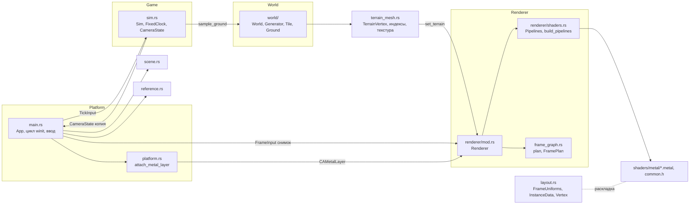
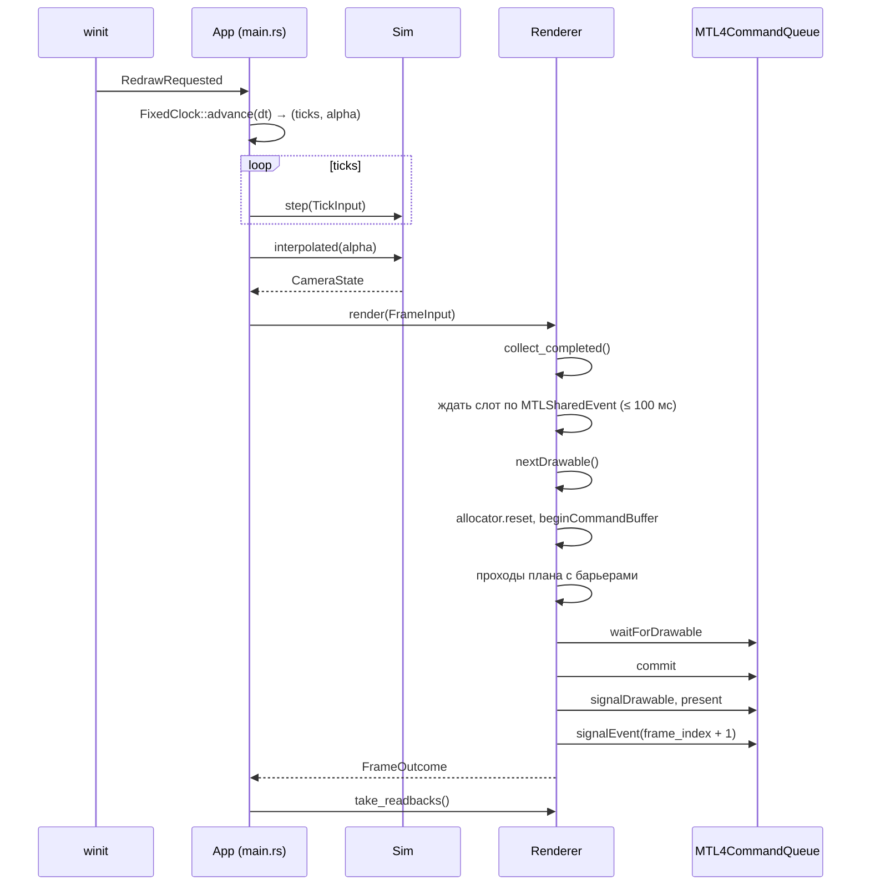

# Архитектура движка «Эхо мицелия»

Живой документ: описывает код в том виде, в котором он есть сейчас. Правила обновления — в [AGENTS.md](../AGENTS.md#архитектура).

- Состояние на — 2026-11-07, ревизия `22c3804` и правки после неё
- Подсистемы — [02-terrain.md](02-terrain.md), [03-water.md](03-water.md)
- Покрытые этапы — [00. Платформа и архитектура](../specs/00-platform.md) (`completed`), [01. Основа Metal 4](../specs/01-metal-foundation.md) (`partial`), [02. Ландшафт и биомы](../specs/02-terrain-biomes.md) (`partial`): подэтап [02.1](../specs/02-1-terrain-data.md) (`completed`), 02.2–02.5 не начаты; [10. Руки от первого лица](../specs/10-first-person-hands.md) (`partial`, шаг 1 — ассет)
- Отчёты — [00](../reports/00-platform.md), [01](../reports/01-metal-foundation.md), [02](../reports/02-terrain-biomes.md), [02.1](../reports/02-1-terrain-data.md), [10](../reports/10-first-person-hands.md)
- Подсистемы — [мир и ландшафт](02-terrain.md)
- Язык и API — Rust 1.99.1 (edition 2024), Metal 4 через `objc2-metal` 0.3.2, MSL

## Содержание

1. [Границы подсистем](#1-границы-подсистем)
2. [Соглашения](#2-соглашения)
3. [Поток кадра](#3-поток-кадра)
4. [Модули, структуры и методы](#4-модули-структуры-и-методы)
5. [Шейдеры и привязки](#5-шейдеры-и-привязки)
6. [Синхронизация и время жизни ресурсов](#6-синхронизация-и-время-жизни-ресурсов)
7. [Планировщик проходов](#7-планировщик-проходов)
8. [Самопроверка](#8-самопроверка)
9. [Соответствие спецификациям](#9-соответствие-спецификациям)
10. [Архитектурные решения и причины](#10-архитектурные-решения-и-причины)
11. [Ограничения и ближайшие изменения](#11-ограничения-и-ближайшие-изменения)
12. [Журнал изменений](#12-журнал-изменений)

## 1. Границы подсистем

[Спецификация 00](../specs/00-platform.md#границы-в-коде) задаёт четыре части: `Platform`, `World`, `Game`, `Renderer`. Сейчас они разложены по модулям так:

| Часть из спецификации | Модуль | Ответственность сейчас | Чего ещё нет |
| --- | --- | --- | --- |
| `Platform` | `src/platform.rs`; приложение `src/app/` (окно, ввод, цикл, самопроверка), точка входа `src/main.rs` | Окно winit, ввод, `CAMetalLayer` на `NSView` | Файловые пути |
| `World` | `src/world/` ([подробно](02-terrain.md)) | Генератор, тайлы 64 × 64 м, поля среды, `BiomeWeights`, `sample_ground` по треугольникам LOD 0, маркеры маршрута, экспорт и импорт слоёв PNG | LOD 1–2, растительность, стриминг (этапы 02, 08) |
| `Game` | `src/sim/` | Фиксированный тик, камера, полёт и ходьба по `Ground` | Игрок, задания, события (этап 05) |
| `Renderer` | `src/renderer/` — фасад `Renderer` и модули `device`, `resources`, `frame`, `passes/`, `readback`, `targets`, `terrain`, `water`, `shaders` ([AD-41](#ad-41-рендерер-и-приложение-разбиты-на-модули-проходы--объекты-за-общим-трейтом)) | Устройство, очередь, ресурсы, проходы, синхронизация, вывод | Счётчики GPU, общий RHI (этап 06) |
| Общие данные | `src/layout.rs`, `shaders/metal/common.h` | Раскладка структур CPU/GPU | — |
| Описание проходов | `src/frame_graph.rs` | Проходы, ресурсы, барьеры без зависимости от API | Стадия indirect-аргументов (этап 02) |
| Тестовая сцена | `src/scene.rs` | Куб и два экземпляра; куб же рисует столбики маркеров | Остаётся для самопроверки (клавиша T) |
| Сетка ландшафта | `src/terrain_mesh.rs` | `TerrainVertex` всех тайлов, общие индексы, детальная текстура | LOD-сетки 33/17 и юбки (подэтап 02.3) |
| Эталоны | `src/reference.rs` | CPU-эталоны узора, глубины кубов и глубины ландшафта (луч по `Ground`) | — |

Правила границ, проверенные в коде:

- Нативные типы (`objc2`, `raw-window-handle`) подключены только в `platform.rs` и `renderer/`. Все вхождения `unsafe` там же: 1 в `platform.rs`, 19 в `renderer/`.
- `Game` не знает о рендере. `Renderer` получает копию состояния через `FrameInput` и не может изменить симуляцию.
- winit 0.30 использует objc2 0.5, проект — objc2 0.6. Связь идёт через сырой указатель `NSView` из `raw-window-handle`, поэтому типы двух версий не смешиваются.

## 2. Соглашения

| Тема | Правило | Где закреплено |
| --- | --- | --- |
| Единицы | Метры, секунды | `sim.rs` |
| Система координат | Правая, Y вверх, при `yaw = 0` камера смотрит в −Z | `CameraState::forward`, тест `yaw_zero_looks_down_negative_z` |
| Матрицы | Векторы-столбцы, `clip = P * V * M * p`, хранение по столбцам (`to_cols_array_2d`) | `layout.rs`, `scene.metal` |
| Глубина | Клип [0, 1], reversed-Z: ближняя плоскость 1, бесконечность 0, очистка 0, тест `GreaterEqual` | `sim::projection`, `Renderer::new`, тест `reversed_z_maps_near_to_one_and_far_to_zero` |
| Лицевая сторона | CCW, отсечение задних граней | `scene::cube`, `setFrontFacingWinding(CounterClockwise)`, тест `cube_triangles_face_outward` |
| Экран | Начало в левом верхнем углу | `reference::expected_depth` |
| Цвет | Линейный HDR `RGBA16Float`, одно преобразование в sRGB форматом `BGRA8Unorm_sRGB` | `shaders.rs`, `tonemap.metal` |
| Общие GPU-данные | `#[repr(C)]`, `align(16)` для uniform-структур, `bytemuck::Pod`, проверка смещений на CPU и GPU | `layout.rs`, ядро `layout_probe` |
| Время симуляции | Тик 1/60 с, не больше 5 догоняющих тиков, кадр длиннее 0,25 с обрезается | `sim.rs` |
| Карта | Тайлы 64 × 64 м, `TileId` — целые координаты, LOD 0 — 65 × 65 точек с шагом 1 м, граничные точки общие; север — малые z, море на юге | `world/mod.rs` |
| Треугольники ландшафта | Ячейка (i, j): диагональ (i, j)–(i+1, j+1), треугольники (a, c, b) и (a, d, c), CCW сверху; одинаково в отрисовке и `sample_ground` | `terrain_mesh::tile_indices`, `World::sample_ground` |

## 3. Поток кадра

Порядок проходов: `pattern` (compute) → `wet_sand` (compute, маска мокрого песка, если загружена вода) → `scene` (render: ландшафт, кубы, затем прозрачная вода) → `readback` (compute, только по запросу) → `viewmodel` (render: руки поверх сцены с очищенной глубиной, если они в кадре) → `tonemap` (render).

## 4. Модули, структуры и методы

### 4.1. `src/main.rs` и `src/app/` — приложение и цикл кадра

`src/main.rs` — только точка входа: модули, разбор аргументов, `--export-world`, цикл winit, код выхода. Приложение — `src/app/`:

| Файл | Строк | Ответственность |
| --- | --- | --- |
| `app/mod.rs` | 195 | константы (`LIGHT_DIR`, `WORLD_SEED`, `WORLD_TILES`, `DETAIL_TEXTURE_SIZE`, `SKY_COLOR`, `TEST_SCENE_CLEAR`), `SceneMode`, `App` (поля состояния), `App::new`, `set_grab`, `reload_shaders`, `land`, `is_minimized` |
| `app/args.rs` | 84 | `Args` (в том числе `pose` — стартовая поза рук), `Args::parse`, `load_world` |
| `app/cameras.rs` | 91 | `trail_start_camera`, `look_camera`, `island_overview_camera`, `terrain_check_camera`, `marker_posts`, `start_camera` |
| `app/input.rs` | 88 | `tick_input` (оси из клавиш), `on_key_pressed` (команды по клавишам) |
| `app/hands.rs` | 56 | `hands_frame` — аниматор рук по камере и шагу, палитра, `HandsUniforms`; в самопроверке — контрольная поза |
| `app/frame.rs` | 144 | `water_frame`, `frame` — тики, камера, `FrameUniforms`, руки, `FrameInput`, readback |
| `app/title.rs` | 85 | `update_title` (с позой рук) |
| `app/setup.rs` | 81 | `create_renderer` — устройство, рендерер, ландшафт, материалы, вода, руки (`Option<Hands>`: без ассета игра работает без рук) |
| `app/handler.rs` | 165 | `impl ApplicationHandler for App`: `resumed`, `window_event`, `device_event`, `about_to_wait`, `exiting` |
| `app/selftest/mod.rs` | 280 | `TestStep`, `SelfTest` (`new`, `check`), `App::selftest_step` |
| `app/selftest/checks.rs` | 302 | `verify_readback`, `compare_terrain_depth`, `compare_terrain_raw`, `verify_terrain_readback`, `verify_water_probe`, `verify_skin_probe`, `report_terrain_readback`, `report_readback` |

Элементы ниже описаны по смыслу; файл — по таблице выше.

Связывает подсистемы. Управление: клик — захват мыши, WASD, Shift — бег, Space — прыжок (в полёте вверх), G — ходьба/полёт (над водой и за картой — на начало тропы), R — на начало тропы, E/Q — вверх/вниз в полёте, B — покачивание головы и рук, H — показать или спрятать руки, 1–4 — позы рук (`relaxed`, `grip`, `point`, `reach`), V/Shift+V — отладочные виды ландшафта, T — ландшафт/тестовые кубы, Esc, ⌘M — свернуть окно, F5 — перезагрузка MSL, F9 — readback, F12 — GPU capture. Аргументы: `--selftest`, `--overview` (старт в полёте над морем с видом на весь остров), `--capture-frame N`, `--world DIR` (мир из слоёв PNG), `--export-world DIR` (записать слои и выйти), `--camera x,y,z,tx,ty,tz`, `--view <вид>`, `--pose <поза>`.

| Элемент | Вид | Описание |
| --- | --- | --- |
| `LIGHT_DIR` | `const Vec3` | Направление света от источника к сцене, нормируется при записи в uniforms |
| `WORLD_SEED` = `0xEC40`, `WORLD_TILES` = 12, `DETAIL_TEXTURE_SIZE` = 512 | const | Первая карта и её текстура |
| `SKY_COLOR`, `TEST_SCENE_CLEAR` | const | Цвет очистки для ландшафта и для тестовой сцены |
| `SceneMode` | enum | `Cubes` — тестовая сцена этапа 01, `Terrain` — ландшафт и маркеры |
| `Args { selftest, overview, capture_frame, world, export_world, camera, view, wet_test }` | struct | Аргументы командной строки. `Args::parse()` разбирает `std::env::args` |
| `load_world(&Args) -> World` | fn | `layers::import(dir)` при `--world`, иначе `World::generate`; ошибка слоёв — сообщение и выход с кодом 2 |
| `trail_start_camera(&World)` | fn | Поза на начале тропы, взгляд вдоль тропы |
| `island_overview_camera(&World)` | fn | Камера `--overview`: 330 м над юго-западным морем, взгляд на центр острова |
| `terrain_check_camera(&World)` | fn | Контрольная камера самопроверки: 12 м над точкой «склон над лесом», взгляд на торфяник |
| `marker_posts(&World) -> Vec<InstanceData>` | fn | Столбики 0,5 × 4 м на маркерах, цвет по виду |
| `start_camera()` | fn | Стартовая и контрольная поза камеры `(0.4, 1.4, 3.6)`, `pitch = −0.3` |
| `TestStep` | enum | Шаги самопроверки: `Warmup`, `ReadbackA`, `HotReload`, `AfterBrokenReload { frames }`, `Minimized { since, presented_at: Option<u64> }`, `Restored { presented_before, presented_while_minimized }`, `Resize`, `ReadbackB`, `TerrainView`, `TerrainReadback`, `Done` |
| `SelfTest` | struct | Состояние самопроверки: `step`, `frames_in_step`, `failures`, `log`, `resize_target`, `size_before`. `check(ok, what)` печатает `[pass]`/`[FAIL]` и копит ошибки |
| `App` | struct | Состояние приложения, см. ниже |
| `verify_readback(t, rb, view, proj)` | fn | Сверяет readback с эталонами: узор, глубина в 9 точках с покрытием обоих кубов, 17 полей раскладки |
| `compare_terrain_depth(rb, view, proj, &World, log) -> (hits, sky, bad, worst)` | fn | Глубина ландшафта с GPU, переведённая в метры (`NEAR_PLANE_M / depth`), против луча по `sample_ground`; допуск 2·10⁻³ относительно; небо — глубина 0 |
| `verify_terrain_readback(...)`, `report_terrain_readback(...)` | fn | Проверка ландшафта в самопроверке и вывод по F9 |
| `report_readback(rb, view, proj)` | fn | То же для F9 в обычном режиме, вывод в stderr |
| `look_camera(from, to)` | fn | Камера для `--camera` |
| `App::water_frame(camera)` | fn | `WaterFrame` кадра: `SeaState::params_for`, `dt`, точки проверки, `water_levels` вокруг камеры; `None` вне ландшафта |
| `verify_water_probe(t, rb, frame, shore)` | fn | Самопроверка: ядро `water_probe` против `water::wave_at`, ±2 мм |
| `compare_terrain_raw(rb, view, proj, &World)` | fn | Вид `Raw`: высота ±5 см, уклон грани ±2°, доминирующий биом ближайшего узла против CPU |
| `main()` | fn | При `--export-world` записывает слои и выходит; иначе создаёт `EventLoop` (`ControlFlow::Poll`), запускает `App`, выходит с `exit_code` |

Поля `App`:

| Поле | Тип | Назначение |
| --- | --- | --- |
| `args` | `Args` | Режимы запуска |
| `world` | `World` | Мир, генерируется в `new` (около 260 мс в Debug) |
| `scene` | `SceneMode` | Что рисовать; самопроверка начинает с `Cubes` |
| `window` | `Option<Arc<Window>>` | Окно, создаётся в `resumed` |
| `renderer` | `Option<Renderer>` | Бэкенд, удаляется в `exiting` до освобождения окна |
| `sim` | `Sim` | Состояние симуляции |
| `clock` | `FixedClock` | Аккумулятор времени |
| `keys` | `HashSet<KeyCode>` | Зажатые клавиши, очищаются при потере фокуса |
| `modifiers` | `ModifiersState` | Текущие модификаторы для сочетаний вроде ⌘M |
| `look` | `(f32, f32)` | Накопленный поворот мыши до следующего тика |
| `grabbed` | `bool` | Курсор захвачен |
| `last_frame`, `started`, `title_timer` | `Instant` | Время кадра, время с запуска, период обновления заголовка |
| `frames_since_title` | `u32` | Кадры для расчёта fps в заголовке |
| `last_error` | `Option<String>` | Последняя ошибка MSL (файл и стадия) |
| `readback_requested`, `capture_requested` | `bool` | Запросы F9 и F12 на следующий кадр |
| `selftest` | `Option<SelfTest>` | Активна при `--selftest` |
| `exit_code` | `i32` | 0 — успех, 1 — провал самопроверки, 2 — ошибка запуска |

Методы `App`:

| Метод | Что делает |
| --- | --- |
| `new(args)` | Генерирует мир, ставит `Sim` на начало тропы в режиме ходьбы (в самопроверке и `--overview` — полёт) |
| `set_grab(grab)` | Вызывает `platform::grab_cursor`, ставит `grabbed`, сбрасывает `look` |
| `reload_shaders()` | Вызывает `Renderer::reload_shaders(None)`, пишет результат в stderr и заголовок |
| `tick_input()` | Строит `TickInput` из `keys`; поворот мыши добавляется в `frame` |
| `is_minimized()` | `Window::is_minimized()`, `false` без окна |
| `update_title(force)` | Раз в 0,5 с: GPU, размер, fps, CPU-время кодирования, поколение или ошибка MSL; на ландшафте — режим, тайл, субстрат, тропа/вода, высота грунта |
| `frame(event_loop)` | Шаг кадра: тики `Sim::step(input, Some(&world))`, интерполяция, `FrameUniforms`, `FrameInput` (ландшафт, маркеры или кубы, цвет очистки), вызов `render`, обработка readback. В свёрнутом окне только `collect_completed` |
| `selftest_step(...)` | Конечный автомат самопроверки, см. [раздел 8](#8-самопроверка) |

`ApplicationHandler for App`:

| Обработчик | Поведение |
| --- | --- |
| `resumed` | Создаёт окно 1280 × 720 pt, `probe_device`, `attach_metal_layer`, `Renderer::new`, `set_terrain` (сетка, индексы, текстура), первый `resize`. Ошибка → stderr и код 2 |
| `window_event` | `CloseRequested` → выход; `Resized` → `Renderer::resize`; `ModifiersChanged` → `modifiers`; `Focused(false)` → очистка клавиш и освобождение мыши; клик → захват; клавиши, включая ⌘M → `set_minimized(true)`, G → `Sim::set_mode`, T → `scene`; `RedrawRequested` → `frame` |
| `device_event` | `MouseMotion` добавляет относительное смещение в `look`, если мышь захвачена |
| `about_to_wait` | Обычное окно: `ControlFlow::Poll` и `request_redraw`. Свёрнутое: `collect_completed`, `ControlFlow::WaitUntil(+100 мс)`, сброс `last_frame`, без перерисовки. В самопроверке разворачивает окно через секунду после подтверждённого сворачивания |
| `exiting` | Удаляет `Renderer` (его `Drop` ждёт GPU) |

Поворот мыши за кадр целиком уходит в первый тик кадра. Для воспроизводимой записи ввода его нужно будет хранить по тикам.

### 4.2. `src/platform.rs` — поверхность вывода

| Элемент | Сигнатура | Описание |
| --- | --- | --- |
| `attach_metal_layer` | `fn(&Window) -> Result<Retained<CAMetalLayer>, String>` | Берёт `NSView` из `RawWindowHandle::AppKit`, создаёт `CAMetalLayer`, включает `wantsLayer`, ставит слой и `contentsScale`. Вызывается на главном потоке из обработчика winit |
| `grab_cursor` | `fn(&Window, bool)` | Захват: `CursorGrabMode::Locked` (при неудаче `Confined`) и `NSCursor::hide`. Освобождение: `CursorGrabMode::None` и `NSCursor::unhide`. Вызовы `hide`/`unhide` сбалансированы флагом |
| `CURSOR_HIDDEN` | `static AtomicBool` | Скрыт ли курсор этим модулем |

### 4.3. `src/sim/` — фиксированный шаг и камера (`Game`)

Код — `sim/mod.rs`, тесты — `sim/tests.rs`.

Константы: `TICK_DT = 1/60`, `MAX_CATCHUP_TICKS = 5`, `MAX_FRAME_DT = 0.25`, `MOVE_SPEED = 8.0` м/с (полёт), `FAST_MULTIPLIER = 4.0`, `FLY_ACCEL = 40` м/с², `MOUSE_SENSITIVITY = 0.0025` рад/пиксель, `PITCH_LIMIT = 1.55` рад, `NEAR_PLANE_M = 0.05`. Ходьба: `EYE_HEIGHT_M = 1.7`, `MAX_STEP_M = 0.35`, `MAX_SLOPE_DEG = 40`, `WALK_SPEED = 4.0`, `RUN_SPEED = 7.0` м/с, `GROUND_ACCEL = 40`, `GROUND_FRICTION = 28`, `AIR_ACCEL = 6` м/с², `UPHILL_SLOWDOWN = 0.8`, `JUMP_SPEED = 4.2` м/с, `GRAVITY = 9.81`. Только для вида (приватные): `STEP_SMOOTH_TAU = 0.07` с, `STEP_SMOOTH_MIN = 0.08` м, `LAND_DIP_PER_SPEED = 0.025`, `LAND_DIP_MAX = 0.25` м, `BOB_STRIDE_M = 0.8`, `BOB_WALK_M = 0.03`, `BOB_RUN_M = 0.05`.

| Тип | Поля | Методы |
| --- | --- | --- |
| `TickInput` | `forward`, `right`, `up` ∈ [−1, 1] (`up > 0` при ходьбе — прыжок); `look_dx`, `look_dy` в пикселях; `fast` | — (команда одного тика) |
| `CameraState` | `position: Vec3`, `yaw`, `pitch` | `forward()` — единичный вектор взгляда; `view()` — `Mat4::look_to_rh`; `lerp(other, t)` — линейная интерполяция позы |
| `MoveMode` | `Fly`, `Walk` | — |
| `Sim` | `tick: u64`, `prev`, `curr: CameraState`, `mode`, `vertical_speed`, `on_ground`, `blocked_ticks`, `velocity: Vec3` (м/с), `view_dy_prev`, `view_dy` (сдвиг глаз только для вида), `head_bob: bool`; приватные `eye_lag`, `bob_phase`, `bob_weight` | `new(start)` (полёт); `look(dx, dy)` — поворот мыши сразу в `prev` и `curr`; `set_mode(mode, &dyn Ground)` — при ходьбе ставит на грунт, обнуляет скорость; `step(&TickInput, Option<&dyn Ground>)` — поворот из команды, затем `walk` или полёт с разгоном `FLY_ACCEL`, `tick += 1`; приватные `walk` (разгон, торможение, замедление на подъёме, скольжение с гашением скорости по оси упора, прыжок, падение, сглаживание ступеньки, приседание при приземлении, покачивание головы) и `can_step` (ступенька ≤ 0,35 м, подъём не круче 40°); `interpolated(alpha)` — поза плюс интерполированный `view_dy` |
| `FixedClock` | `accumulator` (приватное), `dropped_ticks` | `advance(frame_dt) -> (ticks, alpha)` — обрезает `dt`, считает тики, при превышении лимита отбрасывает долг и увеличивает `dropped_ticks` |

Свободные функции: `projection(aspect) -> Mat4` — `perspective_infinite_reverse_rh`, FOV 70°, near 0,05 м; приватные `approach(v, target, max_delta)` и `approach2` — сдвиг вектора к цели не больше чем на шаг.

Инвариант: состояние на тике N зависит только от команд тиков 0..N, поворотов `look` до этого тика и поверхности. `view_dy` не влияет на физику. Тесты `same_ticks_same_state_at_30_60_120_fps` и `walking_is_deterministic_across_frame_rates`. Правила ходьбы — в [02-terrain.md](02-terrain.md#5-ходьба).

### 4.4. `src/layout.rs` — общие данные CPU/GPU

| Структура | Размер, выравнивание | Поля и смещения |
| --- | --- | --- |
| `FrameUniforms` | 128 Б, 16 | `view_proj [[f32;4];4]` @0, `camera_pos [f32;4]` @64, `light_dir [f32;4]` @80, `time f32` @96, `exposure f32` @100, `pattern_time f32` @104, `frame_index u32` @108, `view_mode u32` @112 (`TerrainView`), `map_size_m f32` @116, `_pad [f32;2]` @120 |
| `InstanceData` | 80 Б, 16 | `model [[f32;4];4]` @0, `tint [f32;4]` @64 |
| `Vertex` | 32 Б, 4 | `position [f32;3]` @0, `normal [f32;3]` @12, `uv [f32;2]` @24. В MSL — `packed_float3`, `packed_float3`, `float2` |
| `TerrainVertex` | 32 Б, 4 | `position [f32;3]` @0 (мировые м), `normal [f32;3]` @12, `weights [u8;4]` @24 (лес, торф, берег, тропа), `material [u8;4]` @28 (субстрат, русло, влажность, тип берега 0 песок … 255 камень). В MSL — `packed_float3`, `packed_float3`, `uchar4`, `uchar4` |
| `GerstnerWave` | 32 Б, 4 | `dir [f32;2]` @0, `wavelength` @8, `amplitude` @12, `steepness` @16, `phase` @20, `omega` @24, `_pad` @28 |
| `SeaParams` | 432 Б, 16 | `sea_level` @0, `wave_count u32` @4, `shore_wavelength` @8, `shore_amplitude` @12, `shore_omega` @16, `swash_sand_m` @20, `swash_rock_m` @24, `dry_time_s` @28, `field_size u32` @32, `field_step_m` @36, `dt` @40, `_pad` @44, `waves [GerstnerWave; 8]` @48, `probe [[f32;4]; 8]` @304 |
| `WaterLevel` | 32 Б, 4 | `origin [f32;2]` @0, `cell` @8, `morph_edge u32` @12, `inner_min [f32;2]` @16, `inner_max [f32;2]` @24 |
| `SkinnedVertex` | 52 Б, 4 | `position [f32;3]` @0, `normal [f32;3]` @12, `uv [f32;2]` @24, `joints [u8;4]` @32, `weights [f32;4]` @36. В MSL — `packed_float3`, `packed_float3`, `packed_float2`, `uchar4`, `packed_float4`: всё упаковано, без хвоста |
| `HandsUniforms` | 144 Б, 16 | `proj [[f32;4];4]` @0 (проекция рук, reversed-Z), `view_to_world [[f32;4];4]` @64 (поворот глаз → мир), `vertex_count u32` @128, `joint_count u32` @132, `_pad [u32;2]` @136 |

| Элемент | Описание |
| --- | --- |
| `expected_probe() -> [u32; 31]` | Ожидаемые размеры и смещения в порядке записи ядра `layout_probe` |
| `LAYOUT_PROBE_LEN = 31`, `LAYOUT_PROBE_NAMES`, `SEA_WAVES = 8`, `WATER_PROBES = 8`, `SKIN_PROBES = 8` | Длина и имена полей для диагностики |

Изменение любой структуры требует правки `common.h` в той же правке; несовпадение ловят тест `cpu_layout_matches_msl_rules` и самопроверка.

### 4.5. `src/frame_graph.rs` — проходы и барьеры

Не зависит от Metal. Алгоритм — в [разделе 7](#7-планировщик-проходов).

| Тип | Описание |
| --- | --- |
| `ResourceId(u32)` | Логический ресурс кадра |
| `Stages(u32)` | Битовая маска стадий: `NONE`, `VERTEX`, `FRAGMENT`, `DISPATCH`, `BLIT`. Методы `is_empty`, `contains`, операторы `|`, `|=` |
| `PassKind` | `Compute` (разрешены `DISPATCH`, `BLIT`) или `Render` (`VERTEX`, `FRAGMENT`). Приватный `allowed()` |
| `Hazard` | `Raw`, `War`, `Waw` |
| `PassDecl` | `name`, `kind`, `reads`, `writes` — списки `(ResourceId, Stages)` |
| `Barrier` | `after`, `before: Stages`, `hazards: Vec<(ResourceId, Hazard)>` — один барьер перед проходом |
| `FramePlan` | `passes` и `barriers` с совпадающими индексами |
| `GraphError` | `ReadBeforeWrite { pass, resource }`, `StageNotAllowed { pass, stages }`, реализует `Display` |
| `Track` (приватный) | `last_write`, `reads_since_write` для одного ресурса |
| `plan_after(previous, passes, imported) -> Result<FramePlan, GraphError>` | Валидация и барьеры кадра `passes`, перед которым в очереди выполнен кадр `previous` |
| `plan(passes, imported)` (только тесты) | `plan_after` для кадра, повторяющего тот же список |

### 4.6. `src/renderer/` — бэкенд Metal 4

Фасад `Renderer` (`mod.rs`) хранит ресурсы и оркестрирует кадр; остальное — в модулях ([AD-41](#ad-41-рендерер-и-приложение-разбиты-на-модули-проходы--объекты-за-общим-трейтом)):

| Файл | Строк | Ответственность |
| --- | --- | --- |
| `mod.rs` | 484 | `Renderer` и публичный API: `new`, `size`, `pipeline_generation`, `frame_index`, `shader_dir`, `plan_summary`, `resize`, `reload_shaders`, `collect_completed`, `take_readbacks`, `wait_idle`, `render`; приватные `retire`, `upload_textures`, `encode_frame` (upload слота с руками и палитрой, `PassCtx`, цикл по плану с поиском прохода в реестре); `depth_state` |
| `device.rs` | 103 | `DeviceInfo`, `probe_device`, `start_capture`, `stop_capture` |
| `resources.rs` | 310 | `label`, `to_mtl_stages`, `as_allocation`, `f16_to_f32`, `shared_buffer`, `buffer_with`, `upload_bytes`, `sampled_texture(_usage)`, `private_texture`, `TextureUpload`, `upload_textures`, `DeferredRelease` (`push`, `collect`) — очередь отложенного освобождения |
| `frame.rs` | 204 | константы слота и upload, `ResourceId` проходов, `FrameOutcome`, `FrameInput` (в том числе `hands: Option<HandsFrame>`), `WaterFrame`, `Stats`, `Table` (индекс таблицы аргументов), `FrameSlot` (`new`, `table`), `frame_passes` |
| `readback.rs` | 119 | `RB_*`, `DEPTH_SAMPLES`, `sample_pixels`, `Readback` (в том числе `skin_probe`), `PendingReadback::decode` |
| `targets.rs` | 41 | `Targets::new` — HDR и глубина |
| `terrain.rs` | 145 | `TerrainGpu`, `TerrainTextures`, `Renderer::set_terrain` |
| `water.rs` | 52 | `WaterGpu`, `Renderer::set_water` |
| `hands.rs` | 72 | `MAX_JOINTS` = 64, `HandsGpu` (вершины, индексы, `index_count`, альбедо кожи sRGB с mip), `HandsFrame { uniforms, palette }`, `Renderer::set_hands(vertices, indices, albedo, size)` |
| `passes/mod.rs` | 97 | трейт `FramePass` (`name`, `encode`), `PassCtx` (рендерер, слот, upload, цели, drawable, вход, readback, вода), `PassBarrier` (`apply`, `apply_always`), реестр `REGISTRY`, `find`, `size2` |
| `passes/pattern.rs`, `wet_sand.rs`, `scene.rs`, `readback.rs`, `viewmodel.rs`, `tonemap.rs` | 38–165 | по проходу: `PatternPass`, `WetSandPass`, `ScenePass` (`draw_terrain`, `draw_cubes`, `draw_water`), `ReadbackPass` (с ядрами `water_probe` и `skin_probe`), `ViewmodelPass` (HDR — загрузка, глубина — очистка в 0, обход против часовой, без отсечения граней), `TonemapPass` |
| `shaders.rs` | 284 | компиляция MSL и pipeline |

Описание констант и типов ниже сохранено; файл — по таблице.

Константы:

| Константа | Значение | Смысл |
| --- | --- | --- |
| `FRAME_SLOTS` | 2 | Кадров в полёте |
| `SLOT_WAIT_TIMEOUT_MS` | 100 | Таймаут ожидания слота, после — пропуск кадра |
| `UPLOAD_BYTES` | 12 544 | Upload-буфер слота |
| `INSTANCE_OFFSET`, `INSTANCE_END` | 256, 4096 | Диапазон экземпляров в upload |
| `MAX_INSTANCES` | 48 | `(4096 − 256) / 80` |
| `SEA_OFFSET`, `LEVELS_OFFSET` | 4096, 4608 | `SeaParams` и `WaterLevel[13]` в upload |
| `HANDS_OFFSET`, `PALETTE_OFFSET` | 8192, 8448 | `HandsUniforms` и палитра костей `float4x4[MAX_JOINTS]` в upload |
| `RES_PATTERN … RES_WETNESS` | 1…6 | `ResourceId` для планировщика; 6 — маска мокрого песка. `viewmodel` пишет `RES_HDR` и `RES_DEPTH` |
| `RB_*`, `DEPTH_SAMPLES` | см. [раздел 6](#раскладка-буферов) | Раскладка readback и 9 точек проверки глубины |

Публичные типы:

| Тип | Поля и смысл |
| --- | --- |
| `DeviceInfo` | `name`, `os`, `metal4`, `apple_family: Option<u32>`, `raytracing`, `raytracing_from_render: Option<bool>` (`None` в режиме capture). `Display` печатает строку диагностики |
| `FrameOutcome` | `Presented`, `SkippedZeroSize`, `SkippedNoDrawable`, `SkippedBusySlot` |
| `FrameInput<'a>` | Снимок для кадра: `uniforms: FrameUniforms`, `instances: &[InstanceData]` (кубы или столбики маркеров), `draw_terrain: bool`, `clear_color: [f32; 3]`, `readback: bool`, `capture: Option<PathBuf>`, `water: Option<WaterFrame>` |
| `WaterFrame` | `params: SeaParams`, `levels: [WaterLevel; 11]` — вода кадра |
| `TerrainTextures<'a>` | `detail_rgba`, `detail_size`, `materials: &MaterialArrays`, `wetness_size` |
| `Readback` | `frame`, `pattern_time`, `width`, `height`, `pattern: Vec<u8>` (RGBA8 256 × 256), `depth: Vec<(x, y, f32)>`, `hdr: Vec<[f32; 4]>`, `water_probe: [[f32; 4]; 8]`, `probe: [u32; 24]` |
| `Stats` | `presented`, `skipped_busy`, `skipped_no_drawable`, `released_deferred`, `cpu_encode_ms` |

Приватные типы:

| Тип | Поля и смысл |
| --- | --- |
| `PendingReadback` | `signal_value` (значение события, после которого можно читать), `frame`, `pattern_time`, `width`, `height`, `pixels` (точки глубины) |
| `FrameSlot` | `allocator: MTL4CommandAllocator`, `cmd: MTL4CommandBuffer`, `tables: [MTL4ArgumentTable; 10]` (pattern, scene, readback, tonemap, terrain, wet sand, water, water probe, hands, skin probe), `upload: MTLBuffer`, `signal_value: u64` |
| `TerrainGpu` | вершины, индексы, `detail`, `albedo`, `normal`, `wetness` (R16Float, read/write) |
| `WaterGpu` | `field` (RGBA32Float 1025²), `indices`, `index_count` |
| `HandsGpu` | `vertices` (`SkinnedVertex`), `indices` (u16), `index_count`, `albedo` |
| `TextureUpload` | `texture`, `data`, `pixel_bytes`, `mips` — элемент `upload_textures` |
| `TerrainGpu` | `vertices` (все тайлы), `indices` (одна сетка 65 × 65), `index_count`, `tile_count`, `detail` (текстура с mip) |
| `Targets` | `width`, `height`, `hdr` (`RGBA16Float`), `depth` (`Depth32Float`), обе `Private` |
| `Retired` | `after_value`, `textures` (удаляются из residency set), `_keep_alive: Option<Box<dyn Any>>` (например, старые `Pipelines`) |

Поля `Renderer`:

| Поле | Тип | Назначение |
| --- | --- | --- |
| `info` | `DeviceInfo` | Диагностика адаптера |
| `device` | `MTLDevice` | Устройство |
| `queue` | `MTL4CommandQueue` | Единственная очередь для compute, render и copy |
| `compiler` | `MTL4Compiler` | Сборка pipeline |
| `layer` | `CAMetalLayer` | Поверхность вывода, `BGRA8Unorm_sRGB`, `framebufferOnly`, 3 drawable |
| `residency` | `MTLResidencySet` | Все ресурсы движка; добавлен в очередь вместе с `layer.residencySet()` |
| `event` | `MTLSharedEvent` | Номер последнего завершённого кадра |
| `depth_state` | `MTLDepthStencilState` | `GreaterEqual`, запись глубины |
| `slots` | `Vec<FrameSlot>` | Два слота кадра |
| `pipelines` | `Pipelines` | Текущее поколение pipeline |
| `targets` | `Option<Targets>` | `None` при нулевом размере окна |
| `terrain` | `Option<TerrainGpu>` | Загруженный ландшафт |
| `pattern_tex` | `MTLTexture` | 256 × 256 `RGBA8Unorm`, `ShaderRead | ShaderWrite` |
| `vertex_buf`, `index_buf` | `MTLBuffer` | Куб в `StorageModeShared` |
| `index_count` | `usize` | 36 |
| `readback_buf` | `MTLBuffer` | Общий буфер readback |
| `plans` | `[[FramePlan; 2]; 2]` | Планы `plans[prev][cur]` по наличию readback в предыдущем и текущем кадре |
| `prev_readback` | `bool` | Был ли readback в последнем отправленном кадре |
| `frame_index` | `u64` | Число отправленных кадров |
| `retired` | `Vec<Retired>` | Ожидают завершения GPU |
| `pending_readback` | `Option<PendingReadback>` | Не больше одного readback в полёте |
| `completed_readbacks` | `Vec<Readback>` | Готовые результаты |
| `shader_dir` | `PathBuf` | Каталог MSL |
| `stats` | `Stats` | Счётчики |

Методы `Renderer`:

| Метод | Описание |
| --- | --- |
| `new(device, info, layer, vertices, indices) -> Result<Renderer, String>` | Проверяет Metal 4, настраивает слой, создаёт очередь, компилятор, событие, residency set, depth state, pipeline, буферы, текстуру узора, два слота с таблицами, строит четыре плана переходов |
| `size() -> Option<(u32, u32)>` | Размер целей |
| `pipeline_generation() -> u32` | Поколение pipeline |
| `frame_index() -> u64` | Отправлено кадров |
| `shader_dir() -> &Path` | Каталог MSL |
| `plan_summary() -> String` | Текстовые планы «readback после readback» и «обычный кадр после readback» |
| `resize(width, height, scale)` | Нулевой размер → цели уходят в `retired`, вывод пропускается. Иначе новые цели по пиксельному размеру, добавление в residency set, старые — в `retired` |
| `reload_shaders(over) -> Result<u32, ShaderError>` | Собирает новый набор; при успехе подменяет, старый уходит в `retired`; при ошибке текущий не трогается |
| `collect_completed()` | Освобождает `retired` по значению события, забирает готовый readback |
| `take_readbacks() -> Vec<Readback>` | Отдаёт готовые результаты |
| `set_terrain(vertices, indices, tile_count, detail_rgba, detail_size) -> Result<(), String>` | Буферы в `StorageModeShared`, private-текстура с полным набором mip; одноразовый командный буфер: копия staging → mip 0, барьер blit → blit, `generateMipmaps`; CPU ждёт отдельный `MTLSharedEvent` до 5 с; staging удаляется из residency set; прежний ландшафт уходит в `retired` |
| `wait_idle()` | Ждёт все отправленные кадры, до 2 с |
| `render(&FrameInput) -> FrameOutcome` | Кадр целиком, см. [раздел 3](#3-поток-кадра) и [раздел 6](#6-синхронизация-и-время-жизни-ресурсов). В проходе `scene` сначала ландшафт (группа `terrain: N tiles`, один instanced draw), затем кубы |
| `retire(textures, other)` (приватный) | Ставит ресурс в очередь освобождения с `after_value = frame_index` |
| `read_back(PendingReadback) -> Readback` (приватный) | Копирует данные из `readback_buf` |
| `start_capture(path) -> bool` (приватный) | `MTLCaptureManager` → `.gputrace`, нужен `MTL_CAPTURE_ENABLED=1` |
| `Drop` | `wait_idle()` |

Свободные функции модуля:

| Функция | Описание |
| --- | --- |
| `probe_device() -> Result<(device, DeviceInfo), String>` | `MTLCreateSystemDefaultDevice`, семейство Apple10…7, Metal 4, признаки трассировки |
| `capture_enabled()` | `MTL_CAPTURE_ENABLED == "1"`; при capture признаки трассировки не запрашиваются |
| `flag(Option<bool>)` | Текст «да», «нет», «не запрошено (capture)» |
| `label(&str)` | `NSString` для подписей ресурсов |
| `to_mtl_stages(Stages) -> MTLStages` | Перевод стадий планировщика в Metal |
| `as_allocation(&obj)` | Приведение буфера или текстуры к `MTLAllocation` для residency set |
| `shared_buffer(device, len, name)` | Буфер `StorageModeShared` с подписью |
| `upload_bytes(buf, offset, bytes)` | Проверенная запись в shared-буфер |
| `private_texture(device, format, w, h, usage, name)` | 2D текстура `Private` с подписью |
| `frame_passes(readback) -> Vec<PassDecl>` | Объявление проходов кадра |

### 4.7. `src/renderer/shaders.rs` — MSL и pipeline

| Элемент | Описание |
| --- | --- |
| `Obj<T>` | `Retained<ProtocolObject<T>>` — владеющая ссылка на объект Metal |
| `HDR_FORMAT`, `DEPTH_FORMAT`, `DRAWABLE_FORMAT`, `PATTERN_FORMAT` | `RGBA16Float`, `Depth32Float`, `BGRA8Unorm_sRGB`, `RGBA8Unorm` |
| `Pipelines` | `pattern`, `layout_probe`, `wet_sand`, `water_probe`, `skin_probe` (compute), `scene`, `tonemap`, `terrain`, `water`, `hands` (render), `generation` |
| `ShaderError { file, stage, message }` | Стадии: `read`, `compile MSL`, `entry point`, `compute pipeline`, `render pipeline` |
| `SourceOverride<'a>` | `Option<(файл, текст)>` — подмена исходника в памяти для самопроверки |
| `shader_dir()` | `ECHO_SHADER_DIR`, иначе `Contents/Resources/shaders/metal` при запуске из бандла, иначе `shaders/metal` рядом с `Cargo.toml` |
| `bundle_shader_dir()` (приватная) | Если исполняемый файл лежит в `Contents/MacOS`, возвращает существующий `../Resources/shaders/metal` |
| `read_source(dir, file, over)` | Читает файл и подставляет текст `common.h` вместо `#include "common.h"` |
| `compile_library(device, dir, file, over)` | `newLibraryWithSource:options:error:` |
| `function(lib, name)` | `MTL4LibraryFunctionDescriptor` |
| `require_function(lib, file, name)` | Проверка точки входа по `functionNames` |
| `compute_pipeline(compiler, lib, file, name)` | `MTL4ComputePipelineDescriptor` → `MTL4Compiler` |
| `render_pipeline(compiler, lib, file, label, vs, fs, color_format)` | `MTL4RenderPipelineDescriptor` с одним цветовым вложением |
| `build_pipelines(device, compiler, dir, generation, over)` | Собирает все четыре pipeline или возвращает первую ошибку; частичный набор не публикуется |

### 4.8. `src/scene.rs` — тестовая сцена этапа 01

| Функция | Описание |
| --- | --- |
| `cube() -> (Vec<Vertex>, Vec<u16>)` | Куб [−0.5, 0.5]³: 6 граней по 4 вершины, 36 индексов, обход CCW снаружи |
| `instance_models() -> [Mat4; 2]` | Куб A: масштаб 1,2, поворот Y 0,4. Куб B: масштаб 0,9, поворот X 0,6 и Y −0,3, сдвиг (0,65; 0,35; 0,45), пересекает A |
| `instances() -> [InstanceData; 2]` | Матрицы и оттенки для GPU |
| `boxes() -> Vec<Box3>` | Те же кубы для CPU-эталона |

### 4.9. `src/reference.rs` — CPU-эталоны

| Элемент | Описание |
| --- | --- |
| `PATTERN_SIZE = 256`, `SELFTEST_PATTERN_TIME = 1.25` | Размер узора и фиксированное время самопроверки |
| `pattern_color(x, y, size, t) -> [f32; 3]` | Повторяет `pattern_color` из `common.h`: градиент, шахматка 32 px, полосы по синусу |
| `compare_pattern(pixels, size, t, tolerance) -> (mismatches, max_diff)` | Сверка RGBA8 с эталоном в единицах 1/255 |
| `Box3 { model }` | Куб для пересечения лучом |
| `ray_box(origin, dir, box)` (приватная) | Метод плит в локальных координатах куба |
| `expected_depth(px, py, w, h, view, proj, boxes) -> f32` | Луч из центра пикселя, ближайшее попадание, reversed-Z глубина; 0 — фон |
| `pixel_ray(px, py, w, h, view, proj) -> (origin, dir)` | Луч из центра пикселя в мире |
| `expected_terrain_view_depth((px, py), (w, h), view, proj, &dyn Ground, max_dist) -> Option<f32>` | Шаг 0,25 м до пересечения с грунтом, 40 шагов бисекции, глубина по оси взгляда в метрах; `None` — за картой или дальше `max_dist` |

### 4.9a. `src/terrain_materials.rs` — материалы ландшафта

| Элемент | Вид | Описание |
| --- | --- | --- |
| `MaterialLayer { id, role }`, `LAYERS` | struct, const | 5 слоёв: 0 камень `Rock062`, 1 песок `Ground093A`, 2 почва `Ground082S`, 3 мох `Moss002`, 4 лесная подстилка `Ground037`; индекс = `MAT_*` в MSL |
| `MATERIAL_SIZE` = 1024 | const | сторона текстуры |
| `MaterialArrays { size, layers, albedo_height, normal_rough }` | struct | упакованные слои RGBA8: цвет + высота (Displacement); нормаль XY + шероховатость + 255 |
| `source_dir()` | fn | `Contents/Resources/ambientcg` в бандле или `assets/source/ambientcg` |
| `load(dir) -> Result<MaterialArrays, String>` | fn | декодирует `Color`, `NormalGL`, `Roughness`, `Displacement` (JPEG, `zune-jpeg`) параллельно по слоям; ошибка называет материал и файл |
| `TerrainView` | enum `u32` | `Lit` 0, `Height` 1, `Slope` 2, `Biome` 3, `Substrate` 4, `CoastType` 5, `Wetness` 6, `Materials` 7, `WaterDepth` 8, `WaterDirection` 9, `Surf` 10, `Raw` 15 (числа для самопроверки); `next(back)`, `name()`, `parse(name)` |

### 4.9b. `src/water.rs` — море и прибой

Подробно — [03-water.md](03-water.md).

| Элемент | Вид | Описание |
| --- | --- | --- |
| `WATER_LEVELS` = 13, `WATER_GRID_N` = 64, `WATER_CELL0_M` = 0,5, `DRY_TIME_S` = 20 | const | кольцевая сетка и высыхание |
| `SeaState { params }` | struct | `new(seed)` — 6 волн Герстнера по ветру, береговая волна 30 м / 7 с, заплеск 0,7 / 0,25 м; `params_for(&ShoreField)` — с размером поля |
| `ShoreField { size, step_m, data }` | struct | `from_world(&World)` — (высота, `Fields.coast_d`, `rocky`, 0) на мировой сетке с шагом мира, параллельно; приватные `bilinear`, `shore_at` |
| `ShoreSample { bed, coast_d, rocky, dir }`, `WaveOut { pos, foam, swash, shore }`, `WaterSample { height, depth, dry }` | struct | результаты запросов |
| `wave_at(field, params, base, t, filter_cell) -> WaveOut` | fn | точка поверхности узла сетки (как `water.h`) |
| `sample_water(field, params, p, t) -> WaterSample` | fn | высота воды над мировой точкой; заголовок окна показывает глубину под игроком |
| `water_levels(camera) -> [WaterLevel; 11]` | fn | кольца вокруг камеры с привязкой к решётке |
| `grid_indices()`, `probe_points(&World)` | fn | индексы уровня; 8 точек проверки CPU ↔ GPU |

### 4.9c. `tools/geo/` — импорт реального рельефа

Подробно — [02-terrain.md](02-terrain.md) и [мир Якусимы](../assets/world/yakushima/README.md).

| Элемент | Описание |
| --- | --- |
| `requirements.txt` | numpy, scipy, tifffile, imagecodecs, pillow; окружение `.venv-geo/` вне git |
| `yakushima.py fetch` | скачивает источники из `assets/source/geo/sources.json` в `assets/source/geo/cache/` и сверяет SHA-256 |
| `yakushima.py far` | дальний рельеф всего острова: сетка 1025², шаг 30 м, локальная касательная проекция WGS84 (центр 30,335° с. ш., 130,525° в. д.); суша — связная область у центра; знаковое расстояние до кромки (EDT); дно — процедурный шельф до −250 м до батиметрии GEBCO; тип берега по уклону; влажность и температура по высоте; маркеры мест; слои формата 3 и `world.json` с `geo` в `assets/world/yakushima/far/`. Повторный запуск даёт те же файлы |

### 4.9d. `src/hands/` — руки от первого лица

Пространство рук — пространство глаза: начало в глазу, взгляд −Z, вверх +Y ([AD-44](#ad-44-руки-скелет-на-cpu-скиннинг-в-вершинном-шейдере-отдельный-проход-с-очищенной-глубиной)).

| Файл | Строк | Элементы |
| --- | --- | --- |
| `mod.rs` | 80 | `asset_path()`, `VIEWMODEL_FOV_DEG` = 60, `VIEWMODEL_NEAR_M` = 0,01, `projection(aspect)` (reversed-Z), `CONTROL_POSE` = `point`; `Hands { asset, rig }`: `load()` (позы `POSE_NAMES` и кости `hand.L/R` обязательны), `palette(&RigInput)`, `control_palette()` |
| `asset.rs` | 239 | `HandsAsset { vertices, indices, skeleton, poses, albedo, albedo_size }`, `pose(name)`; `load(path)` — `gltf::Gltf::from_slice`, буферы из блока GLB; суставы скина с родителями и неподвижными узлами между ними (`pre`), обратные матрицы привязки; одна сетка с одним примитивом, веса нормируются; позы — первый ключ каждого канала анимации поверх позы покоя; PNG текстуры → RGBA8 |
| `skeleton.rs` | 132 | `Trs { t, r, s }` (`to_mat4`, `blend` — lerp и slerp), `Joint { name, parent, pre, rest, inverse_bind }`, `Skeleton` (`new` — топологический порядок, `rest_pose`, `joint`, `globals`, `palette(pose, root)`), `Pose(Vec<Trs>)` (`blend`), `skin_position` — CPU-эталон скиннинга |
| `rig.rs` | 132 | `POSE_NAMES` (`relaxed`, `grip`, `point`, `reach`), `POSE_BLEND_S` = 0,25; `RigInput { dt, yaw, pitch, bob_phase, bob_weight, view_dy }`; `HandRig` (`new`, `target`, `set_pose` — переход из текущей смешанной позы, `pose` — smoothstep-смешивание, `update` — прогресс, отставание `lag` от поворота (доля 0,6, τ 0,07 с, ≤ 0,08 рад), сглаженный `view_dy` (τ 0,12 с), `root` — сдвиг покачивания (8 мм вбок, 6 мм вниз по фазе шага), проседание ×0,6 и поворот отставания вокруг глаза) |
| `tests.rs` | 166 | ассет и веса; суставы всех поз против эталона Blender (±1 мм); кисть перед глазом и в кадре, длина 8–25 см; непрерывность смешивания; переход, отставание и выключение покачивания; конечность скиннинга |

### 4.10. Сборка `.app`

`scripts/bundle-app.sh [--open]` собирает `target/release/Echo.app`:

| Путь в бандле | Источник |
| --- | --- |
| `Contents/MacOS/echo` | `cargo build --release` |
| `Contents/Resources/shaders/metal/` | копия `shaders/metal/`, компилируется при запуске |
| `Contents/Info.plist` | `packaging/Info.plist`: `com.vladislav-vasilenko.mycelium-engine`, версия из `Cargo.toml`, номер сборки — число коммитов, `LSMinimumSystemVersion` 26.0, `NSHighResolutionCapable` |

Подпись ad-hoc (`codesign --sign -`), проверка `codesign --verify --strict`. Задача VS Code `bundle Echo.app`.

| Флаг | Действие |
| --- | --- |
| `--install` | `ditto` в `/Applications/Echo.app` (или `ECHO_INSTALL_DIR`), снятие карантина, проверка подписи; запущенная копия закрывается |
| `--open` | Запуск установленной или собранной копии |

`scripts/make-dmg.sh [--no-build] [--layout]` собирает `dist/Echo-<версия>.dmg` (UDZO, HFS+): `Echo.app` и символическая ссылка `Applications`. `--layout` создаёт записываемый образ, оформляет окно Finder через AppleScript (значки 128 pt, приложение слева, `Applications` справа) и конвертирует его в сжатый. Переменные `ECHO_SIGN_IDENTITY` (подпись Developer ID с hardened runtime) и `ECHO_NOTARY_PROFILE` (`notarytool submit --wait`, `stapler staple`) включают подпись и нотаризацию. Задача VS Code `make Echo.dmg`.

### 4.11. Ассеты и инструменты Blender

Ассеты собираются скриптами из неизменённых исходников; результат лежит в `assets/models/` и загружается модулем `src/hands/` ([этап 10](../specs/10-first-person-hands.md)).

| Путь | Назначение |
| --- | --- |
| `assets/source/fps-arms/` | Исходник рук: `fps-arms-rig.blend`, `new_diff.png`, `LICENSE.md` (CC0, автор, SHA-256) |
| `tools/blender/arms_poses.json` | Позы: цель кисти (м от глаза, оси Blender), направление `fwd`, поворот ладони `roll`, сгиб пальцев `curl` (градусы) |
| `tools/blender/export_arms.py` | `prepare` — удаляет камеру, лампы и анимационные данные, впекает масштаб 0,1 и сдвиг к глазу в кости и вершины; `skin_material` — Principled BSDF с текстурой; `set_pose` — кисти через `hand.*.control` (IK), сгиб первых фаланг; `bake_pose`/`apply_visual`/`key_all` — видимые матрицы костей в action из одного ключа; снятие ограничений; экспорт GLB; эталон `*.poses.json` |
| `tools/blender/check_arms.py` | Импорт `.glb` в пустую сцену: одна сетка со скином, 50 костей + `neutral_bone`, позы, суставы кисти против эталона (допуск 1 мм), длина кисти; рендер поз; код выхода 0/1 |
| `assets/models/fps-arms.glb` | Сетка 4600 вершин / 8152 треугольника, скин 51 сустав, материал `skin` с текстурой, анимации `relaxed`, `grip`, `point`, `reach`; метры, начало в глазу, −Z вперёд, +Y вверх |

## 5. Шейдеры и привязки

Файлы в `shaders/metal/`. Строки `#include "файл.h"` подставляются при загрузке рекурсивно (`expand_includes`): Metal API не знает путей проекта.

| Файл | Функции | Назначение |
| --- | --- | --- |
| `common.h` | `FrameUniforms`, `InstanceData`, `Vertex`, `TerrainVertex`, `GerstnerWave`, `SeaParams`, `WaterLevel`, `SkinnedVertex`, `HandsUniforms`, `SKIN_PROBES`, `pattern_color` | Общие типы и эталонная функция узора |
| `pattern.metal` | `pattern_main` (kernel), `layout_probe` (kernel) | Диагностический узор; запись размеров и смещений структур |
| `scene.metal` | `scene_vs`, `scene_fs` | Вершины из буфера по `vertex_id`, экземпляры по `instance_id`; ambient + Ламберт с текстурой узора |
| `terrain.metal` | `terrain_vs`, `terrain_fs`, `sample_layer`, `ramp` | Вершина `instance_id × 4225 + vertex_id`; 5 слоёв материалов ambientCG по весам, типу берега, уклону, тропе, руслу и дну, смешивание по высоте рельефа материала, карты нормалей, мокрый песок по маске, солнце (Ламберт + GGX) и небо; отладочные виды по `view_mode`. См. [02-terrain.md](02-terrain.md#4-отрисовка) |
| `water.h` | `ShoreSample`, `field_bilinear`, `shore_at`, `alongshore_phase`, `WaveOut`, `wave_at` | Функция волн, общая для отрисовки, маски и проверки. См. [03-water.md](03-water.md) |
| `water.metal` | `water_vs`, `water_fs`, `wet_sand_update` (kernel), `water_probe` (kernel), `level_point`, `sky_color` | Кольцевая сетка воды, цвет, пена, мокрый песок, проверка CPU ↔ GPU |
| `hands.metal` | `skin`, `hands_vs`, `hands_fs`, `skin_probe` (kernel) | Скиннинг по 4 весам (позиция и нормаль), проекция рук; кожа: альбедо, «обёрнутый» Ламберт, красноватый край терминатора, слабый широкий блик; нормаль задних граней разворачивается по `front_facing`; сверка скиннинга с CPU |
| `tonemap.metal` | `tonemap_vs`, `tonemap_fs` | Полноэкранный треугольник без буфера; экспозиция и ACES (Narkowicz) |

Таблицы аргументов (`MTL4ArgumentTable`, по одной на проход в каждом слоте, до 4 буферов и 4 текстур):

| Проход | `buffer(0)` | `buffer(1)` | `buffer(2)` | `texture(0)` | Стадии |
| --- | --- | --- | --- | --- | --- |
| `pattern` | upload: `FrameUniforms` | — | — | `pattern_tex` (write) | compute |
| `scene` | `vertex_buf` | upload: `FrameUniforms` | upload + 256: `InstanceData[]` | `pattern_tex` (sample) | vertex, fragment |
| `terrain` (в проходе `scene`) | вершины ландшафта | upload: `FrameUniforms` | — | детальная текстура; `texture(1)` альбедо + высота (массив 5 слоёв, sRGB), `texture(2)` нормаль + шероховатость (массив), `texture(3)` маска мокрого песка R16Float | vertex, fragment |
| `wet sand` (проход `wet_sand`) | — | upload: `FrameUniforms` | upload @4096: `SeaParams` | `texture(0)` маска (read_write), `texture(1)` поле берега | compute |
| `water` (в проходе `scene`) | — | upload: `FrameUniforms` | `buffer(2)` `SeaParams`, `buffer(3)` `WaterLevel[]` | `texture(0)` поле берега, `texture(1)` детальная текстура | vertex, fragment |
| `water probe` (в проходе `readback`) | `readback_buf` + `RB_WATER_OFFSET` | — | `buffer(2)` `SeaParams` | `texture(0)` поле берега | compute |
| `readback` | `readback_buf` + `RB_PROBE_OFFSET` | — | — | — (копии: узор, глубина и HDR в 9 точках) | compute |
| `skin probe` (в проходе `readback`) | вершины рук | upload @8192: `HandsUniforms` | upload @8448: палитра; `buffer(3)` `readback_buf` + `RB_SKIN_OFFSET` | — | compute |
| `hands` (проход `viewmodel`) | вершины рук | upload @8192: `HandsUniforms` | upload @8448: палитра; `buffer(3)` upload: `FrameUniforms` | альбедо кожи | vertex, fragment |
| `tonemap` | — | upload: `FrameUniforms` | — | `hdr` (sample) | vertex, fragment |

Сэмплеры заданы в MSL через `constexpr sampler`, отдельные объекты сэмплеров не используются.

## 6. Синхронизация и время жизни ресурсов

### Слоты кадра и событие

- Кадр с номером N (с нуля) использует слот `N % 2` и после commit сигналит `MTLSharedEvent` значением `N + 1`. Это значение записывается в `slot.signal_value`.
- Перед записью в слот CPU ждёт `event ≥ slot.signal_value`. При таймауте 100 мс кадр пропускается (`SkippedBusySlot`) с сообщением в stderr.
- Других ожиданий CPU нет, кроме `wait_idle()` при выходе. В прогоне самопроверки пропусков 0.

### Вывод кадра

Схема Apple для Metal 4: `nextDrawable` → кодирование → `queue.waitForDrawable` → `commit` → `queue.signalDrawable` → `present`. Без drawable кадр пропускается (`SkippedNoDrawable`), при нулевом размере — `SkippedZeroSize`.

### Резидентность

Все буферы и текстуры движка добавлены в один `MTLResidencySet`, который подключён к очереди вместе с `layer.residencySet()`. Новые цели после resize добавляются сразу, старые удаляются в `collect_completed` после завершения кадров, затем `commit()` набора.

### Отложенное освобождение

`retire` запоминает `after_value = frame_index`, то есть номер последнего отправленного кадра. `collect_completed` освобождает запись, когда `event.signaledValue() ≥ after_value`. Так освобождаются старые цели после resize и старые pipeline после перезагрузки MSL.

### Раскладка буферов

| Буфер | Диапазон | Содержимое |
| --- | --- | --- |
| upload слота (12 544 Б) | 0..128 | `FrameUniforms` |
| | 256..4096 | до 48 `InstanceData` |
| | 4096..4528 | `SeaParams` |
| | 4608..5024 | `WaterLevel[13]` |
| | 8192..8336 | `HandsUniforms` |
| | 8448..12 544 | палитра костей, до 64 × `float4x4` |
| `readback_buf` (262 656 Б) | 0..262 144 | узор RGBA8, строка 1024 Б |
| | 262 144..262 400 | глубина `f32` в 9 точках `DEPTH_SAMPLES` |
| | 262 400..262 656 | 31 значение `u32` из `layout_probe` |
| | далее по 256 Б | HDR в 9 точках (`RB_HDR_OFFSET`), `water_probe` (`RB_WATER_OFFSET`), `skin_probe` — 8 × float4: позиция и индекс вершины (`RB_SKIN_OFFSET`) |

`readback_buf` один на приложение, поэтому в полёте не больше одного readback. Данные читаются после сигнала кадра, в котором стоят копии.

## 7. Планировщик проходов

`frame_graph::plan`:

1. Проверяет, что стадии прохода разрешены его типом, и что каждый прочитанный ресурс записан раньше в кадре или помечен импортированным. Иначе `GraphError`.
2. Первый круг проходит список предыдущего кадра и только собирает состояние ресурсов, второй проходит текущий кадр и выдаёт барьеры. Так учитываются зависимости через границу кадров в одной очереди, в том числе когда состав проходов меняется между кадрами.
3. Для чтения: если есть предыдущая запись — RAW, `after |= стадия записи`.
4. Для записи: если были чтения после последней записи — WAR по стадиям чтений; иначе, если была запись — WAW.
5. Все зависимости прохода сливаются в один барьер `after → before`.

Бэкенд Metal 4 кодирует барьер в начале кодировщика прохода: `barrierAfterQueueStages:beforeStages:visibilityOptions:` с `MTL4VisibilityOptions::Device`. Это consumer queue barrier в терминах Apple: он задерживает стадии `before` в этом и всех следующих проходах очереди, пока стадии `after` не завершатся во всех предыдущих проходах, включая прошлые кадры.

Renderer хранит четыре плана `plans[prev][cur]` и выбирает план по тому, был ли readback в предыдущем отправленном кадре. План «обычный кадр после кадра с readback» отличается от повторяющегося обычного кадра: `pattern` и `scene` ждут ещё и `BLIT`, иначе запись следующего кадра может пересечься с копией readback.

План «кадр с readback после такого же», как его печатает самопроверка:

| Проход | after | before | Зависимости |
| --- | --- | --- | --- |
| `pattern` | `FRAGMENT \| BLIT` | `DISPATCH` | WAR `pattern` (чтения прошлого кадра) |
| `scene` | `FRAGMENT \| DISPATCH \| BLIT` | `FRAGMENT` | RAW `pattern`, WAR `hdr`, WAR `depth` |
| `readback` | `FRAGMENT \| DISPATCH \| BLIT` | `DISPATCH \| BLIT` | RAW `pattern`, RAW `depth`, WAW `readback` |
| `viewmodel` | `BLIT` (и `FRAGMENT` без readback) | `FRAGMENT` | WAR `hdr`, WAR `depth` после копий readback; без readback — WAW после `scene`. Без рук в кадре проход не кодируется: следующий барьер ждёт те же стадии очереди |
| `tonemap` | `FRAGMENT` | `FRAGMENT` | RAW `hdr`, WAW `drawable` |

План «обычный кадр после кадра с readback»: `pattern` — after `FRAGMENT | BLIT`, `scene` — after `FRAGMENT | DISPATCH | BLIT`, `tonemap` без изменений.

Слияние зависимостей в один барьер иногда синхронизирует больше необходимого. Это принятое упрощение этапа 01.

## 8. Самопроверка

`./target/debug/echo --selftest` с фиксированной камерой и `pattern_time = 1.25`. Рекомендуемый запуск: `MTL_DEBUG_LAYER=1 MTL_DEBUG_LAYER_ERROR_MODE=assert MTL_SHADER_VALIDATION=1`.

| Шаг | Условие перехода | Проверки |
| --- | --- | --- |
| `Warmup` | 5 кадров | Печать `DeviceInfo` и плана; захват курсора на 2-м кадре и освобождение на 4-м; запрос readback |
| `ReadbackA` | Готов readback | Узор 256 × 256, глубина в 9 точках с покрытием обоих кубов, 13 полей раскладки |
| `HotReload` | Сразу | Перезагрузка без изменений → поколение +1; ошибочный `pattern.metal` из памяти → ошибка с файлом и стадией, поколение не меняется |
| `AfterBrokenReload` | 3 кадра | Вывод продолжается; исправленная перезагрузка успешна; `set_minimized(true)` |
| `Minimized` | Окно подтверждённо свёрнуто 1 с (`about_to_wait`) | Счёт кадров с момента, когда `is_minimized()` стал `true`; разворот. Не свернулось за 5 с — провал |
| `Restored` | 5 выведенных кадров | В свёрнутом окне выведено 0 кадров; вывод возобновился; запрос размера окна 960 × 600 |
| `Resize` | Размер изменился и прошло 4 кадра | Новые цели, запрос readback |
| `ReadbackB` | Готов readback | Те же проверки при новом размере; сцена переключается на ландшафт |
| `TerrainView` | 3 кадра с контрольной камерой ландшафта | Запрос readback |
| `TerrainReadback` | Готов readback | Глубина ландшафта против луча по `sample_ground` (≥ 4 точек на грунте), вид `Raw`, волны `water_probe`, скиннинг `skin_probe` в контрольной позе `point` (±0,01 мм), раскладка 31 поля |
| `Done` | — | Статистика, `SELFTEST PASSED` и код 0 или `SELFTEST FAILED` и код 1. Предохранитель — 1000 кадров. Кадры, пришедшие после `exit()`, игнорируются, итог печатается один раз |

Итог — 21 проверка. Модульные тесты (`cargo test`, 43 и 1 ручной `export_first_map`): планировщик (6), раскладка (1), симуляция и ходьба (17, включая бота на тропе в сгенерированном мире и в мире из слоёв), эталоны (2), куб (1), шум (2), генератор (1), мир (6), слои (4), сетка ландшафта (3).

## 9. Соответствие спецификациям

| Пункт спецификации | Реализация | Статус |
| --- | --- | --- |
| 00 · Rust, Metal 4, MSL | `Cargo.toml`, `objc2-metal`, `shaders/metal/` | Выполнено |
| 00 · Проверка GPU в приложении | `probe_device`, `DeviceInfo` | Выполнено |
| 00 · Границы `Platform`/`World`/`Game`/`Renderer` | [Раздел 1](#1-границы-подсистем) | `World` появится в 02 |
| 00 · Единицы, координаты, reversed-Z, CCW | [Раздел 2](#2-соглашения) | Выполнено, покрыто тестами |
| 00 · `#[repr(C)]` и проверка на GPU | `layout.rs`, `layout_probe` | Выполнено |
| 00 · Линейный HDR, одно преобразование в sRGB | `HDR_FORMAT`, `DRAWABLE_FORMAT`, `tonemap.metal` | Выполнено |
| 01.1 · winit, `CAMetalLayer`, Debug-компиляция MSL, подписи | `platform.rs`, `shaders.rs`, `label` | Выполнено; офлайн `.metallib` не сделан (нет Metal Toolchain) |
| 01.2 · `MTL4CommandQueue`, буфер, аллокатор, таблицы, резидентность, drawable | `Renderer::new`, `render` | Выполнено |
| 01.3 · Два слота, `MTLSharedEvent`, таймаут, resize, свёрнутое окно | `FrameSlot`, `render`, `resize`, `Retired`, `App::is_minimized`, `about_to_wait` | Выполнено; сворачивание проверяет самопроверка |
| 01.4 · Куб, `Depth32Float`, `RGBA16Float`, тонмаппинг | `scene.rs`, `Targets`, `tonemap.metal` | Выполнено |
| 01.5 · Ввод, фиксированный шаг, интерполяция | `App`, `sim.rs` | Выполнено; ввод вручную не проверен |
| 01.6 · Compute → fragment, сверка с эталоном | `pattern_main`, барьер, `verify_readback` | Выполнено |
| 01.7 · Перезагрузка MSL | `reload_shaders`, `ShaderError` | Выполнено; схема аргументов проверяется только по точкам входа |
| 02.1 · Тайлы 64 × 64 м, 65 × 65 высот, общие границы, `worldSeed`, версия, `TileId` | `world/mod.rs`: `Tile`, `TileId`, `World::generate` | Выполнено |
| 02.1 · Поля высоты, влажности, температуры, субстрата; тропа, русло, берег | `world/generator.rs` | Выполнено |
| 02.1 · `SampleGround(xz)` по треугольникам LOD 0 | `impl Ground for World` | Выполнено, проверено на CPU и GPU |
| 02.1 · `BiomeWeights` из полей, наклона, масок | `generator::biome_weights` | Выполнено |
| 02.1 · Карта высот, сетки на CPU, indexed terrain с текстурой | `terrain_mesh.rs`, `Renderer::set_terrain`, `terrain.metal`, `world::layers::import` (`--world`) | Выполнено; карта генерируется (AD-28) или загружается из слоёв PNG (AD-34) |
| 02.1 · Ходьба: ступенька, крутой склон, граница тайлов | `Sim::walk`, тесты `sim::tests` | Выполнено |
| 02.1 · Точки наблюдения, место моста, коридор реки до моря | `World::place_markers`, `marker_posts` | Выполнено |
| 02.1 · Остров: суша окружена морем, плавная береговая линия, дно уходит под воду | `Generator::coast_distance`, `terrain_without_trail`, тест `island_is_surrounded_by_sea` | Выполнено (AD-36) |
| 02.1 · Проход по тропе от начала до каменистого берега | Бот в тесте `bot_walks_whole_trail_from_start_to_shore`, брод (AD-33) | Выполнено |
| 02.1 · Маска типа берега: песчаные бухты и каменистые мысы | `Generator::rocky`, `coast_type.png`, тест `coast_alternates_sand_and_rock` | Выполнено (AD-37) |
| 02.2 · Texture arrays, `TerrainMaterials`, `TerrainView`, мокрый песок, материалы берега | `terrain_materials.rs`, `Renderer::set_terrain`/`set_wetness`, `terrain.metal`, вид `Raw` в самопроверке | Выполнено (AD-38); 5 слоёв вместо 4 |
| 02.3 · Frustum culling, quadtree, CDLOD с морфингом, текстура высот | — | Не начато |
| 02.4 · `Placement`, группы экземпляров, береговой декор | — | Не начато |
| 03.1 · Море до горизонта, волны Герстнера, мелководье, разворот к берегу, обрушение, накат, мокрый песок, пена | `water.rs`, `water.h`, `water.metal`, `Renderer::set_water`, проход `wet_sand`, самопроверка `волны моря` | Выполнено (AD-39, AD-40); брызги у камней — только пена |
| 03.2–03.4 · Река, устье и вихрь, плывущий мусор | — | Не начато |
| 04.1 · Время суток, солнце, луна, звёзды, атмосфера, свет неба, экспозиция, управление временем | Временный свет в `terrain.metal` (солнце + градиент неба) | Не начато |
| 04.2–04.4 · Тени и туман, погода и осадки, ночное свечение | — | Не начато |
| 11 · Глобальное освещение: видимость неба, пробы освещённости, отражения | — | Не начато |
| 12 · Звук: микшер, окружение, шаги, 3D-звук | — | Не начато |
| 13 · Физика: запросы, капсула игрока, твёрдые тела, плавучесть | — | Не начато |
| 14 · Жизнь в лесу: частицы-существа на GPU, звери с анимацией | — | Не начато |
| 08.1 · World partition, quadtree мира, стриминг ячеек, NVMe, бюджеты (мир ~21 × 20 км) | — | Не начато |
| 08.2 · Виртуальное текстурирование | — | Не начато |
| 08.3 · Кластерная геометрия (Nanite-подобная) | — | Не начато |
| 08.4 · Тесселяция и displacement вблизи, scattering на лету | — | Не начато |
| 08.5 · Тени по полям расстояний | — | Не начато |
| 08.6 · Водосборы, дельты изменений, «Дыхание пустыни» | — | Не начато |
| 02.5 · Видимые списки, indirect, импосторы | — | Не начато |
| 02.6 · Hi-Z, двухпроходное отсечение, occlusion queries | — | Не начато |
| 02.8 · Растения: конвейер Blender, LOD, импосторы, ветер, шейдер листвы | — | Не начато |
| 02.7 · Импорт Якусимы: данные и лицензии, весь остров 30 м | `tools/geo/yakushima.py`, `assets/world/yakushima/far/`, `World.step_m`, `coast_distance.png`, `GeoRef` | Частично (AD-42, AD-43): Copernicus, дно процедурное |
| 02.7 · Реки по стоку, пояса растительности, игровая зона 1 м (GSI DEM1A) | — | Не начато |
| 10.1 · CC0-ассет рук, метры, начало в глазу, запечённые позы, проверка повторным импортом | `tools/blender/export_arms.py`, `check_arms.py`, `assets/models/fps-arms.glb` | Выполнено |
| 10.2 · glTF и скиннинг, сверка GPU ↔ CPU | `src/hands/{asset,skeleton}.rs`, `hands.metal` (`skin`, `skin_probe`), `SkinnedVertex` в `layout_probe` | Выполнено (AD-44) |
| 10.3 · Проход `viewmodel` | `ViewmodelPass`, `hands::projection` (60°, 1 см), `frame_passes` | Выполнено; стоимость в GPU capture не замерена |
| 10.4 · Движение | `HandRig` (смешивание поз 0,25 с, отставание, покачивание, проседание), клавиши 1–4, H, B | Частично: сгиб пальцев по параметрам не сделан |
| 10.5 · Кожа, волосы, рукав | `hands_fs` — временный свет | Не начато |
| 01 · Описание проходов, RAW/WAR/WAW | `frame_graph.rs`, `plan_after` | Выполнено, включая смену состава проходов между кадрами; стадия indirect — в 02 |

## 10. Архитектурные решения и причины

Каждое решение записано в форме: что выбрано, почему, какие варианты отброшены и какой ценой, когда пересмотреть. Номера `AD-NN` постоянные: при пересмотре решение помечается как заменённое и получает ссылку на новое.

### AD-01. Rust и прямой Metal 4 вместо wgpu, Swift или C++

- **Решение.** Код движка на Rust, графика через нативный Metal 4 (`objc2-metal`), шейдеры на MSL.
- **Почему.** Цель проекта учебная: самим вести очереди, барьеры, резидентность и время жизни GPU-ресурсов. wgpu 30.0.1 на Metal использует прежний `MTLCommandQueue` и скрывает синхронизацию, поэтому Metal 4 через него не изучить. Rust даёт проверку владения для данных мира и симуляции, которые потом переедут на Windows без изменений.
- **Отброшено.** wgpu как основа (остаётся лабораторией в [07](../specs/07-shader-labs.md#wgpu-и-общий-исходник)); Swift (сложный путь на Windows); C++ (время жизни указателей без проверки компилятора).
- **Цена.** Много `unsafe` в бэкенде, отдельный бэкенд D3D12 в этапе 06.
- **Пересмотреть,** если Linux станет целью (Vulkan) или поддержка двух бэкендов окажется дороже пользы.

### AD-02. `objc2-metal` как привязка к Metal

- **Решение.** Привязки `objc2-metal` 0.3.2 и соседние крейты `objc2-*`.
- **Почему.** Они генерируются из заголовков SDK и уже содержат `MTL4CommandQueue`, `MTL4ArgumentTable`, `MTL4Compiler` и барьеры Metal 4. Отдельная ручная привязка устарела бы с каждым SDK.
- **Цена.** Почти все вызовы Metal идут через `Retained<ProtocolObject<dyn …>>`, часть методов помечена `unsafe`. В Debug objc2 проверяет наличие методов, отсюда особый случай GPU capture (AD-19).

### AD-03. Конкретный рендерер без общего RHI

- **Решение.** `Renderer` написан прямо на Metal 4. Общая граница — данные кадра (`FrameInput`, `layout.rs`) и описание проходов (`frame_graph.rs`).
- **Почему.** Абстракция над одним API угадывает форму второго. Общий слой выделяем, когда D3D12 повторит несколько реальных проходов ([06](../specs/06-d3d12-port.md), шаг 5).
- **Цена.** Часть кода бэкенда D3D12 будет написана заново.

### AD-04. Одна очередь для compute, render и copy

- **Решение.** Единственная `MTL4CommandQueue`.
- **Почему.** Простейшая корректная модель синхронизации: порядок задают барьеры внутри очереди, межочередные события не нужны. Объём работы этапа 01 не требует параллельного compute.
- **Пересмотреть,** когда профиль покажет простой GPU, который закроет async compute (FFT воды, отбор растительности).

### AD-05. Два слота кадра

- **Решение.** `FRAME_SLOTS = 2`, у каждого свой аллокатор, командный буфер, таблицы аргументов и upload-буфер.
- **Почему.** CPU готовит кадр N+1, пока GPU выполняет кадр N, при задержке ввода не больше одного кадра. Память аллокатора Metal 4 и upload можно переписывать только после завершения GPU, поэтому они принадлежат слоту.
- **Отброшено.** Три слота: дают запас при неровном GPU, но добавляют кадр задержки. Drawable у слоя и так три.

### AD-06. `MTLSharedEvent` с таймаутом и пропуском кадра

- **Решение.** Событие получает номер кадра. Перед повторным использованием слота CPU ждёт не дольше 100 мс, иначе пропускает кадр с диагностикой.
- **Почему.** Одно монотонное значение отвечает сразу на три вопроса: свободен ли слот, можно ли освободить ресурс, готов ли readback. Таймаут не даёт зависнуть приложению при сбое GPU и делает проблему видимой. CPU ждёт только там, где без завершения GPU нельзя продолжить, как требует спецификация.

### AD-07. Один residency set плюс набор слоя

- **Решение.** Все ресурсы движка в одном `MTLResidencySet`, подключённом к очереди вместе с `layer.residencySet()`.
- **Почему.** В Metal 4 резидентность явная: ресурс, которого нет в наборе, GPU не видит. При десятке ресурсов один набор проще всего проверять.
- **Пересмотреть** в этапе 08: при стриминге тайлов понадобятся наборы по группам ресурсов.

### AD-08. Барьеры из описания проходов, независимого от API

- **Решение.** Проходы объявляют чтения, записи и стадии. `frame_graph::plan` вычисляет RAW, WAR и WAW, бэкенд кодирует барьер своего API.
- **Почему.** Metal 4 не отслеживает зависимости сам, и ручная расстановка барьеров легко ломается при добавлении прохода. Описание в данных проверяется тестами без GPU и переиспользуется для D3D12. Циклический анализ ловит WAR через границу кадров: следующий `pattern` не должен писать, пока прошлый `scene` читает текстуру.
- **Упрощение.** Все зависимости прохода сливаются в один барьер `after → before`. Иногда это синхронизирует больше нужного, зато один вызов на кодировщик. Уточним, если профиль покажет простои.
- **Исправление.** Первая версия анализировала список циклически, предполагая, что предыдущий кадр выполнил тот же список. После кадра с readback следующий обычный кадр не ждал `BLIT` и мог перезаписать `pattern` и `depth` во время копии. Теперь план строится по фактическому составу предыдущего кадра (`plan_after`), тест `plan_change_waits_for_previous_frame_stages`.

### AD-09. Reversed-Z с бесконечной дальней плоскостью и `Depth32Float`

- **Решение.** Ближняя плоскость 0,05 м даёт глубину 1, бесконечность — 0, тест `GreaterEqual`.
- **Почему.** У float больше точности около нуля. Reversed-Z переносит эту точность на дальние расстояния, где она нужна большой карте с лесом и берегом. Бесконечная дальняя плоскость убирает подбор far для разных сцен.
- **Цена.** Очистка глубины нулём и обратный тест везде, включая будущие тени и D3D12.

### AD-10. HDR-буфер и отдельный проход тонмаппинга

- **Решение.** Сцена пишет линейный `RGBA16Float`, тонмаппинг (ACES) выводит в `BGRA8Unorm_sRGB`.
- **Почему.** Освещение складывается в линейном пространстве и не обрезается до 1. Экспозиция, bloom и ночные сцены этапа 04 работают с этим буфером. Формат drawable делает одно преобразование в sRGB, без ручной гаммы в шейдере.

### AD-11. Вершины из буфера по `vertex_id` без vertex descriptor

- **Решение.** `scene_vs` читает `Vertex` по индексу из `buffer(0)`.
- **Почему.** Меньше состояния pipeline. Тот же приём подходит данным, которые позже сгенерирует compute (частицы, отбор экземпляров), и близок к mesh-шейдерам из лаборатории 07.
- **Цена.** Раскладку вершины проверяет не Metal, а `layout_probe` и тесты.

### AD-12. Общие структуры через `#[repr(C)]` и проверку на GPU

- **Решение.** `layout.rs` и `common.h` описывают одни структуры. Ядро `layout_probe` пишет размеры и смещения, самопроверка сравнивает их с `offset_of!`.
- **Почему.** Ошибка выравнивания (`float3` против `packed_float3`) не даёт ошибки компиляции, а портит данные молча. Проверка на настоящем компиляторе MSL ловит её сразу.

### AD-13. Фиксированный тик 1/60 с, интерполяция, предел догоняющих тиков

- **Решение.** `Sim` меняется только в `step`, рендер интерполирует между `prev` и `curr`. Не больше 5 тиков за кадр, кадр длиннее 0,25 с обрезается.
- **Почему.** Этап 05 требует одинаковой последовательности событий при 30, 60 и 120 кадрах/с. Это возможно, только если результат зависит от числа тиков, а не от времени кадра. Предел не даёт циклу «догонять» сотни тиков после паузы в отладчике.
- **Цена.** Отрисовка отстаёт от симуляции до одного тика. Для поворота мыши это заменено [AD-32](#ad-32-поворот-мыши-в-каждом-кадре-разгон-и-сдвиг-глаз-только-для-вида).

### AD-14. Компиляция MSL в рантайме и ручная подстановка `common.h`

- **Решение.** В Debug исходники компилируются через `newLibraryWithSource`. Строка `#include "common.h"` заменяется текстом заголовка.
- **Почему.** Metal Toolchain для офлайн-сборки не установлен, а перезагрузка по F5 всё равно требует компиляции в рантайме. API компиляции из строки не знает путей проекта, поэтому заголовок подставляется вручную.
- **Пересмотреть** при сборке Release с `.metallib`.

### AD-15. Атомарная подмена набора pipeline с поколениями

- **Решение.** `build_pipelines` собирает все четыре pipeline. Подмена только при полном успехе, старый набор уходит в `Retired`.
- **Почему.** Частично обновлённый набор может сочетать несовместимые шейдеры. Старые pipeline ещё используются кадрами в полёте, поэтому их нельзя освободить сразу. Номер поколения показывает в заголовке и логе, какая версия работает.

### AD-16. Отложенное освобождение по номеру кадра

- **Решение.** `Retired { after_value }` хранит ресурс до `event ≥ after_value`, затем удаляет его из residency set.
- **Почему.** Rust освобождает объект при `Drop`, а GPU может ещё читать его в отправленном кадре. Номер кадра переносит правило владения Rust на GPU. Это упражнение из маршрута чтения: `Drop` на CPU, освобождение GPU-памяти после последнего кадра.

### AD-17. Самопроверка через readback и независимые CPU-эталоны

- **Решение.** Режим `--selftest` читает с GPU узор, глубину и раскладку и сравнивает с эталонами из `reference.rs`.
- **Почему.** Скриншот не доказывает правильность матриц, обхода граней и глубины. Эталон глубины считается иначе, чем на GPU (луч и пересечение с кубом), поэтому совпадение до 1e-7 проверяет камеру, reversed-Z, отсечение задних граней и перекрытие одновременно. Самопроверка запускается без человека и даёт код выхода.

### AD-18. Статическая геометрия в `StorageModeShared`

- **Решение.** Вершины и индексы куба в shared-памяти без копирования в private.
- **Почему.** На Apple silicon память общая, и для 24 вершин копирование ничего не даёт. Явный upload появится, когда объём данных вырастет в этапе 02 и в порте 06 на дискретный GPU.

### AD-19. Признаки трассировки не запрашиваются при GPU capture

- **Решение.** При `MTL_CAPTURE_ENABLED=1` поля `raytracing` равны `None`.
- **Почему.** Capture оборачивает устройство в `CaptureMTLDevice`, который только пересылает `supportsRaytracing`. Проверка методов objc2 в Debug считает это ошибкой и завершает процесс. Признаки не нужны для записи кадра, а их отсутствие видно в диагностике.

### AD-20. Граница winit ↔ Metal через `raw-window-handle`

- **Решение.** `platform.rs` получает `NSView` как сырой указатель и создаёт `CAMetalLayer` своими типами objc2 0.6.
- **Почему.** winit 0.30 собран с objc2 0.5. Сырой указатель — единственное место стыка двух версий, поэтому их типы не смешиваются, а `unsafe` сосредоточен в одной функции.

### AD-21. Сэмплеры в MSL и диагностика в заголовке окна

- **Решение.** Сэмплеры объявлены `constexpr` в шейдерах. Ошибки MSL, fps и поколение pipeline выводятся в заголовок окна и stderr.
- **Почему.** Меньше объектов в таблицах аргументов. Текстового вывода в кадре пока нет, а заголовок виден всегда и не требует отдельного прохода.
- **Пересмотреть,** когда появится текстовый оверлей.

### AD-22. Debug-профиль: свой код без оптимизаций, зависимости с оптимизацией

- **Решение.** `[profile.dev] opt-level = 0` для крейта `echo`, `[profile.dev.package."*"] opt-level = 2` для зависимостей.
- **Почему.** При `opt-level = 1` LLDB видел встроенные функции и терял локальные переменные. Без оптимизаций свой код пошагово отлаживается в VS Code, а glam, objc2 и winit остаются быстрыми, поэтому кадр и самопроверка не замедляются заметно (CPU-кодирование кадра 0,1–0,5 мс).
- **Цена.** Чуть медленнее собственный код в Debug. Замеры производительности делать в Release.

### AD-23. Consumer queue barriers вместо producer barriers и fence

- **Решение.** Межпроходная синхронизация — consumer barrier в начале прохода-потребителя (`barrierAfterQueueStages:beforeStages:`). Внутри прохода — `barrierAfterEncoderStages:beforeEncoderStages:` при необходимости. Producer barriers и `MTLFence` не используются. Синхронизация CPU и GPU — слоты кадра и `MTLSharedEvent`.
- **Почему.** Планировщик вычисляет зависимости со стороны потребителя: какие стадии каких предыдущих проходов нужно дождаться. Consumer barrier выражает это одним вызовом и охватывает прошлые кадры той же очереди. Producer barrier удобнее, когда один производитель кормит много потребителей; fence точнее, потому что ждёт конкретный проход, а не все предыдущие проходы со стадией, но требует пары `updateFence`/`waitForFence` и объекта на каждую зависимость. Для четырёх проходов в одной очереди выигрыш не окупает сложности.
- **Ограничение TBDR.** На Apple GPU intrapass barrier не может ждать стадии `fragment` или `tile`. Поэтому readback глубины и тонмаппинг вынесены в отдельные проходы, а не сделаны барьером внутри render pass. Это совпадает с рекомендацией Apple: закончить render pass и поставить consumer barrier в следующем.
- **CPU и GPU.** Пример Apple держит число копий изменяемых буферов равным числу кадров в полёте и ждёт освобождения семафором из completion handler. У нас та же схема на `MTLSharedEvent`: два слота с upload-буферами, ожидание значения события перед повторным использованием слота. CPU пишет upload до commit и не трогает его до конца кадра.
- **Пересмотреть,** когда появится async compute на второй очереди (тогда `MTLSharedEvent` между очередями, fence в Metal 4 работают только внутри очереди) или когда профиль покажет, что широкие барьеры задерживают независимые проходы (тогда точечные fence).
- **Источники.** [Consumer barriers](https://developer.apple.com/documentation/metal/synchronizing-passes-with-consumer-barriers), [Producer barriers](https://developer.apple.com/documentation/metal/synchronizing-passes-with-producer-barriers), [Fence](https://developer.apple.com/documentation/metal/synchronizing-passes-with-a-fence), [Intrapass barriers](https://developer.apple.com/documentation/metal/synchronizing-stages-within-a-pass), [CPU и GPU](https://developer.apple.com/documentation/metal/synchronizing-cpu-and-gpu-work).

### AD-24. Свёрнутое окно определяется через окно, а не через drawable

- **Решение.** `App` проверяет `Window::is_minimized()`: в свёрнутом окне кадр не кодируется, цикл переходит на `WaitUntil` с интервалом 100 мс, `Renderer::collect_completed` продолжает освобождать ресурсы. ⌘M обрабатывается в `window_event`.
- **Почему.** Спецификация требует пропускать вывод при свёрнутом окне. Проверка показала, что macOS продолжает выдавать drawable свёрнутому окну, поэтому ветки `SkippedNoDrawable` и `SkippedZeroSize` в рендерере этот случай не ловят: за секунду в свёрнутом окне выводилось около 60 кадров. Меню winit на macOS содержит только пункты приложения, без Window → Minimize, поэтому ⌘M не работал вовсе.
- **Цена.** Решение о пропуске кадра принимает `Platform`, а не `Renderer`. Сворачивание асинхронное: пока идёт анимация, кадры ещё выводятся, и самопроверка считает их с момента подтверждения.

### AD-25. Курсор скрывается через `NSCursor`, а не через winit

- **Решение.** `platform::grab_cursor` скрывает курсор вызовом `NSCursor::hide` и возвращает `NSCursor::unhide`. `Window::set_cursor_visible` не используется.
- **Почему.** При клике в окно приложение падало с `EXC_BAD_ACCESS (SIGBUS)`, `EXC_ARM_DA_ALIGN`. В crash report: `WinitView::reset_cursor_rects` → `invisible_cursor` → `NSImage initWithData` → `IIO_Reader_GIF::parse`. winit 0.30.13 строит невидимый курсор из встроенной GIF-картинки, и на macOS 27.0.1 её разбор в ImageIO внутри приложения падал. Та же GIF в отдельном процессе декодируется, а самопроверка в среде агента падение не воспроизвела: вероятно, курсорные области пересчитываются только в активном окне под мышью. `NSCursor hide` не декодирует изображений.
- **Цена.** Скрытие курсора действует на всё приложение, а не на область окна. Счётчик `hide`/`unhide` AppKit нужно держать сбалансированным, отсюда флаг `CURSOR_HIDDEN`.
- **Пересмотреть** после обновления winit или macOS: проверить, падает ли `set_cursor_visible(false)`.

### AD-26. Бандл `.app` с исходниками MSL и ad-hoc подписью

- **Решение.** Скрипт собирает бандл вокруг release-бинарника, кладёт MSL в `Resources`, `shader_dir` ищет их там. Подпись ad-hoc.
- **Почему.** Metal Toolchain не установлен, поэтому `.metallib` собрать нельзя, а шейдеры и так компилируются при запуске (AD-14). Путь к исходникам, зашитый через `CARGO_MANIFEST_DIR`, работает только на машине сборки; поиск относительно исполняемого файла делает бандл переносимым. `CFBundleIdentifier` нужен macOS для окна и снимает предупреждения о пустом идентификаторе. Ad-hoc подписи хватает для запуска на этом Mac.
- **Отброшено.** `cargo-bundle` — лишняя зависимость ради нескольких команд.
- **Цена.** В бандле лежат исходники шейдеров, компиляция при каждом запуске. Для другого Mac нужна подпись Developer ID и нотаризация.
- **Пересмотреть,** когда появится Metal Toolchain (класть `.metallib`) или понадобится распространение.

### AD-27. Распространение через `.dmg` с ярлыком Applications, подпись по переменным окружения

- **Решение.** `make-dmg.sh` строит образ на `hdiutil` с символической ссылкой на `/Applications` для установки перетаскиванием. Оформление окна — опция `--layout`. Подпись Developer ID и нотаризация включаются переменными окружения, по умолчанию остаётся ad-hoc.
- **Почему.** Перетаскивание из смонтированного образа — привычный способ установки на macOS, и `hdiutil` есть в системе без зависимостей вроде `create-dmg`. Копия, переданная как папка через мессенджер, теряет бит исполнения и получает карантин (так сломалась копия в `/Applications`), а образ сохраняет права. В связке ключей есть только сертификат Apple Development, им нельзя подписывать для распространения, поэтому подпись не зашита в скрипт.
- **Цена.** Без Developer ID и нотаризации на чужом Mac Gatekeeper блокирует запуск: нужно «Открыть» из контекстного меню или разрешение в настройках «Конфиденциальность и безопасность». `--layout` управляет Finder через AppleScript и требует разрешения «Автоматизация».
- **Пересмотреть,** когда появится сертификат Developer ID Application: задать `ECHO_SIGN_IDENTITY` и `ECHO_NOTARY_PROFILE`, проверить `spctl --assess --type open --context context:primary-signature`.

### AD-28. Мир запекается из генератора на общей мировой сетке

- **Решение.** Первая карта задаётся генератором (`Generator::first_map`): шум от seed плюс авторские сплайны реки и тропы, чаша торфяника и береговая линия. Поля считаются на одной мировой сетке (сейчас 1025 × 1025 точек), нормали — центральными разностями по ней же, тайлы нарезаются из сетки.
- **Почему.** Спецификация требует брать высоты и нормали на границе из одного мирового источника. Общая сетка делает совпадение границ точным по построению, а не по допуску. Готовой карты высот нет, а генератор от seed даёт воспроизводимый результат, контрольную сумму и версию для будущих сохранений. Авторские сплайны держат маршрут и место моста там, где они нужны для заданий.
- **Отброшено.** Загрузка PNG/RAW карты высот: нужен внешний инструмент, и поля среды всё равно пришлось бы считать. Отдельная генерация каждого тайла: граничные нормали потребовали бы соседей.
- **Цена.** Шаг 1 спецификации (теперь 02.1) говорил «загрузить карту высот»; вместо файла — запечённый генератор. Вся карта в памяти (~590 тыс. точек). Для стриминга этапа 08 понадобится нарезка без общей сетки или запекание на диск.
- **Пересмотреть** в этапе 08 при карте 4 × 4 км или при появлении авторской карты высот.

### AD-29. Все тайлы LOD 0 одним instanced draw с выборкой вершин

- **Решение.** Вершины всех тайлов лежат подряд в одном буфере, индексы общие для одной сетки 65 × 65 (`u16`), ландшафт рисуется одним `drawIndexedPrimitives(instanceCount: тайлов)`; вершинный шейдер берёт `vertices[instance_id × 4225 + vertex_id]`.
- **Почему.** Один вызов вместо 144, индексы в `u16`, и тот же приём ляжет на indirect-отрисовку видимых тайлов в шагах 3 и 5: список экземпляров станет списком видимых тайлов. Позиции в мировых метрах, поэтому матрица модели не нужна.
- **Цена.** Пока рисуются все тайлы без отсечения. При LOD понадобятся отдельные индексные буферы на уровень и таблица смещений вершин вместо `instance_id × 4225`.

### AD-30. Ходьба по треугольникам LOD 0 через трейт `Ground`

- **Решение.** `Sim` принимает `Option<&dyn Ground>`; `World::sample_ground` интерполирует высоту по тем же треугольникам, что рисует GPU, и отдаёт нормаль грани. Правила: ступенька до 0,35 м, подъём не круче 40°, скольжение по осям, падение под тяжестью.
- **Почему.** Спецификация требует, чтобы форма поверхности для столкновений совпадала с треугольниками LOD 0 в зоне ходьбы. Трейт отделяет симуляцию от мира: тесты подставляют синтетические ступеньки и склоны, а этап 03 добавит воду тем же запросом.
- **Цена.** Нет столкновений с объектами и капсулы игрока — только точка под ногами. Добавятся вместе с растительностью и мостом.

### AD-31. Проверка ландшафта на GPU лучом по `SampleGround`

- **Решение.** Самопроверка читает глубину ландшафта в 9 точках и сравнивает её, переведённую в метры, с трассировкой луча по `sample_ground` на CPU.
- **Почему.** Совпадение доказывает сразу всё: раскладку `TerrainVertex`, выборку вершин по `instance_id`, разбор треугольников и что игрок ходит по той же поверхности, которую видит. Эталон считается по другому коду (луч и бисекция), а не повтором шейдера.
- **Цена.** Допуск 2·10⁻³ относительно задан точностью бисекции и float-глубины; проверяется 9 точек, а не весь кадр.

### AD-32. Поворот мыши в каждом кадре, разгон и сдвиг глаз только для вида

- **Решение.** Поворот мыши применяется в каждом кадре через `Sim::look` сразу к `prev` и `curr`, без интерполяции. Скорость меняется с ограниченным ускорением: разгон 40 м/с², торможение 28 м/с², в воздухе 6 м/с². Шаг 4 м/с, бег 7 м/с, полёт 8 м/с (×4 с Shift). На подъёме скорость делится на 1 + 0,8 · tg уклона. Space — прыжок 4,2 м/с. Ступенька, приземление и покачивание головы сдвигают только глаза (`view_dy`), физическая позиция не меняется.
- **Почему.** При тике 1/60 с и дисплее 120 Гц поворот через тик обновлялся 60 раз в секунду и отставал на тик: вид «плыл» за мышью. Мгновенная скорость давала рывки при старте и остановке, ступенька поднимала камеру скачком на 0,35 м. Скорость 1,6 м/с была реалистичной, но маршрут 768 м занимал бы около 8 минут только на прямой дороге.
- **Отброшено.** Перевести весь `Sim` на переменный шаг — ломает детерминизм (AD-13). Сглаживать физическую высоту — тогда ноги не на грунте и тесты `SampleGround` теряют смысл.
- **Цена.** Поворот больше не идёт через `TickInput`: запись команд для повтора (этап 05) должна сохранять и `look` с номером тика. Покачивание головы может быть неприятно части игроков: выключается клавишей B.
- **Пересмотреть.** При записи и повторе команд в этапе 05; при добавлении капсулы игрока и столкновений с объектами.

### AD-33. Брод у тропы вместо крутого берега до появления моста

- **Решение.** В `terrain_without_trail` внешний край склона русла у оси тропы отодвигается на `FORD_WIDENING_M = 40` м (полностью до 4 м от оси, спад к 12 м). Версия генератора повышена до 2.
- **Почему.** Тест-бот, идущий по тропе бегом, остановился у места моста: тропа спускается в русло, а противоположный берег поднимается под углом до 70°. Маршрут подэтапа 02.1 должен проходиться целиком, а мост появится позже.
- **Отброшено.** Временный мост-объект — нужны столкновения с объектами, которых пока нет. Ослабить правило уклона — сломало бы проверку 40°.
- **Цена.** Около переправы русло шире и мельче, вода этапа 03 должна учесть брод. Запрос `trail.nearest` добавлен в каждую точку рельефа: запекание 261 → 278 мс.
- **Пересмотреть.** Когда появится мост: вернуть крутые берега или оставить брод как второй путь.

### AD-34. Слои карты в PNG: источники и ручные замены

- **Решение.** Мир можно выгрузить в каталог слоёв и собрать обратно (`world::layers`). Источники — `height.png` (16 бит), `masks.png`, `climate.png` — определяют поля; веса биомов и субстрат пересчитываются из них. `biome.png` и `substrate.png` заменяют вычисленные значения, только если перечислены в `overrides` файла `world.json`. Сплайны тропы и реки по-прежнему берутся из генератора по seed, маркеры — из `world.json`. Крейты `png`, `serde`, `serde_json`.
- **Почему.** Карту нужно править в обычных редакторах (Krita, Photoshop, Gaea) слоями: проложить тропу, расширить торфяник, нарисовать веса биомов. Это закрывает исходное требование 02.1 «загрузить карту высот» (отклонение [AD-28](#ad-28-мир-запекается-из-генератора-на-общей-мировой-сетке)). Слои одного размера с мировой сеткой (1025 × 1025) сохраняют общие точки на стыках тайлов.
- **Отброшено.** Сырой `.rgb` или `.r16` — без заголовка размера и разрядности, легко перепутать. 8-битная высота — шаг около 30 см даёт террасы и ложные ступеньки. EXR — нужен тяжёлый декодер, а 16 бит хватает. Автоматически применять все производные слои — правка высоты оставила бы устаревшие веса.
- **Цена.** Квантование: высота ±0,6 мм, поля 1/255; мир из слоёв отличается от сгенерированного (другая контрольная сумма), но импорт детерминирован и идемпотентен. В памяти хранится сетка `World.fields` (~16 МБ). Правка тропы в `masks.png` меняет грунт, но не сплайн тропы: стартовая камера и бот идут по сплайну генератора.
- **Пересмотреть.** Когда понадобится рисовать тропу и маркеры без кода — хранить сплайны в `world.json`; при стриминге этапа 08 — слои по тайлам вместо одного изображения.

### AD-35. Руки из CC0-ассета через скрипт Blender с запечёнными позами

- **Решение.** Руки берутся из CC0-модели «fps arms (rigged only)» (основа MakeHuman). Исходник хранится без изменений, `tools/blender/export_arms.py` собирает `fps-arms.glb`: метры, начало координат в глазу, оси движка, позы как анимации из одного ключа, встроенная текстура. `check_arms.py` проверяет результат повторным импортом.
- **Почему.** Нужны анатомичные руки с отдельными фалангами под реалистичные детали (кожа, волоски, грязь). У выбранной модели 3 кости на палец и UV-развёртка с текстурой, лицензия CC0. Риг автора держит позу в IK и Copy Rotation, которые glTF не переносит, поэтому позы запекаются в видимые матрицы суставов. Скрипт вместо ручного экспорта делает ассет воспроизводимым и проверяемым.
- **Отброшено.** Низкополигональные руки «low poly arms rigged» — грубая сетка и однотонная текстура не подходят для деталей. Руки, собранные процедурно в коде, — нет анатомии кисти. FBX напрямую в движок — нет готового разборщика, а glTF хорошо поддержан в Rust. Ручной экспорт из интерфейса Blender — не повторяется и не проверяется.
- **Цена.** Нужен Blender 5.2 для пересборки. Покой (bind pose) — опущенные руки, в кадре всегда используется одна из поз. Экспортёр добавляет `neutral_bone`. Рукава нет, его нужно моделировать.
- **Пересмотреть.** При замене модели рук или переходе на собственный риг; если понадобится анимация длиннее одного ключа (жесты, розжиг) — хранить клипы, а не позы.

### AD-36. Остров на карте 1024 м вместо берега только на юге

- **Решение.** Первая карта — 16 × 16 тайлов (1024 м). Суша — остров: знаковое расстояние до кромки (`Generator::coast_distance`) от эллипса с плавным изгибом края по углу и авторским каменистым мысом в конце тропы. Рельеф сходит к кромке пляжем, под водой — шельф и спуск до −24 м; весь край карты глубже −10 м. Раскладка маршрута перенесена в координаты новой карты, генератор v3.
- **Почему.** Мир должен читаться как остров, окружённый водой, с плавной береговой линией, а не как квадрат с морем на одной стороне. Глубокий край карты позволит воде этапа 03 продолжиться до горизонта без шва. Карта 1024 м сохраняет длину маршрута (781 м) и даёт полосу моря около 100 м.
- **Отброшено.** Остров на карте 768 м — пришлось бы сжать маршрут, моря у края остаётся 60–80 м. Береговая линия из шума без эллипса — трудно гарантировать, что тропа и река не выйдут к морю; авторские эллипс и мыс плюс тест дают контроль. Отдельный «океан» за картой без дна — нет данных для мелководья и видимого дна.
- **Цена.** Точек сетки в 1,8 раза больше: запекание ~480 мс в Debug, 2,1 млн треугольников за кадр до LOD (02.3), около 120 кадров/с на M3 Max. Диапазон `height.png` расширен до −40…60 м. Слои, выгруженные раньше (v2, 769 × 769), к новой карте не подходят.
- **Пересмотреть.** При стриминге этапа 08 — береговая линия станет данными (маской), а не формулой; при появлении воды 03 — проверить глубину у края и видимость дна.

### AD-37. Маска типа берега по направлению от центра острова

- **Решение.** Тип берега `rocky` (0 песок, 1 камень) — функция направления от центра острова: шум по углу даёт чередование участков, выступающие мысы чаще каменистые, мыс в конце тропы — камень, пляж у устья — песок. Маска меняет уклон пляжа и шельфа, каменистые гряды и субстрат; хранится в `Fields`, `Sample`, `TerrainVertex.material[3]` и слое `coast_type.png`. Генератор v4, формат слоёв 2.
- **Почему.** Берег должен чередоваться: песчаные бухты и каменистые мысы. Одинаковое значение вдоль луча от суши к дну делает участок цельным: пляж, шельф и дно у кромки одного типа. Маска нужна потребителям: материалам 02.2, прибою 03.1, валунам 02.4.
- **Отброшено.** Каменистый только восток (`ROCKY_COAST_X`, заменён) — одна сторона острова. Тип по уклону рельефа — берег становится каменистым там, где случайно круто, без контроля. Узкий переход (±0,06 по шуму) — давал радиальные швы на мелководье, расширен до ±0,22.
- **Цена.** Маска не следит за реальной формой бухт: в узком заливе тип может смениться посреди изгиба. Слои формата 1 больше не читаются.
- **Пересмотреть.** Когда берег станет рисоваться вручную (слои) или появятся устья других рек.

### AD-38. Материалы ландшафта: фотосканы ambientCG в двух массивах, смешивание по высоте

- **Решение.** 5 материалов ambientCG (CC0, 1K): камень, песок, почва, мох, лесная подстилка. JPEG читаются при запуске (`zune-jpeg`) и упаковываются в два `texture2d_array` по 5 слоёв: альбедо (sRGB) + высота и нормаль + шероховатость; mip строит GPU. Шейдер выбирает доли слоёв по весам биомов, типу берега, тропе, руслу, уклону и дну, затем смешивает по высоте рельефа материала; повторы гасит вторая выборка в повёрнутых координатах. Мокрый песок — тот же песок по маске влажности R8 (1 м/тексель) с учётом впитывания слоя, отдельного слоя нет. Отладочные виды — `FrameUniforms.view_mode`; вид `Raw` пишет числа в HDR, самопроверка сверяет их с CPU через readback HDR.
- **Почему.** Фотосканы дают реалистичный камень и песок у воды без ручной работы, лицензия CC0. Два массива вместо пяти пар текстур — одна привязка на тип данных и индекс слоя, общий для Rust и MSL. Смешивание по высоте даёт естественную границу (камень выступает из песка) вместо мутного перехода. Маска влажности вынесена в текстуру, чтобы прибой 03.1 обновлял её в compute без пересборки вершин.
- **Отброшено.** Процедурные текстуры в коде — заметно синтетичнее. Хранить в репозитории упакованные PNG вместо JPEG — в 3–4 раза больше. Пятый слой «трава» вместо лесной подстилки — трава будет геометрией в 02.4. Триплановая проекция камня — в этой итерации не нужна, склоны пологие; пересмотреть на скалах.
- **Цена.** 23 МБ JPEG в репозитории, ~0,8 с загрузки при старте (Debug), 2 × 5 × 4 МБ текстур на GPU с mip. Спецификация 02.2 называла 4 слоя — добавлена лесная подстилка. Отладочные виды проходят через тонмаппинг и выглядят светлее.
- **Пересмотреть.** При скалах и оврагах (триплан), при стриминге этапа 08 (сжатые форматы ASTC/BC), при появлении травы 02.4.

### AD-39. Море: кольцевая сетка, береговая волна по расстоянию до кромки, одна функция на CPU и GPU

- **Решение.** Вода — 11 вложенных колец (64² ячеек, шаг 0,5 м × 2^L) вокруг камеры с привязкой к мировой решётке; стыки — отбрасыванием внутренней части во фрагментном шейдере и сшивкой края. Открытое море — волны Герстнера; у берега — отдельная береговая волна, фаза которой зависит от расстояния до кромки, поэтому фронт параллелен берегу в любом месте острова; обмеление, обрушение и заплеск — аналитически. Функция волн одна (`water.h` ↔ `water.rs`), CPU-запрос `sample_water` совпадает с GPU, это проверяет самопроверка. Вода рисуется в проходе `scene` после непрозрачной геометрии с dual-source смешиванием (`dst × пропускание + цвет`); толщина воды — по высоте дна из поля берега. Мокрый песок — маска в compute.
- **Почему.** Кольца, привязанные к решётке, не «плывут» и тянутся до горизонта (~32 км) за ~90 тыс. треугольников. Поворачивать волны Герстнера к берегу нельзя без разрыва фазы; волна по линиям равного расстояния даёт параллельный фронт без интегрирования. Единая функция позволяет геймплею (лодка, брод, мокрая одежда) опираться на ту же поверхность. Dual-source даёт поглощение по каналам (бирюза на мелководье) без копии кадра.
- **Отброшено.** Отдельный проход `water` с чтением глубины сцены — нужна копия глубины или промежуточный буфер; толщина по полю берега дешевле и точна для дна рельефа. Projected grid — вершины «плывут» при движении камеры. FFT-океан — в лаборатории 07, сохранив контракт.
- **Цена.** Толщина воды над объектами (камни, мусор), которых нет в поле берега, не учитывается. Брызги у камней пока только пена, без частиц. Небо в отражении — градиент до 04.1. Рябь детальной текстуры даёт заметный узор вдали.
- **Пересмотреть.** При 04.1 (LUT неба в отражении), при объектах в воде (02.4, 03.4), при FFT-лаборатории.

### AD-40. Гладкая кромка воды и мокрого песка — в шейдерах, а не уплотнением сеток

- **Решение.** В полосе прибоя фрагментный шейдер воды ищет пересечение луча взгляда с точной поверхностью (2 уточнения по `wave_at`) и выдаёт глубину `[[depth(any)]]`; сетка там приподнята на 15 см, чтобы треугольники накрывали кромку. Растворение воды начинается на 3 см выше гладкого дна. Маска мокрого песка хранит непрерывное покрытие, переходы растянуты на несколько текселей, шейдер ландшафта берёт `smoothstep`. Подкраска дна по `y < 0` в шейдере ландшафта удалена.
- **Почему.** На пологом пляже (4,5 %) ошибка высоты в 1 см сдвигает кромку на 20–30 см, поэтому любая линейная интерполяция (вершины воды, треугольники рельефа 1 м, двоичная маска 1 м) рисует ступени с шагом сетки. Попиксельный расчёт нужен только в узкой полосе у берега и не меняет частоту кадров (115–120 кадров/с).
- **Отброшено.** Уплотнить сетку воды и рельефа у берега — в разы больше вершин и всё равно ступени на своём шаге. Маска 0,25 м — в 16 раз больше памяти и обновлений.
- **Цена.** `depth(any)` отключает раннюю проверку глубины для воды; на воду это не влияет — она прозрачна и рисуется последней.
- **Пересмотреть.** Если полоса прибоя займёт большую часть кадра и станет дорогой — ограничить уточнения расстоянием до камеры.

### AD-41. Рендерер и приложение разбиты на модули; проходы — объекты за общим трейтом

- **Решение.** `src/renderer/mod.rs` (1522 строки) и `src/main.rs` (1324) разделены по ответственности: в рендерере — фасад `Renderer` с прежним API и модули устройства, ресурсов, кадра, readback, целей, ландшафта, воды и проходов; в приложении — `src/app/` (аргументы, камеры, ввод, кадр, заголовок, создание рендерера, события winit, самопроверка и сверки). Проходы кадра — типы с трейтом `FramePass` в реестре; `encode_frame` находит проход по имени из плана `frame_graph` и передаёт ему `PassCtx` и `PassBarrier` (паттерн «Стратегия» вместо большого `match`). Отложенное освобождение — объект `DeferredRelease`, слот кадра — `FrameSlot::new` и `Table` вместо индексов-чисел. Тесты `sim`, `world`, `world::layers` вынесены в отдельные файлы. Поведение не изменилось: тот же вывод самопроверки (20 проверок) и 51 тест.
- **Почему.** Правило размера файлов (AGENTS.md): оба файла были в красной зоне. Проходы растут с каждым этапом (вода, тени, отсечение на GPU); как объекты они добавляются новым файлом и строкой реестра, не раздувая фасад. Самопроверка и сверки — отдельная подсистема, её удобно читать и расширять отдельно от цикла окна.
- **Отброшено.** Наследование и иерархии типов — в Rust композиция и трейты. Отдельный объект на каждую отрисовку внутри `scene` — пока три функции в одном файле проще. Динамическая регистрация проходов во время работы — статического реестра достаточно.
- **Цена.** Поиск прохода по имени (5 сравнений строк за проход, пренебрежимо). Поля `Renderer` видны подмодулям рендерера; `PassCtx` держит ссылку на весь рендерер, а не на узкий набор ресурсов.
- **Пересмотреть.** Когда проходов станет больше десятка или появится динамический граф — сопоставлять проходы по `enum`, а не по строке, и сузить `PassCtx`.

### AD-42. Реальный рельеф: скрипт Python, шаг сетки мира и георазметка

- **Решение.** Реальные данные готовит офлайн-скрипт `tools/geo/yakushima.py` (numpy, scipy, tifffile) в собственном окружении; движок получает обычные слои формата 3. Шаг сетки стал параметром мира (`World.step_m`, `sample_step_m` в `world.json`): тайл — 64 шага, у генератора 1 м, у дальнего рельефа Якусимы 30 м (1920 м на тайл). Расстояние до кромки стало полем мира (`Fields.coast_d`, слой `coast_distance.png`), вода берёт его оттуда, а не из формулы генератора. Привязка к Земле — `GeoRef` в `world.json`. Исходники (кэш, архивы GSI) лежат вне git, в репозитории — адреса, SHA-256 и производные слои.
- **Почему.** Геоданные — это GeoTIFF, GML, проекции и расстояния до кромки: в Python это несколько строк, в Rust — отдельные зависимости и время сборки движка. Один формат слоёв для генератора и реальных данных сохраняет все проверки 02.1 и 03.1. Сетка 1025² с шагом 30 м покрывает весь остров в натуральную величину без изменений рендерера.
- **Отброшено.** Импорт GeoTIFF прямо в движке — тянет GDAL-подобные зависимости в игру. Перепроецирование в UTM — нужен pyproj; на 30 км касательная плоскость точнее 0,1 %. Хранить исходные данные в git — сотни мегабайт.
- **Цена.** Для пересборки мира нужен Python с зависимостями. Copernicus — модель поверхности: в лесу высоты завышены на высоту крон до замены рельефом GSI. Дно — процедурное до GEBCO.
- **Пересмотреть.** При игровой зоне 1 м (слои `zone/` и сшивка с `far/`), при подгрузке ячеек 08.1.

### AD-43. Точность вдали от начала координат: позиции и лучи относительно камеры

- **Решение.** Шейдер ландшафта считает нормаль грани по производным позиции относительно камеры (`rel = world − camera`), вид `Raw` пишет высоту относительно камеры. CPU-эталон строит луч пикселя от позиции камеры: направление — обратной проекцией в пространстве вида, затем поворот обратной матрицей вида.
- **Почему.** На карте 30 км координаты доходят до 30 000 м, шаг f32 там ~2 мм; разность соседних пикселей ~1 см, поэтому производные мировой позиции ошибались на 10–20 % (уклон — на градусы), обратная матрица `proj × view` сбивала эталонный луч на сантиметры, а half в HDR давал шаг высоты 1 м. Ошибки нашла самопроверка на мире Якусимы.
- **Отброшено.** Сдвиг всего мира к началу координат (floating origin) — правильное решение для стриминга, но затрагивает симуляцию и все данные; отложено до 08.1.
- **Цена.** Текстурные координаты материалов по-прежнему мировые: в 15 км от начала их точность ~0,5 текселя; нужен сдвиг начала текстур относительно камеры.
- **Пересмотреть.** В 08.1 — floating origin для всего движка.

### AD-44. Руки: скелет на CPU, скиннинг в вершинном шейдере, отдельный проход с очищенной глубиной

- **Решение.** glTF читается крейтом `gltf` без загрузки изображений (`utils`, `names`); PNG кожи декодирует уже подключённый `png`. Позы — локальные `Trs` суставов; смешивание (lerp сдвига и масштаба, slerp поворота) и палитра `root × глобальная × обратная привязки` считаются на CPU каждый кадр, палитра (до 64 матриц) идёт в upload слота. Вершинный шейдер смешивает 4 матрицы по весам. Руки рисует отдельный проход `viewmodel` после `readback`: HDR загружается, глубина очищается, своя проекция 60° с ближней плоскостью 1 см. Движение (отставание, покачивание, проседание) — один корневой сдвиг и поворот в пространстве глаза, а не изменение поз костей. Сверка GPU ↔ CPU — ядро `skin_probe` в контрольной позе.
- **Почему.** 51 кость и 4600 вершин — CPU-палитра стоит микросекунды и проверяется тестами без GPU. Очищенная глубина гарантирует, что руки не уходят в склон при любом рельефе, а отдельная проекция — что их не обрезает ближняя плоскость мира (5 см). Проход после `readback` оставляет проверки сцены без рук. Стандартная схема FPS-движков (viewmodel).
- **Отброшено.** Скиннинг в compute с записью в буфер — нужен при многих персонажах (этап 14), для одной сетки лишний проход. Рисовать руки в проходе `scene` с подменой диапазона глубины — проще, но руки пересекают близкие склоны. `gltf` с функцией `import` — тянет крейт `image`. Двойные кватернионы — без пользы при отсутствии сильных скручиваний.
- **Цена.** Руки не отбрасывают тень на мир и не получают тень от мира (до этапа 04). Глубина мира после `viewmodel` потеряна: проход, которому она нужна после рук, должен идти раньше.
- **Пересмотреть.** Этап 14 (много персонажей со скином — compute-скиннинг), этап 04 (тени рук), шаг 10.5 (шейдер кожи).

## 11. Ограничения и ближайшие изменения

- Извлечение снимка сцены и цикл окна живут в `main.rs`. В этапе 02 выделить функцию извлечения `RenderScene` и модуль `World`.
- `vertex_buf` и `index_buf` в `StorageModeShared` без копирования в private-память. Явный upload появится вместе с тайлами 02 и портом 06.
- Барьер прохода сливает все зависимости в одну пару стадий.
- Самопроверка не ловит гонки между кадрами: узор и камера одинаковы в каждом кадре, поэтому перезапись не меняет результат. Нужен вариант с разным содержимым по кадрам.
- Перезагрузка MSL проверяет наличие точек входа, но не индексы привязок.
- Время GPU не измеряется: нужны `MTL4CounterHeap` и временные метки по проходам.
- Ландшафт рисуется целиком без отсечения и LOD: 2,1 млн треугольников за кадр на карте 1024 м (подэтап 02.3).
- Небо — плоский цвет очистки, в воде — градиент; настоящее небо — 04.1. Вдали на воде заметен повторяющийся узор ряби.
- Освещение ландшафта временное (солнце: Ламберт + GGX, небо), без теней и тумана — до этапа 04.
- Диагностика выводится в заголовок окна и stderr, текстового оверлея нет.
- Для подэтапа 02.5 планировщику нужна стадия indirect-аргументов (`compute output → indirect args`).

## 12. Журнал изменений

| Дата | Этап | Ревизия | Изменение |
| --- | --- | --- | --- |
| 2026-11-07 | 00, 01 | `22c3804` | Первая версия: модули `main`, `platform`, `sim`, `layout`, `frame_graph`, `renderer`, `renderer::shaders`, `scene`, `reference`; MSL `common.h`, `pattern`, `scene`, `tonemap`; самопроверка |
| 2026-11-07 | 00, 01 | `f5dc091` | Создан этот документ, раздел решений с причинами и правило ведения в `AGENTS.md`. Код не менялся |
| 2026-11-07 | 01 | после `f5dc091` | AD-22: Debug-профиль `opt-level = 0` для своего кода. `App::selftest_step` игнорирует кадры после завершения. Добавлена конфигурация VS Code (`.vscode/`): задачи сборки, тестов и самопроверки, отладка через LLDB DAP (Xcode) и CodeLLDB с Rust-форматтерами; кнопка ▶ Debug rust-analyzer использует CodeLLDB |
| 2026-11-07 | 01 | после `215fb06` | Сверка с документацией Apple по синхронизации. Исправлен пропуск `BLIT` в барьерах кадра после readback: `frame_graph::plan_after`, `Renderer::plans[prev][cur]`, `prev_readback`. AD-23 о выборе consumer barriers |
| 2026-11-07 | 01 | после `c4bcd6a` | AD-24: пропуск вывода и ожидание в свёрнутом окне, ⌘M, поле `App::modifiers`, `App::is_minimized`, шаги самопроверки `Minimized` и `Restored` (15 проверок) |
| 2026-11-07 | 01 | после `c4bcd6a` | AD-25: `platform::grab_cursor` через `NSCursor` вместо `set_cursor_visible` (падение SIGBUS в winit/ImageIO при клике). Самопроверка захватывает и освобождает курсор (16 проверок) |
| 2026-11-07 | 01 | после `c4bcd6a` | AD-26: `scripts/bundle-app.sh`, `packaging/Info.plist`, поиск шейдеров в бандле (`bundle_shader_dir`), задача VS Code `bundle Echo.app` |
| 2026-11-07 | 01 | после `c4bcd6a` | `bundle-app.sh --install`; AD-27: `scripts/make-dmg.sh` (образ с ярлыком Applications, `--layout`, подпись и нотаризация по переменным), задача VS Code `make Echo.dmg`, `dist/` в `.gitignore` |
| 2026-11-07 | 02 | после `c4bcd6a` | Шаг 1 этапа 02: модули `world` (`noise`, `generator`, `mod`) и `terrain_mesh`, `TerrainVertex`, `Sim` с ходьбой (`MoveMode`, `set_mode`, `Ground`), `Renderer::set_terrain` и `TerrainGpu`, таблица `terrain`, pipeline `terrain`, `FrameInput.draw_terrain`/`clear_color`, `SceneMode`, `--overview`, шаги самопроверки `TerrainView`/`TerrainReadback`; AD-28…AD-31; [02-terrain.md](02-terrain.md) |
| 2026-11-07 | 02 | после `4e7f17e` | Этап 02 разбит на подэтапы 02.1–02.5 с контрактами данных; таблица соответствия переписана по подэтапам. Код не менялся |
| 2026-11-07 | 02.1 | после `4e7f17e` | AD-32: `Sim::look`, `Sim.velocity`, `view_dy`/`view_dy_prev`, `head_bob`, разгон и торможение, замедление на подъёме, прыжок (Space), сглаживание ступенек, приседание при приземлении, покачивание головы (B); быстрее шаг, бег и полёт. 5 новых тестов `sim` |
| 2026-11-08 | 02.1 | после `4e7f17e` | AD-33: брод у тропы, `FORD_INNER_M`, `FORD_OUTER_M`, `FORD_WIDENING_M`, `GENERATOR_VERSION = 2`. Тест-бот проходит всю тропу. Подэтап 02.1 `completed` |
| 2026-11-08 | 02.1 | после `d2608c5` | AD-34: модуль `world::layers` (экспорт и импорт слоёв PNG и `world.json`), `FieldGrid`, `DerivedOverrides`, `World::from_grid`, `World.fields`, аргументы `--world` и `--export-world`, функция `load_world`; удалены `dump_map` и `scripts/rgb-to-png.py`. Зависимости `png`, `serde`, `serde_json` |
| 2026-11-08 | 10 | после `3016a9e` | Этап 10, шаг 1: исходник рук `assets/source/fps-arms/`, скрипты `tools/blender/export_arms.py` и `check_arms.py`, позы `arms_poses.json`, ассет `assets/models/fps-arms.glb`; раздел 4.11; AD-35. Код движка не менялся |
| 2026-11-08 | 02.1 | после `53f9e47` | AD-36: остров на карте 16 × 16 тайлов, `FIRST_MAP_TILES`, `Generator::coast_distance`, `first_map(seed)`, `island_*`/`cape_center`, `ROCKY_COAST_X`, `SEA_FLOOR_M`; `island_overview_camera` для `--overview`; `App::land` и клавиша R; G над водой переносит на начало тропы; диапазон высот слоёв −40…60 м |
| 2026-11-08 | 02, 03 | после `2044379` | Спецификации: этап 03 разбит на подэтапы 03.1–03.4 (море и прибой после 02.2), в 02.1 — маска типа берега, в 02.2 — мокрый песок, в 02.4 — береговой декор; таблица соответствия дополнена. Код не менялся |
| 2026-11-08 | 02.1 | после `7d787d0` | AD-37: маска типа берега `Generator::rocky`, `Generator::mouth`, `Fields.rocky`, `Sample.rocky`, `TerrainVertex.material[3]`, `substrate` без параметра x, слой `coast_type.png` (формат слоёв 2), генератор v4; `ROCKY_COAST_X` удалён |
| 2026-11-08 | 02.2 | после `453a670` | AD-38: модуль `terrain_materials` (ambientCG, `TerrainView`, тестовая маска влажности), `FrameUniforms` 128 Б (`view_mode`, `map_size_m`), `layout_probe` 19 полей, `Renderer::set_terrain(…, &TerrainTextures)`, `set_wetness`, `upload_textures`, `sampled_texture`, readback HDR (`RB_HDR_OFFSET`, `Readback.hdr`, `f16_to_f32`), таблица `terrain` с 4 текстурами, новый `terrain.metal`; аргументы `--camera`, `--view`, `--wet-test`, клавиши V и K; шаг самопроверки вида `Raw` (19 проверок); ambientCG в `.app`. Зависимость `zune-jpeg` |
| 2026-11-08 | 04 | после `dce384d` | Спецификации: этап 04 разбит на подэтапы 04.1 «Небо и время суток» (солнце, луна, звёзды, атмосфера, экспозиция, управление временем), 04.2 «Свет, тени и туман», 04.3 «Погода и осадки», 04.4 «Ночное свечение»; таблица соответствия дополнена. Код не менялся |
| 2026-11-08 | 02, 04, 08 | `bd4aac5` | Спецификации: 02.3 переписан (frustum, quadtree, CDLOD), новый 02.6 Hi-Z; этап 08 разбит на 08.1–08.6 под мир ~21 × 20 км; CSM в 04.2 с передачей дальних теней в 08.5. Код не менялся |
| 2026-11-08 | 03.1 | после `bd4aac5` | AD-39, AD-40: модуль `water`, `water.h`, `water.metal`, `GerstnerWave`/`SeaParams`/`WaterLevel` (+5 полей `layout_probe`, 24), upload 8192 Б, проход `wet_sand` и `RES_WETNESS`, таблицы слота 8, `Renderer::set_water`, `WaterFrame`, `WaterGpu`, `water_depth_state`, `sampled_texture_usage`, маска мокрого песка R16Float (тестовая маска, `set_wetness`, клавиша K и `--wet-test` удалены), `Readback.water_probe`, `expand_includes`, `render_pipeline(…, (vs, fs), …, transmit_blend)`, время мира от тиков, виды `water-depth`/`water-dir`/`surf`, `sample_water` в заголовке, самопроверка 20 проверок; правило размера файлов в AGENTS.md |
| 2026-11-08 | 03.1 | после `a32a1e9` | AD-41: рефакторинг без изменения поведения — `src/renderer/` (`device`, `resources`, `frame`, `readback`, `targets`, `terrain`, `water`, `passes/` с трейтом `FramePass` и реестром), `src/app/` (`args`, `cameras`, `input`, `frame`, `title`, `setup`, `handler`, `selftest/`), `src/main.rs` — точка входа; `sim.rs` → `sim/mod.rs` + `sim/tests.rs`, тесты `world` и `world::layers` в отдельных файлах. Самый большой файл — 496 строк |
| 2026-11-08 | 11, 12, 13 | после `4a71665` | Спецификации: 11 «Глобальное освещение», 12 «Звук», 13 «Физика» как ветки; таблица соответствия дополнена. Код не менялся |
| 2026-11-14 | 02.7 | после `7ae05e0` | Спецификация 02.7 «Импорт реального рельефа: Якусима»: источники и лицензии, два уровня мира (остров 30 м и зона 1 м), сток, пояса, планируемые изменения контракта 02.1. Код не менялся |
| 2026-11-14 | 02.8, 14 | после `51debc3` | Спецификации: 02.8 «Растения: конвейер ассетов и листва», 14 «Жизнь в лесу»; таблица соответствия дополнена. Код не менялся |
| 2026-11-14 | 02.7 | после `3932e70` | AD-42, AD-43: `tools/geo/` (импорт Якусимы), `assets/world/yakushima/far/`, `World.step_m`/`geo`/`tile_origin`/`tile_size_m`, `FieldGrid.step_m`, `Fields.coast_d`, слои формата 3 (`coast_distance.png`, `GeoRef`, диапазон высот по данным), камера начала тропы по маркерам, обзорная камера по размеру карты, маска мокрого песка по сетке, `WATER_LEVELS` = 13, `rel` в шейдере ландшафта, вид `Raw` относительно камеры, `pixel_ray` от камеры, проверка уклона по грани под квадратом 2 × 2 |
| 2026-11-14 | 10 | после `4d981fd` | AD-44: модуль `src/hands/` (`asset`, `skeleton`, `rig`, тесты), `app/hands.rs`, `renderer/hands.rs`, проход `viewmodel`, `hands.metal`, `SkinnedVertex` и `HandsUniforms` (раскладка 31 поле), upload 12 544 Б, таблицы 10, `RB_SKIN_OFFSET`, `Readback.skin_probe`, `Sim::bob`, клавиши H и 1–4, `--pose`; зависимость `gltf` 1.4 |
