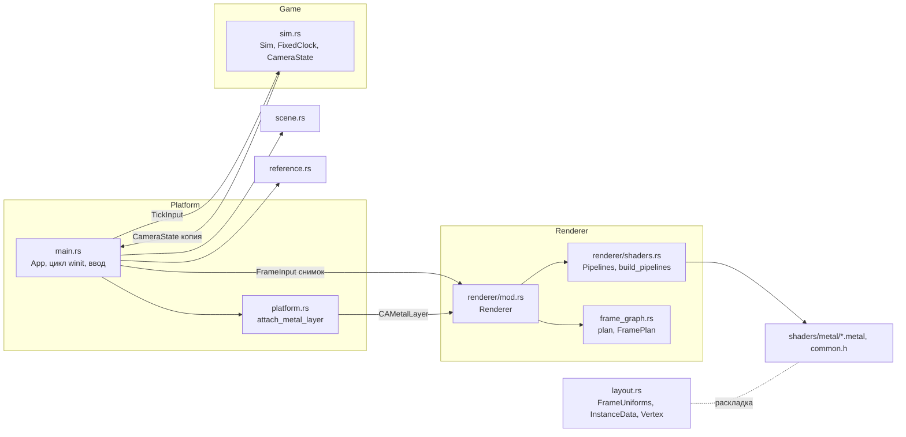
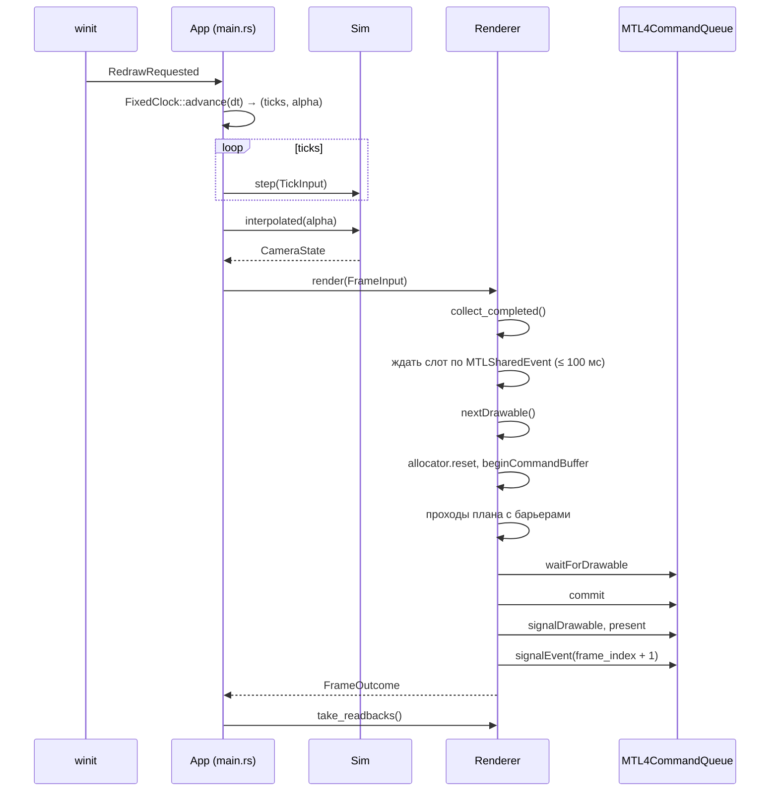

# Архитектура движка «Эхо мицелия»

Живой документ: описывает код в том виде, в котором он есть сейчас. Правила обновления — в [AGENTS.md](../AGENTS.md#архитектура).

- Состояние на — 2026-11-07, ревизия `22c3804` и правки после неё
- Покрытые этапы — [00. Платформа и архитектура](../specs/00-platform.md) (`completed`), [01. Основа Metal 4](../specs/01-metal-foundation.md) (`partial`)
- Отчёты — [00](../reports/00-platform.md), [01](../reports/01-metal-foundation.md)
- Язык и API — Rust 1.99.1 (edition 2024), Metal 4 через `objc2-metal` 0.3.2, MSL

## Содержание

1. [Границы подсистем](#1-границы-подсистем)
2. [Соглашения](#2-соглашения)
3. [Поток кадра](#3-поток-кадра)
4. [Модули, структуры и методы](#4-модули-структуры-и-методы)
5. [Шейдеры и привязки](#5-шейдеры-и-привязки)
6. [Синхронизация и время жизни ресурсов](#6-синхронизация-и-время-жизни-ресурсов)
7. [Планировщик проходов](#7-планировщик-проходов)
8. [Самопроверка](#8-самопроверка)
9. [Соответствие спецификациям](#9-соответствие-спецификациям)
10. [Архитектурные решения и причины](#10-архитектурные-решения-и-причины)
11. [Ограничения и ближайшие изменения](#11-ограничения-и-ближайшие-изменения)
12. [Журнал изменений](#12-журнал-изменений)

## 1. Границы подсистем

[Спецификация 00](../specs/00-platform.md#границы-в-коде) задаёт четыре части: `Platform`, `World`, `Game`, `Renderer`. Сейчас они разложены по модулям так:

| Часть из спецификации | Модуль | Ответственность сейчас | Чего ещё нет |
| --- | --- | --- | --- |
| `Platform` | `src/platform.rs`, цикл окна и ввод в `src/main.rs` | Окно winit, ввод, `CAMetalLayer` на `NSView` | Отдельный модуль цикла и ввода, файловые пути |
| `World` | — | — | Тайлы, биомы, `SampleGround` (этап 02) |
| `Game` | `src/sim.rs` | Фиксированный тик, состояние камеры | Игрок, задания, события (этап 05) |
| `Renderer` | `src/renderer/` | Устройство, очередь, ресурсы, проходы, синхронизация, вывод | Счётчики GPU, общий RHI (этап 06) |
| Общие данные | `src/layout.rs`, `shaders/metal/common.h` | Раскладка структур CPU/GPU | — |
| Описание проходов | `src/frame_graph.rs` | Проходы, ресурсы, барьеры без зависимости от API | Стадия indirect-аргументов (этап 02) |
| Тестовая сцена | `src/scene.rs` | Куб и два экземпляра | Заменяется ландшафтом в этапе 02 |
| Эталоны | `src/reference.rs` | CPU-эталоны узора и глубины | — |

Правила границ, проверенные в коде:

- Нативные типы (`objc2`, `raw-window-handle`) подключены только в `platform.rs` и `renderer/`. Все вхождения `unsafe` там же: 1 в `platform.rs`, 19 в `renderer/`.
- `Game` не знает о рендере. `Renderer` получает копию состояния через `FrameInput` и не может изменить симуляцию.
- winit 0.30 использует objc2 0.5, проект — objc2 0.6. Связь идёт через сырой указатель `NSView` из `raw-window-handle`, поэтому типы двух версий не смешиваются.

## 2. Соглашения

| Тема | Правило | Где закреплено |
| --- | --- | --- |
| Единицы | Метры, секунды | `sim.rs` |
| Система координат | Правая, Y вверх, при `yaw = 0` камера смотрит в −Z | `CameraState::forward`, тест `yaw_zero_looks_down_negative_z` |
| Матрицы | Векторы-столбцы, `clip = P * V * M * p`, хранение по столбцам (`to_cols_array_2d`) | `layout.rs`, `scene.metal` |
| Глубина | Клип [0, 1], reversed-Z: ближняя плоскость 1, бесконечность 0, очистка 0, тест `GreaterEqual` | `sim::projection`, `Renderer::new`, тест `reversed_z_maps_near_to_one_and_far_to_zero` |
| Лицевая сторона | CCW, отсечение задних граней | `scene::cube`, `setFrontFacingWinding(CounterClockwise)`, тест `cube_triangles_face_outward` |
| Экран | Начало в левом верхнем углу | `reference::expected_depth` |
| Цвет | Линейный HDR `RGBA16Float`, одно преобразование в sRGB форматом `BGRA8Unorm_sRGB` | `shaders.rs`, `tonemap.metal` |
| Общие GPU-данные | `#[repr(C)]`, `align(16)` для uniform-структур, `bytemuck::Pod`, проверка смещений на CPU и GPU | `layout.rs`, ядро `layout_probe` |
| Время симуляции | Тик 1/60 с, не больше 5 догоняющих тиков, кадр длиннее 0,25 с обрезается | `sim.rs` |

## 3. Поток кадра

Порядок проходов: `pattern` (compute) → `scene` (render) → `readback` (compute, только по запросу) → `tonemap` (render).

## 4. Модули, структуры и методы

### 4.1. `src/main.rs` — приложение и цикл кадра

Связывает подсистемы. Управление: клик — захват мыши, WASD, E/Q, Shift, Esc, F5 — перезагрузка MSL, F9 — readback, F12 — GPU capture. Аргументы: `--selftest`, `--capture-frame N`.

| Элемент | Вид | Описание |
| --- | --- | --- |
| `LIGHT_DIR` | `const Vec3` | Направление света от источника к сцене, нормируется при записи в uniforms |
| `Args { selftest, capture_frame }` | struct | Аргументы командной строки. `Args::parse()` разбирает `std::env::args` |
| `start_camera()` | fn | Стартовая и контрольная поза камеры `(0.4, 1.4, 3.6)`, `pitch = −0.3` |
| `TestStep` | enum | Шаги самопроверки: `Warmup`, `ReadbackA`, `HotReload`, `AfterBrokenReload { frames }`, `Resize`, `ReadbackB`, `Done` |
| `SelfTest` | struct | Состояние самопроверки: `step`, `frames_in_step`, `failures`, `log`, `resize_target`, `size_before`. `check(ok, what)` печатает `[pass]`/`[FAIL]` и копит ошибки |
| `App` | struct | Состояние приложения, см. ниже |
| `verify_readback(t, rb, view, proj)` | fn | Сверяет readback с эталонами: узор, глубина в 9 точках с покрытием обоих кубов, 13 полей раскладки |
| `report_readback(rb, view, proj)` | fn | То же для F9 в обычном режиме, вывод в stderr |
| `main()` | fn | Создаёт `EventLoop` (`ControlFlow::Poll`), запускает `App`, выходит с `exit_code` |

Поля `App`:

| Поле | Тип | Назначение |
| --- | --- | --- |
| `args` | `Args` | Режимы запуска |
| `window` | `Option<Arc<Window>>` | Окно, создаётся в `resumed` |
| `renderer` | `Option<Renderer>` | Бэкенд, удаляется в `exiting` до освобождения окна |
| `sim` | `Sim` | Состояние симуляции |
| `clock` | `FixedClock` | Аккумулятор времени |
| `keys` | `HashSet<KeyCode>` | Зажатые клавиши, очищаются при потере фокуса |
| `look` | `(f32, f32)` | Накопленный поворот мыши до следующего тика |
| `grabbed` | `bool` | Курсор захвачен |
| `last_frame`, `started`, `title_timer` | `Instant` | Время кадра, время с запуска, период обновления заголовка |
| `frames_since_title` | `u32` | Кадры для расчёта fps в заголовке |
| `last_error` | `Option<String>` | Последняя ошибка MSL (файл и стадия) |
| `readback_requested`, `capture_requested` | `bool` | Запросы F9 и F12 на следующий кадр |
| `selftest` | `Option<SelfTest>` | Активна при `--selftest` |
| `exit_code` | `i32` | 0 — успех, 1 — провал самопроверки, 2 — ошибка запуска |

Методы `App`:

| Метод | Что делает |
| --- | --- |
| `new(args)` | Начальное состояние, `Sim` со стартовой камерой |
| `set_grab(grab)` | `CursorGrabMode::Locked`, при неудаче `Confined`; скрывает курсор; сбрасывает `look` |
| `reload_shaders()` | Вызывает `Renderer::reload_shaders(None)`, пишет результат в stderr и заголовок |
| `tick_input()` | Строит `TickInput` из `keys`; поворот мыши добавляется в `frame` |
| `update_title(force)` | Раз в 0,5 с: GPU, ОС, размер, fps, CPU-время кодирования, поколение или ошибка MSL |
| `frame(event_loop)` | Шаг кадра: тики, интерполяция, `FrameUniforms`, `FrameInput`, вызов `render`, обработка readback |
| `selftest_step(...)` | Конечный автомат самопроверки, см. [раздел 8](#8-самопроверка) |

`ApplicationHandler for App`:

| Обработчик | Поведение |
| --- | --- |
| `resumed` | Создаёт окно 1280 × 720 pt, `probe_device`, `attach_metal_layer`, `Renderer::new`, первый `resize`. Ошибка → stderr и код 2 |
| `window_event` | `CloseRequested` → выход; `Resized` → `Renderer::resize`; `Focused(false)` → очистка клавиш и освобождение мыши; клик → захват; клавиши; `RedrawRequested` → `frame` |
| `device_event` | `MouseMotion` добавляет относительное смещение в `look`, если мышь захвачена |
| `about_to_wait` | `request_redraw` для непрерывного вывода |
| `exiting` | Удаляет `Renderer` (его `Drop` ждёт GPU) |

Поворот мыши за кадр целиком уходит в первый тик кадра. Для воспроизводимой записи ввода его нужно будет хранить по тикам.

### 4.2. `src/platform.rs` — поверхность вывода

| Элемент | Сигнатура | Описание |
| --- | --- | --- |
| `attach_metal_layer` | `fn(&Window) -> Result<Retained<CAMetalLayer>, String>` | Берёт `NSView` из `RawWindowHandle::AppKit`, создаёт `CAMetalLayer`, включает `wantsLayer`, ставит слой и `contentsScale`. Вызывается на главном потоке из обработчика winit |

### 4.3. `src/sim.rs` — фиксированный шаг и камера (`Game`)

Константы: `TICK_DT = 1/60`, `MAX_CATCHUP_TICKS = 5`, `MAX_FRAME_DT = 0.25`, `MOVE_SPEED = 4.0` м/с, `FAST_MULTIPLIER = 3.0`, `MOUSE_SENSITIVITY = 0.0025` рад/пиксель, `PITCH_LIMIT = 1.55` рад.

| Тип | Поля | Методы |
| --- | --- | --- |
| `TickInput` | `forward`, `right`, `up` ∈ [−1, 1]; `look_dx`, `look_dy` в пикселях; `fast` | — (команда одного тика) |
| `CameraState` | `position: Vec3`, `yaw`, `pitch` | `forward()` — единичный вектор взгляда; `view()` — `Mat4::look_to_rh`; `lerp(other, t)` — линейная интерполяция позы |
| `Sim` | `tick: u64`, `prev`, `curr: CameraState` | `new(start)`; `step(&TickInput)` — поворот, ограничение pitch, движение с нормировкой вектора, `tick += 1`; `interpolated(alpha)` |
| `FixedClock` | `accumulator` (приватное), `dropped_ticks` | `advance(frame_dt) -> (ticks, alpha)` — обрезает `dt`, считает тики, при превышении лимита отбрасывает долг и увеличивает `dropped_ticks` |

Свободная функция `projection(aspect) -> Mat4` — `perspective_infinite_reverse_rh`, FOV 70°, near 0,05 м.

Инвариант: состояние на тике N зависит только от команд тиков 0..N. Тест `same_ticks_same_state_at_30_60_120_fps`.

### 4.4. `src/layout.rs` — общие данные CPU/GPU

| Структура | Размер, выравнивание | Поля и смещения |
| --- | --- | --- |
| `FrameUniforms` | 112 Б, 16 | `view_proj [[f32;4];4]` @0, `camera_pos [f32;4]` @64, `light_dir [f32;4]` @80, `time f32` @96, `exposure f32` @100, `pattern_time f32` @104, `frame_index u32` @108 |
| `InstanceData` | 80 Б, 16 | `model [[f32;4];4]` @0, `tint [f32;4]` @64 |
| `Vertex` | 32 Б, 4 | `position [f32;3]` @0, `normal [f32;3]` @12, `uv [f32;2]` @24. В MSL — `packed_float3`, `packed_float3`, `float2` |

| Элемент | Описание |
| --- | --- |
| `expected_probe() -> [u32; 13]` | Ожидаемые размеры и смещения в порядке записи ядра `layout_probe` |
| `LAYOUT_PROBE_LEN = 13`, `LAYOUT_PROBE_NAMES` | Длина и имена полей для диагностики |

Изменение любой структуры требует правки `common.h` в той же правке; несовпадение ловят тест `cpu_layout_matches_msl_rules` и самопроверка.

### 4.5. `src/frame_graph.rs` — проходы и барьеры

Не зависит от Metal. Алгоритм — в [разделе 7](#7-планировщик-проходов).

| Тип | Описание |
| --- | --- |
| `ResourceId(u32)` | Логический ресурс кадра |
| `Stages(u32)` | Битовая маска стадий: `NONE`, `VERTEX`, `FRAGMENT`, `DISPATCH`, `BLIT`. Методы `is_empty`, `contains`, операторы `|`, `|=` |
| `PassKind` | `Compute` (разрешены `DISPATCH`, `BLIT`) или `Render` (`VERTEX`, `FRAGMENT`). Приватный `allowed()` |
| `Hazard` | `Raw`, `War`, `Waw` |
| `PassDecl` | `name`, `kind`, `reads`, `writes` — списки `(ResourceId, Stages)` |
| `Barrier` | `after`, `before: Stages`, `hazards: Vec<(ResourceId, Hazard)>` — один барьер перед проходом |
| `FramePlan` | `passes` и `barriers` с совпадающими индексами |
| `GraphError` | `ReadBeforeWrite { pass, resource }`, `StageNotAllowed { pass, stages }`, реализует `Display` |
| `Track` (приватный) | `last_write`, `reads_since_write` для одного ресурса |
| `plan(passes, imported) -> Result<FramePlan, GraphError>` | Валидация и вычисление барьеров |

### 4.6. `src/renderer/mod.rs` — бэкенд Metal 4

Константы:

| Константа | Значение | Смысл |
| --- | --- | --- |
| `FRAME_SLOTS` | 2 | Кадров в полёте |
| `SLOT_WAIT_TIMEOUT_MS` | 100 | Таймаут ожидания слота, после — пропуск кадра |
| `UPLOAD_BYTES` | 4096 | Upload-буфер слота |
| `INSTANCE_OFFSET` | 256 | Начало экземпляров в upload |
| `MAX_INSTANCES` | 48 | `(4096 − 256) / 80` |
| `RES_PATTERN … RES_READBACK` | 1…5 | `ResourceId` для планировщика |
| `RB_*`, `DEPTH_SAMPLES` | см. [раздел 6](#раскладка-буферов) | Раскладка readback и 9 точек проверки глубины |

Публичные типы:

| Тип | Поля и смысл |
| --- | --- |
| `DeviceInfo` | `name`, `os`, `metal4`, `apple_family: Option<u32>`, `raytracing`, `raytracing_from_render: Option<bool>` (`None` в режиме capture). `Display` печатает строку диагностики |
| `FrameOutcome` | `Presented`, `SkippedZeroSize`, `SkippedNoDrawable`, `SkippedBusySlot` |
| `FrameInput<'a>` | Снимок для кадра: `uniforms: FrameUniforms`, `instances: &[InstanceData]`, `readback: bool`, `capture: Option<PathBuf>` |
| `Readback` | `frame`, `pattern_time`, `width`, `height`, `pattern: Vec<u8>` (RGBA8 256 × 256), `depth: Vec<(x, y, f32)>`, `probe: [u32; 13]` |
| `Stats` | `presented`, `skipped_busy`, `skipped_no_drawable`, `released_deferred`, `cpu_encode_ms` |

Приватные типы:

| Тип | Поля и смысл |
| --- | --- |
| `PendingReadback` | `signal_value` (значение события, после которого можно читать), `frame`, `pattern_time`, `width`, `height`, `pixels` (точки глубины) |
| `FrameSlot` | `allocator: MTL4CommandAllocator`, `cmd: MTL4CommandBuffer`, `tables: [MTL4ArgumentTable; 4]` (pattern, scene, readback, tonemap), `upload: MTLBuffer`, `signal_value: u64` |
| `Targets` | `width`, `height`, `hdr` (`RGBA16Float`), `depth` (`Depth32Float`), обе `Private` |
| `Retired` | `after_value`, `textures` (удаляются из residency set), `_keep_alive: Option<Box<dyn Any>>` (например, старые `Pipelines`) |

Поля `Renderer`:

| Поле | Тип | Назначение |
| --- | --- | --- |
| `info` | `DeviceInfo` | Диагностика адаптера |
| `device` | `MTLDevice` | Устройство |
| `queue` | `MTL4CommandQueue` | Единственная очередь для compute, render и copy |
| `compiler` | `MTL4Compiler` | Сборка pipeline |
| `layer` | `CAMetalLayer` | Поверхность вывода, `BGRA8Unorm_sRGB`, `framebufferOnly`, 3 drawable |
| `residency` | `MTLResidencySet` | Все ресурсы движка; добавлен в очередь вместе с `layer.residencySet()` |
| `event` | `MTLSharedEvent` | Номер последнего завершённого кадра |
| `depth_state` | `MTLDepthStencilState` | `GreaterEqual`, запись глубины |
| `slots` | `Vec<FrameSlot>` | Два слота кадра |
| `pipelines` | `Pipelines` | Текущее поколение pipeline |
| `targets` | `Option<Targets>` | `None` при нулевом размере окна |
| `pattern_tex` | `MTLTexture` | 256 × 256 `RGBA8Unorm`, `ShaderRead | ShaderWrite` |
| `vertex_buf`, `index_buf` | `MTLBuffer` | Куб в `StorageModeShared` |
| `index_count` | `usize` | 36 |
| `readback_buf` | `MTLBuffer` | Общий буфер readback |
| `plan`, `plan_readback` | `FramePlan` | Планы без readback и с ним |
| `frame_index` | `u64` | Число отправленных кадров |
| `retired` | `Vec<Retired>` | Ожидают завершения GPU |
| `pending_readback` | `Option<PendingReadback>` | Не больше одного readback в полёте |
| `completed_readbacks` | `Vec<Readback>` | Готовые результаты |
| `shader_dir` | `PathBuf` | Каталог MSL |
| `stats` | `Stats` | Счётчики |

Методы `Renderer`:

| Метод | Описание |
| --- | --- |
| `new(device, info, layer, vertices, indices) -> Result<Renderer, String>` | Проверяет Metal 4, настраивает слой, создаёт очередь, компилятор, событие, residency set, depth state, pipeline, буферы, текстуру узора, два слота с таблицами, строит оба плана |
| `size() -> Option<(u32, u32)>` | Размер целей |
| `pipeline_generation() -> u32` | Поколение pipeline |
| `frame_index() -> u64` | Отправлено кадров |
| `shader_dir() -> &Path` | Каталог MSL |
| `plan_summary() -> String` | Текстовый план с барьерами |
| `resize(width, height, scale)` | Нулевой размер → цели уходят в `retired`, вывод пропускается. Иначе новые цели по пиксельному размеру, добавление в residency set, старые — в `retired` |
| `reload_shaders(over) -> Result<u32, ShaderError>` | Собирает новый набор; при успехе подменяет, старый уходит в `retired`; при ошибке текущий не трогается |
| `collect_completed()` | Освобождает `retired` по значению события, забирает готовый readback |
| `take_readbacks() -> Vec<Readback>` | Отдаёт готовые результаты |
| `wait_idle()` | Ждёт все отправленные кадры, до 2 с |
| `render(&FrameInput) -> FrameOutcome` | Кадр целиком, см. [раздел 3](#3-поток-кадра) и [раздел 6](#6-синхронизация-и-время-жизни-ресурсов) |
| `retire(textures, other)` (приватный) | Ставит ресурс в очередь освобождения с `after_value = frame_index` |
| `read_back(PendingReadback) -> Readback` (приватный) | Копирует данные из `readback_buf` |
| `start_capture(path) -> bool` (приватный) | `MTLCaptureManager` → `.gputrace`, нужен `MTL_CAPTURE_ENABLED=1` |
| `Drop` | `wait_idle()` |

Свободные функции модуля:

| Функция | Описание |
| --- | --- |
| `probe_device() -> Result<(device, DeviceInfo), String>` | `MTLCreateSystemDefaultDevice`, семейство Apple10…7, Metal 4, признаки трассировки |
| `capture_enabled()` | `MTL_CAPTURE_ENABLED == "1"`; при capture признаки трассировки не запрашиваются |
| `flag(Option<bool>)` | Текст «да», «нет», «не запрошено (capture)» |
| `label(&str)` | `NSString` для подписей ресурсов |
| `to_mtl_stages(Stages) -> MTLStages` | Перевод стадий планировщика в Metal |
| `as_allocation(&obj)` | Приведение буфера или текстуры к `MTLAllocation` для residency set |
| `shared_buffer(device, len, name)` | Буфер `StorageModeShared` с подписью |
| `upload_bytes(buf, offset, bytes)` | Проверенная запись в shared-буфер |
| `private_texture(device, format, w, h, usage, name)` | 2D текстура `Private` с подписью |
| `frame_passes(readback) -> Vec<PassDecl>` | Объявление проходов кадра |

### 4.7. `src/renderer/shaders.rs` — MSL и pipeline

| Элемент | Описание |
| --- | --- |
| `Obj<T>` | `Retained<ProtocolObject<T>>` — владеющая ссылка на объект Metal |
| `HDR_FORMAT`, `DEPTH_FORMAT`, `DRAWABLE_FORMAT`, `PATTERN_FORMAT` | `RGBA16Float`, `Depth32Float`, `BGRA8Unorm_sRGB`, `RGBA8Unorm` |
| `Pipelines` | `pattern`, `layout_probe` (compute), `scene`, `tonemap` (render), `generation` |
| `ShaderError { file, stage, message }` | Стадии: `read`, `compile MSL`, `entry point`, `compute pipeline`, `render pipeline` |
| `SourceOverride<'a>` | `Option<(файл, текст)>` — подмена исходника в памяти для самопроверки |
| `shader_dir()` | `ECHO_SHADER_DIR` или `shaders/metal` рядом с `Cargo.toml` |
| `read_source(dir, file, over)` | Читает файл и подставляет текст `common.h` вместо `#include "common.h"` |
| `compile_library(device, dir, file, over)` | `newLibraryWithSource:options:error:` |
| `function(lib, name)` | `MTL4LibraryFunctionDescriptor` |
| `require_function(lib, file, name)` | Проверка точки входа по `functionNames` |
| `compute_pipeline(compiler, lib, file, name)` | `MTL4ComputePipelineDescriptor` → `MTL4Compiler` |
| `render_pipeline(compiler, lib, file, label, vs, fs, color_format)` | `MTL4RenderPipelineDescriptor` с одним цветовым вложением |
| `build_pipelines(device, compiler, dir, generation, over)` | Собирает все четыре pipeline или возвращает первую ошибку; частичный набор не публикуется |

### 4.8. `src/scene.rs` — тестовая сцена этапа 01

| Функция | Описание |
| --- | --- |
| `cube() -> (Vec<Vertex>, Vec<u16>)` | Куб [−0.5, 0.5]³: 6 граней по 4 вершины, 36 индексов, обход CCW снаружи |
| `instance_models() -> [Mat4; 2]` | Куб A: масштаб 1,2, поворот Y 0,4. Куб B: масштаб 0,9, поворот X 0,6 и Y −0,3, сдвиг (0,65; 0,35; 0,45), пересекает A |
| `instances() -> [InstanceData; 2]` | Матрицы и оттенки для GPU |
| `boxes() -> Vec<Box3>` | Те же кубы для CPU-эталона |

### 4.9. `src/reference.rs` — CPU-эталоны

| Элемент | Описание |
| --- | --- |
| `PATTERN_SIZE = 256`, `SELFTEST_PATTERN_TIME = 1.25` | Размер узора и фиксированное время самопроверки |
| `pattern_color(x, y, size, t) -> [f32; 3]` | Повторяет `pattern_color` из `common.h`: градиент, шахматка 32 px, полосы по синусу |
| `compare_pattern(pixels, size, t, tolerance) -> (mismatches, max_diff)` | Сверка RGBA8 с эталоном в единицах 1/255 |
| `Box3 { model }` | Куб для пересечения лучом |
| `ray_box(origin, dir, box)` (приватная) | Метод плит в локальных координатах куба |
| `expected_depth(px, py, w, h, view, proj, boxes) -> f32` | Луч из центра пикселя, ближайшее попадание, reversed-Z глубина; 0 — фон |

## 5. Шейдеры и привязки

Файлы в `shaders/metal/`. `common.h` подставляется в каждый файл при загрузке.

| Файл | Функции | Назначение |
| --- | --- | --- |
| `common.h` | `FrameUniforms`, `InstanceData`, `Vertex`, `pattern_color` | Общие типы и эталонная функция узора |
| `pattern.metal` | `pattern_main` (kernel), `layout_probe` (kernel) | Диагностический узор; запись размеров и смещений структур |
| `scene.metal` | `scene_vs`, `scene_fs` | Вершины из буфера по `vertex_id`, экземпляры по `instance_id`; ambient + Ламберт с текстурой узора |
| `tonemap.metal` | `tonemap_vs`, `tonemap_fs` | Полноэкранный треугольник без буфера; экспозиция и ACES (Narkowicz) |

Таблицы аргументов (`MTL4ArgumentTable`, по одной на проход в каждом слоте, до 4 буферов и 2 текстур):

| Проход | `buffer(0)` | `buffer(1)` | `buffer(2)` | `texture(0)` | Стадии |
| --- | --- | --- | --- | --- | --- |
| `pattern` | upload: `FrameUniforms` | — | — | `pattern_tex` (write) | compute |
| `scene` | `vertex_buf` | upload: `FrameUniforms` | upload + 256: `InstanceData[]` | `pattern_tex` (sample) | vertex, fragment |
| `readback` | `readback_buf` + `RB_PROBE_OFFSET` | — | — | — | compute |
| `tonemap` | — | upload: `FrameUniforms` | — | `hdr` (sample) | vertex, fragment |

Сэмплеры заданы в MSL через `constexpr sampler`, отдельные объекты сэмплеров не используются.

## 6. Синхронизация и время жизни ресурсов

### Слоты кадра и событие

- Кадр с номером N (с нуля) использует слот `N % 2` и после commit сигналит `MTLSharedEvent` значением `N + 1`. Это значение записывается в `slot.signal_value`.
- Перед записью в слот CPU ждёт `event ≥ slot.signal_value`. При таймауте 100 мс кадр пропускается (`SkippedBusySlot`) с сообщением в stderr.
- Других ожиданий CPU нет, кроме `wait_idle()` при выходе. В прогоне самопроверки пропусков 0.

### Вывод кадра

Схема Apple для Metal 4: `nextDrawable` → кодирование → `queue.waitForDrawable` → `commit` → `queue.signalDrawable` → `present`. Без drawable кадр пропускается (`SkippedNoDrawable`), при нулевом размере — `SkippedZeroSize`.

### Резидентность

Все буферы и текстуры движка добавлены в один `MTLResidencySet`, который подключён к очереди вместе с `layer.residencySet()`. Новые цели после resize добавляются сразу, старые удаляются в `collect_completed` после завершения кадров, затем `commit()` набора.

### Отложенное освобождение

`retire` запоминает `after_value = frame_index`, то есть номер последнего отправленного кадра. `collect_completed` освобождает запись, когда `event.signaledValue() ≥ after_value`. Так освобождаются старые цели после resize и старые pipeline после перезагрузки MSL.

### Раскладка буферов

| Буфер | Диапазон | Содержимое |
| --- | --- | --- |
| upload слота (4096 Б) | 0..112 | `FrameUniforms` |
| | 256..4096 | до 48 `InstanceData` |
| `readback_buf` (262 656 Б) | 0..262 144 | узор RGBA8, строка 1024 Б |
| | 262 144..262 400 | глубина `f32` в 9 точках `DEPTH_SAMPLES` |
| | 262 400..262 656 | 13 значений `u32` из `layout_probe` |

`readback_buf` один на приложение, поэтому в полёте не больше одного readback. Данные читаются после сигнала кадра, в котором стоят копии.

## 7. Планировщик проходов

`frame_graph::plan`:

1. Проверяет, что стадии прохода разрешены его типом, и что каждый прочитанный ресурс записан раньше в кадре или помечен импортированным. Иначе `GraphError`.
2. Дважды проходит список. Первый круг собирает состояние ресурсов предыдущего кадра, второй выдаёт барьеры. Так учитываются зависимости через границу кадров в одной очереди.
3. Для чтения: если есть предыдущая запись — RAW, `after |= стадия записи`.
4. Для записи: если были чтения после последней записи — WAR по стадиям чтений; иначе, если была запись — WAW.
5. Все зависимости прохода сливаются в один барьер `after → before`.

Бэкенд Metal 4 кодирует барьер в начале кодировщика прохода: `barrierAfterQueueStages:beforeStages:visibilityOptions:` с `MTL4VisibilityOptions::Device`.

План с readback, как его печатает самопроверка:

| Проход | after | before | Зависимости |
| --- | --- | --- | --- |
| `pattern` | `FRAGMENT \| BLIT` | `DISPATCH` | WAR `pattern` (чтения прошлого кадра) |
| `scene` | `FRAGMENT \| DISPATCH \| BLIT` | `FRAGMENT` | RAW `pattern`, WAR `hdr`, WAR `depth` |
| `readback` | `FRAGMENT \| DISPATCH \| BLIT` | `DISPATCH \| BLIT` | RAW `pattern`, RAW `depth`, WAW `readback` |
| `tonemap` | `FRAGMENT` | `FRAGMENT` | RAW `hdr`, WAW `drawable` |

Слияние зависимостей в один барьер иногда синхронизирует больше необходимого. Это принятое упрощение этапа 01.

## 8. Самопроверка

`./target/debug/echo --selftest` с фиксированной камерой и `pattern_time = 1.25`. Рекомендуемый запуск: `MTL_DEBUG_LAYER=1 MTL_DEBUG_LAYER_ERROR_MODE=assert MTL_SHADER_VALIDATION=1`.

| Шаг | Условие перехода | Проверки |
| --- | --- | --- |
| `Warmup` | 5 кадров | Печать `DeviceInfo` и плана, запрос readback |
| `ReadbackA` | Готов readback | Узор 256 × 256, глубина в 9 точках с покрытием обоих кубов, 13 полей раскладки |
| `HotReload` | Сразу | Перезагрузка без изменений → поколение +1; ошибочный `pattern.metal` из памяти → ошибка с файлом и стадией, поколение не меняется |
| `AfterBrokenReload` | 3 кадра | Вывод продолжается; исправленная перезагрузка успешна; запрос размера окна 960 × 600 |
| `Resize` | Размер изменился и прошло 4 кадра | Новые цели, запрос readback |
| `ReadbackB` | Готов readback | Те же проверки при новом размере |
| `Done` | — | Статистика, `SELFTEST PASSED` и код 0 или `SELFTEST FAILED` и код 1. Предохранитель — 1000 кадров. Кадры, пришедшие после `exit()`, игнорируются, итог печатается один раз |

Модульные тесты (`cargo test`, 13): планировщик (5), раскладка (1), симуляция (4), эталон глубины и узора (2), обход граней куба (1).

## 9. Соответствие спецификациям

| Пункт спецификации | Реализация | Статус |
| --- | --- | --- |
| 00 · Rust, Metal 4, MSL | `Cargo.toml`, `objc2-metal`, `shaders/metal/` | Выполнено |
| 00 · Проверка GPU в приложении | `probe_device`, `DeviceInfo` | Выполнено |
| 00 · Границы `Platform`/`World`/`Game`/`Renderer` | [Раздел 1](#1-границы-подсистем) | `World` появится в 02 |
| 00 · Единицы, координаты, reversed-Z, CCW | [Раздел 2](#2-соглашения) | Выполнено, покрыто тестами |
| 00 · `#[repr(C)]` и проверка на GPU | `layout.rs`, `layout_probe` | Выполнено |
| 00 · Линейный HDR, одно преобразование в sRGB | `HDR_FORMAT`, `DRAWABLE_FORMAT`, `tonemap.metal` | Выполнено |
| 01.1 · winit, `CAMetalLayer`, Debug-компиляция MSL, подписи | `platform.rs`, `shaders.rs`, `label` | Выполнено; офлайн `.metallib` не сделан (нет Metal Toolchain) |
| 01.2 · `MTL4CommandQueue`, буфер, аллокатор, таблицы, резидентность, drawable | `Renderer::new`, `render` | Выполнено |
| 01.3 · Два слота, `MTLSharedEvent`, таймаут, resize, свёрнутое окно | `FrameSlot`, `render`, `resize`, `Retired` | Выполнено; сворачивание вручную не проверено |
| 01.4 · Куб, `Depth32Float`, `RGBA16Float`, тонмаппинг | `scene.rs`, `Targets`, `tonemap.metal` | Выполнено |
| 01.5 · Ввод, фиксированный шаг, интерполяция | `App`, `sim.rs` | Выполнено; ввод вручную не проверен |
| 01.6 · Compute → fragment, сверка с эталоном | `pattern_main`, барьер, `verify_readback` | Выполнено |
| 01.7 · Перезагрузка MSL | `reload_shaders`, `ShaderError` | Выполнено; схема аргументов проверяется только по точкам входа |
| 01 · Описание проходов, RAW/WAR/WAW | `frame_graph.rs` | Выполнено; стадия indirect — в 02 |

## 10. Архитектурные решения и причины

Каждое решение записано в форме: что выбрано, почему, какие варианты отброшены и какой ценой, когда пересмотреть. Номера `AD-NN` постоянные: при пересмотре решение помечается как заменённое и получает ссылку на новое.

### AD-01. Rust и прямой Metal 4 вместо wgpu, Swift или C++

- **Решение.** Код движка на Rust, графика через нативный Metal 4 (`objc2-metal`), шейдеры на MSL.
- **Почему.** Цель проекта учебная: самим вести очереди, барьеры, резидентность и время жизни GPU-ресурсов. wgpu 30.0.1 на Metal использует прежний `MTLCommandQueue` и скрывает синхронизацию, поэтому Metal 4 через него не изучить. Rust даёт проверку владения для данных мира и симуляции, которые потом переедут на Windows без изменений.
- **Отброшено.** wgpu как основа (остаётся лабораторией в [07](../specs/07-shader-labs.md#wgpu-и-общий-исходник)); Swift (сложный путь на Windows); C++ (время жизни указателей без проверки компилятора).
- **Цена.** Много `unsafe` в бэкенде, отдельный бэкенд D3D12 в этапе 06.
- **Пересмотреть,** если Linux станет целью (Vulkan) или поддержка двух бэкендов окажется дороже пользы.

### AD-02. `objc2-metal` как привязка к Metal

- **Решение.** Привязки `objc2-metal` 0.3.2 и соседние крейты `objc2-*`.
- **Почему.** Они генерируются из заголовков SDK и уже содержат `MTL4CommandQueue`, `MTL4ArgumentTable`, `MTL4Compiler` и барьеры Metal 4. Отдельная ручная привязка устарела бы с каждым SDK.
- **Цена.** Почти все вызовы Metal идут через `Retained<ProtocolObject<dyn …>>`, часть методов помечена `unsafe`. В Debug objc2 проверяет наличие методов, отсюда особый случай GPU capture (AD-19).

### AD-03. Конкретный рендерер без общего RHI

- **Решение.** `Renderer` написан прямо на Metal 4. Общая граница — данные кадра (`FrameInput`, `layout.rs`) и описание проходов (`frame_graph.rs`).
- **Почему.** Абстракция над одним API угадывает форму второго. Общий слой выделяем, когда D3D12 повторит несколько реальных проходов ([06](../specs/06-d3d12-port.md), шаг 5).
- **Цена.** Часть кода бэкенда D3D12 будет написана заново.

### AD-04. Одна очередь для compute, render и copy

- **Решение.** Единственная `MTL4CommandQueue`.
- **Почему.** Простейшая корректная модель синхронизации: порядок задают барьеры внутри очереди, межочередные события не нужны. Объём работы этапа 01 не требует параллельного compute.
- **Пересмотреть,** когда профиль покажет простой GPU, который закроет async compute (FFT воды, отбор растительности).

### AD-05. Два слота кадра

- **Решение.** `FRAME_SLOTS = 2`, у каждого свой аллокатор, командный буфер, таблицы аргументов и upload-буфер.
- **Почему.** CPU готовит кадр N+1, пока GPU выполняет кадр N, при задержке ввода не больше одного кадра. Память аллокатора Metal 4 и upload можно переписывать только после завершения GPU, поэтому они принадлежат слоту.
- **Отброшено.** Три слота: дают запас при неровном GPU, но добавляют кадр задержки. Drawable у слоя и так три.

### AD-06. `MTLSharedEvent` с таймаутом и пропуском кадра

- **Решение.** Событие получает номер кадра. Перед повторным использованием слота CPU ждёт не дольше 100 мс, иначе пропускает кадр с диагностикой.
- **Почему.** Одно монотонное значение отвечает сразу на три вопроса: свободен ли слот, можно ли освободить ресурс, готов ли readback. Таймаут не даёт зависнуть приложению при сбое GPU и делает проблему видимой. CPU ждёт только там, где без завершения GPU нельзя продолжить, как требует спецификация.

### AD-07. Один residency set плюс набор слоя

- **Решение.** Все ресурсы движка в одном `MTLResidencySet`, подключённом к очереди вместе с `layer.residencySet()`.
- **Почему.** В Metal 4 резидентность явная: ресурс, которого нет в наборе, GPU не видит. При десятке ресурсов один набор проще всего проверять.
- **Пересмотреть** в этапе 08: при стриминге тайлов понадобятся наборы по группам ресурсов.

### AD-08. Барьеры из описания проходов, независимого от API

- **Решение.** Проходы объявляют чтения, записи и стадии. `frame_graph::plan` вычисляет RAW, WAR и WAW, бэкенд кодирует барьер своего API.
- **Почему.** Metal 4 не отслеживает зависимости сам, и ручная расстановка барьеров легко ломается при добавлении прохода. Описание в данных проверяется тестами без GPU и переиспользуется для D3D12. Циклический анализ ловит WAR через границу кадров: следующий `pattern` не должен писать, пока прошлый `scene` читает текстуру.
- **Упрощение.** Все зависимости прохода сливаются в один барьер `after → before`. Иногда это синхронизирует больше нужного, зато один вызов на кодировщик. Уточним, если профиль покажет простои.

### AD-09. Reversed-Z с бесконечной дальней плоскостью и `Depth32Float`

- **Решение.** Ближняя плоскость 0,05 м даёт глубину 1, бесконечность — 0, тест `GreaterEqual`.
- **Почему.** У float больше точности около нуля. Reversed-Z переносит эту точность на дальние расстояния, где она нужна большой карте с лесом и берегом. Бесконечная дальняя плоскость убирает подбор far для разных сцен.
- **Цена.** Очистка глубины нулём и обратный тест везде, включая будущие тени и D3D12.

### AD-10. HDR-буфер и отдельный проход тонмаппинга

- **Решение.** Сцена пишет линейный `RGBA16Float`, тонмаппинг (ACES) выводит в `BGRA8Unorm_sRGB`.
- **Почему.** Освещение складывается в линейном пространстве и не обрезается до 1. Экспозиция, bloom и ночные сцены этапа 04 работают с этим буфером. Формат drawable делает одно преобразование в sRGB, без ручной гаммы в шейдере.

### AD-11. Вершины из буфера по `vertex_id` без vertex descriptor

- **Решение.** `scene_vs` читает `Vertex` по индексу из `buffer(0)`.
- **Почему.** Меньше состояния pipeline. Тот же приём подходит данным, которые позже сгенерирует compute (частицы, отбор экземпляров), и близок к mesh-шейдерам из лаборатории 07.
- **Цена.** Раскладку вершины проверяет не Metal, а `layout_probe` и тесты.

### AD-12. Общие структуры через `#[repr(C)]` и проверку на GPU

- **Решение.** `layout.rs` и `common.h` описывают одни структуры. Ядро `layout_probe` пишет размеры и смещения, самопроверка сравнивает их с `offset_of!`.
- **Почему.** Ошибка выравнивания (`float3` против `packed_float3`) не даёт ошибки компиляции, а портит данные молча. Проверка на настоящем компиляторе MSL ловит её сразу.

### AD-13. Фиксированный тик 1/60 с, интерполяция, предел догоняющих тиков

- **Решение.** `Sim` меняется только в `step`, рендер интерполирует между `prev` и `curr`. Не больше 5 тиков за кадр, кадр длиннее 0,25 с обрезается.
- **Почему.** Этап 05 требует одинаковой последовательности событий при 30, 60 и 120 кадрах/с. Это возможно, только если результат зависит от числа тиков, а не от времени кадра. Предел не даёт циклу «догонять» сотни тиков после паузы в отладчике.
- **Цена.** Отрисовка отстаёт от симуляции до одного тика.

### AD-14. Компиляция MSL в рантайме и ручная подстановка `common.h`

- **Решение.** В Debug исходники компилируются через `newLibraryWithSource`. Строка `#include "common.h"` заменяется текстом заголовка.
- **Почему.** Metal Toolchain для офлайн-сборки не установлен, а перезагрузка по F5 всё равно требует компиляции в рантайме. API компиляции из строки не знает путей проекта, поэтому заголовок подставляется вручную.
- **Пересмотреть** при сборке Release с `.metallib`.

### AD-15. Атомарная подмена набора pipeline с поколениями

- **Решение.** `build_pipelines` собирает все четыре pipeline. Подмена только при полном успехе, старый набор уходит в `Retired`.
- **Почему.** Частично обновлённый набор может сочетать несовместимые шейдеры. Старые pipeline ещё используются кадрами в полёте, поэтому их нельзя освободить сразу. Номер поколения показывает в заголовке и логе, какая версия работает.

### AD-16. Отложенное освобождение по номеру кадра

- **Решение.** `Retired { after_value }` хранит ресурс до `event ≥ after_value`, затем удаляет его из residency set.
- **Почему.** Rust освобождает объект при `Drop`, а GPU может ещё читать его в отправленном кадре. Номер кадра переносит правило владения Rust на GPU. Это упражнение из маршрута чтения: `Drop` на CPU, освобождение GPU-памяти после последнего кадра.

### AD-17. Самопроверка через readback и независимые CPU-эталоны

- **Решение.** Режим `--selftest` читает с GPU узор, глубину и раскладку и сравнивает с эталонами из `reference.rs`.
- **Почему.** Скриншот не доказывает правильность матриц, обхода граней и глубины. Эталон глубины считается иначе, чем на GPU (луч и пересечение с кубом), поэтому совпадение до 1e-7 проверяет камеру, reversed-Z, отсечение задних граней и перекрытие одновременно. Самопроверка запускается без человека и даёт код выхода.

### AD-18. Статическая геометрия в `StorageModeShared`

- **Решение.** Вершины и индексы куба в shared-памяти без копирования в private.
- **Почему.** На Apple silicon память общая, и для 24 вершин копирование ничего не даёт. Явный upload появится, когда объём данных вырастет в этапе 02 и в порте 06 на дискретный GPU.

### AD-19. Признаки трассировки не запрашиваются при GPU capture

- **Решение.** При `MTL_CAPTURE_ENABLED=1` поля `raytracing` равны `None`.
- **Почему.** Capture оборачивает устройство в `CaptureMTLDevice`, который только пересылает `supportsRaytracing`. Проверка методов objc2 в Debug считает это ошибкой и завершает процесс. Признаки не нужны для записи кадра, а их отсутствие видно в диагностике.

### AD-20. Граница winit ↔ Metal через `raw-window-handle`

- **Решение.** `platform.rs` получает `NSView` как сырой указатель и создаёт `CAMetalLayer` своими типами objc2 0.6.
- **Почему.** winit 0.30 собран с objc2 0.5. Сырой указатель — единственное место стыка двух версий, поэтому их типы не смешиваются, а `unsafe` сосредоточен в одной функции.

### AD-21. Сэмплеры в MSL и диагностика в заголовке окна

- **Решение.** Сэмплеры объявлены `constexpr` в шейдерах. Ошибки MSL, fps и поколение pipeline выводятся в заголовок окна и stderr.
- **Почему.** Меньше объектов в таблицах аргументов. Текстового вывода в кадре пока нет, а заголовок виден всегда и не требует отдельного прохода.
- **Пересмотреть,** когда появится текстовый оверлей.

### AD-22. Debug-профиль: свой код без оптимизаций, зависимости с оптимизацией

- **Решение.** `[profile.dev] opt-level = 0` для крейта `echo`, `[profile.dev.package."*"] opt-level = 2` для зависимостей.
- **Почему.** При `opt-level = 1` LLDB видел встроенные функции и терял локальные переменные. Без оптимизаций свой код пошагово отлаживается в VS Code, а glam, objc2 и winit остаются быстрыми, поэтому кадр и самопроверка не замедляются заметно (CPU-кодирование кадра 0,1–0,5 мс).
- **Цена.** Чуть медленнее собственный код в Debug. Замеры производительности делать в Release.

## 11. Ограничения и ближайшие изменения

- Извлечение снимка сцены и цикл окна живут в `main.rs`. В этапе 02 выделить функцию извлечения `RenderScene` и модуль `World`.
- `vertex_buf` и `index_buf` в `StorageModeShared` без копирования в private-память. Явный upload появится вместе с тайлами 02 и портом 06.
- Барьер прохода сливает все зависимости в одну пару стадий.
- Перезагрузка MSL проверяет наличие точек входа, но не индексы привязок.
- Время GPU не измеряется: нужны `MTL4CounterHeap` и временные метки по проходам.
- Диагностика выводится в заголовок окна и stderr, текстового оверлея нет.
- Для этапа 02 планировщику нужна стадия indirect-аргументов (`compute output → indirect args`).

## 12. Журнал изменений

| Дата | Этап | Ревизия | Изменение |
| --- | --- | --- | --- |
| 2026-11-07 | 00, 01 | `22c3804` | Первая версия: модули `main`, `platform`, `sim`, `layout`, `frame_graph`, `renderer`, `renderer::shaders`, `scene`, `reference`; MSL `common.h`, `pattern`, `scene`, `tonemap`; самопроверка |
| 2026-11-07 | 00, 01 | `f5dc091` | Создан этот документ, раздел решений с причинами и правило ведения в `AGENTS.md`. Код не менялся |
| 2026-11-07 | 01 | после `f5dc091` | AD-22: Debug-профиль `opt-level = 0` для своего кода. `App::selftest_step` игнорирует кадры после завершения. Добавлена конфигурация VS Code (`.vscode/`): задачи сборки, тестов и самопроверки, отладка через LLDB DAP (Xcode) и CodeLLDB с Rust-форматтерами; кнопка ▶ Debug rust-analyzer использует CodeLLDB |
