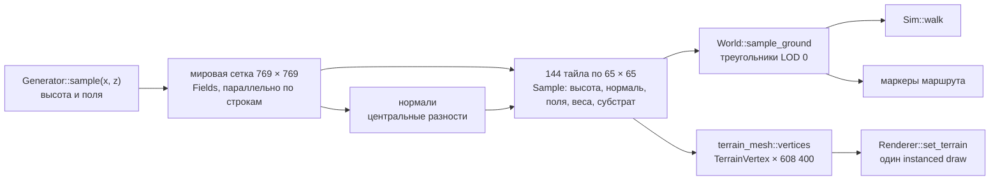

# Архитектура: мир и ландшафт

Подсистема этапа [02. Ландшафт и биомы](../specs/02-terrain-biomes.md). Общие правила, соглашения и решения — в [00-arch.md](00-arch.md); здесь — модули `src/world/` и `src/terrain_mesh.rs`, шейдер `terrain.metal` и данные маршрута. Ведётся по [правилам AGENTS.md](../AGENTS.md#архитектура).

- Состояние на — 2026-11-07, шаг 1 этапа 02 после ревизии `c4bcd6a`
- Отчёт — [reports/02-terrain-biomes.md](../reports/02-terrain-biomes.md)

## 1. Поток данных

Генерация детерминирована: результат зависит от `seed` и `GENERATOR_VERSION`, но не от числа потоков. Контрольная сумма `World::checksum` печатается при запуске (`261451dbad0d94d0` для seed `0xEC40`, версии 1).

## 2. Карта первого маршрута

Карта 12 × 12 тайлов, 768 × 768 м, seed `0xEC40`. Север — малые z, море — на юге (большие z).

| Элемент | Как задан | Где в коде |
| --- | --- | --- |
| Основной рельеф | 9 м + подъём к северу до 24 м + fbm 10 м (масштаб 170 м) + fbm 2,5 м (35 м) | `Generator::terrain_without_trail` |
| Каменистые гряды | ridged-шум 6 м восточнее x = 540…620 у берега | там же |
| Торфяник | чаша радиусом ~115 м с шумным краем, центр (395, 390), дно 7,5 м с кочками | там же |
| Море | береговая линия z ≈ 700 ± 22 м, дно до −7 м, `SEA_LEVEL` = 0 | `shoreline_z`, там же |
| Река | сплайн Катмулла — Рома, 9 опорных точек от (150, −10) к (545, 790); полуширина 3 → 9 м; дно не выше профиля 17 → −2,5 м и на 1,8 м ниже берегов | `Generator::first_map`, `river_half_width` |
| Тропа | сплайн 10 точек от (95, 120) через торфяник к (640, 665); полоса ±1,1…2,6 м выравнивается к высоте оси на 85 %; у реки маска обнуляется (место моста) | `Generator::sample` |
| Маркеры | начало тропы, склон над лесом (t = 0,18), край торфяника (t = 0,45), место моста (ближайшая к реке точка тропы), устье (точка реки на береговой линии), каменистый берег | `World::place_markers` |

Снимок карты сверху: `cargo test dump_map -- --ignored`, затем `scripts/rgb-to-png.py` → `target/world-map.png`.

## 3. Модули

### 3.1. `src/world/noise.rs`

Только целочисленный хеш и арифметика f32 без трансцендентных функций, чтобы результат совпал на Mac и Windows.

| Функция | Описание |
| --- | --- |
| `mix64(u64) -> u64` | splitmix64 |
| `hash01(seed, ix, iz) -> f32` | хеш узла решётки в [0, 1) |
| `value_noise(seed, x, z) -> f32` | value noise в [−1, 1], квинтическая интерполяция |
| `fbm(seed, x, z, octaves) -> f32` | сумма октав с поворотом решётки, нормирована в [−1, 1] |
| `smoothstep(e0, e1, x)`, `lerp(a, b, t)` | вспомогательные |

### 3.2. `src/world/generator.rs`

| Элемент | Вид | Описание |
| --- | --- | --- |
| `SEA_LEVEL` | `const f32` | 0 м |
| `PATH_QUERY_RADIUS` | `const f32` | 60 м — радиус, в котором `Path::nearest` ищет ось |
| `Path` | struct | `points`, `lengths` (накопленная длина); приватные `grid_min`, `grid_w`, `grid_h`, `cells` — сетка ускорения 16 × 16 м со списками сегментов в радиусе запроса |
| `Path::catmull_rom(control, per_segment)` | fn | уплотнение опорных точек, построение сетки |
| `Path::nearest(p) -> (d, t, q)` | fn | расстояние, параметр 0..1 по длине, точка на оси; дальше радиуса — `(∞, 0, p)` |
| `Path::point_at(t)`, `Path::length()` | fn | точка по параметру, длина |
| `Fields` | struct | `height`, `moisture` 0..1, `temperature` °C, маски `trail`, `river`, `coast`, `basin` |
| `Generator` | struct | `seed`, `size_m`, `river`, `trail`, `basin_center`, `basin_radius`, `shore_z` |
| `Generator::first_map(seed, size_m)` | fn | авторская раскладка первой карты |
| `Generator::shoreline_z(x)` | fn | z кромки моря |
| `Generator::sample(x, z) -> Fields` | fn | высота и поля в мировой точке |
| `river_half_width(t)` | fn | полуширина русла 3 → 9 м |
| `biome_weights(&Fields, slope) -> BiomeWeights` | fn | веса из полей, наклона (1 − ny) и масок, квадраты с нормировкой до суммы 1 |
| `substrate(&Fields, slope, &BiomeWeights, x) -> Substrate` | fn | песок у моря, камень на склонах > 0,35, галька в русле, камень/песок на берегу, торф, иначе почва |

Поля среды: влажность = 0,45 + шум + 0,45·торфяник + 0,35·близость реки + 0,15·берег − 0,012·(h − 10); температура = 15 − 0,0065·h + шум.

### 3.3. `src/world/mod.rs`

| Элемент | Вид | Описание |
| --- | --- | --- |
| `TILE_SIZE_M` = 64, `TILE_SAMPLES` = 65, `SAMPLE_STEP_M` = 1, `GENERATOR_VERSION` = 1 | const | параметры LOD 0 |
| `TileId { x, z }` | struct | целые координаты тайла; `origin()` — угол в метрах |
| `Substrate` | enum `u8` | `Soil` 0, `Peat` 1, `Sand` 2, `Rock` 3, `Gravel` 4 — те же числа в `TerrainVertex.material[0]` |
| `BiomeWeights { forest, peat, shore }` | struct | нормированные веса |
| `Sample` | struct | `height`, `normal`, `moisture`, `temperature`, `substrate`, `weights`, `trail`, `river` |
| `Tile` | struct | `id`, `world_seed`, `generator_version`, `samples` (65 × 65, строки по z); `at(i, j)` |
| `GroundSample` | struct | `height`, `normal` (треугольника LOD 0), `substrate`, `on_trail`, `wet` (русло или ниже моря), `tile` |
| `Ground` | trait | `sample_ground(x, z) -> Option<GroundSample>`; `None` за картой. Реализуют `World` и тестовые поверхности |
| `MarkerKind`, `Marker { name, kind, position }` | enum, struct | авторские точки маршрута |
| `World` | struct | `seed`, `tiles_x`, `tiles_z`, `generator`, `tiles` (индекс `z * tiles_x + x`), `markers` |
| `World::generate(seed, tiles_x, tiles_z)` | fn | 1) поля на мировой сетке параллельно по строкам; 2) нормали центральными разностями по той же сетке; 3) нарезка на тайлы с общими граничными точками; 4) маркеры |
| `World::tile(id)`, `size_m()`, `marker(kind)` | fn | доступ |
| `World::checksum()` | fn | хеш всех тайлов и их метаданных |
| `impl Ground for World` | — | точка → тайл → ячейка → треугольник (a, c, b) при fx ≥ fz, иначе (a, d, c); высота — барицентрическая, нормаль — грани; свойства — от ближайшего узла |

Треугольники ячейки (i, j): a = (i, j), b = (i+1, j), c = (i+1, j+1), d = (i, j+1), диагональ a–c, обход CCW сверху. Этот же разбор использует `terrain_mesh::tile_indices`, поэтому столкновения совпадают с отрисовкой LOD 0.

### 3.4. `src/terrain_mesh.rs`

| Элемент | Описание |
| --- | --- |
| `VERTICES_PER_TILE` = 4225 | вершин в тайле |
| `tile_indices() -> Vec<u16>` | 24 576 индексов одной сетки 65 × 65, общие для всех тайлов |
| `vertices(&World) -> Vec<TerrainVertex>` | вершины всех тайлов подряд в порядке `world.tiles`, позиции в мировых метрах |
| `detail_texture(seed, size) -> Vec<u8>` | бесшовный периодический шум RGBA8: R — зернистость, G — пятна, B — камешки |

## 4. Отрисовка

| Что | Как |
| --- | --- |
| Буферы | `terrain vertices (all tiles)` — 608 400 × 32 Б = 19,5 МБ; `terrain tile indices` — 49 КБ; оба `StorageModeShared` |
| Текстура | `terrain detail (mipmapped)` 512 × 512 RGBA8, 10 mip-уровней; mip строятся на GPU одноразовым командным буфером (копия → барьер blit → blit → `generateMipmaps`), CPU ждёт завершения |
| Вызов | в проходе `scene` до кубов: `drawIndexedPrimitives(instanceCount: 144)`; группа отладки `terrain: 144 tiles` |
| Вершинный шейдер | `vertices[instance_id * 4225 + vertex_id]`, позиция в мире, `view_proj` |
| Фрагментный шейдер | цвета биомов по весам, камень на склонах, галька в русле, тропа по маске, детальная текстура в двух масштабах (3 и 23 м), затемнение влажного торфа и дна ниже моря, солнце 1,7 + небо |
| Привязки | таблица `terrain` в слоте: `buffer(0)` вершины, `buffer(1)` `FrameUniforms`, `texture(0)` детальная текстура |

Отсечения и LOD пока нет: рисуются все 1 179 648 треугольников. 120 кадров/с при 2560 × 1440 на M3 Max (Debug), CPU-кодирование кадра 0,3–0,6 мс.

## 5. Ходьба

`Sim::walk` (см. [00-arch.md, 4.3](00-arch.md#43-srcsimrs--фиксированный-шаг-и-камера-game)):

1. Желаемое смещение в плоскости XZ по yaw, скорость 1,6 м/с, бег 4 м/с.
2. Кандидаты: полный шаг, затем составляющие по X и по Z длиннее 0,1 мм (скольжение вдоль препятствия).
3. Шаг разрешён, если подъём ≤ 0,35 м и при подъёме нормаль грани круче 40° не превышена.
4. Вертикаль: подъём на ступеньку сразу; спуск до 0,35 м — без отрыва; глубже — падение с g = 9,81 м/с².
5. Глаза на 1,7 м над грунтом.

## 6. Проверки

| Проверка | Где |
| --- | --- |
| Соседние тайлы совпадают на общих точках (высота, нормаль, поля) | `world::tests::neighbour_tiles_share_border_heights_and_normals` |
| Одинаковые мировые координаты на границе дают ту же высоту | `same_world_coordinates_give_same_ground_from_both_tiles` |
| `sample_ground` в узлах равен вершинам LOD 0 | `sample_ground_matches_lod0_vertices` |
| Детерминизм и метаданные тайлов | `generation_is_deterministic` |
| Сумма весов биомов = 1 | `biome_weights_are_normalized` |
| На маршруте есть тропа, русло, море, торф и 6 маркеров | `route_has_trail_river_and_sea` |
| Сетка ускорения `Path` совпадает с перебором | `generator::tests::grid_nearest_matches_brute_force_within_radius` |
| Треугольники сетки смотрят вверх, вершины совпадают с тайлами | `terrain_mesh::tests` |
| Ступенька 0,3 м — проходима, 0,5 м — нет; склон 20° — да, 50° — нет; падение с уступа; детерминизм ходьбы; переход через границы тайлов на грунте | `sim::tests` |
| Глубина ландшафта с GPU = луч по `SampleGround` (относительная ошибка < 2·10⁻³) | самопроверка, шаг `TerrainReadback` |

## 7. Журнал изменений

| Дата | Этап | Ревизия | Изменение |
| --- | --- | --- | --- |
| 2026-11-07 | 02 | после `c4bcd6a` | Шаг 1: мир, генератор, тайлы, `sample_ground`, маркеры, сетка ландшафта, детальная текстура, отрисовка одним instanced draw, ходьба |
