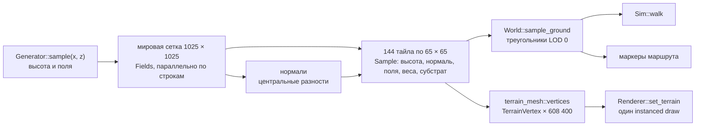

# Архитектура: мир и ландшафт

Подсистема этапа [02. Ландшафт и биомы](../specs/02-terrain-biomes.md); код подэтапа [02.1](../specs/02-1-terrain-data.md), контракты остальных подэтапов — в [обзоре этапа](../specs/02-terrain-biomes.md#контракты). Общие правила, соглашения и решения — в [00-arch.md](00-arch.md); здесь — модули `src/world/` и `src/terrain_mesh.rs`, шейдер `terrain.metal` и данные маршрута. Ведётся по [правилам AGENTS.md](../AGENTS.md#архитектура).

- Состояние на — 2026-11-08, подэтап 02.1 (`completed`), после ревизии `4e7f17e`
- Отчёты — [02.1](../reports/02-1-terrain-data.md), [обзор 02](../reports/02-terrain-biomes.md)

## 1. Поток данных

Генерация детерминирована: результат зависит от `seed` и `GENERATOR_VERSION`, но не от числа потоков. Контрольная сумма `World::checksum` печатается при запуске (`a3f119f4a3951199` для seed `0xEC40`, версии 4).

## 2. Карта первого маршрута

Карта 16 × 16 тайлов, 1024 × 1024 м, seed `0xEC40`, генератор v4 ([AD-36](00-arch.md#ad-36-остров-на-карте-1024-м-вместо-берега-только-на-юге)). Остров около 830 × 790 м, вокруг море; весь край карты глубже −10 м. Север — малые z.

| Элемент | Как задан | Где в коде |
| --- | --- | --- |
| Основной рельеф | 9 м + подъём к северу до 24 м + fbm 10 м (масштаб 170 м) + fbm 2,5 м (35 м) | `Generator::terrain_without_trail` |
| Береговая линия | эллипс с центром (512, 512) и полуосями 410 × 385 м; край изгибается шумом по углу (±13 % и ±4 %, плавные заливы и мысы) и мелким шумом по положению (±1,2 %); каменистый мыс в конце тропы — выступ до 55 м с центром (800, 800) и радиусом 110 м | `Generator::coast_distance` — знаковое расстояние, > 0 на суше |
| Тип берега | маска `rocky` 0..1 от направления из центра острова: шум по углу (чередование), +0,35 × изгиб мысов, каменистый мыс в конце тропы, песчаный пляж в радиусе 90 м у устья; переход ±0,22 по шуму. Вдоль берега 3+ песчаных и 3+ каменистых участков ([AD-37](00-arch.md#ad-37-маска-типа-берега-по-направлению-от-центра-острова)) | `Generator::rocky`, `MOUTH_BEACH_RADIUS_M` |
| Берег и дно | на суше к кромке рельеф сходит в пляж за 70 м (уклон 4,5 % в бухтах, до 30 % на каменистых участках); под водой шельф 30 м (уклон 6 %, до 25 % у камней), затем спуск до `SEA_FLOOR_M` = −24 м к 110 м от кромки; `SEA_LEVEL` = 0 | `terrain_without_trail` |
| Каменистые гряды | ridged-шум 6 м у каменистых участков берега (× `rocky`); при `rocky` > 0,5 берег и дно у кромки — камень | там же, `substrate` |
| Торфяник | чаша радиусом ~120 м с шумным краем, центр (523, 518), дно 7,5 м с кочками | там же |
| Река | сплайн Катмулла — Рома, 10 опорных точек от истока (322, 250) к устью на юге и дальше в море (690, 990); полуширина 3 → 9 м; дно не выше профиля 17 → −2,5 м и на 1,8 м ниже берегов; в море русло затухает за 60 м от кромки | `Generator::first_map`, `river_half_width` |
| Тропа | сплайн 10 точек от (265, 290) через торфяник к каменистому мысу (765, 790), длина 781 м; полоса ±1,1…2,6 м выравнивается к высоте оси на 85 %; у реки маска обнуляется (место моста) | `Generator::sample` |
| Брод | у оси тропы (до 4 м, спад к 12 м) внешний край склона русла отодвигается на 40 м: берег вместо обрыва до 70° становится пологим и проходимым пешком до появления моста (версия 2, [AD-33](00-arch.md#ad-33-брод-у-тропы-вместо-крутого-берега-до-появления-моста)) | `terrain_without_trail`, `FORD_INNER_M`, `FORD_OUTER_M`, `FORD_WIDENING_M` |
| Маркеры | начало тропы, склон над лесом (t = 0,07), край торфяника (t = 0,45), место моста (ближайшая к реке точка тропы), устье (точка реки на береговой линии), каменистый берег | `World::place_markers` |

Снимок карты сверху — `preview.png` из `echo --export-world target/world-layers`.

## 3. Модули

### 3.1. `src/world/noise.rs`

Только целочисленный хеш и арифметика f32 без трансцендентных функций, чтобы результат совпал на Mac и Windows.

| Функция | Описание |
| --- | --- |
| `mix64(u64) -> u64` | splitmix64 |
| `hash01(seed, ix, iz) -> f32` | хеш узла решётки в [0, 1) |
| `value_noise(seed, x, z) -> f32` | value noise в [−1, 1], квинтическая интерполяция |
| `fbm(seed, x, z, octaves) -> f32` | сумма октав с поворотом решётки, нормирована в [−1, 1] |
| `smoothstep(e0, e1, x)`, `lerp(a, b, t)` | вспомогательные |

### 3.2. `src/world/generator.rs`

| Элемент | Вид | Описание |
| --- | --- | --- |
| `SEA_LEVEL` | `const f32` | 0 м |
| `PATH_QUERY_RADIUS` | `const f32` | 60 м — радиус, в котором `Path::nearest` ищет ось |
| `Path` | struct | `points`, `lengths` (накопленная длина); приватные `grid_min`, `grid_w`, `grid_h`, `cells` — сетка ускорения 16 × 16 м со списками сегментов в радиусе запроса |
| `Path::catmull_rom(control, per_segment)` | fn | уплотнение опорных точек, построение сетки |
| `Path::nearest(p) -> (d, t, q)` | fn | расстояние, параметр 0..1 по длине, точка на оси; дальше радиуса — `(∞, 0, p)` |
| `Path::point_at(t)`, `Path::length()` | fn | точка по параметру, длина |
| `Fields` | struct (`Default`) | `coast_d` (знаковое расстояние до кромки, м), `rocky` (тип берега), `height`, `moisture` 0..1, `temperature` °C, маски `trail`, `river`, `coast`, `basin` |
| `FIRST_MAP_SIZE_M` = 1024, `SEA_FLOOR_M` = −24, `CAPE_EXTENT_M` = 55, `CAPE_RADIUS_M` = 110, `MOUTH_BEACH_RADIUS_M` = 90 | const | раскладка острова |
| `Generator` | struct | `seed`, `size_m`, `river`, `trail`, `basin_center`, `basin_radius`, `island_center`, `island_radii`, `cape_center`, `mouth` (первая точка реки в море) |
| `Generator::first_map(seed)` | fn | авторская раскладка острова 1024 м |
| `Generator::coast_distance(p) -> f32` | fn | знаковое расстояние до кромки острова, м (> 0 — суша) |
| `Generator::rocky(p) -> f32` | fn | тип берега 0 (песок) … 1 (камень) |
| `Generator::sample(x, z) -> Fields` | fn | высота и поля в мировой точке |
| `river_half_width(t)` | fn | полуширина русла 3 → 9 м |
| `biome_weights(&Fields, slope) -> BiomeWeights` | fn | веса из полей, наклона (1 − ny) и масок, квадраты с нормировкой до суммы 1 |
| `substrate(&Fields, slope, &BiomeWeights) -> Substrate` | fn | у моря песок или камень по `rocky`, камень на склонах > 0,35, галька в русле, камень/песок на берегу по `rocky`, торф, иначе почва |

Поля среды: влажность = 0,45 + шум + 0,45·торфяник + 0,35·близость реки + 0,15·берег − 0,012·(h − 10); температура = 15 − 0,0065·h + шум.

### 3.3. `src/world/mod.rs`

| Элемент | Вид | Описание |
| --- | --- | --- |
| `TILE_SAMPLES` = 65, `SAMPLE_STEP_M` = 1 (шаг генератора), `GENERATOR_VERSION` = 4, `FIRST_MAP_TILES` = 16 | const | параметры LOD 0 и первой карты; размер тайла — 64 шага мира |
| `TileId { x, z }` | struct | целые координаты тайла; угол в метрах — `World::tile_origin(id)` |
| `Substrate` | enum `u8` | `Soil` 0, `Peat` 1, `Sand` 2, `Rock` 3, `Gravel` 4 — те же числа в `TerrainVertex.material[0]` |
| `BiomeWeights { forest, peat, shore }` | struct | нормированные веса |
| `Sample` | struct | `height`, `normal`, `moisture`, `temperature`, `substrate`, `weights`, `trail`, `river`, `rocky` (в `TerrainVertex.material[3]`) |
| `Tile` | struct | `id`, `world_seed`, `generator_version`, `samples` (65 × 65, строки по z); `at(i, j)` |
| `GroundSample` | struct | `height`, `normal` (треугольника LOD 0), `substrate`, `on_trail` (у мира с объектами — внутри полосы тропы или дороги), `wet` (русло или река из объектов, или ниже моря), `tile` |
| `Ground` | trait | `sample_ground(x, z) -> Option<GroundSample>`; `None` за картой. Реализуют `World` и тестовые поверхности |
| `MarkerKind` (serde), `Marker { name: String, kind, position }` | enum, struct | авторские точки маршрута |
| `FieldGrid { nx, nz, step_m, fields }` | struct | поля `Fields` на мировой сетке `nx × nz` (1025 × 1025 для первой карты), строки по z; `FieldGrid::generate(&Generator, tiles_x, tiles_z)` — параллельно по строкам |
| `DerivedOverrides { weights, substrate }` | struct | `Option<Vec<…>>` по точкам мировой сетки: ручные слои вместо вычисленных |
| `World` | struct | `seed`, `tiles_x`, `tiles_z`, `step_m` (шаг сетки, м), `geo: Option<GeoRef>`, `generator`, `tiles` (индекс `z * tiles_x + x`), `markers`, `fields` (сетка, из которой собран мир; нужна экспорту масок торфяника и берега), `features: Option<FeatureSet>` (тропы, реки, дороги из `features.json`) |
| `World::generate(seed, tiles_x, tiles_z)` | fn | `FieldGrid::generate`, затем `from_grid` без замен |
| `World::from_grid(seed, Generator, FieldGrid, &DerivedOverrides, Option<Vec<Marker>>)` | fn | 1) нормали центральными разностями по сетке; 2) веса и субстрат из полей или из `overrides`; 3) нарезка на тайлы с общими граничными точками; 4) маркеры: переданные получают высоту грунта, иначе расставляются по сплайнам генератора |
| `World::tile(id)`, `tile_size_m()`, `tile_origin(id)`, `size_m()`, `marker(kind)` | fn | доступ; размер тайла = 64 × `step_m` |
| `World::checksum()` | fn | хеш всех тайлов и их метаданных |
| `impl Ground for World` | — | точка → тайл → ячейка → треугольник (a, c, b) при fx ≥ fz, иначе (a, d, c); высота — барицентрическая, нормаль — грани; свойства — от ближайшего узла |

Треугольники ячейки (i, j): a = (i, j), b = (i+1, j), c = (i+1, j+1), d = (i, j+1), диагональ a–c, обход CCW сверху. Этот же разбор использует `terrain_mesh::tile_indices`, поэтому столкновения совпадают с отрисовкой LOD 0.

### 3.3a. `src/world/features.rs` — объекты карты уже шага сетки

Тропы, дороги и реки из OSM как отрезки; отрисовка и ходьба считают точное расстояние до отрезков ([AD-45](00-arch.md#ad-45-тропы-и-реки-векторами-с-точным-расстоянием-в-шейдере-а-не-полем-расстояний-в-текстуре)).

| Элемент | Вид | Описание |
| --- | --- | --- |
| `FEATURE_CELL_M` = 32, `FEATURE_MARGIN_M` = 6, `KIND_TRAIL` = 0, `KIND_RIVER` = 1, `KIND_ROAD` = 2, `FAR` = 1000 | const | ячейка списков, запас вокруг полосы, виды |
| `FeaturesMeta { file }` | struct (serde) | `features` в `world.json` |
| `FeatureSample { trail_m, river_m, road_m }` | struct | расстояние до края ближайшей полосы каждого вида (< 0 — внутри); дальше запаса — `FAR` |
| `FeatureSet { json, segments, cells_n, cells, list }` | struct | отрезки `FeatureSegment`, ячейки `[начало, число]` по строкам z, списки индексов; `json` — исходник для экспорта |
| `FeatureSet::empty(map_size_m)`, `from_json(text, map_size_m)`, `sample(x, z)`, `max_per_cell()` | fn | пустой набор для генератора; разбор и раскладка (полуширина по виду OSM: тропа 0,8 м, `footway` 1,0, `track` 1,4, дороги 1,8–3,5, река — половина ширины по водосбору); точное расстояние, тот же расчёт, что `features.h` |

Каталог слоёв: `world.json` и PNG размером `nx × nz` (1025 × 1025), пиксель (i, j) — точка мировой сетки x = i, z = j ([AD-34](00-arch.md#ad-34-слои-карты-в-png-источники-и-ручные-замены)).

| Файл | Формат | Роль | Каналы |
| --- | --- | --- | --- |
| `height.png` | серый 16 бит | источник | высота в `height_range_m` (−40…60 м, шаг ≈ 1,5 мм) |
| `masks.png` | RGB 8 бит | источник | тропа, русло, чаша торфяника |
| `climate.png` | RGB 8 бит | источник | влажность, температура в `temperature_range_c` (−10…40 °C), близость берега моря |
| `coast_type.png` | серый 8 бит | источник | тип берега: 0 песок, 255 камень |
| `coast_distance.png` | серый 16 бит | источник | знаковое расстояние до кромки в `coast_distance_range_m` (−4…4 км, шаг ≈ 12 см), формат слоёв 3 |
| `biome.png` | RGB 8 бит | замена, если указан в `overrides` | лес, торф, берег; сумма каналов ровно 255 |
| `substrate.png` | серый 8 бит | замена, если указан в `overrides` | индекс `Substrate` × 60 |
| `preview.png` | RGB 8 бит | только просмотр | цветная карта с маркерами |
| `cover.png` | RGBA 8 бит | источник, необязательный | пояса растительности, сумма 255 на суше: низинный лес, кедровый лес якусуги, якудзаса и луга, гранит и застройка (`cover { file, size }`, у Якусимы 2049² × 15 м) |
| `height_fine.png` | серый 16 бит | источник, необязательный | поле высот мельче сетки слоёв (`height_fine { file, size, step_m }` в `world.json`), квантование `height_range_m` |
| `features.json` | JSON | источник, необязательный | реки (имя, вид, ширина, линия), тропы, дороги, болота, точки (вершины, водопады, приюты, криптомерии) в мировых метрах; ODbL |
| `flow.png` | серый 16 бит | только данные для 03.2 | log₂ площади водосбора в клетках × 2048 (мир Якусимы) |

| Элемент | Вид | Описание |
| --- | --- | --- |
| `FORMAT_VERSION` = 3, `COAST_RANGE_M`, `TEMPERATURE_RANGE_C`, `SUBSTRATE_STEP` = 60, `MANIFEST` = `world.json`; приватная `height_range(&World)` — диапазон высот по данным, округлённый до 10 м | const, fn | параметры формата |
| `GeoRef { center_lat, center_lon, center_world_m, projection, sources }` | struct (serde) | привязка мира к Земле в `world.json` (`geo`) и `World.geo` |
| `Manifest` | struct (serde) | `format`, `seed`, `generator_version`, `tiles_x`, `tiles_z`, `sample_step_m`, `size_samples`, `height_range_m`, `temperature_range_c`, `substrate_codes`, `overrides` (`biome`, `substrate`), `exported_checksum`, `markers`, `coast_distance_range_m`, `geo`, `features` |
| `MarkerEntry { name, kind, x, z }` | struct (serde) | маркер в `world.json`; высота при импорте берётся с грунта |
| `export(&World, dir) -> Result<Manifest, String>` | fn | пишет все слои и `world.json` (`overrides` пустой) |
| `import(dir) -> Result<World, String>` | fn | читает `world.json`, проверяет формат, размер, число каналов и 16 бит у высоты; поля из источников, замены из `overrides`; сплайны `Generator` — из seed; затем `World::from_grid`; `features.json` → `World.features` (приватная `import_features`). Экспорт переносит `features.json` без изменений |
| `preview(&World, (nx, nz)) -> Vec<u8>` | fn | RGB-карта сверху (бывший тест `dump_map`) |
| приватные `encode_weights`, `decode_weights` | fn | веса ↔ три байта с суммой 255 (метод наибольших остатков), чтобы повторный экспорт давал те же байты |
| приватные `read_png`, `write_png`, `Image` | fn, struct | PNG 8/16 бит, палитра разворачивается, лишние каналы допускаются |

Квантование источников идемпотентно: экспорт → импорт → экспорт даёт побайтно те же `height.png`, `masks.png`, `climate.png`, `coast_type.png`, `coast_distance.png`. Шаг сетки берётся из `sample_step_m`. Мир после импорта отличается от сгенерированного на половину шага квантования (контрольная сумма другая).

Запуск: `echo --export-world DIR` записывает слои и выходит; `echo --world DIR` собирает мир из слоёв. Ошибки слоёв выводятся с именем файла и завершают программу с кодом 2.

### 3.5. `src/terrain_mesh.rs`

| Элемент | Описание |
| --- | --- |
| `VERTICES_PER_TILE` = 4225 | вершин в тайле |
| `tile_indices() -> Vec<u16>` | 24 576 индексов одной сетки 65 × 65, общие для всех тайлов |
| `vertices(&World) -> Vec<TerrainVertex>` | вершины всех тайлов подряд в порядке `world.tiles`, позиции в мировых метрах |
| `detail_texture(seed, size) -> Vec<u8>` | бесшовный периодический шум RGBA8: R — зернистость, G — пятна, B — камешки |

## 4. Отрисовка

| Что | Как |
| --- | --- |
| Буферы | `terrain vertices (all tiles)` — 608 400 × 32 Б = 19,5 МБ; `terrain tile indices` — 49 КБ; оба `StorageModeShared` |
| Текстуры | `terrain detail (mipmapped)` 512² RGBA8 — крупная вариация; `terrain materials: albedo + height` — массив 5 × 1024² `RGBA8Unorm_sRGB`; `terrain materials: normal + roughness` — массив 5 × 1024² `RGBA8Unorm`; `wet sand mask` — R16Float 1024² (1 м/тексель, пишет ядро `wet_sand_update` подэтапа 03.1, см. [03-water.md](03-water.md#4-мокрый-песок)). Всё грузится `Renderer::upload_textures`: общий staging, копия слоёв → барьер blit → blit → `generateMipmaps`, CPU ждёт завершения ([AD-38](00-arch.md#ad-38-материалы-ландшафта-фотосканы-ambientcg-в-двух-массивах-смешивание-по-высоте)) |
| Вызов | в проходе `scene` до кубов: `drawIndexedPrimitives(instanceCount: 144)`; группа отладки `terrain: 144 tiles` |
| Вершинный шейдер | `vertices[instance_id * 4225 + vertex_id]`, позиция в мире, `view_proj` |
| Фрагментный шейдер | доли слоёв: лес → подстилка и мох (по влажности почвы), торф → мох и почва, берег → песок или камень (по `rocky`), поверх — тропа (почва), русло (камень + песок), склон > ~13° (камень), дно (песок или камень); смешивание по высоте материала с порогом 0,18; повтор слоя 2–4 м + вторая выборка в повёрнутых координатах ×0,43; карта нормалей (касательная +X, бикасательная −Z); мокрый песок: альбедо × 0,4, шероховатость → 0,08 по маске × впитывание слоя; затемнение дна ниже моря; солнце 1,15 (Ламберт + GGX) + небо. Отладочные виды: высота с горизонталями через 5 м, уклон (пурпур > 40°), веса биомов, субстрат, тип берега, влажность, слои материалов; `Raw` — числа для самопроверки |
| Объекты карты | `features.h`: `feature_distances(p, map_size_m, segs, cells, list)` — ячейка 32 м, цикл по её отрезкам (у Якусимы до 41), расстояние до края полосы. Тропа — почва, дорога — камень с почвой, берег русла 1,5 м — камень и песок, вода в русле до 03.2 — цвет: мокрое дно сквозь воду, отражение неба по Френелю горизонтальной нормали с рябью, блик. Край сглажен на пиксель (`px` по производным позиции относительно камеры) |
| Привязки | таблица `terrain` в слоте: `buffer(0)` вершины, `buffer(1)` `FrameUniforms`, `buffer(2)` `FeatureSegment[]`, `buffer(3)` ячейки `uint2`, `buffer(4)` списки; `texture(0)` детальная текстура, `texture(1)` альбедо + высота, `texture(2)` нормаль + шероховатость, `texture(3)` маска влажности. У карты без объектов — пустые ячейки и по одному нулевому элементу (буфер Metal не бывает пустым) |

Отсечения и LOD пока нет: рисуются все 2 097 152 треугольника карты 1024 м. 120 кадров/с при 2560 × 1440 на M3 Max (Debug) с материалами 02.2, CPU-кодирование кадра 0,1–0,2 мс.

## 4a. Кластерный рельеф

С 02.3 рельеф по умолчанию рисуется кластерами ([AD-46](00-arch.md#ad-46-рельеф--кластерная-сетка-в-духе-nanite-вместо-cdlod), [AD-47](00-arch.md#ad-47-кластеры-рельефа-через-meshoptclusterlod-вершина--номер-узла-поля-высот)); тайлы уровня 0 — переключатель L и `--tiles`.

| Что | Как |
| --- | --- |
| Поле высот | `World.heightfield` (`world/heightfield.rs`): у генератора — сетка мира 1025² × 1 м; у Якусимы — `height_fine.png` 4097² × 7,5 м (`layers/fine.rs`, квантование `height_range_m`). Триангуляция ячейки — как у тайлов; `HeightField::sample` — высота и нормаль грани для `Ground`, `normal_at` — центральные разности (как вершинный шейдер) |
| Сборка | `terrain_clusters::load_or_build`: кэш `target/terrain-cache/clusters-<хеш>.bin` или `clod_build` (кластеры ≤ 128 треугольников, группы, упрощение с замороженной границей) и `clod_build_hierarchy` (деревья групп по уровням). Генератор: 34 188 кластеров, 15 уровней, 4,2 млн треугольников, 28,5 МБ, 2,5 с. Якусима 7,5 м: 548 519 кластеров, 19 уровней, 67 млн треугольников, 456 МБ, 45 с сборка, 0,75 с из кэша |
| Срез | каждый кадр на CPU: обход деревьев, порог 1 пиксель (в самопроверке −1 — только уровень 0), отсечение сферой кластера; список видимых — в буфер слота |
| Отрисовка | `drawPrimitives(вершин 384, экземпляров = видимые)`; `terrain_cluster_vs`: кластер → треугольник → локальный индекс → номер узла → позиция и нормаль из поля; лишние треугольники схлопываются; веса и материал — слои `attribute_layers` (RGBA8 на сетке биомов, субстрат — ближайший узел). Фрагментный шейдер общий с тайлами |
| Отладка | виды «кластеры» (случайный цвет) и «уровни» (синий — 0 … красный — грубый); заголовок: кластеры, треугольники, время выбора |

## 5. Ходьба

`Sim::walk` (см. [00-arch.md, 4.3](00-arch.md#43-srcsim--фиксированный-шаг-и-камера-game)):

1. Нужная скорость в плоскости XZ по yaw: шаг 4 м/с, бег 7 м/с, на подъёме делится на 1 + 0,8 · tg уклона по направлению движения.
2. Скорость приближается к нужной с ускорением 40 м/с² (торможение без ввода 28 м/с², в воздухе 6 м/с²).
3. Кандидаты: полный шаг, затем составляющие по X и по Z длиннее 0,1 мм (скольжение вдоль препятствия). Составляющая скорости по оси упора гасится; полный упор обнуляет скорость.
4. Шаг разрешён, если подъём ≤ 0,35 м и при подъёме нормаль грани круче 40° не превышена.
5. Space на грунте — прыжок с 4,2 м/с (≈ 0,9 м).
6. Вертикаль: подъём на ступеньку сразу; спуск до 0,35 м — без отрыва; глубже — падение с g = 9,81 м/с².
7. Глаза на 1,7 м над грунтом. Только для вида: подъём больше 0,08 м за тик гасится с постоянной времени 0,07 с, приземление даёт приседание до 0,25 м, покачивание головы 3 см при шаге и 5 см при беге (клавиша B).

## 6. Проверки

| Проверка | Где |
| --- | --- |
| Соседние тайлы совпадают на общих точках (высота, нормаль, поля) | `world::tests::neighbour_tiles_share_border_heights_and_normals` |
| Одинаковые мировые координаты на границе дают ту же высоту | `same_world_coordinates_give_same_ground_from_both_tiles` |
| `sample_ground` в узлах равен вершинам LOD 0 | `sample_ground_matches_lod0_vertices` |
| Детерминизм и метаданные тайлов | `generation_is_deterministic` |
| Сумма весов биомов = 1 | `biome_weights_are_normalized` |
| На маршруте есть тропа, русло, море, торф и 6 маркеров | `route_has_trail_river_and_sea` |
| Сетка ускорения `Path` совпадает с перебором | `generator::tests::grid_nearest_matches_brute_force_within_radius` |
| Треугольники сетки смотрят вверх, вершины совпадают с тайлами | `terrain_mesh::tests` |
| Ступенька 0,3 м — проходима, 0,5 м — нет; склон 20° — да, 50° — нет; падение с уступа; детерминизм ходьбы; переход через границы тайлов на грунте | `sim::tests` |
| Глубина ландшафта с GPU = луч по `SampleGround` (относительная ошибка < 2·10⁻³) | самопроверка, шаг `TerrainReadback` |

## 7. Журнал изменений

| Дата | Этап | Ревизия | Изменение |
| --- | --- | --- | --- |
| 2026-11-07 | 02 | после `c4bcd6a` | Шаг 1: мир, генератор, тайлы, `sample_ground`, маркеры, сетка ландшафта, детальная текстура, отрисовка одним instanced draw, ходьба |
| 2026-11-07 | 02.1 | после `4e7f17e` | Этап 02 разбит на подэтапы: документ описывает 02.1, ссылки на спецификацию и отчёты обновлены. Код не менялся |
| 2026-11-07 | 02.1 | после `4e7f17e` | Ходьба с разгоном, замедлением на подъёме, прыжком и сдвигом глаз только для вида ([AD-32](00-arch.md#ad-32-поворот-мыши-в-каждом-кадре-разгон-и-сдвиг-глаз-только-для-вида)) |
| 2026-11-08 | 02.1 | после `4e7f17e` | Генератор v2: брод у тропы (AD-33). Тест `bot_walks_whole_trail_from_start_to_shore` |
| 2026-11-08 | 02.1 | после `d2608c5` | Модуль `layers`: экспорт и импорт слоёв PNG, `FieldGrid`, `DerivedOverrides`, `World::from_grid`, `World.fields`, `Marker.name: String`; `dump_map` и `rgb-to-png.py` заменены на `preview.png` ([AD-34](00-arch.md#ad-34-слои-карты-в-png-источники-и-ручные-замены)) |
| 2026-11-08 | 02.1 | после `53f9e47` | Генератор v3: остров на карте 16 × 16 тайлов (1024 м), `coast_distance`, каменистый мыс, шельф и дно до −24 м, русло затухает в море; диапазон `height.png` −40…60 м ([AD-36](00-arch.md#ad-36-остров-на-карте-1024-м-вместо-берега-только-на-юге)) |
| 2026-11-08 | 02.1 | после `7d787d0` | Генератор v4: маска типа берега `Generator::rocky`, `Fields.rocky`, `Sample.rocky`, `TerrainVertex.material[3]`, `Generator::mouth`; уклоны пляжа, шельфа и каменистые гряды от `rocky` вместо востока; слой `coast_type.png`, формат слоёв 2 ([AD-37](00-arch.md#ad-37-маска-типа-берега-по-направлению-от-центра-острова)) |
| 2026-11-08 | 02.2 | после `453a670` | Материалы ambientCG, смешивание по высоте, мокрый песок по маске, отладочные виды ([AD-38](00-arch.md#ad-38-материалы-ландшафта-фотосканы-ambientcg-в-двух-массивах-смешивание-по-высоте)) |
| 2026-11-08 | 03.1 | после `bd4aac5` | Маска влажности — живая маска мокрого песка R16Float из 03.1; подкраска дна ниже моря удалена (цвет под водой даёт вода) |
| 2026-11-14 | 02.7 | после `3932e70` | Шаг сетки — параметр мира (`World.step_m`, `FieldGrid.step_m`, `tile_origin`, `tile_size_m`; `TILE_SIZE_M` и `TileId::origin` удалены), `Fields.coast_d`, слой `coast_distance.png` и `GeoRef`, формат слоёв 3, диапазон высот по данным ([AD-42](00-arch.md#ad-42-реальный-рельеф-скрипт-python-шаг-сетки-мира-и-георазметка)) |
| 2026-11-14 | 02.7 | после `c05863c` | Модуль `world/features.rs` (`FeatureSet`, отрезки по ячейкам 32 м), `World.features`, `features.json` в слоях, `on_trail`/`wet` по объектам, `features.h` и попиксельные тропы, дороги, русла в `terrain.metal` ([AD-45](00-arch.md#ad-45-тропы-и-реки-векторами-с-точным-расстоянием-в-шейдере-а-не-полем-расстояний-в-текстуре)) |
| 2026-11-14 | 02.3 | после `e05965e` | Кластерный рельеф: `HeightField`, `height_fine.png`, ходьба по полю, раздел 4a ([AD-47](00-arch.md#ad-47-кластеры-рельефа-через-meshoptclusterlod-вершина--номер-узла-поля-высот)) |
| 2026-11-14 | 02.7 | после `79d0ca5` | Пояса растительности: `cover.png`, `World.cover`, шестой слой материалов `Grass004`, пояса и полог в шейдере ([AD-50](00-arch.md#ad-50-пояса-растительности-слоем-покрова-полог-леса--подмена-до-деревьев)) |
