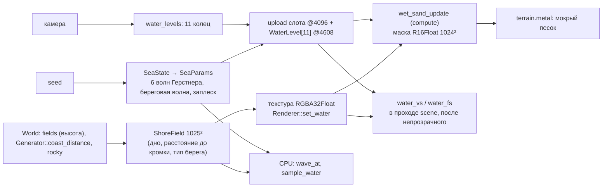

# Архитектура: море и прибой

Подсистема подэтапа [03.1. Море и прибой](../specs/03-1-sea-surf.md). Общие правила и решения — в [00-arch.md](00-arch.md); здесь — модуль `src/water.rs`, шейдеры `water.h` и `water.metal`, маска мокрого песка. Ведётся по [правилам AGENTS.md](../AGENTS.md#архитектура).

- Состояние на — 2026-11-08, подэтап 03.1, после ревизии `bd4aac5`
- Отчёт — [reports/03-1-sea-surf.md](../reports/03-1-sea-surf.md)

## 1. Поток данных

Время волн — время мира от тиков симуляции (`FrameUniforms.time`), поэтому кадр и CPU-запрос детерминированы.

## 2. Модель волн

Одна функция `wave_at(field, params, base, t, filter_cell)` в `water.h` и `water.rs`, построчно одинаковая:

| Часть | Как считается |
| --- | --- |
| Поле берега | билинейно по 4 узлам `field.read`; направление к берегу — центральная разность расстояния до кромки на ±2 м |
| Открытое море | 6 волн Герстнера (38…3,8 м, 0,30…0,025 м) в секторе ±0,6 рад от ветра; ω = √(g·k); Σ Q·k·A = 0,8; вес `smoothstep(4, 14, глубина)`; волны короче 4 шагов сетки гасятся (`filter_cell`) |
| Береговая волна | фаза `k·(u + 8·ln(1 + u/8)) + ω·t + сдвиг вдоль берега`, где u — расстояние от кромки в море: гребни идут по линиям равного расстояния (фронт параллелен берегу), к берегу волна укорачивается вдвое; длина 30 м, период 7 с; амплитуда 0,28 м растёт до ×1,8 на мелководье и ограничена 0,39·глубина + 2 см (обрушение) |
| Пена | обрушение `smoothstep(0,5; 0,78; 2A/глубина)` на гребне; у камней — по `rocky` и гребню |
| Заплеск | фаза совпадает с приходом гребня к кромке; подъём за 20 % периода, откат за 80 %; высота 0,7 м на песке, 0,25 м на камне; вес от глубины и расстояния до кромки (до 40 м на суше) |

`sample_water(p, t)` обращает горизонтальное смещение (4 итерации) и даёт высоту, глубину до грунта и признак сухой точки.

## 3. Сетка и отрисовка

| Что | Как |
| --- | --- |
| Сетка | 11 уровней по (64 + 1)² вершин, шаг 0,5 м × 2^L (последний уровень ~32 км); уровень привязан к мировой решётке шагом 2 × cell — вершины не «плывут»; один индексный буфер `grid_indices` (24 576 индексов), уровень = экземпляр |
| Стыки уровней | внутренний прямоугольник уровня отбрасывается во фрагментном шейдере (его рисует более мелкий уровень); на внешнем крае нечётные узлы — среднее соседей, все узлы края фильтруют волны как грубый уровень: щелей нет |
| Полоса прибоя | вершины приподняты на 15 см; фрагментный шейдер ищет пересечение луча взгляда с точной поверхностью (2 уточнения по `wave_at`) и выдаёт глубину `[[depth(any)]]` — кромка гладкая, не повторяет треугольники |
| Цвет | пропускание по пути взгляда `exp(−(0,42; 0,085; 0,055)·путь)` (красный гаснет первым: бирюза на мелководье), рассеяние в толще, отражение градиента неба по Френелю (F0 = 0,02), блик солнца GGX (α² = 0,0016), рябь из детальной текстуры; растворение слоя тоньше 3…20 см; за краем карты (где нет геометрии дна) вода непрозрачна |
| Смешивание | dual-source: `результат = цвет + dst × пропускание` по каналам; глубина — проверка без записи |
| Отладочные виды | `water-depth`, `water-dir` (направление к берегу, вес береговой волны), `surf` (пена, заплеск, береговая волна); в отладочных видах ландшафта вода прозрачна |

## 4. Мокрый песок

Ядро `wet_sand_update` в проходе `wet_sand` перед `scene` (граф кадра: пишет `RES_WETNESS`, `scene` читает во фрагменте). Маска R16Float 1024², 1 м на тексель:

- покрытие водой — непрерывное `smoothstep(−0,12; 0,25; вода − грунт)`, а не «да/нет», чтобы граница при билинейной выборке была гладкой;
- без воды значение спадает за `dry_time_s` = 20 с;
- под водой (`coast_d` от −1 до −6 м) — плавно 1;
- дальше 45 м на суше не обновляется.

Шейдер ландшафта берёт `smoothstep(0,1; 0,9; маска)` × впитывание слоя.

## 5. Проверки

| Проверка | Где |
| --- | --- |
| Детерминизм и отсутствие петель (Σ Q·k·A ≤ 0,8) | `water::tests::sea_state_is_deterministic_and_waves_do_not_loop` |
| Кромка на пляже ходит > 2 м за период, вода на суше не выше заплеска | `swash_runs_up_and_back_on_sandy_beach` |
| У кромки только береговая волна, направление — к берегу | `near_shore_only_shore_waves_parallel_to_coast` |
| Заплеск на камне ниже, чем на песке | `rocky_coast_swash_is_lower_than_sandy` |
| Уровни вложены, граница мелкого — на линиях грубого | `levels_nest_without_gaps` |
| CPU ↔ GPU: 8 точек, смещённая точка и пена | ядро `water_probe`, самопроверка `волны моря` |

## 6. Журнал изменений

| Дата | Этап | Ревизия | Изменение |
| --- | --- | --- | --- |
| 2026-11-08 | 03.1 | после `bd4aac5` | Первая версия: `water.rs`, `water.h`, `water.metal`, кольцевая сетка, прибой, мокрый песок, проверка CPU ↔ GPU |
