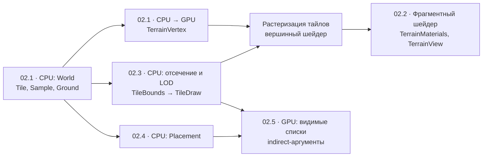

# 02. Ландшафт и биомы

[К карте этапов](README.md)

**Зависит от** — [01. Основа Metal 4](01-metal-foundation.md).

**Результат** — связный маршрут лес → торфяник → каменистый берег с переходами почвы и растительности.

**По книге** — [подготовка тайлов и структура мира](reading-guide.md#02-ландшафт).

Этап состоит из пяти подэтапов. Каждый подэтап — отдельная спецификация со своим отчётом, результатом и проверкой. Подэтапы обмениваются данными только через контракты ниже. Подэтап может менять контракт, который создал сам. Изменение чужого контракта записывается в его спецификации, в архитектуре и в отчётах обоих подэтапов.

## Подэтапы

| Подэтап | Зависит от | Создаёт контракт | Что можно показать |
| --- | --- | --- | --- |
| [02.1. Данные мира и ходьба](02-1-terrain-data.md) | [01](01-metal-foundation.md) | `World`, `Tile`, `Sample`, `Ground`, `TerrainVertex`, слои карты | Карта маршрута, ходьба по грунту, ландшафт LOD 0 |
| [02.2. Материалы и отладочные виды](02-2-terrain-materials.md) | 02.1 | `TerrainMaterials`, `TerrainView`, вход маски влажности | Камень, песок, мокрый песок, земля и мох по весам, наклону и типу берега; отладочные виды |
| [02.3. Отсечение и уровни детализации](02-3-terrain-lod.md) | 02.1 | `TileBounds`, `TileDraw`, индексы уровней | Видимые тайлы с LOD 65/33/17 без щелей |
| [02.4. Растительность и береговой декор](02-4-vegetation.md) | 02.1, 02.2 для материалов, линия заплеска из [03.1](03-1-sea-surf.md) | `Placement`, группы экземпляров | Трава, деревья, кусты, грибы; водоросли, ракушки, звёзды, валуны |
| [02.5. Отсечение на GPU, indirect и импосторы](02-5-terrain-gpu-culling.md) | 02.3, 02.4 | Видимые списки, indirect-аргументы | Тот же кадр через compute-отсечение, сравнение с прямым путём |

02.2 и 02.3 независимы друг от друга. Порядок по умолчанию: 02.2 → [03.1. Море и прибой](03-1-sea-surf.md) → 02.4 → 02.3 → 02.5: море с прибоем нужно раньше, потому что береговой декор 02.4 ложится вдоль линии заплеска.

## Контракты

Слои ландшафта:

| Контракт | Владелец | Потребители | Суть |
| --- | --- | --- | --- |
| Маска типа берега (песок или камень) и `coast_distance` | 02.1 | 02.2, 02.4, 03.1 | Чередование песчаных бухт и каменистых мысов, расстояние и направление к кромке |
| `Tile`, `TileId`, `Sample` | 02.1 | Все подэтапы, 03, 08 | Тайл 64 × 64 м, 65 × 65 значений с шагом 1 м, общие границы, `worldSeed`, версия генератора |
| `Ground::sample_ground(x, z)` | 02.1 | Ходьба, 02.4, 03, 05 | Высота, нормаль, субстрат, тропа, вода по треугольникам LOD 0 |
| `BiomeWeights` | 02.1 | 02.2, 02.4, 04 | Нормированные веса леса, торфа и берега. Погода добавит слой текущей влажности поверх базовых весов |
| Слои карты (`world.json` + PNG) | 02.1 | 02.2, 02.4, 08 | Высота 16 бит, маски, климат, ручные веса биомов и субстрат на мировой сетке |
| `TerrainVertex` (32 Б) | 02.1 | 02.2, 02.3 | Позиция, нормаль, веса, материал. Раскладка проверяется `layout_probe` |
| `TerrainMaterials`, `TerrainView`, вход маски влажности | 02.2 | 03.1, 04 | Слои массива текстур и режим отладочного вида |
| `TileBounds`, `TileDraw` | 02.3 | 02.5, 07 | Границы тайла по высоте; список видимых тайлов с уровнем и маской краёв |
| `Placement` | 02.4 | 02.5, 05 | Детерминированный экземпляр растения или гриба |
| Видимые списки, indirect-аргументы | 02.5 | 03, 07 | Группы mesh/material/LOD, ёмкость и счётчик переполнения |

Геометрия ходьбы и отрисовки берётся из одних данных `Tile`. Высоты на GPU не генерируются, пока ходьба опирается на треугольники LOD 0. Генерация и запекание на GPU с CPU-эталоном — в [этапе 08](08-world-scaling.md).

## Проверка готовности

Этап считается выполненным, когда все подэтапы `completed` и пройдена сквозная проверка маршрута:

- Игрок проходит от начала тропы до каменистого берега в режиме ходьбы с включёнными LOD и растительностью. Он не проваливается и не застревает на стыках тайлов и уровней.
- На трёх контрольных камерах маршрута записан GPU capture. В нём видны стоимость terrain и foliage, число видимых тайлов и экземпляров по LOD.
- Прямой и indirect пути дают одинаковый кадр на одной камере. Mesh shading позже получит этот же набор для отдельного сравнения.

## Куда дальше

- [03. Вода](03-water.md) — море и прибой после 02.2, затем русло и устье.
- [Лаборатория mesh shading на Metal](07-shader-labs.md#геометрия-и-детализация) — сравнить с indirect-инстансингом после [02.5](02-5-terrain-gpu-culling.md).
